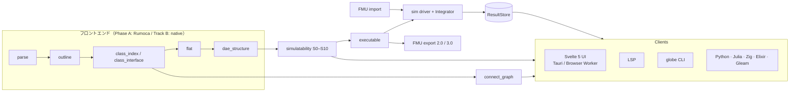

# GlobeMode アーキテクチャ

- 版: v0（2026-10-18、S001）。
- 判断の理由は [adr/](adr/) に、機能の一覧は [features.md](features.md) に、順序は [roadmap.md](roadmap.md) にある。

## 1. 全体像

計算はすべて Rust のコアで行う。UI と各言語の API は、同じ facade（`globe-mode`）と同じ protocol 型（`globe-mode-protocol`）を通してコアを呼ぶ。



## 2. 配置

### 2.1 ディレクトリ

ユーザーが作った言語別の構成に合わせる。

```text
Cargo.toml                      virtual workspace（resolver 3, edition 2024）
mise.toml / mise.lock           ツールの版（rust / uv / zig / julia / erlang / elixir / gleam。P4 で node）。rust-toolchain.toml は置かない
pyproject.toml / uv.lock        Python の依存（uv）
src/Rust/mod/<crate>/           workspace の library crate（2.2 の表）
src/Rust/apps/desktop/          Tauri 2 のシェル（Linux, Windows, Android）
src/Rust/apps/experimental/     leptos/ と dioxus/（default-members から外す）
src/Rust/xtask/                 build、bump-rumoca、licenses、wasm --threads
src/Svelte/                     Svelte 5 + TypeScript の UI。Tauri とブラウザで共用する
src/Python/mod/                 Python パッケージ globe_mode（PyO3 と maturin）
src/Python/marimo/              marimo のノートブックと anywidget
src/Python/streamlit/           結果ダッシュボードとパラメータスイープ
src/Elixir/  src/Gleam/         Rustler の NIF を呼ぶ薄いラッパ
src/Julia/   src/Zig/           C ABI を呼ぶ薄いラッパ
src/Modelica/                   サンプルモデルと検証用ライブラリ
data/msl/                       MSL 4.1.0（取得スクリプトで置き、sha256 で確かめる。コミットしない）
doc/  log/                      文書と記録
```

### 2.2 Rust crate（`src/Rust/mod/`）

**（S002）** と書いたものは実装済み。ほかは予定。

| crate | 責務 | 主な依存 |
| --- | --- | --- |
| `globe-mode-core` **（S002）** | `TextRange`、`Diagnostic{code,severity,stage,message,file,range,notes}`、検査段階 `Stage`（S0〜S10）、診断コード。今後: ID、単位、修正案（fix） | serde |
| `globe-mode-ir` **（S002）** | フロントエンドに依存しない中立 IR: `Outline`（クラス・コンポーネント・extends・connect、S004 で flow / stream と input / output）、`ClassIndex`（字句的な名前解決、extends を含むインターフェース、S004）、`BalanceCount`（スカラー）、`DaeCounts`（配列ごと、S003）。今後: `ConnectSet`、`DaeStructure`（変数、属性、incidence、初期方程式） | core |
| `globe-mode-frontend` **（S002）** | `trait Frontend{outline, check}`。feature `rumoca`（Phase A、`src/rumoca.rs`）と feature `native`（Track B） | rumoca-compile |
| `globe-mode-db` **（S004）** | salsa のクエリ DB: `outline` → `outline_shape`（防火壁）→ `class_index` → `connect_graph`。実行したクエリの記録（テストと計測） | salsa |
| `globe-mode-analysis` | Hopcroft–Karp、Dulmage–Mendelsohn、Tarjan BLT、Pantelides、`SimulatabilityReport` | ir |
| `globe-mode-graph` **（S004: connect グラフ）** | connect グラフを flatten せずに作る。辺の種類（flow / stream / real / boolean …）、depth による部分回路の展開、graphology JSON。今後: ライブラリ / incidence のグラフ、差分、ForceAtlas2 | serde_json |
| `globe-mode-exec` | `HybridSystem` の実装: Rumoca の実行系（feature `rumoca-exec`）、FMU-ME アダプタ | rumoca-sim |
| `globe-mode-solver` | `trait Integrator`、ソルバ名の登録表、自前の固定刻みと陽的 RK | diffsol, sundials（feature） |
| `globe-mode-sim` | ハイブリッドループの driver、`ResultStore`（CSV / MAT v4 / Arrow IPC） | solver |
| `globe-mode-fmi` | FMU の Import、マスターアルゴリズム、パッケージング | fmi, fmi-schema |
| `globe-mode-fmu-runtime` | FMI 2 / 3 の C API を実装する cdylib（P5b） | — |
| `globe-mode-protocol` | serde 型と JSON Schema。TypeScript と Python の型を生成する | serde, specta |
| `globe-mode` | 公開する Rust API（facade）: `Workspace{open, set_text, outline, check, graph, simulate, export_fmu}` | 上記すべて |
| `globe-mode-lsp` | `lsp-types` と自前のディスパッチャ。Transport は stdio / Tauri のチャネル / Web Worker | lsp-types |
| `globe-mode-cli` **（S002）** | バイナリ `globe`（`outline` / `check` / `graph`、`--json`、S003 で `--library`、S004 で `graph` とディレクトリの入力。終了コード 0 / 1 / 2） | clap |
| `globe-mode-capi` | `extern "C"`、不透明ハンドル、JSON とバイト列。cbindgen でヘッダを生成する | — |
| `globe-mode-py` | PyO3（abi3-py312） | pyo3 |
| `globe-mode-nif` | Rustler。Erlang モジュール名は `globe_mode_nif` | rustler |
| `globe-mode-wasm` | wasm-bindgen。ブラウザの Worker、Gleam の JS target、marimo の anywidget から使う | wasm-bindgen |
| `globe-mode-testkit` | MSL コーパス、ファネル比較、omc との照合、Reference-FMUs（S003 の突き合わせは、ひとまず xtask に置いた） | — |
| `xtask` **（S003）** | `cargo xtask fetch-msl` / `fetch-rumoca` / `msl-compare` / `bump-rumoca`。場所は `src/Rust/xtask` | sha2, zip |

### 2.3 ツールチェーン

[ADR-0003](adr/0003-toolchain.md) にまとめた。

- **言語の管理は mise・uv・cargo で分担する**。mise がツールの版（`mise.lock`）、uv が Python と依存（`uv.lock`）、cargo が Rust の依存（`Cargo.lock`）を受け持つ。
- Rust の版は `mise.toml` に一本化し、`rust-toolchain.toml` は置かない。mise が設定する `RUSTUP_TOOLCHAIN` が優先されるため。
- **既定は stable**。Rumoca の `rust-toolchain.toml`（nightly 固定）は Rumoca 自身のワークスペースでしか効かない。git 依存として取り込むと、GlobeMode 側のツールチェーンでビルドされる。
  - ただし、Rumoca のコードが nightly の機能を使っていれば stable では通らない。**P1 で確かめる**。
- スレッドを使う wasm だけは nightly でビルドする。`-Z build-std` と atomics が要るためで、コマンドは `xtask wasm --threads`。配信には COOP/COEP のヘッダか coi-serviceworker が要る。
- wasm と Android の target は mise の rust の `targets` で宣言する。Python 本体は uv が `.python-version` から取得する。手順は [mise-setup.html](mise-setup.html)。

## 3. 中核の設計

### 3.1 フロントエンドと Rumoca アダプタ

[ADR-0002](adr/0002-rumoca-adapter.md) にまとめた。

#### 依存のしかた

- `rumoca-*` はすべて同じ git の `rev` から取り、`default-features = false` にする。
- **umbrella crate `rumoca` は使わない**。zenoh・gamepad・UDP を引き込むため。

#### 閉じ込め方

- cargo-deny の `bans` に `wrappers = ["globe-mode-frontend", "globe-mode-exec"]` を設定し、ほかの crate から Rumoca を直接使わせない。
- Rumoca の型は中立 IR（`globe-mode-ir`）に変換してから外に出す。Rumoca の API が変わっても直すのはアダプタだけで済み、Track B（自前コア）に替えても下流は変わらない。

#### 更新

- 月に1回 `xtask bump-rumoca` で `rev` を上げる。
- MSL コーパスのファネルの差分を作業記録に残す。

### 3.2 遅延評価とシミュレーション前のアサーション

[ADR-0005](adr/0005-lazy-query-db.md) にまとめた。

**salsa のクエリ**（Phase A から使う）:

| クエリ | 入力 | 比較 | 役割 |
| --- | --- | --- | --- |
| `SourceFile` | （入力） | — | ユーザーのファイルは Durability LOW、MSL は HIGH |
| `parse(file)` | SourceFile | `no_eq`（`Arc`） | Rumoca の AST |
| `outline(file)` | parse | **Eq** | **第1の防火壁**。空白やコメントだけの編集では、ここから先が再計算されない |
| `class_index(root)` | outline | Eq | `package.order` から作る。MSL は名前解決で必要になったファイルだけ parse する |
| `class_interface(path)` | class_index | Eq | extends を解決した後のコンポーネントと、flow / stream / potential の区別 |
| `connect_graph(path, depth)` | class_interface | Eq | **flatten しなくても描ける**。ノードは要求されたときに展開する |
| `deps_closure(model)` | class_interface | Eq | Rumoca に渡すファイル集合（広めに見積もる）。無効化を正確にするため |
| `flat(model)` | deps_closure | `no_eq` | Rumoca の resolve と flatten。`catch_unwind` で包む |
| `dae_structure(model)` | flat | **Eq** | **第2の防火壁** |
| `simulatability(model)` | dae_structure | Eq | 下表の S0〜S10 |
| `executable(model, backend)` | dae_structure | LRU | 実行形式 |

シミュレーションの実行は salsa の外のジョブにする。結果は (executable, settings) のハッシュでキャッシュする。

**`assert_simulatable`** は simulate と export の前に必ず走る。

- 段階の順に検査し、Error が出た段階で止める。その段階の指摘は全件出す。
- `--force` を付けない限り、Error があれば実行を拒否する。

| 段階 | 検査 | 主なコード |
| --- | --- | --- |
| S0 | 構文 | GM-E0xx |
| S1 | 名前解決、`uses` の版の不一致 | GM-E1xx / W1xx |
| S2 | 型と次元。単位の不一致は警告 | GM-E2xx / W2xx |
| S3 | instantiate: partial なトップクラス、redeclare されていない replaceable | GM-E3xx |
| S4 | connector のバランス（MLS 9.3）、非互換な接続、未接続（警告）、トップレベルの input（情報。FMU の入力になる） | GM-E4xx / W4xx / I4xx |
| S5 | 方程式数と変数数。コンポーネントごとのローカルバランス（MLS 4.7）で、どのコンポーネントが原因かを示す | GM-E5xx |
| S6 | 構造特異: 完全マッチングの有無。無ければ Dulmage–Mendelsohn 分解で過剰・不足の部分を span 付きで示す | GM-E6xx |
| S7 | インデックス: Pantelides と状態選択 | GM-E7xx / W7xx |
| S8 | 初期化: 初期化系のバランス、start 値の無い状態変数、fixed の過剰、値の無いパラメータ | GM-E8xx / W8xx |
| S9 | 代数ループ: 非線形の反復変数に start 値が無い | GM-W9xx |
| S10 | プリフライト: パラメータの評価、t0 で残差が有限か、ソルバの能力が足りるか、experiment annotation が妥当か | GM-E10xx |

- **「コンパイラが未対応」は GM-Uxxx として分ける**。対象は stream / expandable / overconstrained connector、state machine、operator record など。「モデルの誤り」と混同させないため。
- 結果は `SimulatabilityReport{verdict, stages[], stats}` として返す。出力先は LSP の診断、CLI（ariadne 風）、protocol の JSON、グラフのハイライト。
- S5 の正しさは `omc checkModel()` の方程式数・変数数と照合して確かめる。

### 3.3 ソルバ

```rust
trait HybridSystem {
    fn dims(&self) -> Dims;                                      // n_x, n_roots, 形式: Ode | MassMatrix | ImplicitDae
    fn rhs(&mut self, t: f64, x: &[f64], dx: &mut [f64]) -> Eval;
    fn residual(&mut self, t: f64, x: &[f64], dx: &[f64], r: &mut [f64]) -> Eval; // 任意
    fn jacobian(&mut self, t: f64, x: &[f64], j: &mut dyn JacSink) -> Eval;      // 任意。無ければ着色差分
    fn roots(&mut self, t: f64, x: &[f64], g: &mut [f64]) -> Eval;
    fn next_time_event(&self) -> Option<f64>;
    fn event_update(&mut self, t: f64, x: &mut [f64]) -> EventOutcome;
}

trait Integrator {
    fn caps(&self) -> Caps;  // implicit, adaptive, dae, native_roots, dense, wasm
    fn init(&mut self, s: &mut dyn HybridSystem, t0: f64, x0: &[f64], o: &SolverOptions) -> Result<()>;
    fn step(&mut self, s: &mut dyn HybridSystem, t_stop: f64) -> Result<Step>; // Advanced | Root | Reached
    fn dense(&self, t: f64, x: &mut [f64]) -> Result<()>;
    fn reset(&mut self, t: f64, x: &[f64]) -> Result<()>;
}
```

- ハイブリッドループは `globe-mode-sim` の driver が持つ。担当は時間イベント、根探索（ソルバ自身の機能か、密出力と Illinois 法）、イベント反復、リセット。
- **Modelica のモデルと FMI-ME の FMU は同じ driver を使う。**
- 代数ループは faer の LU を使った減衰 Newton 法で解く。feature `sundials` を有効にしたときは KINSOL を使う。

| GlobeMode ID | OpenModelica | Dymola | 実装 | ライセンス | wasm |
| --- | --- | --- | --- | --- | --- |
| `bdf`（既定） | dassl†、ida† | Dassl†、Lsodar† | diffsol BDF | MIT | ○ |
| `ida`、`cvode` | ida、cvode | Cvode | SUNDIALS（feature `sundials`） | BSD-3 | × |
| `esdirk34`、`trbdf2` | gbode（esdirk） | Esdirk34a | diffsol SDIRK | MIT | ○ |
| `esdirk23`、`esdirk45`、`sdirk34hw` | gbode | Esdirk23a/45a、Sdirk34hw | diffsol SDIRK と自前の係数表 | MIT | ○ |
| `tsit45` | — | — | diffsol | MIT | ○ |
| `dopri45`、`dopri853` | gbode（dopri45） | Dopri45、Dopri853 | 自前の陽的 RK（ode_solvers と照合する） | 自前 | ○ |
| `euler`、`heun`、`rk4`、`impeuler`、`trapezoid` | 同名、rungekutta | Euler、Rkfix2/3/4 | 自前の固定刻み | 自前 | ○ |
| `radau5`（P8） | gbode（radau） | Radau IIa | 自前。russell_ode は GPL の UMFPACK をリンクするので**使わない** | 自前 | ○ |
| `cerk23/34/45`、`qss` | qss | Cerk23/34/45 | 後回し | — | — |

† は別名。指定すると「dassl → bdf（同等の手法で、結果は一致しない）」と表示する。

KLU（LGPL）は同梱しない。

### 3.4 FMI 2.0 / 3.0

#### Import（`fmi` 0.8 と `fmi-schema` の上に作る）

| 種類 | 実装 |
| --- | --- |
| ME（2.0 / 3.0） | `FmuMeSystem` が `HybridSystem` を実装するので、全ソルバと driver をそのまま使える |
| CS（2.0 / 3.0） | `CoSimUnit{do_step, get/set, get/set_state, early_return}` |
| SE（3.0） | `ScheduledUnit{activate_model_partition}` と、優先度付きのクロックスケジューラ |

マスターアルゴリズムは次の順で作る。

1. 固定刻みの Jacobi / Gauss–Seidel から始める。実行順は `ModelStructure` の direct feedthrough から決め、代数ループは不動点反復で解く。
2. 次に可変刻みに進む。`canGetAndSetFMUState` があるときはロールバックする。FMI 3 のイベントモード、early return、SE にも対応する。
3. 系の構成は SSP か `.gmsys`（JSON）で与える。

ブラウザでの制約: ネイティブの FMU バイナリはデスクトップと Android でしか読めない。ブラウザでは `modelDescription.xml` の閲覧と、wasm バイナリ付きの FMU の実行に限る。

#### Export

| 段階 | 方法 | 対応 |
| --- | --- | --- |
| P5a（早い経路） | Rumoca の `fmi2` / `fmi3` テンプレートでソース FMU を作り、`cc` か `zig cc` で各 target 向けにビルドする | テンプレート生成物のライセンスはこの段階で確かめる |
| P5b（自前のランタイム） | `globe-mode-fmu-runtime`（BSD-2 の FMI ヘッダの上に作る）。IR を埋め込んで解釈実行するか、Rumoca の `rust-ode` テンプレートでコンパイルする | FMI 2 の ME / CS、FMI 3 の ME / CS / SE。解釈実行ならコンパイラが要らないので、ブラウザや Android からも出力できる |

- `ModelStructure` は BLT の incidence から作る。
- CS の FMU は自前のソルバで刻む。
- `fmi-export` は FMI 3 だけを Export できる代替手段として扱う。FMI 2 の Export は自前で作る。

#### FMI の検証

- Reference-FMUs（BSD-2）を FMI 2 と 3 の両方で動かし、参照 CSV と照合する。モデルは BouncingBall、Dahlquist、VanDerPol、Stair、Feedthrough、Resource、Clocks。
- Export した FMU は、次をすべて通す。
  - `fmpy.validate_fmu`
  - FMPy と fmusim でのシミュレーション
  - FMU Compliance Checker（FMI 2 のみ）
- 往復（Export → Import）の結果が、直接シミュレーションした結果のファネルに収まることを確かめる。
- OMSimulator は別プロセスでのみ使う。

### 3.5 connect のネットワークグラフ

S004 で最初の版を作った（`globe-mode-graph`、`globe graph`）。辺の種類は、コネクタのクラスから次のように決める。

| 種類 | 判定 | 例（`src/Modelica/GlobeModeValidation`） |
| --- | --- | --- |
| `flow` | コネクタに flow の変数がある（potential と flow） | 電気のピン（Real の v と flow Real の i） |
| `stream` | コネクタに stream の変数がある | Medium を持つ流体ポート |
| `real` / `integer` / `boolean` / `string` | コネクタが組み込みの型を継承している（`connector RealInput = input Real`） | Real・Boolean の信号 |
| `other` / `unresolved` | potential だけ / 索引に無い型 | — |

- **データ**: `connect_graph(path, depth)` が graphology 形式の JSON（nodes / edges / attributes）と、編集ごとの差分を返す。
  - ノードはコンポーネントとコネクタ。エッジは connect 文と、継承や包含の関係。
  - ノードの色は connector の種類（電気、並進、熱、信号など）で決め、大きさは次数で決める。
- **描画**: sigma.js（WebGL）と ForceAtlas2 で描く。ForceAtlas2 は Worker で回し、反復回数に上限を設ける。
  - 1万ノードを超えたら cosmos.gl に切り替える。
  - CLI では Rust の ForceAtlas2 で SVG を出力する。
- **操作**: 階層の展開と折り畳み（depth）、検索、近傍のハイライト。
  - 検査で見つかった問題（S4〜S6）をグラフ上に色で示す。

## 4. ターゲットごとの実行方法

| ターゲット | 計算 | UI | 配布物 |
| --- | --- | --- | --- |
| Desktop（Debian 系 / Windows 11） | Tauri のプロセス内でネイティブ実行 | Svelte 5（TauriBackend） | .deb、.AppImage、.msi |
| Android（7 以降。検証は API 34） | 同上。cranelift は無効 | 同上 | .apk |
| ブラウザ | **閲覧者の端末の Web Worker で wasm を実行**。サーバーでは計算しない。既定はシングルスレッドの stable ビルド | Svelte 5（WorkerBackend） | 静的サイト（CSP は `connect-src 'self'`） |
| CLI | ネイティブ | — | `globe` |
| marimo | anywidget で wasm を読む。代替は PyO3 の wheel | ノートブック | wheel と ESM |
| Streamlit | PyO3 の wheel | ダッシュボード | wheel |

Svelte の UI は `Backend` インターフェースだけに依存する。実装は TauriBackend と WorkerBackend の2つ。

## 5. 言語 API

| 言語 | 経路 | 置き場所 |
| --- | --- | --- |
| Rust | facade crate `globe-mode` | `src/Rust/mod/globe-mode` |
| Python | `globe-mode-py`（PyO3）→ パッケージ `globe_mode` | `src/Python/mod` |
| Julia | `globe-mode-capi` を ccall で呼ぶ。BinaryBuilder の JLL で配る | `src/Julia` |
| Zig | `globe-mode-capi` のヘッダを `@cImport` する | `src/Zig` |
| Elixir | `globe-mode-nif`（Rustler、rustler_precompiled） | `src/Elixir` |
| Gleam | Erlang target は `@external` で `globe_mode_nif` を呼び、JS target は `globe-mode-wasm` を呼ぶ | `src/Gleam` |

**共通の参照シナリオ**: 全言語で同じ手順を通す。open → check → graph → simulate（bdf）→ 結果を取得 → FMU を出力。P7 の完了条件はこれが6言語で通ること。

## 6. UI の比較実験（P7）

- 本線は Tauri 2 と Svelte 5。
- Leptos 版と Dioxus 版は `src/Rust/apps/experimental/` に、機能を絞って作る（エディタ、検査パネル、グラフ）。
- 同じ測定ハーネスで比べ、結果を `doc/bench/ui.md` に書く。
  - 測定項目: 起動時間、RSS / PSS、CPU、フレーム時間、バンドルサイズ
  - 環境: Linux、Windows、Android

## 7. 検証の基盤

| 対象 | 方法 |
| --- | --- |
| フロントエンド | MSL 4.1.0 の例題でファネルを数え、Rumoca の値と比べる（Track B では native と rumoca の差分） |
| 検査 | S5 を `omc checkModel()` と照合する（別プロセス） |
| シミュレーション | MSL の参照結果と、ファネル（許容帯）で比較する |
| FMI | Reference-FMUs、FMPy、fmusim、fmuCheck、往復 |
| ライセンス | cargo-deny、`pnpm licenses`、cargo-about、CycloneDX SBOM |
| CI | 差分だけを検査し、依存・ツール・CI の定義の変更や大きな変更のときだけ全体を検査する（[ADR-0006](adr/0006-incremental-ci.md)） |
| 性能 | P2: 空白だけの編集の再検査が 50 ms 未満。P4: 5k ノードのグラフが 30 fps 以上 |
