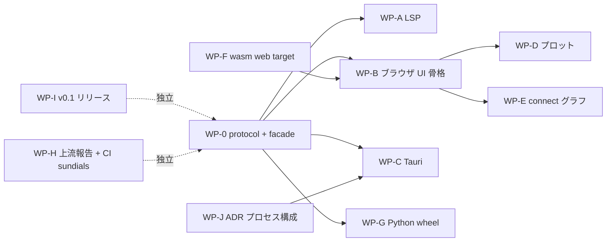

# リリースまでの見積もりと並行作業プラン（2026-10-30、S033）

- 書いた日: 2026-10-30。S032 までの状態（P3 の完了条件は達成、P4 は未着手）を俯瞰した。
- 目的: (1) 設計への助言、(2) リリースまでの時間とトークンの見積もり、(3) **他のエージェントにそのまま渡せる作業指示書**（§4）、(4) Codex を監査役にする運用（§5）、(5) 無料プロバイダをワーカーにする戦略（§6）。
- 正典は [roadmap.md](../roadmap.md)・[architecture.md](../architecture.md)・[features.md](../features.md)。この文書は計画を変えない。変えるときは正典を同じコミットで直す。

## 1. 俯瞰

| 項目 | 状態（2026-10-30） |
| --- | --- |
| セッション | S001〜S032（13 日間、2026-10-18〜10-30） |
| Rust | 10 crate、約 33,000 行（analysis 7.2k・sim 6.4k・exec 5.9k・frontend 5.8k・db 3.4k・cli 1.7k・ir 1.2k・wasm 0.6k・core 0.6k・graph 0.3k） |
| 検査（P2） | MSL 566 本: OK 369・NG 13・GM-U 184・panic 0。omc との S5 の照合は P2 の完了条件を満たす |
| 実行（P3） | MSL 356 本: 実行 309・管に収まった 301/308（97.7%）。ソルバ 20（+ feature `sundials` の `cvode`） |
| wasm | Node で検査と実行が通る（`wasm:node`・`wasm:compare` 一致しない 0）。ブラウザ（`--target web`・Worker）は未試験 |
| 未着手 | `globe-mode-protocol`・`globe-mode`（facade）・`globe-mode-lsp`・`globe-mode-fmi`・`globe-mode-capi`・`globe-mode-py`・`globe-mode-nif`・`globe-mode-testkit`。`src/Svelte`・`src/Rust/apps`・`src/{Python,Julia,Zig,Elixir,Gleam}` は README だけ |

### 設計への助言

1. **P3 は終わっている。ソルバを足すのをいったん止める。** S026〜S032 の 7 回は roadmap で P8 に置いた内容（係数表・radau5・qss・cvode）で、リリースを近づけていない。`ida` は P8 に戻す。
2. **次の 1 回は `globe-mode-protocol` と facade `globe-mode` を作ることに使う（§4 の WP-0）。** UI・LSP・Python・Tauri・wasm のすべてがこの 2 つに依存するので、ここが並行化の分岐点になる。中身は既存の db・exec・sim を薄く包むだけにし、新しい計算を入れない。`globe-mode-wasm` の `Request` / `Response` の JSON をそのまま protocol の型に昇格させれば、wasm 側は差し替えだけで済む。
3. **プロセス構成を P4 の最初に ADR で決める。** `Checker` は最大 RSS 7.2 GiB、wasm は MSL を読んだ後 262 MiB（roadmap の候補 9・3）。Desktop では検査と実行を UI のプロセスから分ける（`msl:sim` のワーカーの形を再利用する）のが安全で、Tauri の sidecar として `globe` の CLI をそのまま使えば新しいコードはほぼ要らない。
4. **UI はブラウザ版（WorkerBackend）から作り、Tauri を後にする。** WSL の RAM 3 GB では Tauri（webkit2gtk）のビルドと Android のエミュレータが厳しい（[ADR-0019](../adr/0019-rpi-aarch64-environment.md)、memory `wsl-memory-3gb`）。ブラウザ版は P6 の前提（候補 3）を同時に満たし、Playwright の検査が既にある。Tauri は RPi か PC で、`TauriBackend` の実装だけを足す。
5. **`globe-mode-solver` crate はまだ作らない。** 自前の積分器は Rumoca のプラグインとして exec と sim に置いて動いている（[ADR-0014](../adr/0014-session-route-wasm.md)）。FMU の driver（P5b）か Track B で要るまで待つ。
6. **CI に feature `sundials` を毎週の全体検査にだけ足す。** S032 で CI が回していない。cmake つきで約 2 分。差分の検査には入れない。
7. **Rumoca への上流報告（候補 8）を先に出す。** EL005 の 18 本など止まった例題の多くは上流で、GlobeMode 側では直らない。報告の下書きは安いモデルで作れる（§6）。
8. **Track B は P4 が出るまで触らない。** rowan の CST は IDE の補完に魅力があるが、Rumoca の AST との二重化の費用が大きい。P4 の LSP は Rumoca の outline で足りる。

## 2. 実測の費用（S001〜S032）

`log/local/raw/*.jsonl.gz` の `usage` を合計した（主セッションの transcript 10 本。**サブエージェントの transcript は含まない**ので、S010〜S012・S032 など並列で回した回は 1.3〜1.5 倍を見ておく）。

| 項目 | 合計 | 1 セッションあたり（÷32） |
| --- | ---: | ---: |
| ターン（API 呼び出し） | 5,427 | 170 |
| 出力トークン | 7.06 M | 220 k |
| キャッシュ書き込み | 18.8 M | 590 k |
| キャッシュ読み出し | 1.38 G | 43 M |
| 非キャッシュ入力 | 49 k | 1.5 k |
| モデルの内訳（ターン数） | Opus 5.5 3,865・Fable 5.1 1,459・Sonnet 5.5 99 | |
| 壁時計 | 13 日で 32 回 → 約 2.5 回 / 日 | |

- roadmap の目安に対する実績: P1 3 回 → 2 回、P2 4 回 → 7 回、P3 5 回 → 10 回（S011〜S020。S021〜S032 は詰めと P8 の前倒し）。**本体の実装は目安の約 2 倍**で見る。
- 金額は出さない（単価はこの文書に写さない。計算するときは公式の料金表を参照）。

## 3. リリースまでの見積もり

「リリース」を 3 段に分ける。係数 2 を掛けた回数と、§2 の 1 回あたりの実測から出した。幅の上側はサブエージェント分（×1.5）。

| 段 | 内容 | セッション | 壁時計（2.5 回 / 日） | 出力トークン | キャッシュ読み出し |
| --- | --- | ---: | ---: | ---: | ---: |
| **v0.1 CLI + wasm** | 今あるものの配布: `globe` のバイナリ（linux x86_64 / aarch64、windows）、crates.io の metadata、LICENSE-MIT / LICENSE-APACHE、英語 README、CHANGELOG、CI の release ジョブ | 2〜3 | 1〜2 日 | 0.5〜1 M | 90〜200 M |
| **v0.2 Desktop MVP**（P4） | protocol・facade・LSP・ブラウザ UI（エディタ、検査パネル、プロット、connect グラフ）・Tauri・.deb / .msi | 12〜15 | 5〜8 日（Tauri は PC で） | 2.6〜5 M | 0.5〜1 G |
| **v1.0**（P4 + P5） | + FMI Import / Export、Reference-FMUs、コシミュレーションのマスター | 28〜32 | 2〜3 週 | 6〜10 M | 1.2〜2 G |
| 参考: roadmap 全体（P4〜P7） | + Web / marimo / Android / 言語 API 6 つ | 50〜60 | 4〜6 週 | 11〜20 M | 2〜4 G |

不確かさが大きいところ:

- **UI は 1 行も無い。** これまでの実績はすべて Rust で、Svelte・CodeMirror・Tauri の生産性は未測定。P4 の最初の 2 回で測り直す。
- **WSL の RAM 3 GB。** Tauri と Android は別の機械が要る。これが v0.2 の壁時計を決める。
- **FMI（P5）は検証の道具が外部**（FMPy・fmusim・fmuCheck）で、環境構築に 1 回分かかる。
- 並行化（§4）で壁時計は 1.5〜2 倍縮むが、トークンは縮まない（レビューと統合の分だけ増える）。

## 4. 並行作業プラン（エージェントへの指示書）

### 使い方

- WP-0 だけ先に 1 人で終える。あとは依存の矢印に従って同時に走らせる。
- **1 WP = 1 セッション = 1 worktree**。`/start-session` で `feature/sNNN-<topic>` を切り、締めは `/finish-session`。S 番号は main の `doc/sessions/README.md` を見てから取る（memory `s-number-collision`）。
- 各 WP の「所有」に無いファイルは触らない。触る必要が出たら止めて報告する（正典の文書は例外: 自分の WP の行だけ直す）。
- 推奨モデル: **A** = Opus / Fable（設計判断・数値・unsafe）、**B** = Sonnet（仕様が固まった実装）、**C** = 無料プロバイダ（§6。機械的に検証できる作業）。
- 下の各ブロックは、そのままエージェントの最初のプロンプトに貼れる形にしてある。

### 依存関係



### WP-0 `protocol` と facade（モデル A、先行、1 回）

**S035 で実施（済）**。4 の JSON Schema の書き出しだけ持ち越した（core・analysis の型に `JsonSchema` の derive が要り、WP-0 の「触らない」に当たるため。WP-B が TypeScript の型を要るときに、schemars を足すか、protocol の型から手で書くかを決める）。完了条件の「（S033）」は「（S035）」と読み替える。

```text
目的: globe-mode-protocol（serde の型）と globe-mode（facade）を作り、UI・LSP・Python・wasm がこの 2 つだけに依存できるようにする。新しい計算は入れない。
先に読む: doc/architecture.md §2.2（protocol / globe-mode の行）、src/Rust/mod/globe-mode-wasm/src/lib.rs（Request / Response）、src/Rust/mod/globe-mode-cli（check / simulate の --json の形）、doc/adr/0014-session-route-wasm.md。
所有: src/Rust/mod/globe-mode-protocol/**、src/Rust/mod/globe-mode/**、Cargo.toml（workspace members）、globe-mode-wasm/src/lib.rs（protocol の型に差し替えるだけ）、doc/architecture.md §2.2 の 2 行、doc/licenses.md（依存を足したときだけ）。
触らない: db / exec / sim / analysis / frontend の中身。
やること:
  1. protocol: CheckReport・SimRun・SimSettings・Outline・Diagnostic・GraphJson を serde + schemars（または既存の JSON と同じ形）で定義。wasm と CLI の --json が今出している JSON と後方互換にする（既存の試験で確かめる）。
  2. facade: Workspace { open_library, set_file, remove_file, outline, check, graph, simulate, list_solvers, tunable_parameters }。中身は db::Db と exec を呼ぶだけ。
  3. wasm と CLI を facade 経由にし、出力の JSON が 1 バイトも変わらないことを snapshot で確かめる。
  4. `cargo xtask` に protocol の JSON Schema を書き出すコマンド（TypeScript 型は WP-B が生成する）。
完了条件: mise run check が通る。wasm:node・wasm:compare が S032 と同じ数。CLI の --json の snapshot 試験が通る。architecture.md §2.2 の 2 行が「（S033）」になる。
報告: 作業記録に、facade の公開 API の一覧と、wasm の大きさの前後。
```

### WP-A `globe-mode-lsp`（モデル B、WP-0 の後）

**S038 で実施（済）**。hover は「クラスの種類」だけ（アウトラインにコメントが無い）。パッケージの中のモデルは検査しない。

```text
目的: stdio の LSP サーバ `globe lsp`。診断（check の結果）、documentSymbol（outline）、hover（クラスの種類とコメント）の 3 つだけ。補完・定義ジャンプは入れない。
先に読む: doc/architecture.md §2.2 の globe-mode-lsp の行、src/Rust/mod/globe-mode/（WP-0）、src/Rust/mod/globe-mode-db/src/（check の経路）。
所有: src/Rust/mod/globe-mode-lsp/**、globe-mode-cli（`lsp` サブコマンドの追加だけ）、doc/licenses.md（lsp-types を足す。/add-dependency を使う）。
やること: lsp-types + 自前のディスパッチャ（tower-lsp は足さない。architecture.md の方針）。didOpen / didChange → facade.set_file → publishDiagnostics。範囲は core::TextRange → lsp の Range。
完了条件: GlobeModeValidation の Invalid.* を開いて診断が出る統合試験（stdio を子プロセスで叩く）。mise run check。
```

### WP-B ブラウザ UI の骨格（モデル B、WP-0 と WP-F の後）

**S041 で実施（済）**。wasm に `check` を足した（所有の例外）。TypeScript の型は手書き（JSON Schema は未着手）。試験は Python の Playwright。

```text
目的: src/Svelte に Svelte 5 + TypeScript の最小の UI。Backend インターフェース、WorkerBackend（wasm を Web Worker で）、CodeMirror 6 のエディタ、検査パネル（診断の一覧）。Tauri・プロット・グラフは入れない。
先に読む: src/Svelte/README.md、doc/architecture.md §4、doc/adr/0004-ui-tauri-svelte.md、WP-0 の JSON Schema、WP-F の wasm の糊。
所有: src/Svelte/**、mise.toml（node・pnpm のツールと `ui:check` タスク）、mise.lock、.github/workflows/ci.yml（ui のジョブ 1 つ）、doc/licenses.md（npm の依存。/add-dependency）。
やること: pnpm + Vite。Backend { setFile, check, simulate }。WorkerBackend は wasm の Request / Response を protocol の TypeScript 型で包む。検査パネルは診断を段（S0〜S10）と重さで並べ、クリックでエディタの範囲へ飛ぶ。Playwright の試験 1 本（Decay を開いて診断 0 件、Invalid を開いて診断あり）。
完了条件: `mise run ui:check`（svelte-check + Playwright）。pnpm licenses で許可外 0。CSP connect-src 'self' のまま動く。
```

### WP-C Tauri のシェル（モデル B、PC か RPi。WP-0・WP-B・WP-J の後）

```text
目的: src/Rust/apps/desktop に Tauri 2。TauriBackend（WP-B の Backend の 2 つ目の実装。コマンドは facade を呼ぶ）。CI が .deb と .msi を作る。
先に読む: WP-J の ADR（プロセス構成）、doc/adr/0004、src/Svelte/（WP-B）。
所有: src/Rust/apps/desktop/**、Cargo.toml（members）、.github/workflows/（release ジョブ）、doc/licenses.md。
完了条件: ChuaCircuit を開く・検査・実行が通る（P4 の完了条件の前半）。RSS の基準値を作業記録に書く。CI の成果物に .deb と .msi。
注意: WSL（RAM 3 GB）では回さない。
```

### WP-D プロット（モデル B、WP-B の後）

```text
目的: 実行結果（CSV / MAT v4）の時系列プロット。uPlot。信号の選択、ズーム、2 軸。
所有: src/Svelte/src/lib/plot/**、src/Svelte の依存。globe-mode-wasm（結果を列ごとに返す API を 1 つ足すときだけ。protocol に型を足す）。
完了条件: Decay と ChuaCircuit の結果を描く Playwright のスクリーンショット試験。10 万点で 30 fps（measure して作業記録に）。
```

### WP-E connect グラフの表示（モデル B、WP-B の後）

```text
目的: globe graph の graphology JSON を sigma.js + ForceAtlas2 で描く。depth の切り替え、ノードのクリックでエディタへ。
先に読む: src/Rust/mod/globe-mode-graph/src/、doc/architecture.md §3.5。
所有: src/Svelte/src/lib/graph/**、src/Svelte の依存。
完了条件: MSL の Electrical.Analog.Examples 全体（5k ノード相当）で 30 fps 以上（P4 の完了条件）。測定値を作業記録に。
```

### WP-F wasm の web target（モデル A、独立。roadmap の候補 3）

```text
目的: wasm-bindgen --target web と Web Worker で回す。panic の後の Workspace を作り直す道。MSL の線形メモリ 262 MiB を減らす（パッケージ単位の分割読み込み）。
先に読む: src/Rust/mod/globe-mode-wasm/、mise.toml の wasm:* タスク、doc/adr/0014。
所有: globe-mode-wasm/**、mise.toml の wasm:* タスク、.cargo/config.toml、globe-mode-db（ライブラリの分割読み込みの query を足すときだけ。既存の query の形は変えない）。
完了条件: wasm:node・wasm:compare が同じ数。Node で Worker（worker_threads）から呼ぶ試験 1 本。MSL を読んだ後の memory_bytes の前後を作業記録に。
```

### WP-G Python の wheel（モデル B、WP-0 の後。独立）

**S039 で実施（済）**。numpy は足さず、結果の表は既に依存にある polars で読む。`graph` はライブラリとして読んだモデルを引けない（`load_dir` で回す）。

```text
目的: globe-mode-py（PyO3、abi3-py312）と maturin で src/Python/mod/globe_mode に wheel。参照シナリオ open → check → graph → simulate → 結果を numpy で。
所有: src/Rust/mod/globe-mode-py/**、src/Python/mod/**、pyproject.toml、uv.lock、.github/workflows/ci.yml（python のジョブ）。
完了条件: uv run pytest で参照シナリオが通る。wheel の大きさを作業記録に。
```

### WP-H 上流への報告と CI の sundials（モデル C → A の確認。独立）

```text
目的: (1) doc/research/msl-sim-failures.md と roadmap の候補 8 から、Rumoca への issue の下書きを 1 件 1 ファイルで doc/research/upstream/ に書く（最小の再現 .mo つき。英語）。(2) .github/workflows/ci.yml の毎週の全体検査に `--features sundials` のジョブを足す（差分の検査には足さない）。
所有: doc/research/upstream/**、ci.yml の週次ジョブ 1 つ。
完了条件: 下書き 9 件。各件に再現ファイルと、GlobeMode 側の回避の有無。ユーザーが出す（エージェントは出さない）。
```

### WP-I v0.1 のリリース工程（モデル C → B の確認。独立）

**S044 で実施（済）**。cargo-dist は足さず matrix で作った（aarch64 はネイティブランナー）。タグ `v0.1.0-rc1` の dry-run による完了条件の確認は CI で行う。crates.io の metadata は workspace と CLI だけ。

```text
目的: `globe` の CLI を配る。cargo-dist か素の CI で linux x86_64 / aarch64 / windows のバイナリ、LICENSE-MIT と LICENSE-APACHE、CHANGELOG.md（S001〜S032 の作業記録から）、英語 README の更新、crates.io の metadata（publish はしない）。
所有: LICENSE-*、CHANGELOG.md、README.md、.github/workflows/release.yml、各 crate の Cargo.toml の [package] metadata。
完了条件: タグ v0.1.0-rc1 の dry-run で成果物が 3 つ。cargo deny check。cargo-dist を足すなら /add-dependency。
```

### WP-J プロセス構成の ADR（モデル A、独立。WP-C の前提）

**S040 で実施（済）**（[ADR-0023](../adr/0023-desktop-and-web-process-layout.md)）。sidecar の独自の要求の名前は WP-C で決める。

```text
目的: ADR-0023「Desktop と Web のプロセス構成」。検査（RSS 7.2 GiB）と実行を UI から分けるか、分けるなら sidecar（globe の CLI）か専用のワーカーか。wasm 側の上限（262 MiB → 目標）も決める。
先に読む: doc/roadmap.md の候補 9、doc/msl-funnel.md の RSS、src/Rust/xtask の msl-sim のワーカー、doc/adr/0019。
所有: doc/adr/0023-*.md、doc/architecture.md §4、doc/roadmap.md の P4 の行。
完了条件: 状態 / 背景 / 決定 / 結果の 4 章。測定（ChuaCircuit を check した後の RSS、`globe` を sidecar にしたときの起動時間）を数字で。
```

## 5. Codex を監査役にする運用

- 置き場: [`log/review/`](../../log/review/README.md)。1 レビュー 1 枚、指摘は原文のまま、採否は実装側が書く。
- タイミング: `/finish-session` の 1（`mise run check`）が通った後、5（コミット）の前。差分は `git diff main...HEAD`。
- 依頼の文面に入れるもの: その WP の「完了条件」、所有ファイルの一覧（外を触っていないかの確認を頼む）、[doc/licenses.md](../licenses.md) の規則（依存の追加があるとき）。
- Codex は**助言にとどめる**（[ADR-0008](../adr/0008-local-llm-reviewer.md) の Bonsai と同じ扱い）。指摘はコードで確かめてから採否を決め、不採用の理由を残す。レビュアーの誤りが続く種類は、依頼の文面に「見なくてよい」と書いて絞る。
- Codex に `log/local/` と `data/` は見せない（生ログと取得物）。差分だけを渡す。

## 6. 無料プロバイダをワーカーにする戦略（Orca / Hermes Agent / OpenRouter の Nemotron など）

目的は「トークンの節約」ではなく「**安いモデルで済む作業を Claude の待ち時間に並行して進める**」こと。§3 のトークンの 2〜3 割はこの種の作業。

### 向く作業（機械的に検証できる・曖昧さが無い）

| 作業 | 検証の方法 | 対応する WP |
| --- | --- | --- |
| 上流 issue の下書き、英語の README・CHANGELOG | 人が読む。`check_docs.py`、markdownlint | WP-H・WP-I |
| 既存の純粋関数の試験の追加（係数表の次数条件のような形） | `cargo test` | — |
| `msl-sim.md` の失敗 41 本のログの分類（EL005 / 時間切れ / 上流）の表 | 本数が報告と一致 | WP-H |
| JSON Schema から TypeScript 型の生成、Playwright の試験の雛形 | `svelte-check`、試験が通る | WP-B |
| markdownlint・リンク切れ・スライドの `style=` の除去 | `mise run docs:check` | 毎回 |
| 作業記録・解説書の下書き（事実は作業記録から写す） | Claude が数字を確かめる | 毎回 |

### 向かない作業（渡さない）

数値の積分器・初期化の判定、`unsafe` と FFI、ライセンスの判断と依存の追加、ADR、Rumoca のアダプタの変更。これらは誤りが黙って混ざり、検証に本体と同じ費用がかかる。

### 守ること

1. **worktree を分け、push させない。** 成果は差分として Claude（または Codex）がレビューし、`/finish-session` は Claude が回す。
2. **送るものを絞る。** 無料の経路は入力を学習に使う規約のものがある（提供者ごとに違う。使う前に規約を確かめる【未確認】）。公開リポジトリのコードと文書は渡してよい。`log/local/`・`data/`・セッション記録の原文・メールアドレスを含むものは渡さない。
3. **`.claude/settings.json` の allow に無い操作は頼まない。** 自動のフック（セッション記録）は Claude Code のものなので、他のエージェントの記録は `log/review/` か作業記録に手で残す。
4. **レート制限を前提に、夜間のバッチで回す。** 1 件 1 ファイルの作業（issue の下書き、試験の追加）に切る。
5. **Orca・Hermes Agent の具体の導入手順はこの文書に書かない【未確認】。** 導入したら `doc/research/` に日付と URL つきで記録し、ADR-0008 を Superseded ではなく追記で広げる（ローカル LLM と同じ「助言と下請け」の位置づけ）。

### 判断に特化したモデル（judge / verifier）の使い所

ユーザーが挙げた「Jev などの判断特化モデル」は、この文書を書いた時点では名前と提供元を確かめていない【未確認】。導入するときは `doc/research/` に URL と確認日を書く。使い所は生成ではなく**採否の判定**に限る。

| 使い所 | 入力 | 出力 | 効くところ |
| --- | --- | --- | --- |
| Codex の指摘の一次選別 | 指摘 1 件 + 該当の差分 | 「要確認 / 不要」と 1 行の理由 | Claude が確かめる件数を減らす。`log/review/` の採否欄の下書きになる |
| 無料ワーカーの成果の合否 | 成果の差分 + WP の完了条件 | 合 / 否 + 外れた条件 | §6 の「確認の時間が本体を上回る」問題を抑える |
| 作業記録の数字の照合 | 作業記録 + 検査のログ | 食い違いの一覧 | `/finish-session` の 4（数字で書く）の検算 |

守ること: 判定モデルの出力も**助言**で、採否は Claude か人が決める（ADR-0008 と同じ）。最初の 2〜3 回は Claude の判定と並べて一致率を作業記録に書き、一致率が低い種類の判定は渡さない。

### 最初の 1 回でやること

- OpenRouter 経由の Nemotron に WP-H の (1)（issue の下書き 9 件）を頼み、Claude が確認する。費用が 0 でも、確認の時間が本体の作業を上回らないかを測る。上回るなら、この戦略は文書の下書きだけに縮める。
