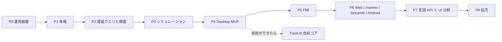

# GlobeMode ロードマップ

- 版: v0（2026-10-18、S001）。
- **P** は開発の段階（Phase）、**S** はセッション番号（`doc/sessions/SNNN-*`）。
- 1 つの Phase は複数のセッションにまたがる。セッションの数は目安。

## 全体

## Phase ごとの範囲と完了条件

| Phase | 範囲 | 完了条件 | 目安 |
| --- | --- | --- | --- |
| **P0 運用基盤** | 調査、計画、CLAUDE.md、スキル、セッション記録のフック、スライドと解説書の型 | S001 の成果物がそろう。フックが伏せ字版を出力する。リンク切れが 0 件 | S001 |
| **P1 骨格**（S003 で完了） | workspace 化、mise の rust の targets、cargo-deny、CI（Linux / Windows / wasm）。core / ir / frontend / cli。MSL の取得スクリプト。Python パッケージの改名 | `cargo deny check` が通る。MSL の例題 20 本で `globe check` の結果が Rumoca と一致する。frontend が wasm32 向けにビルドできる。[ADR-0003](adr/0003-toolchain.md) が Accepted になる | 3 回（workspace と CI / アダプタと CLI / wasm の確認） |
| **P2 遅延クエリと検査**（S004〜S010。完了条件は S008 で 3 つとも満たした。S9・S10 は S010 で足した。S10 の数値の部分は P3） | db、outline、class_index、connect_graph、`assert_simulatable` の S0〜S10 | 空白だけの編集の再検査が 50 ms 未満で、`flat` が再実行されない（salsa のイベントで確かめる）。MSL の全例題に判定が出て、panic は 0 件。S5 が omc と 95% 以上一致する | 4 回 |
| **P3 シミュレーション**（S011 で着手。完了条件の 1 つ目と 2 つ目は S011 で、3 つ目（wasm）は S012 で満たした。1 つ目と 2 つ目は S012 の既定（`auto`）で測り直した。公開ライブラリの失敗の上流への下書きは [upstream.md](upstream.md)、S108 で 31・32 を足して 37 件。S113 で 28〜32 を Rumoca v0.10.4 で確かめ直し、日本語版と AixLib 向けの 33 を足して 38 件。S115 で 17〜27 を v0.10.4 で確かめ直し、25・25b・25c・25g・26 は直っていたので提出の順から外した） | exec、driver、bdf / esdirk34 / tsit45 / dopri / 固定刻み、ResultStore | MSL の例題 153 本以上が実行できる。そのうち 90% 以上が参照結果のファネルに収まる。bdf が wasm で（Node 上で）動く | 5 回 |
| **P4 Desktop MVP** | CodeMirror 6 と LSP（S053 で整形・補完・lint、S130 で設定ファイル `globe-mode.toml`、**S132 で定義ジャンプ・参照**、**S138 でエディタから定義ジャンプ**、**S149 でホバー**）、**S141 でファイルを開く・保存**。**S142 で実行の設定の UI**（ソルバ・終了時刻・許容誤差・間隔・パラメータの上書き）、**S143 で Desktop が `globe-mode.toml` を読む**、**S144 で FMU を書き出す UI**、**S146 で CSV / PNG の書き出し**、**S150 で上書きできるパラメータの一覧**、**S151 でタブと最近使ったファイル**、**S154 で Desktop の最近使ったファイルを開ける**、**S152 でダークモード**、**S161 で参照の一覧とリネーム（S166 でクラス名も）**、**S163 で構文の色付け**、**S171 で補完を Rust 側に**、**S175 でキーボード操作**、ライブラリツリー（**S127 で UI、S167 で入れ子のクラスと検索**）、検査パネル（**S173 で未対応の見せ方と強行**）、プロット（S128 で系列の選択・2 軸・パラメトリック、**S169 で信号の絞り込み**）、sigma.js の connect グラフ | ChuaCircuit で開く・検査・実行・プロットが通る。5k ノードのグラフが 30 fps 以上で動く。RSS の基準値を記録する（**S056 で記録**: MSL を読んだ後、sidecar 1.52 GiB・アプリ 136 MiB）。CI が .deb と .msi を作る（**S049 で済**。Linux の locale が `C.UTF-8` でも起動する: **S134**）。Release に付けて自動更新（**S135 で仕組み**、鍵の登録は未）。**5k ノードの 30 fps は実 GPU で未測定**（S046 のヘッドレス Chromium で約 10 fps）。**この 2 つが残るので P4 は完了していない** | 6 回 |
| **P5 FMI**（S094 で着手。Export は P5a を先行し P5b を並行する。[ADR-0031](adr/0031-fmi-export-p5a-first.md)） | Import（ME / CS / SE）とマスター。Export は P5a（Rumoca のテンプレート）と P5b（自前のランタイム、S095。S099 から resources の Modelica を compile して exec の `ModelInstance` で回す。S109 から事象のあるモデルも。S112 から代数・離散の変数も読める。S114 から入力も与えられる。S117 から `modelDescription.xml` の型と書く側を `globe-mode-fmi` で P5a と共有。S124 から書く側は FMI 3.0 も。S144 で UI の「FMU を書き出す」: ブラウザは wasm の zip、Desktop は LSP の `globe/exportFmu`。S154 で UI から FMI 2.0 / 3.0 を選べる） | Reference-FMUs が linux64 と win64 で一致する。Export した FMU が FMPy・fmusim・fmuCheck を通る（**S094: Decay の FMI 2.0 の FMU が FMPy の validate と ME・CS の simulate を通った。S098: FMI 3.0 も同じく通り、2.0・3.0 とも fmusim の validate と ME・CS の simulate を GitHub Actions で通った。S105: `--target`（zig cc）で linux64・win64・darwin64 を 1 つの FMU に入れ、Ubuntu・Windows・macOS の FMPy で validate と ME・CS を通った**。fmuCheck は持ち越し）。Clocks（SE）が往復できる。**S204: Import の最初の一切れ**（[ADR-0026](adr/0026-fmi-import-placement.md) を Accepted に。新 crate `globe-mode-fmi-import` が FMI 2.0・3.0 の Co-Simulation を自前の C ABI で読み込み、Reference-FMUs の BouncingBall・Dahlquist・VanDerPol の参照の CSV と全桁で一致、Export した Decay の往復も通る。CLI `globe fmu info` / `run`。手動の `fmu-import.yml` で Linux・Windows・macOS）。**Import の ME・コシミュレーションのマスター・SE は未着手** | 8 回 |
| **P6 Web / marimo / Streamlit / Android** | WorkerBackend、MSL のパッケージ単位の分割読み込み、anywidget、wheel、APK | ブラウザが CSP `connect-src 'self'` のまま実行できる（サーバーで計算しない。**S093 で確かめた**: Worker にも同じ CSP の header を付け、`ui:check` が error 0・外への要求 0）。marimo の WASM で 2 GB 未満に収まる（S093 は調査だけ。[調査](research/marimo-wasm-2026-11-02.md)。**S102 で Decay を確かめた**: anywidget の `_esm` から `globe-mode-wasm` を呼び、ブラウザの RSS の合計 857〜966 MiB。**S104 で MSL も**: Web Worker で ChuaCircuit を渡す道は未回し、RSS の合計 1152〜1154 MiB、`--offline` の書き出しに CSP を付けて違反 0 件）。Android API 34 のエミュレータで検査と実行が通る（**S100 で確かめた**: UI から Decay の検査と実行、logcat の `GM-SMOKE` の行。**S103 で MSL も**: APK に MSL.json を同梱し、ChuaCircuit の検査で `msl=ok`。**S106 で release の APK も**: ABI ごとの release APK を作り、secret があるときだけ署名、release でも smoke が `msl=ok`）。**S145 でブラウザ版の配布物**: 手動の `web.yml` が artifact `globe-web`（wasm・UI・MSL.json・`_headers`・`nginx.csp.conf`）を出し、サブパスと幅 400 px の試験を足した。公開は未実施（ユーザーの判断）。**S147 で Desktop と Android の smoke に UI の操作**（木・整形・グラフ・止める・実行の設定・プロットの選択・定義ジャンプ）の 7 項目を足し、`desktop.yml`・`android.yml` の合格条件にした（全部 ok） | 6 回 |
| **P7 言語 API と UI 比較** | C / Zig / Julia、Elixir / Gleam、Python。Leptos 版と Dioxus 版、負荷の測定ハーネス | 参照シナリオが 6 言語で通る（**S110 で参照シナリオを決め、機能表を作った**: Decay を開く → check → simulate → x(1) → format。[調査](research/lang-api-matrix-2026-11-03.md)。**S111 で 6 言語に format / lint を足し、参照シナリオが 6 言語の試験で通った**。**S116 で列の道（`simulate_columns`）を C・Zig・Julia・Elixir・Gleam に足した**。**S118 で FMU export を facade に置き、C・Zig・Julia・Elixir・Gleam・Python から呼べるようにした**。**S121 で進捗と中断の設計を [ADR-0033](adr/0033-progress-and-cancel.md) に書いた**。**S123 で core・IR・exec・facade に進捗と中断を入れた（ADR-0033 の順の 1）**。**S129 で Python に `on_progress` と中断を入れた（順の 3）**。**S131 で C・Zig・Julia と NIF・Elixir・Gleam に進捗と中断を入れた（順の 4）**。**S133 で wasm とブラウザ UI に進捗と「止める」を入れた（順の 2）**。**S136 で LSP と Desktop に進捗と「止める」を入れ、ADR-0033 を Accepted にした（順の 5）**）。**各 UI はダークモード対応を含む（S152 で Svelte 版を済ませた。Leptos 版は S153 で最初から）**。`doc/bench/ui.md` に 3 UI × 3 OS の比較を書く（**S125 で測定ハーネス（[ADR-0034](adr/0034-ui-bench-method.md)）を作り、Svelte のブラウザ（Linux）と Desktop（Linux・Windows）を [doc/bench/ui.md](bench/ui.md) に載せた**。Leptos・Dioxus のブラウザ（Linux）は S153・S155。**S156 で 3 UI のブラウザ版を Windows・macOS・Linux（Actions）でも測り、列を足した**: 手動の `ui-bench.yml`、run 41984237319。Svelte Tauri の macOS だけが「未」だったが、**S160 で `desktop.yml` に macOS を足して測り、表の欄がすべて埋まった**: run 41994245407）。**S153 で Leptos 版を作り、ブラウザ（Linux）の列を足した**（[ADR-0035](adr/0035-experimental-ui-leptos.md)）。**S155 で Dioxus 版を作り、同じ列を足した**（[ADR-0036](adr/0036-experimental-ui-dioxus.md)）。**P7 の完了条件は 2 つとも満たした**（参照シナリオは S111、3 UI × 3 OS は S160） | 6 回 |
| **P8 拡充** | radau5（S030）、SUNDIALS（S032・S034）、ESDIRK / CERK（S027・S029）は済。SSP 2.0.1、Diagram ビュー、BLT デバッガは未 | ソルバの表がそろう（**済**: S050、S126 で回し直し）。SSP が往復できる（未） | 未定 |
| **Track B 自前コア** | B1 rowan の CST と寛容なパーサ → B2 resolve → B3 flatten → B4 DAE。`Frontend` の feature `native` として作る | 段階ごとに Rumoca 以上の数字を出す（parse 566 / flatten 562 / balanced 464 / simulate 153）。`xtask diff-frontend` で回帰が 0 件になったら既定を切り替える | P4 以降、余裕ができてから |

Track B の B1〜B2 は IDE の機能（補完、アウトライン）から先に使える。コンパイルのパイプラインは引き続き Rumoca が受け持つ。ただし AST が別物なので、両者を混ぜるのは「IDE 機能か、コンパイルか」の境目に限る。

## 進み具合

### S002（P1 の 1 回目、2026-10-18）で済んだこと

- ルートを virtual workspace にし、4 つの crate を作った: `globe-mode-core`、`globe-mode-ir`、`globe-mode-frontend`（Rumoca アダプタ）、`globe-mode-cli`（`globe outline` / `globe check`）。
- **Rumoca v0.10.2（`276e82bd`）の `rumoca-compile` が、stable 1.99.1 でビルドできることを確かめた**。
  - ネイティブでも `wasm32-unknown-unknown` でも `cargo check` が通る。
  - これで [ADR-0003](adr/0003-toolchain.md) を Accepted にした。
- `mise.toml` に wasm と Android の target、cargo-deny、`mise run check` / `mise run docs:check` を足した。
- `deny.toml` を作った。
  - ライセンス・bans・取得元はすべて ok。
  - `rumoca-compile` を使えるのはアダプタだけに限った（wrappers）。違反させて検出できることも確かめた。
- CI の雛形（`.github/workflows/ci.yml`）を作った。Linux・Windows・wasm・Python とスライドの検査の各ジョブ。**まだ push していないので、実行は確かめていない**。
- Python パッケージを `globe_mode`（`src/Python/mod/`）に改名した。

### P1 の残り（S003〜）

| 完了条件 | 状態 |
| --- | --- |
| `cargo deny check` が通る | 済（S002） |
| frontend が wasm32 向けにビルドできる | 済（S002、`cargo check`） |
| ADR-0003 が Accepted | 済（S002） |
| MSL の例題 20 本で `globe check` の結果が Rumoca と一致する | 済（S003、20 本中 20 本） |
| CI が GitHub 上で通る | 済（run 39093072719、全ジョブ成功） |

### S003（P1 の 2 回目、2026-10-18）で済んだこと

- `cargo xtask fetch-msl`: MSL 4.1.0 を sha256 で確かめて `data/msl/` に展開する。
- `cargo xtask fetch-rumoca`: Rumoca の CLI v0.10.2 を取得する（照合用。Linux の x86_64 と aarch64。S017 で aarch64 を足した）。
- `globe check --library data/msl -m <モデル>`: MSL の中のモデルを検査できるようにした。
- `cargo xtask msl-compare`: 例題 20 本で Rumoca の CLI と突き合わせた。**20 本すべて一致**（[報告](sessions/S003-msl-check/msl-compare.md)）。
- CI に `msl` ジョブを足した（全体を検査するときだけ）。
- これで **P1 の完了条件はすべて満たした**。

### S004（P2 の 1 回目、2026-10-18）で済んだこと

- `globe-mode-db`（salsa 0.28.5）を作った。クエリは `outline` → `outline_shape`（位置を落とした防火壁）→ `class_index` → `connect_graph`。
- `globe-mode-graph`: connect グラフを flatten せずに作る。
  - 辺の種類は flow / stream / real / boolean …。
  - depth で部分回路を展開できる。
  - 出力は graphology の JSON。CLI は `globe graph`。
- 検証用のパッケージ `src/Modelica/GlobeModeValidation` を作った。
  - Real の potential / flow、Real と Boolean の信号、Medium の流体ポート、階層、型の誤りのモデルを入れた。
  - OMEdit などでも開けるパッケージの構成にした。
- **空白とコメントだけの編集では、`class_index` と `connect_graph` が再実行されないことをテストで確かめた。**
  - 再計算は中央値 0.20 ms で、目標の 50 ms 未満。
- Rumoca v0.10.2 の制約を見つけた（ライブラリとして読んだクラスから別のライブラリを extends できない）。作業中のパッケージは文書として読んで回避した。

### S005（P2 の 2 回目、2026-10-18）で済んだこと

- **検査（S0〜S6）を salsa のクエリにした**（[ADR-0005](adr/0005-lazy-query-db.md) の結果）。
  - 防火壁 0 の `source_shape`（コメントを除き空白を畳んだ本文）を足した。計画では `outline` を防火壁にしていたが、Rumoca に渡せるのは本文なので直した。
  - クエリは `source_shape` → `check`（S0〜S5）→ `dae_shape`（防火壁 2）→ `structural`（S6）。診断の位置は `shape_map` で元の本文に戻す。
  - **空白とコメントだけの編集では `check` が再実行されない**ことをテストで確かめた。再検査は中央値 0.01 ms。
- **MSL は一度だけ読む**。`Checker` が、MSL を読んだ Rumoca の `Session` を使い回す。読んだあとの別のモデルの検査は 0.12 s。
- `globe-mode-analysis` を作った: Hopcroft–Karp と粗い Dulmage–Mendelsohn 分解（S6、Rumoca に依存しない）。
  - **S6 の判定は、`x` と `der(x)` を 1 つの列にまとめた二部グラフ**で行う。最初は der の形で判定し、MSL の正しい例題 166 本を構造特異にしてしまったので直した。der の形の結果は、S7 の情報 `GM-I7001`（微分インデックスが 1 より大きい見込み）にした。
- **GM-U の振り分けを決めた**（[ADR-0007](adr/0007-unsupported-classification.md)）: Rumoca のコードの規則（`GM-U0001` / `GM-U0002`）と、既知の制約の一覧 50 行（`GM-U0003`）の併用。omc との照合は任意（S005 では未実施。S008 で行い、一覧の 50 本は全部 omc で通った）。
- **MSL の全例題 566 本に判定を出した**（`cargo xtask msl-funnel`、[報告](sessions/S005-check-queries/msl-funnel.md)）。例題の選び方は Rumoca と同じ名前の規則で、本数も Rumoca の基準値と一致した。
  - 最終の結果: OK 369（うち S7 の情報 154）・NG 13（S5 1・S6 12）・GM-U 184・panic 0。S6 で止まった 12 本は、Examples の下にある接地の無い部品モデル（`OpAmpCircuits.*`、`FluxTubes…Components.*`）で、単体で検査すると電位が 1 つ決まらない。omc では未確認。
  - 最初の実行では flatten 532 / DAE 382 / balanced 381 本が通り、Rumoca の基準値（flatten 494 / DAE 305 / balanced 293）を上回った。基準値は Rumoca の別の commit（`b92932c0`）で記録されたものなので、差の内訳は確かめていない。
- 検証用のモデル `Invalid.StructurallySingular`（S6 で止まる）と `Invalid.HighIndexDuplicate`（S6 は通り、S7 の情報が出る）を足した。
- CLI: `globe check` を db 経由にし、S6 と GM-U を表示する。`globe flat` で flat モデルの要約を出す。

### S007（P2 の 3 回目、2026-10-18）で済んだこと

- 範囲は S007 の候補のうち `deps_closure`（1）、S7（3）、S8（4）。**omc との照合（5）はユーザーの指示で後回し**にした（omc 未導入。OpenModelica のサイトが重くて取得できない。入れたら再開する）。`Checker` のメモリ（2）は P4 のプロセス構成が決まってから、上流への報告（6）はユーザーが出す。`class_index` の残り（7）は import だけを扱った。
- **`deps_closure`**: `check` に渡すファイルを、モデルが使うものだけに絞った（[ADR-0005](adr/0005-lazy-query-db.md) の結果）。
  - 識別子の単純名と、ファイルが定義するトップレベルのクラスの名前を突き合わせ、固定点まで広げる。広めに見積もり、足りないことは無い。
  - `Connect.RealCircuit` の閉包は 5 / 23 ファイル。閉包だけの検査と全ファイルの検査は、検証用パッケージのモデル 20 本以上のすべてで一致した。
  - 使わないファイルの式を変えた後の再検査は、`check` 0 回で中央値 0.19 ms（MSL を使う `MediumFlow`、release）。代わりに、閉包の違うモデルへ初めて切り替えると、Rumoca が MSL ごと解決し直すので約 1.7 s かかる（全ファイルを渡したままなら 67 ms）。
  - CLI: `globe deps <files> -m <model>` で閉包を見られる。
- **S7（Pantelides 法と状態選択の候補）**と **S8（初期化系の検査）**を足した（[ADR-0009](adr/0009-structural-index-and-init.md)）。
  - S7 は情報にとどめる（`GM-I7001` インデックス 2 以上、`GM-I7002` 状態選択が要る）。打ち切りだけ `GM-E7001`。
  - S8 は初期条件の数と属性で判定する。要る数には S7 の動的な状態の数を使う。過剰は `GM-E8001`（離散変数を含むか、インデックスの低減で状態が減るときは、確定できないので警告 `GM-W8004`）、不足は `GM-W8001`・`GM-W8002`、値の無いパラメータは `GM-W8003`。
  - 検証用のモデル `Index.Pendulum`（インデックス 3、動的な状態 2 / 4）、`Index.ParallelCapacitors`（インデックス 2、動的な状態 1 / 2）、`Init.*` の 5 本を足した。`Invalid.HighIndexDuplicate` は、動的な状態が 0 で `fixed = true` が 1 つ余るので、S8 の警告 `GM-W8004` を出して通る。
  - `globe check` に S7・S8 の行と `--json` の `s7` / `s8` / `init`。`check_model` は S0〜S8。
- `msl:funnel` の報告の置き場を [msl-funnel.md](msl-funnel.md) に固定した。S7・S8 の列と集計を足した。
  - 最初の実行で、MSL の正しい例題 3 本（インデックス 2 で、拘束でつながった状態すべてに `fixed = true`）が S8 の Error になったので、過剰の規則を直した（[ADR-0009](adr/0009-structural-index-and-init.md)）。
  - 最終の結果: 566 本: OK 369（うち S7 の情報 154）・NG 13（S5 1・S6 12・S7 0・S8 0）・GM-U 184（82 / 52 / 50）・panic 0。OK・NG の本数は S005 と同じ。S7 を回した 369 本の構造インデックスは 1 が 215・2 が 58・3 が 95・4 以上が 1・打ち切り 0、状態選択が要るもの 154。S8 の 369 本は合う 111・過剰の見込み 3（`GM-W8004`。Error 0）・不足 255・入力なし 0、`GM-W8003` あり 2。S6 と Rumoca の照合 381 / 381。検査 833.0 s（1 本 1.47 s）、最大 RSS 7.2 GiB。
- テストは workspace 全体で 209 本が通過。clippy 0 件、fmt の差分 0。

### S008（P2 の 4 回目、2026-10-19）で済んだこと

- 範囲は S008 の候補のうち **omc との照合（1）だけ**。ユーザーが OpenModelica 1.27.1 を入れたので、S007 で後回しにした項目を最初に再開した。方法は [ADR-0010](adr/0010-omc-comparison.md)、報告は [omc-compare.md](omc-compare.md)。
- **`cargo xtask omc-compare`**（`mise run msl:omc`）: `msl-funnel --json` の結果を入力に、omc を別プロセスで呼んで `checkModel`（方程式数・変数数）と `translateModel`（バックエンドまで）の結果を突き合わせる。omc に読ませる MSL は `data/msl` の素の 4.1.0（omc 同梱の `+maint.om` ではない）。50 本ごとに 1 プロセス、落ちたら 1 本ずつ再実行。`--reuse` で omc を呼ばずに照合だけやり直せる。
- **結果（566 本、omc は 391 s）**: S5 は判定のある 382 本すべてで一致（**100%。P2 の完了条件を達成**）。GM-U 184 本は全部 omc の `checkModel` で数が合い、既知の制約の一覧（`GM-U0003`）の 50 本は全部 omc で通った。S6 は 363 本中 362 本、S8 の過剰は 355 本中 354 本が一致。globe が S6 で止めた 12 本のうち 7 本は omc も特異（残り 5 本は omc が手前の「fixed なパラメータに値が無い」で止まる）。globe の `GM-W8004` の 3 本は omc も「over specified」で、余分な本数まで同じ。
- 食い違い 2 本（`AdvancedSolenoid`: globe は通し omc は Pantelides の内部エラー。`NonCircularPipes`: globe は不足、omc は冗長な初期方程式 2 本）は S009 の候補にした。
- `msl:funnel` は JSON（`target/msl-funnel.json`、`counts.unknowns` を追加）も残すようにした。ファネルを回し直した本数は S007 と同じ（OK 369・NG 13・GM-U 184・panic 0）。

### S009（P2 の 5 回目、2026-10-19）で済んだこと

- 範囲は S009 の候補のうち **omc と食い違った 2 本の調査（1）** と **S8 の精密化（3）**。1 の調査で `NonCircularPipes` の食い違いが「数だけの S8 は冗長を見られない」ことだったので、3 をそのまま主な実装にした。方法は [ADR-0011](adr/0011-init-system-matching.md)。
- **`AdvancedSolenoid` は S6 の限界**（直さない）: 接地の無い部品の単体の検査で、枝 8 本 ≥ 節点 7 つなので二部グラフには完全マッチングがあるが、キルヒホッフの電流則が数値的に従属（電位は差しか決まらない）。omc は記号的な簡約の後に `0.0 = 0.0` を見つけて止める（`-d=bltdump`）。構造の検査では捕まえられないので、S10 のプリフライトで初期化のヤコビ行列の階数を見る候補にした。検証用のモデル `Invalid.UngroundedLoop` に記録（`Connect.Subsystem` のように枝 < 節点 なら構造でも特異で、S6 で止まる）。
- **S8 の精密化**: 初期化系（DAE とその微分 + 初期方程式 + `fixed = true`）を二部グラフにして、最大マッチングと DM 分解で**冗長な初期条件**（過剰な部分）と**初期条件の無い未知数**（不足している部分）を名指しする（`globe-mode-analysis/src/init_system.rs`）。数だけの判定は「不足 − 冗長」しか分からなかった。
  - `InitStructure` に初期方程式の参照（`der(x)`・代数、状態そのもの、パラメータ、離散）と、初期化で決めるパラメータへの DAE の方程式からの参照を足した。フロントエンドは `structure.rs` と同じ鍵で写す。
  - 過剰は、過剰な部分に DAE の行（拘束やその微分）があれば `GM-W8004`（整合する値なら冗長なだけ。omc も Warning で外す）、無ければ `GM-E8001`。不足は `GM-W8001` と、不足している部分の start の無い状態に `GM-W8002`。両方あれば両方出す。
  - `globe check` の S8 にマッチングの行、`--json` の `s8.matching`。`msl-funnel` の S8 の列に「冗長 k・決まらない m」、`omc-compare` の S8 の照合は「過剰 = 冗長が 1 つ以上」。
  - 検証用のモデル `Init.RedundantAndMissing`（数は 1 / 1 で合うが、冗長 1・決まらない 1）。
- **Rumoca v0.10.2 の制約を 2 つ見つけた**（どちらも S8 の入力が欠けたり誤ったりする。GlobeMode 側では直せないので記録し、上流への報告の候補にした）。(1) `outer` の参照を `inner` の修正ではなく型の既定で評価する。MSL の Fluid の例題 11 本は `inner Modelica.Fluid.System system(energyDynamics = FixedInitial)` の形なので、`PartialDistributedVolume` の `if` の中の初期方程式（`mediums.p = ps_start` など）が globe の DAE に無く、S8 が「不足」になる。`NonCircularPipes` で omc が冗長と言う 2 本はこれ（globe の入力に無い）。検証用のモデル `Init.OuterModification` と db のテスト（Rumoca が直ったら落ちる）に記録。(2) 例題の `wheelSet(theta1(fixed = true))` のような修正が、部品の中の同名の `wheelSetJoint.theta1`（MSL は `fixed = false` で外している）にも漏れる。`RollingWheelSetDriving` / `RollingWheelSetPulling` で S8 が「冗長 7」を出し、omc（過剰と言わない）と食い違うのはこのため。検証用のモデル `Init.ModifierScope` と db のテストに記録。
- **MSL の全例題**（`mise run msl:funnel`、[msl-funnel.md](msl-funnel.md)）: 566 本: OK 369・NG 13（S5 1・S6 12）・GM-U 184・panic 0（S007・S008 と同じ本数）。S8 まで来た 369 本すべてで初期化系をマッチングできた（射影の失敗 0）。S8 の分布は合う 111・過剰 6（すべて `GM-W8004` の見込み。Error 0）・不足 252（S008 は 合う 111・過剰 3・不足 255。冗長と不足を両方持つ 3 本が過剰に移った）。検査 723.8 s（1 本 1.28 s）、全体 748 s、最大 RSS 7.1 GiB。
- **omc との照合**（`cargo xtask omc-compare --reuse`。omc は S008 の結果を再利用、[omc-compare.md](omc-compare.md)）: S5 382 / 382、S6 362 / 363（`AdvancedSolenoid`。上の限界）、**S8（過剰）352 / 355**（S008 は 354 / 355）。不一致 3 本はどれも Rumoca の制約で入力が欠けるか誤るもの: `NonCircularPipes`（inner/outer で初期方程式が消え、omc の冗長 2 本が globe の入力に無い）、`RollingWheelSetDriving` / `RollingWheelSetPulling`（修正の漏れで別名の両方が `fixed = true` になり、globe が冗長 7 を出す）。globe の `GM-W8004` の 3 本（`GenerationOfFMUs` 2 本、`CompareLineTrunks`）は omc も過剰で、冗長の本数（2・3・1）まで一致した。
- テストは workspace 全体で 232 本が通過（S008 は 216 本）。clippy 0 件、fmt の差分 0。

### S010（P2 の 6 回目、2026-10-19）で済んだこと

- 範囲は S010 の候補のうち **S9・S10（3）**、**離散変数の when の区別（1）**、**閉包の切り替えの費用（2）**。5 つのサブエージェントが所有するファイルを分けて同時に作業した（S9 の BLT と tearing、S9 の線形・非線形の判定、S10、閉包、S8 の when）。`Checker` のメモリ（4）は P4 のプロセス構成が決まってから、上流への報告（5）はユーザーが出す。
- **S9（代数ループ）**（[ADR-0012](adr/0012-loops-and-preflight.md)）: BLT（Hopcroft–Karp と再帰を使わない Tarjan 法）で大きさ 2 以上のブロックを見つけ、貪欲な tearing で反復変数を選び、非線形のループの反復変数に start 値が無ければ `GM-W9001`（警告）。ループがあれば `GM-I9001`（情報）。インデックス 2 以上のモデルは Pantelides 法の最高階の系で数える（状態選択の前の見込み）。線形・非線形は、フロントエンドが残差の式木を族の単位で広めに判定する（`DaeStructure::nonlinear`）。
- **S10（プリフライトの静的な部分）**（[ADR-0012](adr/0012-loops-and-preflight.md)）: パラメータと start 値を Rumoca の評価器で評価し、非有限は `GM-E10001` / `GM-E10003`、関数の中の assert の失敗は `GM-E10002`。experiment annotation は Rumoca が不正な値を黙って捨てるので、根のクラスの本文を読み直して生の値で判定する（`GM-E10004` / `GM-W10001` / `GM-I10001`）。t0 の残差・初期化のヤコビ行列の階数・ソルバの能力は P3 の実行系ができてから。
- **S8 の離散変数の when の区別**（[ADR-0011](adr/0011-init-system-matching.md) の S010 の追記）: when の中で決まる・when の外の式で決まる・`when initial()` で決まるを分け、初期化でも成り立つ離散の方程式を行に足した（MLS §8.6）。決まり方の分かる離散変数の不足と冗長は確定させた。
- **閉包の切り替えの費用**（[ADR-0005](adr/0005-lazy-query-db.md) の結果）: `Checker` に文書の和集合を持たせた。一度検査したモデルへ編集なしで戻るときは約 2.1 s → **49 ms**。Rumoca の Session にはライブラリの解決だけを残す道が無いので、文書の組を変えないようにした。閉包の違うモデルを初めて検査するときは今も約 1.7〜2.0 s。
- 検証用のモデル 20 本: `Loops.*` 4 本、`Preflight.*` 10 本、`Init.Discrete*` 6 本（[src/Modelica/README.md](../src/Modelica/README.md)）。
- **MSL の全例題**（`mise run msl:funnel`、[msl-funnel.md](msl-funnel.md)）: 566 本: OK 369・NG 13（S5 1・S6 12）・GM-U 184・panic 0（S009 と同じ本数）。S8 の分布は **合う 269**・過剰 6（すべて `GM-W8004`）・**不足 94**（S009 は 111・6・252。離散変数の区別で StateGraph などの「不足」が「合う」に移った）。S9 は 369 本すべてで解析し、代数ループのあるもの 226・非線形のループのあるもの 142・`GM-W9001` のあるもの 57（反復変数 188 個）、一番大きいループは `MultiBody.Examples.Loops.EngineV6` の 4584 本（最高階の系）。**ループの大きさの一覧は Rumoca の構造解析と、微分の要らない 215 本すべてで一致**。S10 は Error 0（experiment annotation の無い 16 本に `GM-I10001`）。検査 849.8 s（1 本 1.50 s。S009 は 1.28 s。後半に `msl:compare` を同時に回したので揺れを含む）、最大 RSS 7.1 GiB。
- **omc との照合**（`mise run msl:omc`、omc を回し直した。[omc-compare.md](omc-compare.md)）: S5 382 / 382、S6 362 / 363、S8（過剰）352 / 355（S009 と同じ）。**S9（非線形のループの有無）282 / 355（79.4%）、S9（start の無い非線形の反復変数の有無）312 / 355（87.9%）**。omc は別名の消去と式の変形を先にするので有無だけを比べた。食い違いの主な見込みは、線形の判定が方程式ごとの集合しか持たないこと（`v = R*i` の `R` がループの外で決まっても非線形とみなす。`ShowVariableResistor`）。
- テストは workspace 全体で 324 本が通過（S009 は 232 本）。clippy 0 件、fmt の差分 0。`msl:compare` は 20 / 20。

### S011（P3 の 1 回目、2026-10-19）で済んだこと

- 範囲は S011 の候補 1（P3 の始め: 実行系と S10 の数値の部分）。Rumoca の実行系と参照結果の調べもの 2 つを先に並べ、その結果で骨格を固めてから、所有するファイルを分けた 3 つのサブエージェント（exec、sim、xtask）を同時に走らせた。
- **実行系 `globe-mode-exec`**（[ADR-0013](adr/0013-exec-backend.md)）: Phase A は Rumoca の実行系（`rumoca-sim`。diffsol の BDF と Rumoca の Dormand–Prince 5(4)）をそのまま使い、`globe-mode-exec` に閉じ込めた。Rumoca のモデルを自前の `HybridSystem` で包む公開の API が無いため、自前の driver は FMU（P5）と Track B で作る。diffsol は Rumoca が数値の修正を当てた版を `[patch]` で使う（Rumoca の CLI と同じ数値）。結果は中立の `SimRun`、失敗は `Stage::Run` の診断（`GM-E11001`〜`GM-E11006`、`GM-I11001`、`GM-W11001`、`GM-U0004` / `GM-U0005`）。
- **S10 の数値の部分**: start 値で評価して t0 で代数変数と導関数が有限か（`GM-W10002`。初期化で変わりうるので警告）、ソルバの名前（`GM-E10005` / `GM-I10003`）。初期化のヤコビ行列の階数は Rumoca に公開の API が無いので送った。
- **`globe-mode-sim`**: ソルバの名前の登録表（`bdf`・`dopri45`・`auto`、別名、未実装のもの）、設定の決定（指定 > experiment > 既定。出どころも返す）、CSV の読み書き、参照結果との比較（csv-compare の矩形の管を書き直したもの。許容差 0.002）。Rumoca に依存しない（wasm32 でビルドできる）。
- **`globe simulate`**: 検査（S0〜S10）を通してから実行し（Error があれば `--force` が無い限り実行しない）、`--output` に CSV を書く。db に `GlobeDb::compiled_model`（`check` と同じ文書で DAE を返す）。
- 検証用のモデル `Simulation.*` 12 本（[src/Modelica/README.md](../src/Modelica/README.md)）。
- **MSL の全例題の実行**（`mise run msl:sim`、[msl-sim.md](msl-sim.md)）: OK の 369 本のうち partial の 12 本を除く 357 本を別プロセスのワーカーで実行し、**303 本が終了時刻まで進んだ**。MAP-LIB の参照結果（v4.1.0）と比べた 302 本のうち **292 本（96.7%）が管に収まった**。止まった 54 本は、実行系が未対応 26・初期化 6・積分 6・時間切れ 5・実行系の内部エラー 4・外から停止（120 s）7。全体 31 分 52 秒、ワーカーの最大の常駐メモリ 3.5 GiB。
- テストは workspace 全体で 422 本が通過（S010 は 324 本）。`msl:compare` は 20 / 20。

### S012（P3 の 2 回目、2026-10-19）で済んだこと

- 範囲は S012 の候補のうち **bdf を wasm で動かす（1）** を中心に、**自前の積分器（3）**、**パラメータを変えた再実行と MAT v4（4）**、**止まった 54 本と管から外れた 10 本の調査（2）**。調べもの 3 つ（wasm の試作、積分器・再実行・MAT の調査、止まった例題の調査）を先に並べ、その結果で骨格を固めてから、所有するファイルを分けた 5 つのサブエージェント（実行系の本体、自前の積分器、wasm、sim と CLI、xtask）を同時に走らせた（ユーザーの指示で Opus・effort medium）。候補 5〜10 は持ち越した。
- **session の道**（[ADR-0014](adr/0014-session-route-wasm.md)）: Rumoca の FMI ME 風の host（公開の関数だけ）に数値積分のプラグイン（`MeIntegratorBackend`）を差して回す道を `globe-mode-exec` に 1 つ作り、wasm32 のすべてのソルバと自前の積分器に使う。ネイティブの `bdf`・`dopri45`・`auto` は S011 の型付きの道のまま。`Simulation.*` 12 本の bdf で、2 つの道は**ビット単位で同じ**（dopri45・auto も一致）。
- **wasm**（`globe-mode-wasm`、wasm32-unknown-unknown + wasm-bindgen 0.2.129）: 検査（S0〜S10）→ DAE への変換 → 実行が Node v24.22.0 で通った。ライブラリ（MSL）はファイルの組で 1 回だけ読む（Rumoca の in-memory の組）。`mise run wasm:compare` の 117 件（`Simulation.*` 13 本 × 9 ソルバ）のうち 114 件がネイティブと一致し、bdf・dopri45・auto は全件一致（最大 3 ulp）。MSL の `ChuaCircuit` も bdf で回った（Node で検査 2.8〜3.2 s・実行 0.45〜0.5 s。MSL の読み込みは 10.5〜11.9 s で 1 回だけ）。最適化した wasm は 14.5 MB（gzip 4.48 MB）。CI に Node のジョブ `wasm-node` を足した。
- **自前の積分器 6 つ**: diffsol の `esdirk34`・`trbdf2`・`tsit45`（Rumoca のプラグインを写して改変）と、固定刻みの `euler`・`heun`・`rk4`（`--step`、既定は出力の間隔）。使えるソルバは 9 つ。大域誤差の次数の実測は euler 1.03・heun 2.06・rk4 4.06。MSL の `Electrical.Analog.Examples` 54 本では bdf 50 本が実行・48 本が管、esdirk34 42・39、tsit45 40・36（予算 30 s）。
- **`auto` の切り替え**: BDF が積分に失敗したとき（`GM-E11002`）とサンプラが食い違ったときも dopri45 で回し直し、`GM-I11002` で知らせる（S011 は方向微分が作れないときだけ黙って切り替えていた）。MSL の `TwoMass` が通る。
- **パラメータの上書き**（再コンパイル無し）: `globe simulate --param NAME=VALUE`、`--list-parameters`。変えられないもの・無い名前・有限でない値は `GM-E10006`。プリフライトも上書きを反映する。検証用のモデル `Simulation.Parameters`。
- **結果の MAT v4**（`globe simulate --format mat`）: OpenModelica・Dymola の dsres の形。scipy・DyMat 0.7 で読め、omc 1.27.1 の実物と同じスクリプトで同じに読めた。Arrow IPC は持ち越し（OpenModelica の形式が 0.1 の開発版、依存が 25 増える）。
- **設定の検査**: 許容誤差が 1e-10 未満なら 1e-10 に上げる（`GM-W10003`）、固定刻みは許容誤差を使わない（`GM-I10004`）、刻み幅の検査（`GM-E10004`）。
- **止まった 54 本と外れた 10 本の調査**（[research/msl-sim-failures.md](research/msl-sim-failures.md)）: Rumoca の CLI では通るのに GlobeMode で止まるものは 0 本。GlobeMode で直せるもの（`auto` の切り替え、許容誤差の下限、時間切れの回し直し、比べる前のイベントの行の正規化、既知の外れの一覧、例題でないものを外す、ワーカーの段の知らせ）を直した。上流への報告の候補 9 つを分けた。
- **MSL の全例題の実行**（`mise run msl:sim`、既定 `auto`、時間切れは 180 s で回し直す）: 対象 356 本（partial の 12 本と例題でない `SpacePhasorLimiter` を除く）のうち **309 本が終了時刻まで進み**（S011 は 303 本、+6）、参照結果と比べた 308 本のうち **299 本（97.1%）が管に収まった**（S011 は 292 / 302 本、+7。信号の数で 1753 / 1772）。止まった 47 本（S011 は 54 本）は、実行系が未対応（GM-U0004）24・初期化 6・時間切れ 5・積分 4・イベント 1・外から停止 7（どれも実行系の段）。GM-U0005（サンプラの食い違い）は 4 → 0。時間切れの 6 本を予算 180 s で回し直して 1 本が通った。`auto` が dopri45 に切り替えたもの（GM-I11002）は 11 本で、うち 4 本が最後まで進んだ。管から外れた 9 本のうち 2 本は既知の外れ（`src/Modelica/msl-sim-known-deviations.txt`）。新しく実行できた 6 本のうち `GenerationOfFMUs` は、Rumoca と同じ規則（初期化で方向微分が作れない）で RK に切り替わって最後まで進むが、温度が動かず管から外れる（調査の上流への報告の候補 6「RK で黙って誤った結果」）。全体 2945.8 s（49 分。回し直しを含む。S011 は 31 分 52 秒）、ワーカーの最大の常駐メモリ 3.4 GiB（[msl-sim.md](msl-sim.md)）。
- テストは workspace 全体で 485 本が通過・10 本 ignore（S011 は 422 本）。clippy 0 件。

### S013（P3 の 3 回目、2026-10-19〜20）で済んだこと

- **`auto` は方向微分が作れないときに切り替えない**（[ADR-0015](adr/0015-auto-and-reference-tolerance.md)）: S011 から残っていた「組み立て・初期化で方向微分が作れなければ dopri45」をやめた。MSL で当たっていた `GenerationOfFMUs` は RK で温度が動かない誤った結果だったので、`GM-U0004` で止まるほうを選んだ。
- **参照結果と同じ許容誤差で突き合わせる**: `cargo xtask msl-sim --tolerance-scale <倍率>`。注釈に Tolerance があるモデルだけ倍率を掛け、無ければ 1e-6 のまま（MAP-LIB の参照結果の作り方と同じ）。`mise run msl:sim` は 0.1 で回す。`globe simulate` の既定は変えない。
- **既知の外れの一覧**に `DoublePendulumInitTip`（カオス的。許容誤差を 1/10 にすると悪くなる）を足した。
- **MSL の全例題の実行**（[msl-sim.md](msl-sim.md)）: 実行できた 309 → **308**（`GenerationOfFMUs` が止まる）、参照結果と比べた 307 本のうち **301 本（98.0%）** が管に収まった（S012 は 299 / 308、+2）。外れ 6 本のうち 3 本は既知の外れ。

### S014（P3 の 4 回目、2026-10-20）で済んだこと

- **プリフライトの lowering を 1 回にした**（[ADR-0016](adr/0016-preflight-on-build-lowering.md)）: bdf・auto と session の道は、組み立ての lowering の結果でプリフライトを行う（ネイティブの dopri45 だけは単独のまま）。`run` の時間（release）は `DoublePendulum` で 0.39 s、lowering で止まる `Fluid.Examples.HeatingSystem` で 4.26 s 減った。`FullRobot` は 111.6 s → 57.9 s。
- **実行系の中の段を知らせる**: `globe_mode_exec::run_with_progress` と `ExecStage`（プリフライト・lowering・組み立て・初期化・積分）。`msl-sim` のワーカーは親に送り、外から止めたものに最後の段を付ける。外から止めた 7 本は **7 本とも lowering の段**で止まっていた（[research/msl-sim-failures.md](research/msl-sim-failures.md) の節「S014 で直したもの」）。
- **MSL の全例題の実行**（[msl-sim.md](msl-sim.md)）: 356 本のうち 307 本が実行でき、300 / 306 本（98.0%）が管に収まった（S013 は 308 本・301 / 307 本。P3 の完了条件は満たしたまま）。減った 1 本の `LightningSegmentedTransmissionLine`（S013 で 115 s）は 120 s の外からの停止に変わった。機械の負荷（15 分の平均 10〜12、16 コア）のためで、同じ負荷では S013 の実行ファイルでも外から止まった（空いた機械では S014 のほうが速い）。外から止めた 9 本の最後の段は、S013 の 7 本が 7 本とも lowering、残りは `FullRobot` がプリフライト（lowering が約 118 s で終わった直後）、`LightningSegmentedTransmissionLine` が積分。

### S015（P3 の 5 回目、2026-10-20）で済んだこと

- **MSL の実行の上限と回し直し**（[ADR-0017](adr/0017-lowering-limit-and-hard-timeout-retry.md)、`cargo xtask msl-sim` の中だけ）: lowering の段に別の上限（`--lowering-kill-seconds`、既定 150 s）を掛け、外から止めたもの（その上限で止めたものを除く）も時間切れと同じく予算 180 s で回し直す。親は段ごとの秒を記録する（JSON の `stage_times`、報告の「lowering の段の長いもの」）。
- **外から止めた 7 本を 600 s で回した**（[research/msl-sim-failures.md](research/msl-sim-failures.md) の節「S015 で調べたこと」）: 3 本は lowering が終わらない、2 本は約 520 s で `GM-U0004`（EL005）、`EngineV6` は 169 s で終わる（lowering 64 s）、`DrumBoiler` は lowering が約 117 s で終わり、**GlobeMode のプリフライト（t0 の評価）が 481 s で終わらない**。120 s より短い上限では、終わる lowering と終わらない lowering を分けられないので、「早く見切る」はしなかった。
- **MSL の全例題の実行**（[msl-sim.md](msl-sim.md)、空いた機械）: 356 本のうち **309 本**が実行でき、**301 / 308 本**（97.7%）が管に収まった（S014 は 307 本・300 / 306 本）。増えたのは `EngineV6`（回し直しで。管は 2 / 4 で外れ）と `LightningSegmentedTransmissionLine`。全体の時間は 3733 s。

### S016（P3 の 6 回目、2026-10-21）で済んだこと

- **DrumBoiler のプリフライトが終わらない原因を調べた**（[research/msl-sim-failures.md](research/msl-sim-failures.md) の節「S016 で調べたこと」）: 止まっているのはプリフライトの評価（`eval_at`）ではなかった。Rumoca の実行時オブジェクトの組み立て（`SolveRuntime::new`）の中で、根の条件 31 本（計 59.7 万演算）の構造解析が終わらない。組み立ての段も同じ所を通るので、プリフライトに上限を掛けても実行できる本数は増えない。**上限は掛けず、上流に回した**（[ADR-0018](adr/0018-no-preflight-limit.md)）。コードは変えていない。
- **EngineV6 の管の外れの原因を調べた**（同じ節）: Rumoca の初期化の不具合。初期化方程式（`filter` の `initType=SteadyState`）を、関係式 `v_rel < 0` の既定値 false で解き、初期化の後に関係式が反転しても解き直さない。t = 0 で `filter.x` が 0.066（参照 563.19）。小さいモデル（`if v < 0` を読む `CriticalDamping`）で再現し、omc は正しい。既知の外れの一覧には載せず（実行系の不具合なので）、上流の候補にした。
- WSL のメモリが 3 GB の機械で回したので、`msl:funnel`・`msl:sim` の全体は回していない（コードも変えていない）。

### P3 の完了条件の進み具合

| 完了条件 | 状態 |
| --- | --- |
| MSL の例題 153 本以上が実行できる | **済**（S011）。303 本（[msl-sim.md](msl-sim.md)）。S012 の既定（`auto`、時間切れの回し直し）で測り直した: **309 本**（S011 から +6）。S013 で `auto` が方向微分の失敗で切り替えなくなり 308 本 |
| そのうち 90% 以上が参照結果のファネルに収まる | **済**（S011）。参照結果と比べた 302 本のうち 292 本（96.7%）。MAP-LIB の参照結果（v4.1.0）と csv-compare の矩形の管（許容差 0.002）。S012 で比べる前にイベントの行を整えるようにして測り直した: 308 本のうち **299 本（97.1%）**（+7） |
| bdf が wasm で（Node 上で）動く | **済**（S012）。`globe-mode-wasm`（wasm32-unknown-unknown + wasm-bindgen）を Node v24.22.0 で回し、`Simulation.*` 13 本の bdf がネイティブと全件一致（最大 3 ulp）、MSL の `ChuaCircuit` も bdf で回った（t = 3686 s まで一致し、その後はカオスで分かれる）。`Instant::now()` を呼ぶ型付きの道を避け、Rumoca の FMI ME 風の host に BDF のプラグインを差す session の道で回す（[ADR-0014](adr/0014-session-route-wasm.md)）。CI のジョブ `wasm-node` で Decay を回す |

### P2 の完了条件の進み具合

| 完了条件 | 状態 |
| --- | --- |
| 空白だけの編集の再検査が 50 ms 未満で、下流が再実行されない | **済**（S005）。S0〜S6 の再検査が中央値 0.01 ms（最大 0.02 ms、リリースビルド、20 回）。`check`（Rumoca の flatten を含む）は再実行されない（salsa のイベントで確かめた） |
| MSL の全例題に判定が出て、panic は 0 件 | **済**（S005）。566 本すべてに判定。panic 0 件。S007 で S0〜S8 にして回し直した: OK 369・NG 13・GM-U 184・panic 0（S005 と同じ本数。S7・S8 の Error は 0） |
| S5 が omc と 95% 以上一致する | **済**（S008）。omc 1.27.1 の `checkModel` と、判定のある 382 本すべてで一致（100%）。方程式数と未知数が同じ数なのは 307 本（違いは `Clocked` のクロック変数など、両側に同じだけ付く）。S6 は 363 本中 362 本、S8 の過剰は 355 本中 354 本が一致。報告は [omc-compare.md](omc-compare.md)、方法は [ADR-0010](adr/0010-omc-comparison.md) |

## 次のセッション

**S017** の候補（P3 の完了条件は 3 つとも満たした。P3 の残りは、止まった例題、ソルバの範囲の残り、ブラウザの前提）:

### S017（運用、2026-10-22）で済んだこと

- 範囲は「S017 の最初にやること」の 3 つ（下）。Claude の実行場所を Raspberry Pi（aarch64、4 コア、RAM 7.9 GiB、glibc 2.36）に移した。決定は [ADR-0019](adr/0019-rpi-aarch64-environment.md)。製品のコードは変えていない。
- **`fetch-rumoca` の aarch64**: `RUMOCA_ASSET: Option<(ファイル名, sha256)>` を `cfg!(target_arch)` の const で選び、`msl-compare` の `--rumoca` の既定も同じ名前にした。対応していない機械では `None`（ビルドは通し、実行時に断る）。RPi で `mise run msl:compare` は 20 / 20 本が一致（ビルド込み 1055 s）。
- **RPi の環境**: mise 本体（linux-arm64）、`mise install --locked` で rust 1.99.1・cargo-deny・wasm-bindgen・zig・julia・gleam・erlang・uv が入り、`uv sync` も通った。**elixir だけ失敗**（erlang の arm64 ビルドが hex.pm の ubuntu-26.04 向けで `GLIBC_2.38` を要求。RPi は 2.36）。`MISE_DISABLE_TOOLS=elixir` で外して進めた。`mise run check` は全段通過（3798 s。x86_64 よりかなり遅い）。
- **メモリ**: swap を dphys-swapfile の 512 MB から 8 GB にした（ユーザーの選択）。`mise run msl:funnel`（release）は RPi で **566 本: OK 369・NG 13・GM-U 184・panic 0**（S010 以降と同じ本数）。検査 1312.7 s（1 本 2.32 s。x86_64 は 1.50 s）、全体 24.6 分、最大 RSS 6.5 GiB（swap の使用 1.1 GiB）。テストは 487 本が通過・10 本 ignore。
- 持ち越し: elixir（erlang のソースビルドか apt）、`msl:sim`（実行系を変えていないので回していない。参照結果も未取得）。

### S018（P3 の 7 回目、2026-10-22）で済んだこと

- **初期化の解き直しの検査**（候補の 4。[ADR-0020](adr/0020-init-resettle-check.md)）: Rumoca は初期化方程式の残差を評価する関数を公開していない（`eval_initial_residual` は crate の中の trait）。代わりにプリフライトで初期化系を 2 回解き（1 回目は Rumoca の初期化と同じ順、2 回目はその結果から）、2 回目で動いた変数のうち実行が始まった t0 の値も違うものを警告 GM-W10004 で知らせる（`run` だけ。Rumoca の初期イベントの反復で解き直されるモデル `IMC_Initialize` を誤って拾わないため）。実行は変えない。最小の再現 `GlobeModeValidation.Simulation.InitRelationBranch`（x = 2 → 1）を足した。
- MSL での結果（RPi、`msl:sim`）: 356 本のうち実行できた 307、管に収まった 300 / 306、GM-W10004 は 0 本（EngineV6 は RPi では外から止まるので、単独で回して確かめた）。詳しくは [msl-sim.md](msl-sim.md) と作業記録。
- **次に残したこと**: 根の条件の無いモデルでは解き直しを省く（ADR-0020 の案 D。`LightningSegmentedTransmissionLine` は解き直しの分で RPi の 240 s の上限に当たるようになった）。レビューの指摘（解き直しの panic で GM-W10002 も消える、t0 の値との比較の単体試験）を直す。

### S019（P3 の 8 回目、2026-10-24）で済んだこと

- **解き直しの後始末**（[ADR-0021](adr/0021-resettle-only-when-relations-flip.md)）: 初期化の解き直しは、1 回目のあとに関係式の記憶が変わったモデルだけで行う（ADR-0020 の案 D を狭めた形）。S018 のレビューの指摘（解き直しの panic で GM-W10002 を失う、判定の単体試験が無い、差の式の重複、使っていない値、コメント）を直した。`mise run check` は 489 本が通り、失敗 0。
- **次に残したこと（ユーザーの決定、2026-10-24: 次回から作業は PC）**: 最初に `msl:funnel`・`msl:sim`・`wasm:node`・`wasm:compare` を回し、EngineV6 の警告、MSL で GM-W10004 が 0 本、`Lightning` の費用を確かめる（S019 は RPi で締めたので未実施。**S020 で済んだ**）。

### S020（P3 の 9 回目、2026-10-24〜25）で済んだこと

- S019 が PC に回した 4 つの検査を WSL（x86_64、RAM 3 GB + swap 16 GB）で回した。`msl:funnel` は 566 本: OK 369・NG 13・GM-U 184・panic 0（S017 と同じ）。`msl:sim` は 356 本のうち実行できた 309・管に収まった 301 / 308（97.7%。S015 と同じ）。**GM-W10004 は `EngineV6` の 1 本だけ**（`filter.x = 0.066 → 563`。ほかの 355 本は 0）。`wasm:node` は通り、`wasm:compare` は 126 件中 123 件が一致（既知の差 3、一致しない 0）。ADR-0021 は直さない。コードは変えていない。
- `msl:sim` を Claude Code の背景で回すとメモリ不足で止められる（2 回）。この PC ではユーザーの端末で `nohup` で回す。

### S021（P3 の 10 回目、2026-10-25）で済んだこと

- **自前の積分器の詰め**（候補 2）: esdirk34 が bdf で通る MSL の回路で落ちる原因は、diffsol の SDIRK が Newton 法の失敗を積分全体で累積して数え、既定の 50 回で止まること（BDF は 1 歩の中で数える）。SDIRK の問題を組むときに上限を外した（`rk.rs` の 1 行。刻みの下限が暴走を止める）。`Electrical.Analog.Examples` 54 本の esdirk34 は実行 42 → 45、管 39 → 42。全体 356 本は 実行 272・管 262 / 271（96.7%。auto は 309・301 / 308）。最小の再現 `GlobeModeValidation.Simulation.DiodeSwitching` と回帰の試験を足した。
- tsit45 の射影の失敗は硬い回路で最初の刻みから発散するもので、Rumoca の host が試しの点の射影の発散を復帰不能の失敗として記憶する。Rumoca 自身の dopri45 も同じ所で失敗するので直さない。heun の既定の刻みも変えない（`Rotational.Examples` 7 本で 3 / 7。`ElasticBearing` は発散）。上流への報告の候補 12・13（[research/msl-sim-failures.md](research/msl-sim-failures.md)）。
- **次に残したこと**: esdirk34 が `OvervoltageProtection` で終了時刻まで進むが誤った軌道になる（直す前も同じ軌道で止まっていた）。`CauerLowPassSC`・`HeatingRectifier`・`ThyristorBehaviourTest` の残り。 **S022 で OvervoltageProtection を直した。**

### S022（P3 の 11 回目、2026-10-27）で済んだこと

- **esdirk34 の残り**: `OvervoltageProtection` で黙って誤った軌道になる原因は、diffsol の SDIRK がヤコビ行列を段の未知数ではなく状態の点（`phi + c·y`、状態の約 1.4 倍）で取ること。指数で立ち上がるツェナーではその点の `J` が 1e15 になり、Newton 法と誤差の見積もりが潰れる。プラグインのヤコビ行列の閉包で刻みの始めの受理した状態を使うようにした（`rk.rs`）。esdirk34・trbdf2 とも bdf と一致（CL.v(0.4) = -0.00062）。上流への報告の候補 14。
- `Electrical.Analog.Examples` 54 本の esdirk34 は実行 45 → 48、管 42 → 46（`HeatingRectifier` も同じ直しで通る）。trbdf2 は 48・45。全体 356 本の esdirk34 は 実行 282・管 273 / 281（97.2%。S021 は 272・262 / 271）。残り: `CauerLowPassSC`（イベントの後の再開で刻みが縮む）、`ThyristorBehaviourTest`（esdirk34 だけ射影の発散）、`--param` で時間イベントのパラメータが効かない件。 **S023 で CauerLowPassSC を直し、`--param` の原因を確かめた。**

### S023（P3 の 12 回目、2026-10-27）で済んだこと

- **RK の再開の最初の刻み**: `CauerLowPassSC` の esdirk34・trbdf2 が t = 1.05 で止まる原因は、状態がほぼ 0 で導関数が大きい再開で diffsol の最初の刻みの見積もり（`0.01·‖y‖/‖f‖`）が 2e-16 になり、刻みの下限 1e-13 を割って 1 歩も試さないこと。`rk.rs` の `initial_state()` で下限の 10 倍まで持ち上げた。最小の再現 `GlobeModeValidation.Simulation.TinyStateRestart` と回帰の試験を足した。上流への報告の候補 15。全体 356 本の esdirk34 は 実行 282 → 286、管 273 → 277（サイリスタの整流器 4 本）。
- **`--param` で時間イベントの時刻が変わらない**: Rumoca の DAE の段が時刻を既定値で畳んで静的な時間イベントにするため（上流の候補 16）。直していない。手元で直すなら `Session::set_structural_overrides` で組み込んでコンパイルし直す道で、frontend・キャッシュ・wasm に届くので ADR を書いてから。
- 残り: `ThyristorBehaviourTest`（esdirk34 だけ射影の発散）。

### S024（P3 の 13 回目、2026-10-28）で済んだこと

- **パラメータの上書き**: `--param` は時間イベントだけでなく、同じ名前の修飾で写された値（`SineVoltage` の `f` など）にも届かず、黙って誤っていた（Rumoca の instantiate が外側の値を内側の束縛に書き込む）。上書きがあれば、ライブラリだけの session を複製して `set_structural_overrides` で組み込んでからコンパイルし直す（[ADR-0022](adr/0022-structural-parameter-overrides.md)）。CLI と wasm の両方。上流の候補 17・18。
- **`ThyristorBehaviourTest` の esdirk34**: 消弧の後の再開で最初の刻み（4.05e-6）が大きく、Newton 法の試しの点で host の射影が失敗し、復帰不能として記憶される（候補 19）。再開の刻みを抑えれば通るが、崖が見積もりのすぐ下にある調整なので入れていない。通しても diffsol の Hermite の補間が硬い変数で外れる（候補 20）。

### S025（P3 の 14 回目、2026-10-28）で済んだこと

- **配列のパラメータの上書き**（S024 の積み残し）: 要素（`a[2]`、`t[1]`）は実行時の上書きで直接使う配列と時間イベントに届く。配列全体（`a`）は以前 ED020 の「未対応」だったのを `GM-E10006` にした。同じ名前の修飾で内側へ写された配列の要素（`src.k[1]`）は内側に届かず黙って誤っていたので、変換の前に `GM-E10006` で断る（名前の形だけで見分ける。[ADR-0022](adr/0022-structural-parameter-overrides.md)）。Rumoca の構造的な上書きはスカラだけで、上流の候補 21。再現 `GlobeModeValidation.Simulation.ArrayParameters` と試験を足した。

### S026（P3 の 15 回目、2026-10-28）で済んだこと

- **固定刻みの陰的ソルバ**（候補 6 の一部）: `impeuler`（陰的 Euler 法）と `trapezoid`（台形公式）を θ 法として `plugins/fixed.rs` に差した。1 歩ごとに Newton 法で解き、ヤコビ行列は部品の方向微分から密に作る。解けなければ失敗にする。`Decay` で次数 0.97・2.00、硬い減衰（hλ = -100）で理論の増幅率と一致。

### S027（P3 の 16 回目、2026-10-29）で済んだこと

- **自前の係数表の SDIRK**（候補 6 の一部）: `esdirk23`（Jørgensen らの ESDIRK23。`trbdf2` と同じ方法）、`esdirk45`（Kennedy–Carpenter の ESDIRK5(4)7L[2]SA2）、`sdirk34hw`（Hairer–Wanner の SDIRK4。補間の係数つき）を diffsol の `Tableau::new` で SDIRK の道に差した。係数の写し間違いは、根つき木で 6 次までの次数条件を確かめる試験で捕まえる。

### S028（P3 の 17 回目、2026-10-29）で済んだこと

- **`dopri853`**（候補 6 の一部）: SciPy の DOP853 の係数を 13 段の FSAL の表にして、diffsol の陽的 RK に差した。誤差は 5 次の埋め込みだけで見積もる（Hairer の 5 次と 3 次の組み合わせではない）。刻みの間は 3 次の Hermite 補間。根つき木の次数条件の試験を 8 次まで広げた。

### S029（P3 の 18 回目、2026-10-29）で済んだこと

- **`cerk23`・`cerk34`・`cerk45`**（候補 6 の一部）: Owren–Zennaro の連続の陽的 RK 3(2)・4(3)・5(4)（OrdinaryDiffEq.jl の有理数の係数から生成）を diffsol の陽的 RK に差した。補間の多項式は `beta` に渡し、刻みの間も主解と同じ次数になる。主解・埋め込み・補間の次数条件を試験で確かめる。

### S030（P3 の 19 回目、2026-10-29）で済んだこと

- **`radau5`**（候補 6 の一部）: 自前の Radau IIA（3 段 5 次、刻み幅は自動）。簡略 Newton 法で 3n×3n の密な LU、誤差は 3 次の埋め込み（係数は自分で導いて試験で確かめる）、補間は Hermite。`DiodeSwitching` で `bdf` との差は最大 9.6e-7（許容誤差 1e-6 の内側）。

### S031（P3 の 20 回目、2026-10-30）で済んだこと

- **`qss`**（候補 6 の一部）: 自前の QSS2（量子化状態法の 2 次）。事象ごとに `f` 全体を呼び（依存の構造を持たない）、硬い系に弱い（LIQSS なし。壁時計の上限で止まる）。`DiodeSwitching` で `bdf` との差は v で最大 5.8e-7、`BouncingBall` は跳ねる回数が同じ。

### S032（P3 の 21 回目、2026-10-30）で済んだこと

- **`cvode`**（候補 6 の一部）: SUNDIALS 7.1.1 の CVODE（BDF、可変次数）を `sundials-sys` 0.6.2 で呼ぶ（feature `sundials`。同梱のソースを cmake で静的にビルドする）。密な線形ソルバと差分商のヤコビ行列だけで、根探索は使わない。feature を立てないビルド（既定・wasm・CI）は変わらない。`DiodeSwitching` で `bdf` との差は v で最大 9.4e-6、`BouncingBall` は跳ねる回数が同じ。CI は feature つきのビルドを回していない。

### S034（P3 の 22 回目、2026-10-30）で済んだこと

- **`ida`**（候補 6 の残り）: SUNDIALS 7.1.1 の IDA を同じ feature `sundials` に足した。ホストは ODE を渡すので残差 y' − f(t, y) として解き、`IDACalcIC` は呼ばず y'0 = f を導関数 1 回で求める。密な線形ソルバ、差分商のヤコビ行列、根探索なしは `cvode` と同じ。`DiodeSwitching` で `bdf` との差は v で最大 5.8e-7、`BouncingBall` は跳ねる回数が同じ。これで登録表の計画のソルバは feature `sundials` のビルドでは 0 になった。

### S035（P4 の準備、2026-10-30）で済んだこと

- **`globe-mode-protocol` と facade `globe-mode`**（[計画書](plan/2026-10-30-release-estimate-and-parallel-plan.md)の WP-0）: CLI の `--json` と wasm の `Request` / `Response` の形をそのまま protocol の serde 型（`CheckResponse`・`SimulateRequest`・`SimulateResponse`・`ParametersResponse`）に昇格させ、facade の `Workspace` が db の `check_model` / `compiled_model_with_overrides` と exec の `run` を呼ぶ。CLI と wasm はこの 2 つに依存する（wasm の直接の依存は facade だけ）。新しい計算は入れていない。JSON は 1 バイトも変えていない（CLI の snapshot 試験 `tests/snapshots/`）。例外は `simulate` が実行を断る文言の `--force` → `force`（facade は CLI のフラグ名を知らない）。
- 持ち越し: JSON Schema の書き出し（core・analysis の型に `JsonSchema` の derive が要る）。WP-A（LSP）・WP-B（ブラウザ UI）・WP-F（wasm の web target）・WP-G（Python）はここから同時に始められる。

### S046（P4、2026-10-31）で済んだこと

- **connect グラフの表示**（[計画書](plan/2026-10-30-release-estimate-and-parallel-plan.md)の WP-E）: wasm の `Workspace` に `graph(model, depth)`（facade の `graph` の `to_graphology()` の JSON。`GraphError` は例外の文字列）、`worker.js`・`client.js`・`Backend`・`WorkerBackend` に `graph`。`src/Svelte/src/lib/graph/Graph.svelte` が sigma 4.0.4 + graphology 0.26 + ForceAtlas2（円に置いて 100 反復、同期）で描き、ノードのクリックで `onSelect(nodeId)`、深さは 1〜3。Playwright で RealCircuit のグラフ（4 ノード・4 辺）が描かれてクリックが通り、Hierarchical は深さ 2 で 10 ノード。合成 5k ノード・約 1 万辺の描画はヘッドレス Chromium（ソフトウェア GL）で約 10 fps（実 GPU では未測定）。npm は 63 パッケージ（追加の 6 つは MIT）。
- 締めで `App.svelte` に「グラフ」ボタンと `onSelect`（名前の字面でエディタを選ぶ）を組み込み、`ui:check` に `test_graph.py` を足した。
- 持ち越し: 実 GPU での fps、~~MSL のグラフ（wasm の `graph` は `set_file` の文書のモデルだけ引ける。ライブラリとして読んだものは索引に無い）~~（S079 で済んだ。[解説書](sessions/S079-graph-library-models/解説書.md)）。

### S045（運用、2026-10-31）で済んだこと

- **上流への報告の下書き**（[計画書](plan/2026-10-30-release-estimate-and-parallel-plan.md)の WP-H）: Rumoca 11 件・diffsol 3 件の issue の下書きを英語で 1 件 1 ファイル [research/upstream/](research/upstream/README.md) に書いた。GlobeMode 側の回避の有無、環境（Rumoca v0.10.2、rev `276e82bd`、MSL 4.1.0）、再現（最小の `.mo` 7 本、MSL の例題はモデル名とコマンド）を付けた。出すのはユーザーで、出すときは Rumoca の最新で再現を確かめる。この環境に Rumoca の CLI が無かったので、再現は新しく確かめていない（本文に [not verified]）。
- **週次の CI に sundials**: ci.yml のジョブ `rust-sundials`（毎週と手動の全体のときだけ。`cargo test -p globe-mode-cli -p globe-mode-exec -p globe-mode-sim --features sundials`、rust-cache の key は `sundials`）。cmake がランナーにあるかは初回の run で確かめる【未確認】。
- 持ち越し: 下書きにしなかった候補（4・5・7・8・9・20）、diffsol の件を単体の diffsol のプログラムに縮めること。

### S044（P8 の 1 回目、2026-10-31）で済んだこと

- **v0.1 のリリース工程**（[計画書](plan/2026-10-30-release-estimate-and-parallel-plan.md)の WP-I）: `.github/workflows/release.yml`（タグ `v*` の push で `globe` を linux x86_64・linux aarch64（`ubuntu-24.04-arm`）・windows x86_64 でビルドし、`.tar.gz` / `.zip`（`globe`・LICENSE-MIT・LICENSE-APACHE・README）と `SHA256SUMS` を Release に付ける。手動は dry-run で artifact だけ。`sundials` は付けない。cargo-dist は使わない）、`CHANGELOG.md`（S001〜S041）、`[workspace.package]` の metadata（`publish = false` と version は変えない）、README の Install。ビルドは CI の dry-run で確かめる。
- 持ち越し: タグ `v0.1.0-rc1` の dry-run、配布物のサードパーティのライセンス表（cargo-about）、署名・deb・msi（WP-C と一緒に）。

### S042（P4 の 4 回目、2026-10-31）で済んだこと

- **実行とプロットの UI**（[計画書](plan/2026-10-30-release-estimate-and-parallel-plan.md)の WP-D、最小の形）: `App.svelte` に「実行」ボタン（`Backend.simulate`、`refused` と診断は既存の診断パネル）。`src/Svelte/src/lib/plot/` に CSV を列に分ける `csv.ts` と uPlot の `Plot.svelte`（信号のチェックボックス、既定は最初の 3 本。ズームは uPlot の既定）。npm は uPlot（MIT、依存なし）を足して 58 パッケージ、GPL・NC は 0。Playwright の試験に、Decay の実行でプロットの canvas と系列が出ること、選択を外すと系列が消えること、10 万点 × 4 状態の結果を描く時間の測定を足した。実装は Sonnet のサブエージェント 1 人。
- 持ち越し: ~~2 軸~~（S128 で済）、凡例の凝った UI、MAT v4 の読み込み、ChuaCircuit のスクリーンショット試験、結果を列ごとに返す API（CSV の解析が 10 万点で約 0.3 s かかる。**S051 で wasm、S065 で UI に済んだ**）。

### S041（P4 の 3 回目、2026-10-31）で済んだこと

- **ブラウザ UI の骨格**（[計画書](plan/2026-10-30-release-estimate-and-parallel-plan.md)の WP-B）: `src/Svelte` に pnpm + Vite + Svelte 5 + TypeScript の最小の UI。`Backend { setFile, check, simulate }`、S036 の `GlobeWorker` を包む `WorkerBackend`（wasm を Web Worker で。CSP `connect-src 'self'`）、CodeMirror 6 のエディタ、検査パネル（診断を S0〜S10 と error / warning / info で並べ、押すとエディタの範囲へ）。`globe-mode-wasm` に `check`（実行しない検査）を足した。Playwright の試験 1 本（Decay は error 0、Bad は GM-E5002）、CI のジョブ `ui`、`mise.toml` に node・pnpm と `ui:check`。npm は 57 パッケージで GPL・NC は 0（MPL-2.0 の lightningcss はビルド時だけ）。`GlobeWorker` が起動で落ちた worker を無限に作り直す問題（worker.js が 404 で 8 秒に 914 回）を直した。実装は Sonnet のサブエージェント 1 人。
- 持ち越し: 実行の UI、~~プロット（WP-D）~~（S042 で済）、~~グラフ（WP-E）~~（S046 で済）、~~`TauriBackend`（WP-C）~~（S049 で済）、protocol の JSON Schema からの型の生成、~~CodeMirror と `globe lsp` の接続~~（S138 で済）。

### S040（P4 の 2 回目、2026-10-31）で済んだこと

- **ADR-0023 Desktop と Web のプロセス構成**（[計画書](plan/2026-10-30-release-estimate-and-parallel-plan.md)の WP-J、[adr/0023](adr/0023-desktop-and-web-process-layout.md)）: 検査と実行は UI のプロセスから分け、ワーカーは 1 つで 1 度に 1 要求、落ちたら作り直す。Desktop は `globe` の CLI を Tauri の sidecar にして `globe lsp` の stdio の枠に独自の要求を足す（専用のワーカー crate は作らない）。Web は Web Worker のまま、線形メモリの目標 128 MiB（MSL の後）/ 1 GiB（1 モデルの後）、上限 2 GiB で作り直し。`Checker` の内側に上限は入れない（持ち越し 9）。測定: ChuaCircuit の検査の最大 RSS 1.48 GiB、`globe lsp` の起動 3 ms / MSL あり 2.3〜2.8 s。architecture §4 を書き換えた。
- 持ち越し: ~~sidecar の独自の要求の名前と形（WP-C）~~（S049 で済）、~~Android の sidecar（P6）~~（S092 で済）、~~線形メモリの上限の実測（P6）~~（S051 で済）。

### S039（P7 の 1 回目、2026-10-31）で済んだこと

- **Python の wheel**（[計画書](plan/2026-10-30-release-estimate-and-parallel-plan.md)の WP-G）: 新しい crate `globe-mode-py`（PyO3 0.30、abi3-py312、facade だけに依存）を maturin で `src/Python/mod/globe_mode` の `_native` に入れた（`pyproject.toml` の build-backend を uv_build から maturin に）。`Workspace{set_file, load_dir, check, graph, simulate}` と `solvers()` の入出力は JSON の文字列で、`__init__.py` が `dict` と polars の表（`table()`）にする。参照シナリオ（`src/Python/tests/test_api.py`）: `load_dir(src/Modelica)` → `Decay` の check → `RealCircuit` の graph → `Decay` の simulate → x(1) が e⁻¹ と一致。wheel は 17.3 MB（linux x86_64）。CI の `python` のジョブに rust と `pytest`。実装は Sonnet のサブエージェント 1 人。
- 持ち越し: ~~`graph` がライブラリとして読んだモデルを引けない~~（S079 で済んだ。[解説書](sessions/S079-graph-library-models/解説書.md)）、~~Arrow での結果の受け渡し~~（S085 で済んだ）、~~anywidget~~（S078 で済んだ。[解説書](sessions/S078-marimo-anywidget/解説書.md)）。他の OS の wheel は S074 で済んだ（`release.yml` で linux x86_64・aarch64・windows x86_64 の wheel を作って pytest を回し、Release に付ける。[解説書](sessions/S074-wheel-release/解説書.md)）。~~wheel の版をタグにそろえる、Linux の wheel を manylinux にする~~（S077 で済。タグの版と `manylinux_2_39`、[解説書](sessions/S077-ci-lang-wheel/解説書.md)）。~~Linux の wheel を古い glibc でも入るようにする~~（S086 で済。`--zig` で `manylinux_2_28`、[解説書](sessions/S086-wheel-manylinux-zig/解説書.md)）。~~`globe` の CLI 本体も古い glibc で動くようにする~~（S090 で済。`cargo-zigbuild` で `GLIBC_2.28`、[解説書](sessions/S090-cli-glibc-zig/解説書.md)）。PyPI への公開と macOS は持ち越し。

### S038（P4 の 1 回目、2026-10-30）で済んだこと

- **`globe-mode-lsp`**（[計画書](plan/2026-10-30-release-estimate-and-parallel-plan.md)の WP-A）: stdio の LSP サーバ `globe lsp --library DIR`。`lsp-types` の型と自前の JSON-RPC で、診断（最上位の model / block / class を facade の `check` に通す）・documentSymbol・hover の 3 つだけ。実装は Sonnet のサブエージェント 1 人（計画書のモデル B）。CLI の統合試験が `Invalid.StructurallySingular` を開いて `GM-E6001` を受け取る。
- 持ち越し: パッケージの中のモデルの検査、~~hover の説明文字列~~（S149 で済）、エディタでの動作確認、~~Tauri / Web Worker の transport~~（S049・S041 で済）。

### S036（P3 の 23 回目、2026-10-30）で済んだこと

- **ブラウザの Web Worker**（候補 3 の前半、[plan](plan/2026-10-30-release-estimate-and-parallel-plan.md) の WP-F）: `wasm:build` が同じ .wasm から `--target web` の糊も作る（`target/wasm-pkg/web`）。`globe-mode-wasm/web/worker.js` はブラウザの module Worker と Node の `worker_threads` で共用し、`client.js` の `GlobeWorker` が呼び出しを直列にする。panic（`WebAssembly.RuntimeError`）の後は Worker を捨てて作り直し、ライブラリとファイルを再生する。`mise run wasm:web`（Node と Playwright の Chromium）で Decay（bdf）の x(1) の誤差 2.7e-8、panic の後も同じ値。CI の `wasm-node` に Node の Worker の試験を足した。Rust は変えていない。
- 持ち越し: ~~MSL を読んだ後の線形メモリを減らす分割読み込み~~（S037 で済）。作り直しは MSL 全体の読み直しを含む（約 13 s）。

### S037（P3 の 24 回目、2026-10-31）で済んだこと

- **MSL の分割読み込み**（候補 3 の残り）: wasm の `Workspace` の既定を分割読み込みにした（`globe-mode-frontend` の `Checker::with_library_sources_split`、字句の走査は `split_library.rs`）。ライブラリのファイルは本文のまま持ち、検査のたびにモデルと作業中の文書から名前（絶対・字句的なスコープ・`import`）をたどって、使うファイルだけを Rumoca の Session に足す（足りないときは Session を作り直して文書を足し直す。読んだものは外さない）。`mise run wasm:node` で、読み込み後の線形メモリ 262 → 62 MiB、`ChuaCircuit` の後 513 → 113 MiB。全部を読む道は JS の `new Workspace(json, name, true)` で残した（1 ファイルに 2 つ以上のトップレベルのクラスがあるライブラリ向け）。ネイティブの CLI と `msl:funnel` の道は変えていない。
- **`msl:sim` を GitHub Actions で回す道**: `.github/workflows/msl-sim.yml`（手動だけ）。ランナーで `msl:funnel` と `msl:sim` を回し、報告と JSON を artifact `msl-sim` に残す。前回の `target/msl-sim.json` は actions/cache から戻す。
- 持ち越し: 分割読み込みの閉包が狭すぎると Rumoca の名前解決が失敗する。`msl-compare.txt` の 20 本で全部を読んだときと検査の結果が一致することは試験（`tests/split.rs`、`--ignored`）で確かめたが、566 本すべては確かめていない（S047 で済: 全例題で一致）。

### S043（P3 の 25 回目、2026-10-31）で済んだこと

- **分割読み込みを全例題で確かめる道**: `tests/split.rs` の ignored 試験が `GM_SPLIT_MODELS`（一覧のファイル）と `GM_SPLIT_FRESH`（モデルごとに検査器を作り直す）を読み、全部回してから不一致の一覧を出す。`msl-sim.yml` にジョブ `split-all`（`msl-funnel --list` の 566 本、`msl-sim` と並行）を足した。

### S047（P3 の 26 回目、2026-10-31）で済んだこと

- **GitHub Actions の結果を取り込んだ**: `msl-sim.yml` の run 41174276501 の artifact で [msl-funnel.md](msl-funnel.md) と [msl-sim.md](msl-sim.md) を更新した。数字は 2026-10-24 の手元の実行と同じ（funnel: OK 369・GM-U 184・NG 13・panic 0、sim: 実行できた 309・管に収まった 301/308）。違うのは回し直し 13 → 12 本（実行できた 2 → 1）と時間・メモリ。ランナーで 2 回回し（run 41170414005 と 41174276501）、前回との差は 0（前回の JSON は actions/cache から戻った）。所要は msl-sim ジョブで 85 分・79 分。
- **分割読み込みは全例題で全部読みと一致**: ジョブ `split-all`（S043）で MSL の 566 本すべての `CheckReport` が一致（`GM_SPLIT_FRESH=1`、試験 2932 s、ジョブ 61 分）。S037 の持ち越しを閉じた。

### S049（P4、2026-10-31）で済んだこと

- **Desktop の Tauri 2 のシェル**（計画書の WP-C）: `src/Rust/apps/desktop`（**別の Cargo workspace**。自分の `Cargo.lock` を持ち、ルートの workspace・差分 CI に webkit2gtk を持ち込まない）。同梱の `globe` を sidecar（`externalBin`）にして `globe lsp --library ...` で起動し、UI の `invoke("rpc" | "notify")` を stdio の JSON-RPC に中継する。facade はリンクしない。`globe/simulate` の予算 180 s を超えたら kill して作り直し、開いているファイルを再生する（[ADR-0023 の結果](adr/0023-desktop-and-web-process-layout.md)）。
- **`globe lsp` の独自の要求**: `globe/check`・`globe/simulate`・`globe/graph`（中身は protocol の JSON）。UI 側は `src/Svelte/src/lib/tauri-backend.ts`（`TauriBackend`。`@tauri-apps/api` なし）。App.svelte の切り替え（`inTauri()`）は S049 のマージ時に済ませた。
- **`.github/workflows/desktop.yml`**（手動）: .deb（ubuntu-24.04）と .msi（windows-2025）を artifact `desktop-linux`・`desktop-windows` に出す。結果と大きさは [作業記録](../log/work/2026-10-31-s049-desktop-tauri.md)。Tauri のライセンスは [licenses.md](licenses.md)（MPL-2.0 の 5 crate を desktop の `deny.toml` の例外に）。

### S048（P4、2026-10-31）で済んだこと

- **ブラウザ UI で MSL を読み、ChuaCircuit の検査・実行・プロットが通った**（P4 の完了条件の前半）: `src/Svelte/scripts/pack-msl.mjs` が `data/msl` の `.mo`（2556 ファイル）を `public/msl/MSL.json`（15.2 MiB、`.gitignore` 済み）にし、`prepare-wasm` の段で呼ぶ（`data/msl` が無ければ警告だけ）。`Backend.library(name, json)` と `WorkerBackend` が `GlobeWorker.library` を呼び、`App.svelte` の「MSL を読む」ボタン（起動時は読まない）で読む。ヘッドレス Chromium で MSL を読む 0.5〜1.0 s、ChuaCircuit の検査 約 2 s（error 0）、実行（bdf）約 1.5 s（5 万点、44 信号）。`tests/test_ui.py` に試験、ci.yml の `ui` ジョブに `data/msl` の cache と `fetch-msl`。wasm・worker・client は変えていない。
- 持ち越し: ~~ライブラリのモデルの `graph`（「索引に無い」と赤字で出る）~~（S079 で済んだ。[解説書](sessions/S079-graph-library-models/解説書.md)）、実ブラウザでの計測、~~ライブラリツリー~~（S127 で済んだ。[解説書](sessions/S127-ui-library-tree/解説書.md)）、~~LSP、Tauri のシェル~~（S138・S049 で済）。詳しくは [解説書](sessions/S048-ui-msl/解説書.md)。

### S053（P4、2026-10-31）で済んだこと

- 整形器と lint を自前の crate `globe-mode-fmt`（依存 0、wasm 可）で作った（[format-style.md](format-style.md)、[ADR-0024](adr/0024-own-formatter-and-lint.md)）。規則はユーザーと対話して決めた: インデント 2、80 桁で括弧を折り返す、図形プリミティブの引数を位置・形状 → points → fill → line の順に並べ替えてグループの境目で改行、`origin = {0, 0}` の補完、`within` の後・クラス頭の後・`end` の前に空行。出力のトークン列を照合して意味を変えないことを保証する。
- 入口: CLI `globe fmt` / `globe lint`（標準入力の `--json`）、LSP の `formatting` / `completion` / lint の診断（`GM-L0001`〜`GM-L0003`）、wasm の `format` / `lint`、ブラウザ UI の「整形」ボタンと CodeMirror の補完（`@codemirror/autocomplete`）・波線（`@codemirror/lint`）。
- ウェブアプリ群 10 種（[web-apps.md](web-apps.md) の共通の契約。各アプリは独立したプロジェクトで、サブエージェントが 1 つずつ作った）: Rust の axum・actix-web・Rocket・loco（crate を直接）、Elixir Phoenix、Gleam wisp、Python の Streamlit・marimo・FastAPI、TypeScript の Astro（CLI を子プロセスで）。
- 持ち越し: ~~設定ファイル~~（S130 で済）、~~深い補完と定義ジャンプ~~（S132・S171 で済）、~~VS Code 拡張の実体~~（S059 で済）、`src/Modelica` の書き換え（69 本すべてが変わる）、ウェブアプリの CI。詳しくは [解説書](sessions/S053-fmt-lint-completion/解説書.md)。

### S052（P8 の 2 回目、2026-10-31）で済んだこと

- **release.yml の dry-run と配布物のライセンス表**（S044 の持ち越し）: feature ブランチで `gh workflow run release.yml --ref feature/s052-release-rc1-about`（run 41195617479、約 3.5 分）が success。artifact は `globe-x86_64-unknown-linux-gnu`（17,266,507 バイト）・`globe-aarch64-unknown-linux-gnu`（15,732,498）・`globe-x86_64-pc-windows-msvc`（14,763,818）と `SHA256SUMS`。タグは打っていない。
- **`THIRD-PARTY.md`**: ジョブ `third-party` が cargo-about 0.9.2（`cargo install --locked --features cli`）で `globe-mode-cli` の依存 325 crate（Apache-2.0 240・MIT 67・Unicode-3.0 19・Zlib 2・BSD-2-Clause 1・ISC 1、338,277 バイト）の表を作り、3 つのビルドが各アーカイブに同梱する。`about.toml` の `accepted` は deny.toml の allow と同じ 10 個で、許可外があれば `--fail` で落ちる。[licenses.md](licenses.md) の 3・4 と末尾の節を直した。
- `CHANGELOG.md` に S042〜S047 と S044・S045・S052 の項目を足した。
- 持ち越し: タグ `v0.1.0-rc1` の Release（ユーザーが打つ）、npm・wasm のライセンス表（wheel は S074）、CycloneDX の SBOM、署名・deb・msi（WP-C）。

### S051（P3、2026-10-31）で済んだこと

- **リソースの計測**（[research/resources-2026-10-31.md](research/resources-2026-10-31.md)、手動のワークフロー `resources.yml`、run 41196216961）: `globe check` / `simulate` の最大 RSS は 3 モデルで 1.5〜1.9 GiB（ChuaCircuit の check 1,493 MiB は ADR-0023 の 1.48 GiB と同じ）。MSL の全体を読まず閉包の 1,075 ファイルだけを渡すと 461 MiB（手元）。wasm の線形メモリは MSL の 566 本を順に `check` して 300 本目で 520 MiB だが、**336 本目の `Spice3BenchmarkFourBitBinaryAdder` 1 本で 668 → 3,802 MiB**（wasm32 の上限 4 GiB の手前）。ADR-0023 (c) の「検査の後に見て 2 GiB で作り直す」は 1 回の検査の中の伸びを止められない。
- **列ごとの結果**: wasm の `Workspace.simulate_columns` が `SimColumns`（`response`・`layout()`・`column(i)` の `Float64Array`）を返す。protocol に `ColumnsLayout` を足しただけで、既存の JSON と CLI の snapshot は変わらない。10 万点 × 7 列で wasm の呼び出しから JS の配列まで 548 → 159 ms（ランナー）。Svelte への接続は S065 で済んだ。
- 持ち越し: ~~`Backend`/`Plot` への接続~~（S065 で済）、~~`globe --library` の分割読み込み（RSS 1/3 の見込み）~~（S054 で済）、1 回の検査で大きく伸びるモデルの予告か上限。

### S050（P3、2026-10-31）で済んだこと

- **ソルバ別の表**: `msl-sim.yml` にジョブ `solvers`（`msl-sim` の後。14 ソルバの matrix で `msl-sim --solver <名前> --tolerance-scale 0.1`。cvode・ida は xtask のビルドに `--features globe-mode-exec/sundials`）と `solvers-report`（`cargo xtask msl-solvers`）を足し、[msl-solvers.md](msl-solvers.md) を作った（run 41194959752、全ジョブ成功、ソルバのジョブは 63〜174 分）。対象 356 本のうち実行できたのは 283（dopri853）〜301（bdf）本、管に収まった割合は 95.2（trbdf2）〜98.3%（ida）。`auto` は 309・301/308。`bdf` 単独と `auto` の差 8 本は、`bdf` の内部エラー（`GM-U0005`）10 本を dopri45 の回し直しで救ったもの。入れなかったもの: `qss`、固定刻み、`esdirk23`、別名（理由は解説書）。これで P8「ソルバの表がそろう」の数字の土台ができた。更新は `gh workflow run msl-sim.yml`（手元では回さない）。

### S162（P3、2026-11-05）で済んだこと

- **上流の下書き 01〜16 を Rumoca の最新のリリース v0.10.4（2026-11-05 でも最新）で確かめ直した**（[解説書](sessions/S162-upstream-recheck-01-16/解説書.md)、[upstream.md](upstream.md)）: CLI で回せる件は v0.10.2 と v0.10.4 で回し、API だけの件は Python 束縛かソースの比較で確かめた。03（終わらない症状）と 04（初期値）は v0.10.4 で直り、02（`ChopperBuckBoost_DutyCycle`）と 15（契約の誤りの 9 本）は diffsol の BDF の修正で直った。10・11 は diffsol の main で直っている（未リリース）。01・05〜09・12〜14・16 は再現する（06・12・14 はソースを読んだだけ）。
- 再現する 12 件に `_jp.md` と `_jp.html` を足した。issue は出していない。Rust のコードも GlobeMode 側の回避も変えていない。
- 持ち越し: GlobeMode の Rumoca の rev を v0.10.4 に上げるかの判断（`msl:funnel`・`msl:sim`）。上げれば 04 の GM-W10004、02・15 の auto の切り替えが外せるかを見る（S172 で 0.2.0 は v0.10.2 のまま固定。判断は次の版のとき）。

### S195（P8、2026-11-06）で済んだこと

- **`release.yml` のタグの経路を、タグを打たずに確かめられるようにした**（[解説書](sessions/S195-release-tag-path/解説書.md)、手順は [release.md](release.md)）: 手動実行の入力 `tag` を env `TAG` に置き、push のタグと同じ道を通す。Release の step は push のときだけ。レビューの指摘 9 件のうち、rc タグ（`v0.2.0-rc1`）が MSI の「pre-release は数字だけ」で落ちるのを run で再現して直した。版の書き換え（perl、`--config`）を消し、最初のジョブがタグの版を 4 か所と突き合わせて止める。鍵の env は bundle の step だけ、softprops は v2.6.2 のコミット、tauri-cli 2.12.4・cargo-zigbuild 0.24.1 に固定。タグ・Release は 0 件のまま。

### S176（P7、2026-11-05）で済んだこと

- **`release.yml` に macOS（arm64）を足した**（[ADR-0023](adr/0023-desktop-and-web-process-layout.md) の付記。[解説書](sessions/S176-release-macos/解説書.md)）: ジョブ `build` の matrix に `aarch64-apple-darwin`（`macos-latest`）を 1 行足し、`globe` の tar.gz（THIRD-PARTY.md 入り）と wheel（`macosx_*_arm64`）を作って wheel を入れた pytest を回す。ジョブ `desktop` の matrix にも macOS を足し、`--bundles app,dmg` で署名なしの .dmg を作る。鍵（`TAURI_SIGNING_PRIVATE_KEY`）があるときだけ updater 用の `GlobeMode_<版>_aarch64.app.tar.gz` と `.sig` も付け、`latest.json` に `darwin-aarch64` を足す。鍵が無い今は署名なしの bundle だけ。`about.toml` の targets に `aarch64-apple-darwin` を足した（macOS にだけ入る crate の表示のため）。タグの push の wheel の版の置換は BSD sed で動かないので perl にした。
- dry run（`gh workflow run release.yml --ref feature/s176-release-macos`、run 42048206686）は全 10 ジョブ success。macOS の成果物は `globe` の tar.gz 18.2 MB、wheel `macosx_11_0_arm64` 17.6 MB、.dmg 21.9 MB。試走で、upload の path に別のディレクトリを足すと artifact に階層が付き SHA256SUMS から漏れることを見つけて直した（[解説書](sessions/S176-release-macos/解説書.md) の 4）。タグは打たず、Release も作っていない。
- 署名・公証はしていない。Gatekeeper の案内は [features.md](features.md) の Desktop の行。
- 持ち越し: x86_64 の macOS（ランナーと費用）、署名・公証の鍵（ユーザーの判断）、鍵を登録したあとの `latest.json` の `darwin-aarch64` と実機での更新の確認【未確認】、macOS の wheel を PyPI に出すこと（PyPI は非公開のまま）。

### S160（P7、2026-11-05）で済んだこと

- **Desktop（Tauri）の macOS**（[ADR-0023](adr/0023-desktop-and-web-process-layout.md)・[ADR-0034](adr/0034-ui-bench-method.md) の付記。[解説書](sessions/S160-desktop-macos/解説書.md)）: `desktop.yml` の matrix に `macos-latest`（arm64）を足した。`cargo tauri build --bundles app,dmg`（署名なし。dmg だけだと .app が片付けられる）で .dmg 20.9 MiB と .app を作り、MSL を取得して ChuaCircuit を検査・実行する smoke と、UI の測定（`GM-SMOKE` の 12 項目 ok を 3 回）が通った。Rust のコードは変えていない（`fix_c_locale` は Linux だけ、sidecar の探し方は実行ファイルと同じ場所のまま動いた）。
- 結果（run 41994245407、3 つの OS のジョブとも成功。macOS のジョブは約 27 分。3 回の中央値）: 起動 190 ms、Decay 256 ms（1 回目は 827 ms）、MSL+ChuaCircuit 2,200 ms、RSS 164.4 MiB、.dmg 20.9 MiB。[bench/ui.md](bench/ui.md) の「Svelte Tauri macOS」が埋まり、P7 の「3 UI × 3 OS」の欄はすべて埋まった。
- 署名・公証はしていない。Gatekeeper の案内は [features.md](features.md) の Desktop の行。
- 持ち越し: `release.yml` への macOS の Desktop（署名・公証の鍵はユーザーの判断）、.dmg を Finder から開く経路と自動更新の確認（【未確認】）、macOS の RSS のピーク（0.2 s のサンプリング）、x64 の macOS。

### S156（P7、2026-11-05）で済んだこと

- **3 UI × 3 OS のブラウザ版の測定**（[ADR-0034](adr/0034-ui-bench-method.md) の付記。[解説書](sessions/S156-ui-bench-3os/解説書.md)）: 手動だけの `.github/workflows/ui-bench.yml`。`ubuntu-latest`・`windows-latest`・`macos-latest` で Svelte・Leptos・Dioxus を release の wasm でビルドし、`bench_ui.py browser --ui <UI>` を 3 回ずつ回して、JSON を artifact `ui-bench-<os>` に出す。`bench_ui.py` に `merge`（artifact の取り込み）、Actions 上の Linux を別の列（`linux-actions`）にすること、Windows・macOS の RSS（psutil）を足し、[bench/ui.md](bench/ui.md) に Windows・macOS・Linux（Actions）の 9 列とランナーの仕様を書いた。
- 結果（run 41984237319、3 OS とも成功。3 UI のブラウザ版の起動 70〜450 ms、MSL+ChuaCircuit 0.9〜2.1 s、RSS は Svelte 576〜612 MiB・Leptos と Dioxus 295〜326 MiB、バンドルは OS によらず同じ）: 値はランナーの共有により目安。P7 の「3 UI × 3 OS」のブラウザ版の欄はそろった。
- 試走で見つけたこと: macOS の bash は引数の全角文字を surrogate で渡し、`bench_ui.py` の JSON 書き込みが `UnicodeEncodeError` で落ちた（1 回目 run 41979389483）。`PYTHONUTF8=1` と ASCII の `--source` で直した。`uv sync` は maturin で `globe-mode-py` をビルドするので使わず、`uv run --no-project --with playwright==1.64.0` にした。
- 持ち越し: ~~Svelte Tauri の macOS（`desktop.yml` に .dmg を足す）~~（S160 で済）、CPU・フレーム時間・PSS、macOS の RSS のピーク（終了時点の値で過小になりうる）、`ui-bench.yml` の main での dispatch（この run は feature ブランチの一時的な `push` トリガ）、ランナーの揺れを見るための繰り返し。

### S154（P4/P5、2026-11-05）で済んだこと

- **Desktop の最近使ったファイル**（S151 の持ち越し。[解説書](sessions/S154-ui-recent-scope-fmi3/解説書.md)）: dialog を通さないパスは fs プラグインの許可の外なので、Tauri の command `read_recent { path }` を足し、Rust が読む（`.mo` の通常のファイルだけ。拡張子と `metadata().is_file()` の検査。依存 0。選んだ道と理由は [ADR-0023](adr/0023-desktop-and-web-process-layout.md) の S154）。`TauriBackend.openPath` がこれを呼ぶ（「開く」の dialog は従来どおり fs）。
- **FMU の書き出しで FMI の版を選ぶ**（S144 の持ち越し）: 「FMU を書き出す」の隣に select（FMI 2.0 / 3.0、既定 2.0）。`Backend.exportFmu(model, fmiVersion)` へそのまま渡る（API は S144 から版を取っていた）。
- 試験: `test_ui.py` に 3.0 の書き出しを足した（既定は `fmiVersion="2.0"`、3.0 を選ぶと `fmiVersion="3.0"` の `modelDescription.xml` と `sources/`）。`main.rs` に `read_mo` の単体試験。`GM-SMOKE` に `recent=ok`（desktop.yml。Linux と Windows が作業ディレクトリの `Recent.mo` を開く。ブラウザ・Android は出さない）。
- 持ち越し: 再読み込みをまたぐ未保存の印、タブの並べ替え、`--build` の UI、FMU import。

### S158（P3、2026-11-05）で済んだこと

- **`sdirk34hw` の `ThyristorBridge2Pulse_DC_Drive`（t = 13.04）の `GM-E11003` の原因を特定した。GlobeMode 側では直せず、記録した**（[解説書](sessions/S158-sim-sdirk34hw-thyristor/解説書.md)）: Rumoca の host（`relation_memory.rs`）が関係式の根の側を `value == 0.0` の厳密な比べ方で決める。事象の時刻の状態がちょうど釣り合う（`dcpm.la.i + lMains.i == 0.0`）と根が 1e-29 の雑音になり、固定した方式のあとの射影で符号が両方反転して上書きが外れ、周期 2 の繰り返しが `fixed_point_cap`（32）まで続く。host の 2 行を `abs() <= 1e-24` にした手元の版は 15 s まで通る（Rumoca は変えない）。v0.10.4 と main（`590ac739`）も同じ行。S139 の「刻みの 1 ulp で揺れる」は、補間した状態が釣り合いにビットまで一致するかが刻みで変わる、ということ。
- 記録: 上流の下書き 34（[upstream.md](upstream.md)）、[msl-solvers.md](msl-solvers.md) の注記、既知の限界の試験 `msl_sdirk34hw_thyristor_bridge_event_iteration_is_a_known_limit`（`#[ignore]`）。実行系は変えていないので `wasm:node`・`wasm:compare`・`msl-sim.yml` は回していない（数値は S139 のまま）。
- 持ち越し: 下書き 34 の提出（ユーザー）と、同じ雑音がほかのサイリスタ・ダイオードの回路で当たる数の調査。

### S168（文書、2026-11-05）で済んだこと

- **README と CHANGELOG を S164 までの main に合わせた**（[解説書](sessions/S168-readme-changelog-sync/解説書.md)）: S164 の監査の穴 4（N11）。README は S012 の状態の 1 段落をやめ、できること（features.md の ○ だけ）、使い始め方（MSL・CLI・ブラウザ・Desktop・Android・VS Code・Python・他の言語を面ごとに。書いたコマンドは手元で動かした）、既知の限界（MSL の 369 / 312 / 303 / 311 本）、開発の入口にした。公開物（Release・タグ・Pages・PyPI・Marketplace）は 0 件と書いた。CHANGELOG は S048〜S165 を足し、P5・P6 の節を新設した。版の番号は変えていない。
- features.md の重なっていた古い行（Text ビュー・整形・lint・Desktop・Android）をまとめ、marimo の「MSL は未」と Leptos / Dioxus 行の「macOS は未」を直した。
- 持ち越し: 版の番号の決定と公開（ユーザー）、~~起動直後の案内~~（S179 で済）。

### S165（P4、2026-11-05）で済んだこと

- **VS Code の拡張を本物の VS Code の中で確かめる**（[解説書](sessions/S165-vscode-test-electron/解説書.md)）: S059・S163 の持ち越し。新しい workflow `vscode.yml`（手動と main への `src/VSCode/**` の push。ci.yml には入れない）が、`globe` を release でビルドして PATH に置き、拡張を束ね、`@vscode/test-electron` で VS Code stable（1.145.0）を `xvfb-run` の中で起動して `e2e/suite.cjs` を拡張ホストで回す。確かめる 4 項目は、言語 ID が `modelica` になり拡張が activate する、構文の誤りの `.mo` に診断が出る、正しい `.mo` で documentSymbol が返る、`textDocument/rename` が WorkspaceEdit（3 箇所）を返す。run 42005761115 で 4 項目とも 1 回目で通った。拡張や LSP の不具合は見つからなかった。
- **TextMate 文法を Oniguruma で当てた**: VS Code の API には TextMate の scope を取るものが無い（semantic tokens は別物）ので、`vscode-textmate` と `vscode-oniguruma` を試験の中（`test/grammar-onig.test.mjs`）だけで使い、同じ文法ファイルを VS Code と同じ正規表現エンジンで当てた。S163 の JS 正規表現の検査と同じ分類が当たる。
- 同じ workflow で、これまで CI で回していなかった拡張の `pnpm test`（`lsp.test.mjs`・`save.test.mjs`・文法）も `GLOBE_BIN` を release の `globe` にして回す。
- 依存: 開発依存に `@vscode/test-electron` 3.1.0・`vscode-textmate` 9.3.2・`vscode-oniguruma` 2.0.1（すべて MIT。[licenses.md](licenses.md)）。VSIX には入らない。
- 持ち越し: Windows・macOS での試験、semantic tokens、折りたたみ、インデントの規則、Marketplace。

### S163（P4、2026-11-05）で済んだこと

- **構文の色付け**（[解説書](sessions/S163-syntax-highlight/解説書.md)）: 調べると、Svelte のエディタは `defaultHighlightStyle` も言語も入れておらず本文は無地で、VS Code の拡張は文法を持たず（`contributes.grammars` が無い）、どちらも無かった。Svelte は `editor.ts` に `StreamLanguage` の小さなトークナイザ（予約語・組み込みの型 Real / Integer / Boolean / String・文字列・数値・`//` と `/* */`・演算子。引用符つきの識別子は予約語に見ない）と `HighlightStyle`（クラス `cm-mo-*`）を足し、色は `theme.css` の `--syn-kw` などの変数（明・暗とも。エディタの地に対してコントラスト 4.5 以上）。VS Code は自前の TextMate 文法 `syntaxes/modelica.tmLanguage.json`（他のプロジェクトの文法は写さない）を `contributes.grammars` と VSIX（`pack_vsix.py`）に載せ、`/*` の自動で閉じる対を足した（拡張 0.0.5）。
- **予約語の一覧は「一致を試験で確かめる」形で持つ**: 補完（S053）が既に TS の `KEYWORDS` を手で写していて、wasm に予約語を返す口は無い。口を足すと起動時の非同期が要るので、TS の一覧を補完と色付けの共通にし、Rust の `globe-mode-fmt::KEYWORDS` と同じ並びであることを `test_ui.py` が、TextMate 文法の予約語の集合が同じであることを `test/grammar.test.mjs` が確かめる。
- 依存: npm の `@lezer/highlight` 1.2.5（MIT）を `src/Svelte` の直接の依存にした（`@codemirror/language` の依存として既に入っていたが、pnpm では直接 import できない）。
- 試験: `test_ui.py` に明と暗（予約語・型・数値・文字列・コメントに別々の色、地に対して 4.5 以上、予約語の色は KEYWORDS の語だけ）と KEYWORDS の一致。S149 のホバーの補助が行の最初のテキストノードだけを見ていたので、色付けで行が分かれても動くようにした。`node --test`（拡張）に文法の 4 本。
- 持ち越し: semantic tokens、折りたたみ、インデントの規則、Marketplace、~~`@vscode/test-electron`~~（S165 で済んだ）。

### S170（P4、2026-11-05）で済んだこと

- **結果と進捗を見える所へ、開く・モデル名の扱い**（S164 の穴 2 と穴 5。[解説書](sessions/S170-ui-result-visibility-open/解説書.md)）: 実行中の表示と失敗の理由をボタンの行の下へ移し、実行・検査が終わったとき 1 回だけ（失敗、無ければプロット、無ければ診断を）`scrollIntoView({ block: "nearest" })` で画面に入れる（即時。1280 x 800 でプロットの上端が 1019 px から画面の中へ、390 幅でも）。パラメータの一覧は閉じて始める。2 モデルのファイルは Rust の outline の候補（`Backend.models`、wasm `models`、LSP `globe/models`）を select に出して選び直せ、モデル名はタブごとに保存して再読み込みで戻す。未保存の編集があるタブと同じ名前の自分のファイルを開くときは、本文を差し替えずそのタブへ切り替えて理由を出す。ライブラリにあるモデル名を打ったときは食い違いの案内と「ライブラリのファイルを開く」。
- 持ち越し: ~~未対応の例題と force~~（S173 で済）、~~キーボード全般~~（S175 で済）、`.txt` を黙って開く件、候補を打つたびに更新すること、ディスクの内容で読み直す操作。

### S171（P4、2026-11-05）で済んだこと

- **エディタの補完を Rust 側につないだ**（S164 の穴 9。[解説書](sessions/S171-ui-completion-backend/解説書.md)）: `Backend.completion(file, line, character)`（ブラウザは wasm の `completion`、Desktop は rpc の `globe/completion`。`textDocument/completion` と同じ計算で LSP の `CompletionItem` を返す）。CodeMirror は予約語と本文の単語を即時に出し、Rust の候補を非同期に足す（`validFor` と `aborted` で古い応答を捨てる）。Rust 側は `Resolver`（S132・S166）と `LibraryTree`（S167）で引き、`Modelica.Blocks.` のようにクラスが先なら直下の子（種類と説明つき）、`pin.` のように部品が先ならその型の部品名（継承した分も）、語の頭では予約語と文書の名前とライブラリの最上位。文字列・コメントの中は空、最大 200 件。打ちかけで文書が壊れていれば、カーソルの行を除いて読み直す（`Resolver` の `overlay`）。
- 測定（MSL 4.1.0、wasm を Node で）: 木の子 1.5〜3.9 ms、最上位 1.2〜2.0 ms、継承した部品は初回 255〜340 ms（ライブラリのファイルの解析）、2 回目 1.1〜1.4 ms（wasm の `scratch` を持ち続けるようにして）。
- 持ち越し: 初回の約 0.3 s の先読み、本文の単語と Rust の候補の重複、カーソルの行以外にも誤りがあるときの補完、引数・シグネチャ・スニペット・修飾子名・import の自動挿入。

### S174（P2、2026-11-05）で済んだこと

- **診断の方程式の名前**（S164 の監査と S173 の調査。[解説書](sessions/S174-equation-labels/解説書.md)）: `structure.rs` の `label()` が来歴の span のソース片を名前にしていたため、接続・流れの和・束縛から生まれた方程式で変数の宣言（`SI.Current i`）が `GM-I7001`・`GM-E6001` に並んだ。由来がこれらのものは残差を式の形にして名前にする（`a.p.v = b.n.v`、`a.p.i + b.n.i = 0`、`a.w = 3 * a.k`）。書かれた方程式と診断の範囲は変えない。Rumoca は改変しない。
- 持ち越し: 部品が違うだけの同じ書かれた方程式（`v = p.v - n.v`）に部品の名前を添えるか。

### S173（P4、2026-11-05）で済んだこと

- **未対応の見せ方、force、エラー文面、FMU の説明**（S164 の穴 3・穴 6。[解説書](sessions/S173-ui-unsupported-force-errors/解説書.md)）: Error がすべて `GM-U` のとき、Rust の `unsupported_summary` が要約を作り（応答の `unsupported`）、UI は診断の上に「未対応（モデルの誤りではない）」を出す。行は重大度が「未対応」で error と別の色（`--unsup`）、Rumoca の英語の原文は「Rumoca の原文」に畳んで残す。強行（`force`）はコードと実例で確かめ、**効くのは `GM-E8001`（初期条件が余る）だけ**（GM-U の 15 種のコードの例題・S1〜S6・`GM-E10003` / `GM-E10004` は強行しても DAE にできない・実行系が止める・設定が断る）。Rust の `force_helps` が `can_force` を立てたときだけ「それでも実行する」を出し、結果に「強行した実行」の印。意味の無いときは文面を「強行しても実行できない」に（CLI も同じ）。失敗の表示に最初の error の診断を 1 行（`GM-E10004`・`GM-E10006`）、数でない終了時刻は欄の `aria-invalid` と文面 1 回。FMU はソースだけだと、ボタンの横と書き出した後に `globe fmu export --build` つきで示す。「最後の時刻の値」から内部名を除く。
- 持ち越し: 強行が通るほかの Error（`GM-E7001` など）、未対応の理由の日本語化、診断の折りたたみ、~~キーボード~~（S175 で済）、UI から `--build`。

### S175（P4、2026-11-05）で済んだこと

- **キーボードとアクセシビリティ**（S164 の穴 8。[解説書](sessions/S175-ui-keyboard-a11y/解説書.md)）: キーだけで開く・書く・検査・診断へ飛ぶ・実行・止める・結果を見る・保存まで通せる。診断と参照の行は行の中の本物の `<button>`（Tab・Enter・Space でエディタの該当位置へ、フォーカスもエディタへ）。ショートカットは Ctrl/Cmd+Enter 実行、+Shift+Enter 検査、+. 止める、+S 保存（Desktop は +Shift+S 名前を付けて保存）、+O 開く（capture で受け、エディタの中でも効く。CodeMirror の Mod-Enter「空行を挿入」は覆う）。ボタンに `title` と `aria-keyshortcuts`。プロットの canvas に `role="img"` と信号名・時間の範囲・最後の値・最小・最大の `aria-label`（純粋な関数 `plotLabel`）。`:focus-visible` の輪郭を `--accent` に（エディタの 1px の点線は暗で見えなかった）。検査・実行の完了を `aria-live="polite"`、`h1` を読み上げ専用に。`test_ui.py` にキーだけの 1 本。
- 持ち越し: ~~エディタへ飛ぶスキップリンク~~（S179 で済）、~~タブの矢印キー~~（S179 で済）、Mac の実機、スクリーンリーダー（NVDA・VoiceOver）の実機、Esc で止める、~~Tab での字下げ~~（S188 で済）。

### S192（P4、2026-11-06）で済んだこと

- **整形器（`globe-mode-fmt`）の issue・PR を片付けた**（[解説書](sessions/S192-fmt-issues-prs/解説書.md)）: PR #17 の panic 2 件（UTF-8 の途中でのスライス、省略した tuple の出力）、issue #19（CRLF の複数行コメント・文字列）、issue #21（`end` の種類の不一致を断る）を直した。issue #20 は S167 で修正済み。MSL 4.1.0 の `.mo` 2,556 本ほか 2,661 本で、断るファイルは前後とも 0 本・整形結果の差は 0。別セッションのレビュー文書は `log/review/2026-11-03-*/` へ移した。

### S187（P4、2026-11-06）で済んだこと

- **CLI の案内の取りこぼし**（S185 の再点検の R1・R5・R6・R10、E4・E5・E10b、穴 6・12。[解説書](sessions/S187-cli-hints-followup/解説書.md)）: `-L` が MSL のサブフォルダのときの S180 の補足が CLI で出なかったのは、組で読む道のライブラリの名前（`library:<パス>`）から `package.mo` を探していたため。名前をパスに戻して直した。`-L` を忘れて FILES だけ渡したときは「`Modelica` を読み込んでいない」の 1 行、パッケージ名（`-m Modelica.Blocks`）は `GM-E1002`「パッケージで、モデルではない」と直下のモデル、短い名前・遠い綴り（`Nope`・`T`）には候補を出さず、開いている文書のモデルをライブラリより先に。`globe deps -L`（ライブラリのファイルも閉包に）、`outline` の `<FILE>` の説明。README の既知の限界・秒数・`fmt --check` の例を事実に。
- 持ち越し: ~~`src/Modelica/` の整形（119 ファイルの内訳は解説書 3.2）~~（S189 で済）、終了コードの体系・`fmt --check` の標準入力・`msl fetch`・ヘルプの言語（ユーザーの判断）。UI のモデル名の追従（R2）・位置へ移る（R3）は S186 で、~~FMU（R4）~~は S189 で済み。

### S182（P4、2026-11-06）で済んだこと

- **CLI の simulate・出力先・ヘルプ**（S178 の監査の穴 4〜8、WP の B1・B2。[解説書](sessions/S182-cli-simulate-help/解説書.md)）: `-o` なしは結果を捨てたと stderr に 1 行、`-o` は「書いた: パス（n 行）」。`-o`・`fmu export --out` は計算の前に確かめ、パスと理由を言う（共通の `io_error`・`io_reason`）。`| head` は終了コード 0（`println!` を同名のマクロで置き換え。unsafe 禁止のため）。`allow_negative_numbers`。ヘルプに例、S0〜S10、内部のセッション番号を消した。`--force` の重複を除き、最後の行に最初の error（JSON の `refused` は変えない）。info は既定で件数だけ（`-v`。`--json` は変えない）。`graph` に `-L`（`deps` は Workspace の持ち方が違うので足さない）。試験 `tests/cli_flow.rs` 7 本。
- 持ち越し: facade `simulate_unmarked` の診断の重複（wasm・UI は【未確認】）、`fmt` のパス省略と非 TTY・GM-U の終了コード・`msl fetch`・ヘルプの言語（ユーザーの判断）。

### S180（P4、2026-11-06）で済んだこと

- **CLI のモデル名と `-L` の案内**（S178 の監査の穴 1・2、WP の A1。[解説書](sessions/S180-cli-model-name-library-hints/解説書.md)）: ライブラリを使うとき、`-m PID_Controller` や `…PID_Contoller` は Rumoca の英語の原文だけが返っていた。Rust の `check_synced_inner`（CLI・Python・LSP・wasm・UI の検査の入口 1 か所）で、Rumoca が要求したモデルの結果も失敗の記録も持たず、字句の索引（`LibraryTree`）と Session のどのクラスにも無いときだけ `GM-E1002` と候補（完全修飾名の末尾が一致、末尾の名前が同じ、綴りが近い。上位 5 件）を出す。名前が正しい失敗は今のまま。`-L` が `package.mo` のあるフォルダで同じ親に `ModelicaServices` か `Complex` が並ぶときは、失敗の診断（`GM-E1001`）に「親のフォルダを `-L` に渡す」の補足（自動では足さない）。CLI は `-L` も FILES も無いときに `-L <根> -m <完全修飾名>` の例を足す。Python の `Workspace("data/msl")` は S181。
- 持ち越し: 短い名前を完全修飾名に補う提案、~~パッケージ名を渡したときの案内（今は Rumoca の原文のまま）~~（S187 で済み）、終了コードの体系・`-o` なしの simulate・負の時刻（S182 以降）。

### S184（P4、2026-11-06）で済んだこと

- **診断の重複と結果の 1 行を facade・protocol に寄せた**（S182・S183 の持ち越し。[解説書](sessions/S184-facade-summary-dedup/解説書.md)）: `--force` でコンパイルに失敗すると、facade の `simulate` が検査とコンパイルの同じ診断を両方返していた（CLI だけの問題ではなく wasm・LSP・UI も同じ。Python の `simulate` に `force` は無い）。`simulate_observed` の最後でコード・位置・文面が同じものを最初の 1 つに除き、CLI の除去は消した。応答に追加の `summary`（`CheckResponse` は常に、`SimulateResponse` は実行しなかったときだけ。文面は CLI のまま。`summary_line`・`refused_summary` は protocol に 1 つ）。
- 持ち越し: UI（Svelte）の `unsupported` の要約と失敗の行を `summary` に置き換える。

### S189（P4・P5、2026-11-06）で済んだこと

- **`src/Modelica` を `globe fmt` で整形し、FMU のファイル名に版を付けた**（S185 の監査の R10・R4、ユーザーの決定。[解説書](sessions/S189-fmt-validation-fmu-name/解説書.md)）: `src/Modelica/` の 71 ファイルを整形（誤りになったファイル 0、2 回目は差分 0）。85 モデルの `check` の診断（コード・重大度）と `Simulation`・`Examples` の実行の最後の値は整形の前後で同じ、`wasm:compare` 387 / 400（既知の差 13）、`msl:compare` 20 / 20。位置に依存する試験（CLI の snapshot 3 枚、行番号 4 件、本文の文字列 2 件）を更新。`globe fmt --check src/Modelica` を CI のサンプルの検査と `mise run check` に足した。FMU の既定のファイル名は `<名前>-fmi2.fmu` / `<名前>-fmi3.fmu`（`MeSources::file_name` の 1 か所。CLI・facade・Python・LSP・C・NIF・各言語・UI のダウンロード名と Desktop の既定名。中身は不変）。書き出せないモデルの失敗は「このモデルは FMU に書き出せない（理由: …）」を原文の前に付ける。
- 持ち越し: 展開したフォルダ `<名前>/` の版つきの名前、Desktop の保存ダイアログで選んだファイル名を使うこと。

### S188（P4、2026-11-06）で済んだこと

- **エディタの Tab は字下げ**（S175・S185 の持ち越し。[解説書](sessions/S188-editor-tab-indent/解説書.md)）: Svelte 版のエディタで Tab は空白 2 つの字下げ（選んだ行すべて）、Shift+Tab は戻す（`indentWithTab`）。フォーカスを出す手は CodeMirror の組み込みで、Esc のあと Tab / Shift+Tab、または Ctrl+M（Mac は Shift+Alt+M）で「Tab で移動」の切り替え。Esc は補完・リネームの取り消しと当たらない。案内はエディタの下の 1 行と `aria-describedby`、README の表。挙動が変わる点（前は Tab でフォーカスが出た）。
- 持ち越し: `fmt.indent` への追従、Enter のあとの自動字下げ、Tab での補完の確定、Leptos・Dioxus の試験版。

### S186（P4、2026-11-06）で済んだこと

- **UI の細部 5 件**（S185 の監査の R2・R3・R7〜R9。[解説書](sessions/S186-ui-rename-follow-open-position/解説書.md)）: クラス名の F2 がいまのモデル名のクラス（かその途中の成分）なら、欄も同じ編集で追い、Ctrl+Z で戻る（新しい名前は Rust の `models` が決める）。ライブラリの木・検索から入れ子のクラスを開くと宣言の行へカーソルと画面が動く（`librarySource` に追加の `range`）。補完の一覧が開いたままの Ctrl+Enter、「MSL を読む」の後のフォーカス、スキップリンク「結果へ」。
- 持ち越し: 候補の順位（R6）、`-L` の案内（R5）、README（R1）、FMU（R4）。

### S183（P7、2026-11-06）で済んだこと

- **Python の読み取りの口と他言語の README**（S178 の監査の穴 10 の残り、WP の C2・D。[解説書](sessions/S183-python-outline-lang-readme/解説書.md)）: Python に `Workspace.outline`（ファイルのクラスの一覧）・`deps`（`check` が読むファイル）・`flat`（変数と方程式の数）を足した（CLI の `globe outline` / `deps` / `flat --json` と同じ。facade の既存の口を `globe-mode-py` から呼ぶだけで、計算は Python に書かない）。S180 のモデル名の候補（`GM-E1002`）が Python の `check` にも出ることを試験で確かめた。C・Zig・Julia・Elixir・Gleam の README に、書いてあるとおりに動く最初の例を置き（5 本とも実際に動かした）、Julia の README を実物（`load_dir`・`simulate_columns`・`simulate_observed`・`export_fmu`・`graph`・`format`・`lint`）に合わせた。marimo の `sim_app.py` にライブラリとモデルの入力欄、`__marimo__/` を `.gitignore` へ。
- 持ち越し: ~~C ABI・NIF・wasm に `outline`・`deps`・`flat` を広げる~~（S191 で済）、`check` の人が読む 1 行の要約（CLI の最後の行は CLI の中だけにあり、facade・protocol に無いので足していない）、結果の dict の TypedDict 化、例外の階層。

### S179（P4、2026-11-05）で済んだこと

- **最初の 1 分: 起動直後の案内・スキップリンク・タブの矢印キー・未保存の印**（S164 の穴の残り。[解説書](sessions/S179-ui-first-run/解説書.md)）: Svelte の UI だけで、Rust は触っていない。案内は保存したタブが無い初回だけ「はじめに」の 3 手順（モデルを書く・開く、検査、実行。ショートカットは S175 と同じキー。MSL が未読み込みなら「MSL を読む」を促す 1 行）を出し、閉じると localStorage（`globe-mode.welcome`）に残す。smoke では出さない。スキップリンクは Tab 1 回で「エディタへ」、2 回で「結果へ」（Tab は十数回から 1〜2 回）。タブは `role="tablist"` の作法で左右の矢印・Home・End、roving tabindex、選ぶと開く。未保存の印は ● と `aria-label` の「未保存」。保存済みの本文は、編集中のタブだけ localStorage に持ち、再読み込みをまたいでも印が正しい（S151 までの保存は戻した本文を保存済みとみなす）。未保存があるときだけ `beforeunload`（ブラウザのみ。Tauri は付けない）。`ready_ms` は 3 回の中央値で 382 から 339 ms（差は雑音の範囲）。
- 試験: `test_ui.py` に 1 本（初回の案内と閉じる・smoke で出ない、スキップリンク、矢印・Home・End と tabindex、編集で印・再読み込み・beforeunload・保存で消える）。`pnpm check` 0 警告。
- 持ち越し: タブの並べ替え（ドラッグ）、ツリーのアイコン、案内の多言語化、案内を出し直す操作、Esc で止める、スクリーンリーダーの実機（【未確認】）。

### S181（P7、2026-11-06）で済んだこと

- **Python API を厳しくした**（S178 の監査の Python の穴 P2・P7・P10・P11、WP 案 C1。[解説書](sessions/S181-python-api-strictness/解説書.md)）: `Workspace("data/msl")`（文字列・`Path` の単体）を 1 つのライブラリとして扱う（前は 1 文字ずつ）。**未知の設定のキーは `TypeError`**（前は黙って無視され `ok: True`。使えるキーを添える。キーと型の一覧は Rust の `SimSettings` から `settings_sample()` で取る）、型の誤りは「設定 stop_time は数値のはず」と言う `ValueError`、`export_fmu` は明示のキーワード引数。ライブラリが読めない `RuntimeError` の本文は `GM-E1003: …`（元の診断は `.diagnostics`）。公開の関数すべての docstring、`py.typed`・`_native.pyi`、`on_progress` は既定のソルバ（bdf・auto・dopri45）では積分の中に届かないと明記、`src/Python/README.md`・`main()` の古い文面を直した。`SimSettings` の読み方・C ABI・NIF は変えていない（facade が `SimSettings` を再公開しただけ）。
- 持ち越し: `outline`・`flat`・`deps` と `check` の要約（C2）、結果の TypedDict、**例外の階層（`GlobeModeError`）と「未知のモデルを例外にするか」はユーザーの判断**（解説書 2.5）。

### S166（P4、2026-11-05）で済んだこと

- **クラス名の参照とリネーム**（[解説書](sessions/S166-references-classes/解説書.md)）: S161 の口（`globe/references`・`globe/rename`・`Backend.references`・`rename`）のまま、カーソルがクラス名の上なら、その文書で定義ジャンプと同じ解決（`Resolver::definition`）で同じクラスに行き着く識別子のトークンを一覧にし、リネームで置き換える（宣言の名前・`end 名前`・部品の型・`extends`・`import`・点つきの名前の途中）。別の入れ子の同名のクラスは混ざらない（S161 の持ち越し「同名の入れ子のクラスの区別」はクラス名について片付いた）。リネームはこの文書で定義したクラスだけで、別ファイル（ライブラリ）のクラスと import の別名は断る。`textDocument/prepareRename` を足し、UI の F2 は今の名前のまま `rename` を試して、断られたら入力欄を出さずに理由を出す。LSP の `textDocument/references` はほかの開いた文書の参照も返し、リネームはほかの文書に参照があれば断る。UI の Workspace は今の文書しか持たない（離れたタブは外す）ので、UI の一覧は今の文書だけ。
- 持ち越し: ライブラリ全体・未開封のファイルの参照、継承した部品のリネーム、複数ファイルの一括リネーム、import の別名の参照、UI の一覧にほかのタブを含めること。

### S161（P4、2026-11-05）で済んだこと

- **エディタで参照の一覧（Shift+F12）とリネーム（F2）が使える**（[解説書](sessions/S161-editor-references-rename/解説書.md)）: `globe-mode-lsp` の `definition::references_at`・`rename_at` が範囲と編集（LSP の Range と TextEdit）を計算し、wasm の `Workspace.references`・`rename`、sidecar の `globe/references`・`globe/rename`、VS Code 向けの `textDocument/rename`（capability `renameProvider`）が同じ計算を呼ぶ。範囲は開いている文書の、いちばん内側のクラスの中だけ（一致は字句解析の識別子のトークンだけ。コメント・文字列の中は対象外）。リネームはそのクラスで宣言した部品に限り、部品でない名前・識別子でない名前・予約語・同じクラスに既にある名前は理由つきで断る。UI は参照を診断の表と同じ作りの一覧にし、F2 は入力欄を出して 1 回の `dispatch` で入れる（Ctrl+Z 1 回で戻る）。新しい依存は無し。
- 試験: `globe-mode-lsp` 2 本（rename の編集と断る場合、RPC）、wasm の decay 1 本、`test_ui.py`（Shift+F12 で 3 行・押して飛ぶ、F2 で pos に変えて検査が通る、予約語は断られる、undo 1 回で戻る）。
- 持ち越し: 別ファイル・ライブラリ全体の参照、継承した部品・型・クラスのリネーム、`prepareRename`（クラス名と `prepareRename` は S166 で済）。

### S159（P4/P7、2026-11-05）で済んだこと

- **Android の WebView では、COOP / COEP を付けても cross-origin isolated にならず、止めると作り直しのまま**と確かめた（[ADR-0033](adr/0033-progress-and-cancel.md) の 7 段目。[解説書](sessions/S159-android-cancel-isolation/解説書.md)）: `GM-SMOKE` の行に `isolated=` と `cancel_path=` を足し（ブラウザ `isolated=1 cancel_path=flag`、Android `isolated=0 cancel_path=restart`、Desktop `isolated=0 cancel_path=sidecar`）、Tauri 2.12.5 の `app.security.headers` で付けたヘッダが応答に届いても `SharedArrayBuffer` が `undefined` だった。ヘッダは外し、`android.yml` の条件に `isolated=0 cancel_path=restart` を足した。
- 持ち越し: Android で isolated にする別の道（WebView の設定など。【未確認】）、Desktop の既定 `auto` の積分の中の中断。

### S157（P4、2026-11-05）で済んだこと

- **止めても、そこまでの列がプロットに残る**（[ADR-0033](adr/0033-progress-and-cancel.md) の 6 段目。[解説書](sessions/S157-cancel-partial-result/解説書.md)）: ネイティブ（exec・facade・LSP・Desktop）には途中の列を返す口が既にあり、足りなかったのは wasm の Worker に止める合図を届けることと、UI の表示だけだった。wasm の進捗の関数が厳密に `true` を返すと `CancelToken` を立て、`GlobeWorker.cancel()` は SharedArrayBuffer(4) のフラグを立てて、Worker が進捗のたびに読む。止まった実行は列と `GM-I11004` を普通の結果として返し、`App.svelte` は「止めた（t = … で止めた、そこまでの n 点を表示）」を出して列を残す（Desktop も同じ分岐）。SharedArrayBuffer が無い配信（cross-origin isolated でない）と、2 s 応えない実行（lowering など）は前のとおり `terminate()` して作り直す。COOP / COEP は `vite.config.ts`・`web-bundle.sh`・`test_ui.py` の配信に付けた。
- 試験: `wasm:node`（`smoke.mjs` に中断の項目）、`worker-node.mjs`（フラグで restarts 0 と途中の列、`shared: false` で reject と restarts 1）、`test_ui.py`（止めたあとプロットに線）。
- 持ち越し: ~~Android の WebView に COOP / COEP を付けられるか~~（S159 で済: 付けても isolated にならず作り直しのまま）、Desktop の既定 `auto` の積分の中の中断、py・c・nif への展開、再開。

### S155（P7、2026-11-05）で済んだこと

- **Dioxus 版 UI**（[ADR-0036](adr/0036-experimental-ui-dioxus.md)、Accepted。[解説書](sessions/S155-ui-dioxus/解説書.md)）: `src/Rust/apps/experimental/dioxus/`（別の workspace）。Dioxus 0.7.10（MIT OR Apache-2.0、`minimal` + `web`）で、Leptos 版と同じ機能（`<textarea>`・検査と診断・実行と最後の値の表・MSL を読む・ダークモード）。facade `globe-mode` を同じ wasm にリンクする。ビルドは `mise run dioxus:build`（`dx` なし。cargo build → `wasm-bindgen --target web`。初回 7 分）、`?smoke=1` で `GM-SMOKE` の行。
- 測定: `bench_ui.py browser --ui dioxus`。ブラウザ（Linux、手元、load 約 0.7）で起動 141 ms、Decay 172 ms、MSL 1,457 ms、RSS 324.2 MiB、バンドル 12.7 MiB。同じ条件の Leptos は 128 / 142 / 1,500 ms、323.3 MiB、12.5 MiB、Svelte は 289 / 176 / 1,868 ms、582.2 MiB、18.7 MiB。[bench/ui.md](bench/ui.md) に列を足した。
- 試験: `dioxus/tests/test_dioxus.py`。`mise run dioxus:check`。CI には入れていない。
- 持ち越し: CI、プロット・graph・ツリー・タブ、~~Windows・macOS の列~~（S156 で済）、Tauri への組み込み、テーマの保存。

### S153（P7、2026-11-05）で済んだこと

- **Leptos 版 UI**（[ADR-0035](adr/0035-experimental-ui-leptos.md)、Accepted。[解説書](sessions/S153-ui-leptos/解説書.md)）: `src/Rust/apps/experimental/leptos/`（別の workspace）。Leptos 0.8.23（MIT、`csr`）で、`<textarea>`・検査と診断の一覧・実行と最後の値の表・MSL を読む・ダークモード（OS に追従 + 手動）。facade `globe-mode` を同じ wasm にリンクする（UI と計算が 1 つの wasm。メインスレッドは止まる）。ビルドは `mise run leptos:build`（`trunk` なし。cargo build → `wasm-bindgen --target web`）、`?smoke=1` で `GM-SMOKE` の行。
- 測定: `bench_ui.py browser --ui leptos`。ブラウザ（Linux、手元、load 約 2）で起動 154 ms、Decay 195 ms、MSL 1,924 ms、RSS 323 MiB、バンドル 12.5 MiB（同じ条件の Svelte は 324 / 196 / 2,064 ms、584 MiB、18.7 MiB。機能が違う）。[bench/ui.md](bench/ui.md) に列を足した。
- 試験: `leptos/tests/test_leptos.py`（`GM-SMOKE`、検査・実行、ダークモード）。`mise run leptos:check`。CI には入れていない。
- 持ち越し: ~~Dioxus 版~~（S155 で済）、CI、プロット・graph・ツリー・タブ、~~Windows・macOS の列~~（S156 で済）、Tauri への組み込み、テーマの保存。

### S152（P4/P7、2026-11-05）で済んだこと

- **Svelte 版 UI のダークモード**（[解説書](sessions/S152-ui-dark-mode/解説書.md)）: 配色は `src/Svelte/src/theme.css` の CSS 変数 9 本（背景・文字・弱い文字・境界・罫線・ホバー・選択・強調・警告・誤り。明は `:root`、暗は `@media (prefers-color-scheme: dark)` の `:root:not([data-theme="light"])` と `:root[data-theme="dark"]`。スライドの CSS と同じ作り）。`theme.svelte.ts` が 明 / 暗 / OS に合わせる（既定）の選択を `localStorage`（`try/catch`）に持ち、ツールバーの select で切り替える。`App`・`LibraryTree`・`SimSettings`・`Plot`・`Graph` の色は変数に置き換えた。CodeMirror は `EditorView.theme` を変数で書き、`darkTheme` だけ `Compartment` で差し替える（開いているタブ全部の `EditorState` に反映）。uPlot の軸・格子は JS で渡すので、切り替えで作り直す。sigma は辺・ノード・ラベル・ホバーの吹き出しの色を変数から取って作り直す。新しい依存は 0。
- PNG の書き出しは、暗いときは暗い地に明るい軸の文字で書き出す（明は白地のまま。軸の文字が明るいので、白地にすると読めないため）。
- 試験: `test_ui.py` に 1 本（`color_scheme="dark"` で body・エディタ・診断・プロット・graph が暗く、軸の文字が文字色。「明」で戻り、再読み込みで残り、「OS に合わせる」で暗に戻り、OS が明なら明）。既存の試験と `GM-SMOKE` の全項目、`test_graph.py` は通った。
- 持ち越し: Leptos 版・Dioxus 版（S153 から）、色のカスタマイズ UI、プロット系列の色の暗用の調整。

### S151（P4、2026-11-05）で済んだこと

- **タブと最近使ったファイル**（S138・S141 の持ち越し。[解説書](sessions/S151-ui-tabs/解説書.md)）: 開いた文書（自分の `.mo`、ライブラリのファイル）をタブに積み、`EditorState` を文書ごとに持って、切り替えで本文・モデル名・診断・元に戻す履歴を保つ。閉じるボタン（自分のファイルで開いた・保存した本文と違えば confirm 1 つ。最後の 1 つは閉じられない）。定義ジャンプは別の文書をタブに開き、Alt+左はタブの切り替え。「開く」の隣の一覧に最近使ったファイル（上限 10。Desktop はパス、ブラウザは名前と本文を `localStorage`）。自動保存はタブ全体（本文の合計 2 MB、超えたら古いものから）。`smoke()` は `restore` が元のタブへ戻る形に直しただけ。
- 試験: `test_ui.py` に 1 本（2 つ開いてタブ、切り替え、再読み込みで戻る、未保存の confirm、最近使ったファイルから開き直す）。
- 持ち越し: ~~Desktop の最近使ったパスは dialog を通さないので fs の許可範囲（`capabilities` の scope）が要る。~~（S154 で済）再読み込みをまたぐ未保存の印。

### S150（P4、2026-11-04）で済んだこと

- **上書きできるパラメータの一覧**（S142 の持ち越し。[解説書](sessions/S150-ui-tunable-params/解説書.md)）: `Backend.tunableParameters(model)`（wasm の `Workspace.tunable_parameters`、LSP の `globe/tunableParameters`。どちらも facade の既存の `Workspace::tunable_parameters` を呼ぶだけで `ParametersResponse` の JSON）。`SimSettings.svelte` が「検査」のあとに一覧を取り、各行に名前・単位・説明と、モデルの値を placeholder にした値の欄を出す。打った行だけ `parameters` に入れて S142 の道で送り、13 本以上なら絞り込みの欄を 1 つ出す。textarea は残した（同じ名前なら textarea が優先）。`App.svelte` には検査のたびに新しい値を作る `checkedModel` の 2 行と属性渡し 1 つだけ。
- 試験: `cargo test` に wasm の `decay_lists_tunable_parameters`、LSP の `tunable_parameters_are_listed`。`test_ui.py` に Decay の `k`・2 を打って x(1) = e⁻²・ChuaCircuit の絞り込み。
- 持ち越し: 設定のモデルごとの保存、開始時刻・固定刻み・予算の欄、min / max の表示と検査、本文を直したあとの一覧の自動更新、~~ダークモード~~（S152 で済）。

### S147（P6、2026-11-04）で済んだこと

- **Desktop と Android の smoke に UI の操作を足した**（S140 の点検の順位 6。[解説書](sessions/S147-ui-smoke-ops/解説書.md)、[ADR-0023 の S147](adr/0023-desktop-and-web-process-layout.md)）: `App.svelte` の `smoke()` が、ライブラリの木（`tree`）、整形（`fmt`）、グラフ（`graph`）、止める（`cancel`）、実行の設定（`settings`）、プロットの系列の選択（`plot`）、定義ジャンプ（`def`）を UI のコードの関数と要素で回し、`GM-SMOKE` の行に `=ok` / `=ng`（理由は `failure=`）で足す。`desktop.yml`（Linux・Windows）と `android.yml` の合格条件は 7 項目すべて ok、`test_ui.py` の smoke も同じ。desktop.yml run 41706643110（Linux・Windows とも 3 回 ok）、android.yml run 41706648182（debug・release の emulator とも ok）。見つかった不具合は 0 件。
- 持ち越し: `cancel` の通った道（`cancelled` か `GM-I11004`）を行に出す、プロットとグラフの描画の中身の確認、実機の Android。

### S148（CI の基盤、2026-11-04）で済んだこと

- **zig の取得を安定させた**（[解説書](sessions/S148-ci-zig-mirror/解説書.md)、[ADR-0006 の S148](adr/0006-incremental-ci.md)）: `ci.yml` の `lang` が、mise の zig のコミュニティのミラー（502・500）と、そのあとのファイル名の取り違え（404）で落ちた（run 41702810070）。zig を入れる 3 か所（`ci.yml` の `lang`、`fmu-export.yml`、`release.yml`）に `MISE_ZIG_USE_COMMUNITY_MIRRORS=false` を足し、ziglang.org から直接取る。
- 持ち越し: ファイル名の取り違えの原因（mise 側、【未確認】）。ziglang.org が落ちたら zig の install 先の `actions/cache`。

### S146（P4、2026-11-04）で済んだこと

- **プロットの書き出し**（S140 の点検の順位 8。[解説書](sessions/S146-ui-plot-export/解説書.md)）: `Plot.svelte` に「CSV」「PNG」。CSV は選んだ系列と x の列（`plot/csv.ts` の `toCsv`、null は空欄）、PNG は uPlot の canvas を白地に写した `toBlob`。`Backend.saveBinary?(name, bytes)` を optional で足し、ブラウザ・Android は Blob のダウンロード、Desktop は `dialog.save` と `fs.writeFile`（`capabilities/desktop.json` に `fs:allow-write-file` を 1 つ）。保存ダイアログの絞り込みは名前の拡張子から作る。`App.svelte` は触らず、Plot が保存の道を選ぶ。
- 試験: `test_ui.py` に 1 本（Decay の CSV の見出し `time,x`・行数・数値、PNG の署名と大きさ）、`test_columns.mjs` に `toCsv`。Desktop は `desktop.yml` の smoke。
- 持ち越し: MAT の読み書き、凡例つきの PNG、SVG、Android の WebView でのダウンロードの実機確認、~~ダークモード~~（S152 で済）。

### S149（P4、2026-11-04）で済んだこと

- **エディタのホバー**（S138 の持ち越し。[解説書](sessions/S149-ui-hover/解説書.md)）: 名前の上にマウスを 300 ms 置くと、宣言の 1 行と説明文字列が素のテキストで出る（部品は `Real x(start = 1) "説明"`、クラスは `model Resistor "Ideal linear electrical resistor"`）。`Backend.hover(file, line, character)` が `{contents, range}`（`range` はカーソルの名前）か null を返す。`globe-mode-lsp` の `definition::hover_at` が `definition_at` と同じ `Resolver` で定義を引き、定義のファイルの宣言の行頭から取る。ブラウザは wasm の `Workspace.hover`（ライブラリのクラスの説明文字列も出る）、Tauri は sidecar の `globe/hover`。既存の `textDocument/hover`（囲むクラスの種類）は変えていない。新しい依存は無し
- 持ち越し: ~~参照・リネームの UI~~（S161 で済）、Markdown の描画、~~ダークモード~~（S152 で済）、`textDocument/hover` を新しい解決に替えること（VS Code）、行をまたぐ宣言の正確な範囲（今は行頭から `;`）、組み込み型（`Real` など）のホバー。

### S145（P6、2026-11-04）で済んだこと

- **ブラウザ版を配れる形にした**（S140 の点検の順位 7。[解説書](sessions/S145-web-bundle/解説書.md)、[ADR-0023 の S145](adr/0023-desktop-and-web-process-layout.md)）: 手動の `web.yml`（wasm:build、`pnpm build`＝`MSL.json` 込み、`test_ui.py`、`scripts/web-bundle.sh`）が artifact `globe-web` を出し、大きさ（生・gzip・brotli）を Step Summary に書く。vite の `base` を `./` にして、サブパスに置いても動く。CSP は `index.html` の meta が正で、`_headers`（Cloudflare Pages / Netlify）と `nginx.csp.conf` に写す。`SharedArrayBuffer` を使わないので COOP / COEP は不要。`App.svelte` に `@media (max-width: 600px)` を足し、`test_ui.py` に `/app/` での検査と MSL の読み込み、幅 400 px の試験を足した。
- 持ち越し: **公開（GitHub Pages の有効化・URL の配布）はユーザーの判断**、PWA、~~ダークモード~~（S152 で済）、`MSL.json` の分割配信。

### S143（P4、2026-11-04）で済んだこと

- **Desktop が `globe-mode.toml` を読む**（S140 の点検の順位 5。[解説書](sessions/S143-desktop-config-root/解説書.md)）: `Worker` が sidecar の `initialize` に `rootPath` を渡す。根は `--root <DIR>`、無ければ環境変数 `GLOBE_ROOT`、無ければカレントディレクトリ（`main.rs` の `root_from_env`）。`rootUri` でなく `rootPath` にしたのは、LSP が両方を読み（`rootUri` が先）、URI の組み立て（パーセント符号化と Windows のドライブ）を Desktop に足さずに済むため。command `reload_config` が `workspace/didChangeConfiguration` を送り、UI の「設定を読み直す」ボタン（`SimSettings` の下）と、sidecar の `window/showMessage`（設定の誤り）の表示をつなぐ。S130 の LSP は、独自の要求 `globe/format`・`globe/lint` が設定を見ていなかったので、設定ファイルを土台にし params のキーがあればそれを優先するよう直した（`textDocument/formatting` と同じ）。UI の `format()` は引数を渡さず（`Backend.format` の indent などを optional に）、ブラウザの `WorkerBackend` だけが 2・true を補う。試験は `globe-mode-lsp` の既存の試験に `globe/format`・`globe/lint` を足し、`worker.rs` に `GLOBE_BIN` の実プロセスの試験（根の toml で indent 4、書き換えて reload で 3）、`desktop.yml` の UI の測定を `globe-mode.toml`（indent = 4）のある作業ディレクトリから起動して GM-SMOKE の行の `cfg=ok` を確かめる。
- 持ち越し: 設定の値の編集 UI、「フォルダを開く」で根を替えること（今は起動時だけ）、起動時に設定を読んだことの通知（S130 は誤りのときだけ `showMessage`）、VS Code 拡張。

### S141（P4、2026-11-04）で済んだこと

- **自分のモデルを持ち込み、持ち帰る**（S140 の点検の順位 1。[解説書](sessions/S141-ui-file-open-save/解説書.md)）: `Backend.openFile()`・`saveFile(name, text, saveAs?)`。ブラウザ・Android は `<input type=file accept=".mo">` と Blob のダウンロード（`lib/browser-file.ts`）、Desktop は `tauri-plugin-dialog` / `tauri-plugin-fs`（`window.__TAURI__.dialog` / `fs`。npm は足さない）で「開く」「保存」（開いた・保存したパスへ上書き）「名前を付けて保存」。`capabilities/desktop.json` は `dialog:allow-open`・`dialog:allow-save`・`fs:allow-read-text-file`・`fs:allow-write-text-file` だけ（fs の許可は dialog で選んだパスだけ）。本文とファイル名は `localStorage` に自動保存して起動時に戻す（ライブラリのファイルを開いている間は保存しない）。モデル名は開くときも戻すときも本文の先頭の `model` などから入れる（保存しない。smoke が書き換えたモデル名を次の起動で拾って desktop.yml の UI の測定が落ちたため）。
- 試験: `test_ui.py` に 1 本（ファイル選択で `Mine.mo` を開く、検査が通る、保存でダウンロードの内容が一致、再読み込みで戻る）。Desktop は `desktop.yml`（Linux の smoke）。
- 持ち越し: File System Access API（同じファイルへの上書き）、~~複数の文書（タブ）、最近使ったファイル~~（S151 で済）、Android の WebView でのダウンロードとファイル選択の実機確認、~~FMU export の UI~~（S144 で済）、実行の設定の UI（S142）、~~ダークモード~~（S152 で済）。

### S142（P4、2026-11-04）で済んだこと

- **実行の設定の UI**（S140 の点検の順位 2。[解説書](sessions/S142-ui-sim-settings/解説書.md)）: 新しい部品 `SimSettings.svelte` が、ソルバ（登録表の「実装のある」ものだけ）・終了時刻・許容誤差・出力の間隔・パラメータの上書き（1 行に `名前=値`）を持ち、`simulate()` の `settings` に渡す。触った欄だけを送る（出どころ「指定」）ので、空の欄は experiment annotation か既定値のまま。experiment の値は検査の結果 `CheckResponse.experiment`（新しい項目。annotation が無ければ出ない。`globe check --json` の snapshot は experiment のあるモデルの 1 枚だけ変わる）から初期値と出どころ「experiment」で出る。実行のあとは使われた値と出どころ（`SimulateResponse.settings`）と最後の時刻の値も出す。LSP は `globe/solvers` を 1 つ足した（wasm は既存の `solvers`）。`test_ui.py` に 1 本（Decay を終了時刻 2・dopri45 で x(2) = e⁻²、DecayK で k = 2 の上書きと experiment の Tolerance、数でない行は実行しない）。
- 持ち越し: 開始時刻・固定刻みの幅・壁時計の予算の欄、~~`TunableParameter` の一覧からの選択（今は名前を手で打つ。tunable でない名前は実行の診断 GM-E10006）~~（S150 で済）、設定の保存（モデルごと）、ファイルの開く/保存（S141）。

### S144（P4/P5、2026-11-04）で済んだこと

- **FMU を UI から書き出す**（S140 の点検の順位 4。[解説書](sessions/S144-ui-fmu-export/解説書.md)、[ADR-0031](adr/0031-fmi-export-p5a-first.md) の追記）: ボタン「FMU を書き出す」（`Backend.exportFmu(model, fmiVersion)` → 保存先か null。UI は FMI 2.0）。**ブラウザ・Android でも出来た**: `globe-mode-fmi/export` は `wasm32-unknown-unknown` で `cargo check` が通り、ファイルに触らない経路だけを足した（`fmi::export::fmu_bytes`、facade の `Workspace::export_fmu_bytes`、wasm の `Workspace.export_fmu` が `Uint8Array`）。UI は Blob にしてダウンロード（`lib/browser-file.ts` の `browserSave` がバイト列も受ける）。Desktop は LSP の `globe/exportFmu {model, fmiVersion?, outDir}`（facade の `export_fmu`、build 無し）。`dialog.save` で選んだ場所のフォルダを `outDir` にし、`<名前>.fmu` と展開した `<名前>/` が出来る。lsp と wasm は facade の feature `fmu` を有効にした。試験は lsp に 1 本、wasm に 1 本、`test_ui.py` に 1 本（`expect_download` で `Mine.fmu`、zip に `modelDescription.xml` と `sources/`）。
- 持ち越し: `--build`（cc / zig）の UI、~~FMI 3.0 の選択（API は `fmiVersion` を取る）~~（S154 で済）、FMU import、Desktop で選んだファイル名の反映（今はフォルダだけ使う）、Android の WebView でのダウンロードの実機確認、wasm のサイズの増え分の切り分け。

### S138（P4、2026-11-03）で済んだこと

- **エディタから定義ジャンプ**（S132 の持ち越し。[解説書](sessions/S138-ui-editor-lsp/解説書.md)）: `Backend.definition(file, line, character)` が `{file, text, range}` を返す。ブラウザは wasm の `Workspace.definition`（`globe-mode-lsp` の `definition::definition_at` を呼ぶ。`Resolver` に本文の読み手 `read` を足し、LSP はディスク、wasm は読み込んだ組）、Tauri は sidecar の `globe/definition`。CodeMirror は F12 と Ctrl/Cmd+クリックで、同じファイルなら範囲へ、ライブラリのファイルなら S127 と同じく同じ名前の文書として開き、Alt+← で入る前の文書へ戻る。`test_ui.py` で Decay の x と、ChuaCircuit の `Modelica.Electrical.Analog.Basic.Resistor` が通る。
- 持ち越し: ~~ホバー・参照・リネーム~~（ホバーは S149、参照・リネームは S161 で済）・inlay hint の UI、ライブラリのファイルへ入ったときのモデル名、~~複数の文書~~（S151 で済）、~~ダークモード~~（S152 で済）。

### S134（P4、2026-11-03）で済んだこと

- **Linux の Desktop の白画面**（S125 で見つけた不具合。[解説書](sessions/S134-desktop-lang-c-fix/解説書.md)）: locale が `C.UTF-8` などだと WebKitGTK の既定の言語が `C` になり、CodeMirror の `Intl.Segmenter` が `RangeError` を投げて UI が描かれなかった。`main.rs` の `fix_c_locale` が起動時に `en_US.UTF-8` に替える（[ADR-0023](adr/0023-desktop-and-web-process-layout.md) の S134）。`desktop.yml` の UI の測定から `LANG: en_US.UTF-8` を外して通る。
- 持ち越し: 実機（Debian・Ubuntu の `C.UTF-8` の環境）での確認。

### S132（P4、2026-11-03）で済んだこと

- **LSP の定義ジャンプと参照**（features.md の「定義ジャンプ・参照は未着手」。[解説書](sessions/S132-lsp-definition/解説書.md)）: `globe lsp` に `textDocument/definition`（部品の型・部品名・`R1.p` のような点つきの名前・extends の先・import を、内側のクラスから外へ部品名、無ければ入れ子 → import → 外側の順に型名として引く。開いた文書の `Outline` を先に、無ければ `LibraryTree` でファイルを決めて読む）と `textDocument/references`（同じクラスの中の字句の一致）を足し、`initialize` で宣言した（VS Code 拡張はそのまま使える）。
- 持ち越し: ~~ブラウザ UI（CodeMirror）からの接続~~（S138 で済）、~~リネーム~~（S161 で済）、全ライブラリ横断の参照、受け継いだ入れ子のクラス。

### S127（P4、2026-11-03）で済んだこと

- **ライブラリツリーの UI**（S048 の持ち越し。[解説書](sessions/S127-ui-library-tree/解説書.md)）: 「MSL を読む」の後に左の木（`src/Svelte/src/lib/LibraryTree.svelte`）を出し、展開のたびに直下の子だけを引く。モデルを押すとそのファイルをライブラリと同じ名前でエディタに開き、モデル名を入れる（同じ名前の `setFile` がライブラリのファイルを差し替えるので、編集が検査・実行に効く）。口は `globe-mode-fmt` の `LibraryTree`（ファイルの見出しだけを読む）と、wasm の `library_tree` / `library_source`、LSP の `globe/libraryTree` / `globe/librarySource`。`test_ui.py` で Modelica → Electrical → Analog → Examples → ChuaCircuit を開いて検査が通る。
- **ライブラリの木に入れ子のクラスと検索**（S164 の穴 1。[解説書](sessions/S167-library-tree-nested-search/解説書.md)）: `LibraryTree` が各ファイルを字句解析して文を切り出し（`globe-mode-fmt` の整形器と同じ道）、ファイルの中の入れ子のクラス（短いクラスも）を木の項目にした。MSL 4.1.0 の 6,487 件がアウトライン（Rumoca）の一覧と過不足なく一致し、例題 553 本（partial を除く）のうち木に出ない本数は 123 本から 0 本になった。木の上の検索欄（名前の部分一致、`Backend.librarySearch`、wasm `library_search`、LSP `globe/librarySearch`）。整形器の `extends` つきクラスの修飾が入れ子の括弧で読めない誤りも直した（MSL の Media の 1,071 クラスが木に出なかった原因）。
- 持ち越し: ~~検索~~（S167 で済）、アイコン、`package.order` の順、1 ファイルのパッケージの中の入れ子のクラス、wasm でライブラリの本文を 2 重に持つ（約 15 MiB）こと。

### S135（P4、2026-11-03）で済んだこと

- **Desktop の自動更新の仕組み**（features.md の「署名と自動更新は未」。[解説書](sessions/S135-desktop-updater/解説書.md)、[ADR-0023](adr/0023-desktop-and-web-process-layout.md) の S135）: `tauri-plugin-updater` 2.14 を Desktop だけに入れ、`tauri.conf.json` の `plugins.updater`（`endpoints` は Release の `latest.json`、`pubkey` は空）を置いた。`pubkey` が空のビルドはプラグインを入れず、UI の「更新を確認」は「未設定」と出す。`release.yml` に `desktop-ui`・`desktop`（.deb・.msi）を足し、secret `TAURI_SIGNING_PRIVATE_KEY` があるときだけ `createUpdaterArtifacts` で `.sig` を作り、ジョブ `release` が `latest.json`（キーは `linux-x86_64-deb`・`windows-x86_64-msi`）を作って Release に付ける。
- 持ち越し: 鍵の生成と secret の登録（ユーザー）、`release.yml` の手動の dry run での bundle の確認、署名つきで回した Release からの実機での更新、Desktop の THIRD-PARTY.md、macOS。

### S130（P4、2026-11-03）で済んだこと

- **整形と lint の設定ファイル**（features.md の「設定ファイルは未」。[解説書](sessions/S130-fmt-config-file/解説書.md)）: プロジェクトの `globe-mode.toml`（`[fmt]` の `indent`・`width`・`insert_origin`・`blank_around_sections`・`format_html`、`[lint]` の `disable`）を CLI `globe fmt` / `globe lint`（対象から上へたどる。引数が優先）と LSP（`initialize` の根から。`workspace/didChangeConfiguration` で読み直し）が読む。読む処理は `globe-mode-fmt` の optional な feature `config`（`LintOptions::from_toml`・`find`）で、既定と wasm は依存 0 のまま（[ADR-0024](adr/0024-own-formatter-and-lint.md) 追記、[format-style.md](format-style.md) の 5 章）。
- 持ち越し: VS Code 拡張の設定 UI とエディタのオプションとの同期、ブラウザ UI の設定、LSP の複数の根。

### S120（P4、2026-11-03）で済んだこと

- **features.md の P4 の行の追いつき**（S107 の持ち越し。文書だけ。[解説書](sessions/S120-features-p4-sync/解説書.md)）: [features.md](features.md) の 15 行に、roadmap の「済んだこと」と索引の「完了」から成果を書いた（LSP・アウトライン・整形・Text ビュー・MSL の読み込み・ライブラリツリー・graph・プロット・Desktop・ブラウザと、S105・S106・S108・S113・S115）。ライブラリツリーの UI は未、graph の 30 fps は実 GPU で未測定と書いた。言語の行は S118 に任せた。
- 持ち越し: S104・S117 が main に入ったら marimo・FMI の行を直す。

### S104（P6、2026-11-03）で済んだこと

- **marimo の WASM で MSL を Web Worker で回す**（S102 の持ち越し。[解説書](sessions/S104-marimo-wasm-msl-worker/解説書.md)、[調査](research/marimo-wasm-2026-11-02.md)）: `src/Python/marimo/wasm_app.py` の `_esm` が `globe-mode-wasm/web` の `GlobeWorker`（ブラウザ版の `WorkerBackend` と同じ `client.js`・`worker.js`）で Web Worker を起こし、`msl/MSL.json` を `fetch` して `library` に渡す（Pyodide を通さない）。ChuaCircuit は check passed、simulate ok（C1.v(T) = -0.9928894683235796）。simulate の間の 20 ms の timer は 26〜29 回走り、間隔の最大 20 ms（メインのスレッドが固まらない）。wasm の線形メモリ 112 MiB、ブラウザの RSS の合計 1152〜1154 MiB で 2 GB 未満。`wasm_check.py --offline` は CSP `default-src 'self'; script-src 'self' 'unsafe-inline' 'wasm-unsafe-eval' data:; style-src 'self' 'unsafe-inline'; img-src 'self' data:; font-src 'self' data:` を付け、違反 0 件・外への要求 0 件（1 項目ずつ外して最小を確かめた）。
- 持ち越し: emscripten の wheel（(B) の道）、`wasm_check.py` の CI、長いモデルでの timer の間隔。

### S115（P3、2026-11-03）で済んだこと

- **上流の下書き 17〜27（20b・25b〜25h を含む）を Rumoca v0.10.4 で確かめ直した**（[解説書](sessions/S115-upstream-recheck-17-27/解説書.md)、[upstream.md](upstream.md)）: 再現の 62 モデルを v0.10.2 と v0.10.4 で回し、v0.10.4 で通るようになったのが 11、両方で落ちるのが 20。25・25b・25c・25g・26 は直った（出さない）。20 は `loadResource` の形（136 本）が直り 20b（2 本）が残る、25e は `constant` の形が直り `parameter` の形が残る。17・18・19・21・24・25d・25f・25h・27 は v0.10.2 と同じに再現する。
- **日本語版と 1 枚の解説**: 再現する 11 件（17・18・19・20・21・24・25d・25e・25f・25h・27）に `_jp.md` と `_jp.html` を足した。提出の順は 24 が 5 位に上がり、20 は 13 位に下がった。issue は出していない。Rust のコードは変えていない。
- 持ち越し: 01〜16 の再確認は S162 で済んだ。直った件がライブラリの例題で消えるかは、GlobeMode の Rumoca の rev を上げて確かめる。

### S113（P3、2026-11-03）で済んだこと

- **上流の下書き 28〜32 を Rumoca の最新のリリース v0.10.4 で確かめ直した**（[解説書](sessions/S113-upstream-recheck-jp/解説書.md)、[upstream.md](upstream.md)）: 28 は素直な形（`M`・`M2`）が直り、replaceable な package を通す形（`M1`・`M3`・`M5`）が残る。29〜32 は v0.10.2 と同じに再現する。Rumoca の main（v0.10.4 の 10 コミット後）はビルドしていない【未確認】。
- **日本語版と 1 枚の解説**: 28〜33 に `_jp.md`（英語と同じ章立て）と `_jp.html`（スライド 1 枚）を足した。ユーザーが読んで出すかを決める。
- **AixLib 向けの下書き 33**: `CHPCombustionMixtureGasNasa.T_psX` が宣言の無い `specificEntropyOfpTX` を呼ぶ。AixLib main（`e5df9a8d` = v3.0.1）でも同じで、omc も断る。issue は出していない。Rust のコードは変えていない。

### S108（P3、2026-11-03）で済んだこと

- **EF024 の残りと ER002 の `specificEntropyOfpTX` を上流の下書きにした**（S091 の持ち越し。[解説書](sessions/S108-upstream-ef024-er002/解説書.md)、[upstream.md](upstream.md)）: 取得した Buildings・AixLib と Rumoca v0.10.2 の CLI で最小にし、新しい下書き 31（EF024、束縛が replaceable な record を通して成分を読む。8 本）と 32（ER002、モデルが使わない別の派生クラスの Medium の関数まで解決する。39 本）、28 に `nXi` の形（1 本）を追記した。どれも Rumoca の穴で、omc は再現の 12 本とも通す。32 で呼ばれる関数は AixLib の誤り。Rust のコードは変えていない。
- 持ち越し: 31 の AixLib の `T` の 1 本と 28 の `nXi` の 1 本をライブラリの写しで直して確かめる。32 の ER002 は `globe check` では出ない（閉包だけ読む）ので、funnel も閉包で読むかを決める。

### S106（P6、2026-11-03）で済んだこと

- **Android の release APK**（S092・S103 の持ち越し。[解説書](sessions/S106-android-release-apk/解説書.md)、[ADR-0023 の S106](adr/0023-desktop-and-web-process-layout.md)）: `android.yml` の `apk` が release の APK を ABI ごとに作り（配布は aarch64、artifact `globe-android-release`）、secret `ANDROID_KEYSTORE_BASE64` ほか 3 つがあるときだけ `keystore.properties` を書いて署名する（無ければ `-release-unsigned`）。debug の universal 257,983,951 bytes（246.0 MiB）に対し release の aarch64 は 12,706,158 bytes（12.1 MiB）。`emulator` は matrix で debug と release の smoke を回す（release は x86_64 を debuggable で作り直し、使い捨ての鍵で署名。run 41544046811）。鍵の作り方と secret の登録は解説書に。
- 持ち越し: secret を登録した run での署名つき APK の実機確認、配布用の UI を smoke なしで作るか、Rust を mobile の lib に直接 link する道。

### S103（P6、2026-11-03）で済んだこと

- **Android で MSL を読む**（S092 の持ち越し。[解説書](sessions/S103-android-msl/解説書.md)、[ADR-0023 の S103](adr/0023-desktop-and-web-process-layout.md)）: `android.yml` のジョブ `ui` が `cargo xtask fetch-msl` してから `pnpm build` し、既存の `pack-msl.mjs` の `MSL.json`（15.2 MiB）が APK に入る。アプリのコードは変えず、「MSL を読む」はブラウザと同じ道。smoke は Decay の後に MSL を読んで ChuaCircuit を検査し、`msl=ok` を同じ行に足す（run 41521456071）。APK は +6.1 MiB（251,629,679 → 257,983,183 bytes）。
- 持ち越し: ~~release の署名つき APK~~（作る仕組みは S106 で済。secret を登録した署名つき APK の実機確認は未）、Rust を mobile の lib に直接 link する道。

### S102（P6、2026-11-03）で済んだこと

- **marimo の WASM で anywidget から `globe-mode-wasm`**（S093 の持ち越しの 1 つ目。[解説書](sessions/S102-marimo-wasm-anywidget/解説書.md)、[調査](research/marimo-wasm-2026-11-02.md)）: `src/Python/marimo/wasm_app.py` の widget の `_esm` が `--target web` の糊を `import()` し、文面の Decay を check → simulate する（Pyodide 側は traitlets で渡すだけ）。`marimo export html-wasm`（Pyodide v314.0.0）を Chromium で開いて x(1) = 0.367879468116207（e⁻¹ との差 2.7e-8）。メモリは JS heap 22〜25 MiB、wasm の線形メモリ 2 MiB、ブラウザの RSS の合計 857〜966 MiB で 2 GB 未満。`--offline` で書き出すと origin の外への要求は 0 件。検査は `uv run python src/Python/marimo/wasm_check.py [--offline]`（手元だけ、CI には入れていない）。README に extra `widget` の入れ方を足した（S097 の持ち越し）。
- 持ち越し: ~~MSL を widget に渡す道とそのメモリ~~（S104 で済）、marimo の WASM に合う CSP の header、~~Web Worker での実行（今はメインのスレッドで同期）~~（S104 で済）、emscripten の wheel（(B) の道）。

### S100（P6、2026-11-02）で済んだこと

- **Android のエミュレータで検査と実行**（S092 の持ち越し、P6 の Android の完了条件。[解説書](sessions/S100-android-emulator-smoke/解説書.md)）: `App.svelte` が `VITE_GM_SMOKE=1`（ビルド時）か `?smoke=1` のときだけ、起動時にエディタの Decay を検査・実行して `GM-SMOKE check=ok simulate=ok x1=…` を console に 1 行出す。`android.yml` のジョブ `ui` はこの設定でビルドし、`emulator` は logcat にこの行が出るまで最大 5 分待って `check=ok simulate=ok` を確かめる（run 41444392188、`Displayed` の 5.7 s 後に x1 = 0.3678797279080248）。`test_ui.py` も `?smoke=1` で同じ行を確かめる（x1 = 0.3678797279080248）。
- 持ち越し: ~~Android での MSL~~（S103 で済）、Rust を mobile の lib に直接 link する道、~~release の署名つき APK~~（作る仕組みは S106 で済。secret を登録した署名つき APK の実機確認は未）。

### S137（P5b の 6 回目、2026-11-03）で済んだこと

- **P5b の `globe-mode-fmu` が同じ cdylib で FMI 3.0 の ME も出す**（S114・S124 の持ち越し。[解説書](sessions/S137-fmu-runtime-fmi3/解説書.md)、[ADR-0032](adr/0032-p5b-own-runtime.md)・[ADR-0031](adr/0031-fmi-export-p5a-first.md) の追記）: `fmi3FunctionTypes.h` の 75 関数（ME の 24 関数は 2.0 の関数の包み、CS・SE の Instantiate は NULL、残り 49 は `fmi3Error` の stub）と `model_description_3`（EventIndicator の変数と independent の `time` を足す）。`globe-mode-fmi` の `ModelStructure` に `event_indicators` を足し、`write_model_description_3` の EventIndicator の `Err` を外した。Decay・HarmonicOscillator・BouncingBall・SampleCounter・NonlinearLoop・InputDecay が 3.0 でも FMPy 0.3.32 の validate と ME を通り、終了時刻の値は 2.0 と全桁で同じ。
- 持ち越し: CS、Windows・macOS の FMU、MSL を使うモデル、Enumeration・String、`dependencies`。

### S124（P5a・P5b の共通、2026-11-03）で済んだこと

- **FMI 3.0 の `modelDescription.xml` の書く側**（S117 の持ち越し。[解説書](sessions/S124-fmi3-writer/解説書.md)、[ADR-0031](adr/0031-fmi-export-p5a-first.md) の追記）: `globe-mode-fmi` の `write_model_description_3`（`instantiationToken`、`Float64`・`Int32`・`Boolean` の要素、`ModelStructure` の `Output`・`ContinuousStateDerivative`・`InitialUnknown` の `valueReference`）。2.0 と private な関数を共有し、2.0 の出力と試験は変えていない。読む側は 3.0 で `<EventIndicator>` の数を `number_of_event_indicators` に入れ、書く側はそれが 1 つ以上なら `Err`。Reference-FMUs の Dahlquist 3.0 と P5a の Decay 3.0 で読み→書き→読みが同じ `ModelDescription` になる。`globe-mode-fmu` は 2.0 のまま。
- 持ち越し: ~~P5b の 3.0 のランタイム（そのとき `ModelStructure` に `EventIndicator` の valueReference を足す）~~（S137 で済）、CS、`dependencies`、Enumeration・String。

### S117（P5a・P5b の共通、2026-11-03）で済んだこと

- **`modelDescription.xml` の書く側を `globe-mode-fmi` に 1 つ置いた**（[解説書](sessions/S117-fmi-model-description-shared/解説書.md)、[ADR-0031](adr/0031-fmi-export-p5a-first.md)・[ADR-0032](adr/0032-p5b-own-runtime.md) の追記）: `write_model_description_2`（FMI 2.0、Real・Integer・Boolean）。`ModelDescription` に `initial`・`start`・`derivative`・`ModelStructure`・`numberOfEventIndicators`・`DefaultExperiment` などを足して読む側も合わせた。`globe-mode-fmu` の `model_description` は型を組み立てて呼ぶだけになり（`globe-mode-fmi` の既定の feature に依存）、FMPy の validate はそのまま通る。P5a は Rumoca のテンプレートの XML のまま、Decay の 2.0 で読み→書き→読みが同じ `ModelDescription` になる。
- 持ち越し: ~~FMI 3.0 の書く側~~（S124 で済）、CS、`Outputs` の `dependencies`、Enumeration・String。

### S114（P5b の 5 回目、2026-11-03）で済んだこと

- **入力のあるモデルを FMU で回す**（[解説書](sessions/S114-fmu-inputs/解説書.md)、[ADR-0032](adr/0032-p5b-own-runtime.md) の追記）: `ModelInstance` に `set_input`（Rumoca の公開の `SolveLayout::input_parameter_index` の位置のパラメータの枠に書く。host の `set_float64` と同じ所）を足し、lowering の前の値は入力の `start` を `SimOptions::initial_inputs` で渡す（Rumoca は改変していない）。`globe-mode-fmu` は入力を `causality="input"`（start 必須）で載せ `fmi2SetReal` で書け、出力を `InitialUnknowns` にも並べた（FMPy の validate が通る）。`Simulation/InputDecay` に FMPy の `input=` で t = 0.5 に 0 → 2 の階段を与え、x(1) が解析解と 5.6e-8、y(1) = 2 x(1) が 1.1e-7 の差。
- 持ち越し: 初期化が入力に依るモデル、代数・離散の変数の書き込み、exec の `run` に入力を与える道、`Outputs` の `dependencies`、Enumeration・String、`initial()` の事象、MSL を使うモデル、CS・~~FMI 3.0~~（S137 で済）・Windows。

### S112（P5b の 4 回目、2026-11-03）で済んだこと

- **代数・離散の変数を FMU の外から読む**（[解説書](sessions/S112-fmu-outputs/解説書.md)、[ADR-0032](adr/0032-p5b-own-runtime.md) の追記）: `ModelInstance` に `variables`・`variable_values`（Rumoca の公開の `SolveRuntime::visible_values` を `full_solver_y` の上で評価。exec の結果の列と同じ部品。Rumoca は改変していない）を足し、`globe-mode-fmu` が値参照 `2n+p..` に `local`／`output`・`continuous`／`discrete` の Real・Integer・Boolean として載せ、`fmi2GetReal`・`fmi2GetInteger`・`fmi2GetBoolean` で読めるようにした。FMPy 0.3.32 の ME で SampleCounter の n = 10・xs は exec と 4.4e-16、BouncingBall の n = 3、NonlinearLoop の代数変数 y・z は exec と 8.9e-16。
- 持ち越し: ~~入力~~（S114 で済）と書き込み、Enumeration・String、`initial()` の事象、MSL を使うモデル、CS・~~FMI 3.0~~（S137 で済）・Windows。

### S109（P5b の 3 回目、2026-11-03）で済んだこと

- **事象のあるモデルを FMU で回す**（[解説書](sessions/S109-fmu-events/解説書.md)、[ADR-0032](adr/0032-p5b-own-runtime.md) の追記）: `ModelInstance` に `n_event_indicators`・`event_indicators`・`enter_event_mode`・`update_discrete_states`（Rumoca の公開の `SolveRuntime` の `eval_root_conditions`・`apply_projected_event_update`・`next_runtime_event_stop` ほか。Rumoca は改変していない）を足し、`GM-U0004` で断るのをやめた。`globe-mode-fmu` の `fmi2GetEventIndicators`・`fmi2EnterEventMode`・`fmi2NewDiscreteStates` がそれを呼び、`numberOfEventIndicators` を生成する。FMPy 0.3.32 の ME で BouncingBall は跳ねた回数 3（exec の n と同じ）、h(2)・v(2) は exec の `run` と 1.8e-6・1.6e-5 の差。SampleCounter は時刻事象 10 回（exec の n と同じ）、x(1) は 2.2e-16 の差。
- 持ち越し: `initial()` の事象、~~離散・出力の変数の値参照（今は FMU の外から n を読めない）~~（S112 で済）、MSL を使うモデル、CS・FMI 3.0・Windows。

### S099（P5b の 2 回目、2026-11-02）で済んだこと

- **exec の微分の API と FMU の載せ替え**（[解説書](sessions/S099-fmu-exec-api/解説書.md)、[ADR-0032](adr/0032-p5b-own-runtime.md) の追記）: `globe-mode-exec` に公開の `ModelInstance`（`new(&CompiledModel, &上書き, 開始時刻)`・`set_time`・`set_states`・`derivatives` ほか。Rumoca の公開の `SolveRuntime` を包む。事象のあるモデルは `GM-U0004`）を足した。`globe-mode-fmu` は exec と frontend に依存し、`fmi2Instantiate` が `resources/<完全修飾名>.mo` を compile する（ADR-0032 の道 2）。`modelDescription.xml` は手書きをやめ `model_description` で生成。FMPy 0.3.32 の validate は問題 0、Decay の x(1) は e⁻¹ と 2.6e-8、HarmonicOscillator は exec の `run` と 2.7e-8（x）・1.5e-7（v）。cdylib は release 44.1 MB（strip 後 32.8 MB）。
- 持ち越し: ~~事象のあるモデル~~（S109 で済）、~~出力の値参照~~（S112 で済）、MSL を使うモデル（ライブラリの同梱）、~~`modelDescription.xml` の生成を P5a と共有~~（S117 で済）、CS・~~FMI 3.0~~（S137 で済）・Windows。

### S095（P5b の 1 回目、2026-11-02）で済んだこと

- **自前の FMU ランタイム**（[解説書](sessions/S095-fmu-runtime/解説書.md)、[ADR-0032](adr/0032-p5b-own-runtime.md)）: 新しい crate `globe-mode-fmu`（cdylib + rlib、依存 0）が FMI 2.0 ME の 35 関数を `extern "C"` で出す（FMUstate・方向微分・Integer/Boolean/String は `fmi2Error` の stub）。モデルは `GlobeModeValidation.Simulation.Decay` を Rust で固定、`modelDescription.xml` は手書き。`tests/fmpy.rs` が cdylib を `binaries/linux64/` に詰めて FMPy 0.3.32 の ME で回し、x(1) = 0.3678794150955906（e⁻¹ との差 2.6e-8）。`fmi-export` 0.3.0（FMI 3.0 のみ）は採らない。
- 持ち越し: exec に「状態 → 微分」の公開 API を足して手書きの式を置き換える、~~任意のモデルの載せ替え（FMU ごとにビルド / Rumoca で compile / Solve IR の解釈実行）~~（S099 で済）、~~`modelDescription.xml` の生成を P5a（S094）と共有~~（S117 で済）、CS・~~FMI 3.0~~（S137 で済）・Windows。

### S093（P6、2026-11-02）で済んだこと

- **ブラウザの CSP**（P6 の完了条件の 1 つ目。[解説書](sessions/S093-web-csp-marimo-wasm/解説書.md)）: `src/Svelte/index.html` の meta の CSP（S041 から。`connect-src 'self'`、`script-src 'self' 'wasm-unsafe-eval'`、style だけ `'unsafe-inline'`）は変えず、`test_ui.py` の http.server が同じ CSP を応答の header にも付ける（meta は Web Worker に効かない）。context の要求が配った origin・`data:`・`blob:` 以外なら失敗にした。`mise run ui:check` は MSL・ChuaCircuit を含めて console の error 0・外への要求 0。
- **marimo の WASM の調査**（[調査](research/marimo-wasm-2026-11-02.md)）: 今の abi3 の wheel は Pyodide に入らない。`cargo check -p globe-mode-py --target wasm32-unknown-emscripten` は通る（cranelift は `target_arch = "wasm32"` で外れる。emsdk が無いと `psm` だけ落ちる）。先に試すのは anywidget の `_esm` から `globe-mode-wasm` を直接呼ぶ道。
- 持ち越し: ~~marimo の WASM でのメモリの実測（2 GB）~~（S102・S104 で済）、~~配信先での CSP の header~~（S145 で済）。

### S088（P3、2026-11-02）で済んだこと

- **`Dimmer_RL`・`Dimmer_R` の `y_arg` の外れは同じ原因**（S064 の持ち越し。[解説書](sessions/S088-sim-dimmer-thyristor/解説書.md)）: 外れるのは、サイリスタが止まって第 1 高調波の振幅が漏れ電流（参照 2.67e-6 V、導通時の 2e-8）まで落ちる窓の位相だけ。点弧の時刻・電流・導通区間の信号は合う。`Dimmer_RL` は `L·di/dt` の積分誤差で止まっている間の振幅が 4〜8e-5 V になり、位相が 1.06 と 1.70 rad に分かれる。実行系は変えず、2 本とも `msl-sim-known-deviations.txt` に載せた（既知の外れ 3 → 5）。
- **CI**（`msl-sim.yml` run 41403194603）: 実行できた 310・管に収まった 301 / 309 で S064 と同じ。モデルごとの判定も同じ。
- **持ち越し**: `ThyristorBridge2mPulse_DC_Drive` は BDF が 5〜7.5 s で落ち、esdirk34 は手元 159.8 s・ランナー 94〜180 s 以上。時間はイベント約 3.75 万回（15 s）ごとのやり直しに使われる。回し直しの各段に 180 s を渡しているので、予算の分け方の 1 行では収まらない。`auto` の全体の予算は計測だけ（最初の試行で 30 s を超えたのは 7 本、最大 53.3 s）。

### S119（P3、2026-11-03）で済んだこと

- **サイリスタの事象 1 回あたりの費用を測って軽くした**（S088 の持ち越し。[解説書](sessions/S119-sim-thyristor-event-cost/解説書.md)、[ADR-0013](adr/0013-exec-backend.md) の追記）: `ThyristorBridge2mPulse_DC_Drive` の esdirk34（0〜2 s）で、実行 27.6 s のうち事象の後の最初の刻みが 28%（1 回 2.58 ms、通常の刻みの約 14 倍）、通常の刻み 37%、Rumoca の host 28%、reset と作り直し 7%。session の道の SDIRK で、事象のあとの最初の刻みを直前に diffsol が選んでいた刻みで上から抑えた（誤差の検査の失敗 18,273 → 7,612、右辺の評価 -14%、最初の刻みの時間 -29%、実行 -7%）。
- **CI**（`msl-sim.yml` run 41589277425）: `ThyristorBridge2mPulse_DC_Drive` が回し直しの esdirk34 で終了時刻まで（積分 177.1 s / 予算 180 s、管 OK 38/38。前は 187.5 s で時間切れ）、`ThyristorBridge2Pulse_DC_Drive` も（63.4 s、管 OK 19/19。前は 197.4 s で時間切れ）。実行できた 310 → 312、管に収まった 301 / 309 → 303 / 311。ほかの 353 本の判定と管は変わらない。2mPulse は予算 180 s に対して 177.1 s で余裕が小さい。
- 持ち越し: reset の直後の `initialize` で捨てられるヤコビ行列と LU（5%）、Rumoca の host の部分、`--stop-time 0.5`・`1` で t = 0.0617 s に `GM-E11003` になる件（直す前から）。

### S126（P3・P8、2026-11-03）で済んだこと

- **ソルバの表を S119 の後の版で更新した**（文書だけ。[解説書](sessions/S126-msl-solvers-refresh/解説書.md)）: `msl-sim.yml` run 41616928442（main `97be9cc`、14 ソルバすべて、全ジョブ success）の artifact で [msl-solvers.md](msl-solvers.md) と [msl-sim.md](msl-sim.md) を置き換えた。S050 から: `auto` 309 → 312・管 301 / 308 → 303 / 311、`dopri45` 292 → 293、`sdirk34hw` 294 → 292（管 285 → 282）、`tsit45` 287 → 285、`cerk23`・`cvode` 1 本ずつ減、ほかは同じ。`auto` の 356 本の判定は S119 の run と同じ。`ThyristorBridge2mPulse_DC_Drive` は積分 125.6 s で完走（S119 の run は 177.1 s。ランナーで揺れ、予算 180 s の境目のまま）。
- 持ち越し: session の道の SDIRK（`esdirk34`・`esdirk45`・`sdirk34hw`）で `HBridge_TrianglePWM_RL`・`HBridge_DC_Drive` が `GM-E11002`、`sdirk34hw` で `ThyristorBridge2Pulse_DC_Drive` が `GM-E11003` に変わった。plugins を変えたのは S119 だけなので S119 の刻みの上限が疑わしいが【未確認】。**S139 で確かめて直した**（下）。`sdirk34hw` の `GM-E11003` は S158 で原因を特定した（Rumoca の host の側。下書き 34）。

### S139（P3、2026-11-03）で済んだこと

- **S126 の SDIRK の新しい失敗の原因は S119 の刻みの上限だった。着地の側を直した**（[解説書](sessions/S139-sim-sdirk-regression/解説書.md)、[ADR-0013](adr/0013-exec-backend.md) の追記）: 上限を切ると `HBridge_TrianglePWM_RL`（esdirk34・sdirk34hw・esdirk45、0〜1 s）と `HBridge_DC_Drive`（esdirk34、0〜24 s の t = 3.714）の失敗が消える。上限が直前の刻み（出力の格子に切り詰められた値の繰り返し）を使うので、停止時刻の手前 1e-14 に着地すると残りが `min_timestep` を下回って `Step size is too small`、先 5e-15 に着地すると diffsol が切り詰めずホストの境界を越えた。`DiffsolRk::advance` で隙間が丸めの 8 倍より大きく `min_timestep` の 10 倍未満のときだけ刻みを `latest - t` にする（`land_on_stop`）。ThyristorBridge 2 本の esdirk34（0〜2 s）の受理・誤差の失敗・Newton の失敗は S119 と同じ。`wasm:compare` は 387 / 400・既知の差 13・不一致 0。
- `sdirk34hw` の `ThyristorBridge2Pulse_DC_Drive` の `GM-E11003` は、上限なしでも `ThyristorBridge2mPulse_DC_Drive`（0〜2 s）で起きる事象の反復の揺れ（刻みの 1 ulp の違いで収束したりしなかったりする）で、S119 だけが原因ではない。
- **CI**（`msl-sim.yml` run 41666815770、`solvers=["esdirk34","sdirk34hw"]`）: `HBridge_TrianglePWM_RL` は esdirk34・sdirk34hw とも終了時刻まで（管 OK 7/7）、`HBridge_DC_Drive` は `GM-E11002` が消えて時間切れ（`GM-E11005`、180.85 s）、ThyristorBridge 2 本の esdirk34 は終了時刻まで（2Pulse 47.0 s・2mPulse 160.4 s）。`sdirk34hw` の 2Pulse は `GM-E11003`（t = 13.04）のまま。`esdirk34` 295・管 286 / 294、`sdirk34hw` 293・283 / 292（どちらも S126 の表より 1 本増）。
- 持ち越し: 事象の反復の揺れ（Rumoca の host の側）、`HBridge_TrianglePWM_RL` は上限で歩数が約 2 倍（4,014 から 9,109）。

### S092（P6、2026-11-02）で済んだこと

- **Android の debug APK**（S038 の持ち越し「Android の sidecar」。[解説書](sessions/S092-android-apk-ci/解説書.md)）: Android では sidecar を使えないので、Tauri の mobile の入口（desktop の `src/lib.rs`）は UI を表示するだけで、UI は Android なら `WorkerBackend`（wasm）を使う（[ADR-0023](adr/0023-desktop-and-web-process-layout.md) の「S092」）。`gen/android` をコミットし、`android.yml` が署名なしの debug APK（aarch64・x86_64、251,627,503 B、artifact `globe-android`）を作り、API 34 のエミュレータで起動（`Displayed` まで 2.5 s）を確かめる（run 41409143035）。
- 持ち越し: ~~エミュレータで検査と実行を UI から回す（P6 の完了条件）~~（S100 で済）、~~Android での MSL~~（S103 で済）、Rust を mobile の lib に直接 link する道、~~release の署名つき APK~~（作る仕組みは S106 で済。secret を登録した署名つき APK の実機確認は未）。

### S081（P4、2026-11-02）で済んだこと

- **文書のモデルの中のライブラリの部品**（S079 の持ち越し）: `GlobeDb::connect_graph` は、ライブラリがあれば常にライブラリ + 文書の索引で引く（分割読み込みは `Checker::library_outlines(sources, model, cached)` が文書の本文も渡して閉包を読む）。`tests/data/MslParts.mo` の `unresolved` がライブラリなしの 3 から 0 に。ライブラリのアウトラインは `GlobeDb` が世代（分割で読んだファイルの数、全部読みは 0）ごとに持ち越し、MSL 全部読みの `ChuaCircuit` の 2 回目は 234 → 52 ms（debug）。[解説書](sessions/S081-graph-library-parts/解説書.md)
- 持ち越し: ~~索引（`ClassIndex`）ごとの持ち越し~~、~~import した名前の解決~~（S089 で済）。

### S089（P4、2026-11-02）で済んだこと

- **graph の import と索引の持ち越し**（S081 の持ち越し）: `GlobeDb` はライブラリの `ClassIndex` を世代ごとに `Arc` で持ち、文書の小さな索引を `ClassIndex::over` でその上に重ねる（MSL 全部読みの `ChuaCircuit` の 2 回目 52 → 6.9 ms、debug）。`ClassIndex::resolve` は各スコープで「クラス → そのクラスの import」の順に引く（MLS §5.3.1・§13.2 の最小。qualified・renamed・unqualified・selective）。別名の import は `ClassOutline::imports` に `D=A.B.C` の形で入る。`tests/data/MslPartsImport.mo` の `unresolved` 0。[解説書](sessions/S089-graph-imports-index-cache/解説書.md)
- 持ち越し: ~~継承したクラスの中の入れ子のクラスの解決~~（S101 で済）。

### S140（P4・P6、2026-11-04）で済んだこと

- **アプリの使える流れの点検**（文書だけ。[調査](research/app-flow-2026-11-04.md)、[解説書](sessions/S140-app-flow-audit/解説書.md)）: 起動から更新までの 23 段を、ブラウザ・Desktop・Android の 3 列で ○ / △ / × にした。「MSL を読む・モデルを選ぶ・検査・実行・プロット・止める・グラフ」の中核は 3 列とも通るが、**自分のモデルを持ち込み持ち帰る側が無い**: ファイルを開く・保存（UI にもダイアログにも無い。Desktop は command も dialog プラグインも無い）、FMU export の UI、`globe-mode.toml`（Desktop は rootUri を渡さない）、実行の設定（ソルバ・終了時刻・パラメータ）、定義ジャンプの接続（S138 が進行中）。× は 8（Android は 9）。
- **埋める順**（調査の 4 章）: 1 ファイルを開く・保存、2 実行の設定の UI、3 エディタの LSP 接続（S138）、4 FMU export の UI、5 Desktop の設定ファイル、6 Desktop・Android の UI の試験、7 ブラウザ版の公開先と小画面、8 プロットの書き出し、9 Desktop の更新の鍵、10 ダークモード（ユーザーの指示で最後）。
- 同期: features.md（Text ビューと FMU export の行、複数ソルバの S126）、README の状態の段落（S118〜S136）、索引を S 番号の降順に並べ直した。
- 持ち越し: `test_ui.py` は main に `dist/` が無く cargo も使えなかったので回していない（CI の `ui` に任せる）。

### S136（P7、2026-11-03）で済んだこと

- **進捗と中断の LSP と Desktop の段**（[ADR-0033](adr/0033-progress-and-cancel.md) の実装の順の 5。ADR を Accepted に。[解説書](sessions/S136-progress-cancel-lsp/解説書.md)）: `globe lsp` の読みを別スレッドにし（キューと `CancelToken` の表、計算は 1 度に 1 つ）、`globe/simulate`・`globe/simulateColumns` に `$/progress`（`workDoneToken` があるとき）と `$/cancelRequest`（途中の列と `GM-I11004`）。Desktop に `Canceller` と command `cancel_run`（応えなければ 2 s で sidecar を作り直す）、`TauriBackend` の `onProgress`・`cancel`。
- 持ち越し: Desktop の既定（`auto`）の積分の中では t も中断も出ない。CodeMirror と LSP の直接の接続。

### S133（P7、2026-11-03）で済んだこと

- **進捗と中断の wasm と UI の段**（[ADR-0033](adr/0033-progress-and-cancel.md) の実装の順の 2。[解説書](sessions/S133-progress-cancel-wasm/解説書.md)）: wasm の `simulate_columns(request, on_progress?)`（js-sys を足さず `extern` で関数を呼ぶ）、`worker.js` が `{type: "progress", …}` を `postMessage`、`GlobeWorker.simulateColumns(req, {onProgress})` と `cancel()`（Worker を `terminate()` して作り直し、`cancelled: true` で reject）。`App.svelte` に進捗の 1 行と「止める」（Desktop には出さない）。`performance.now()` は ChuaCircuit で 1 回の実行に 12,074 回、1 回 60〜160 ns で 0.5% 未満。
- 持ち越し: ~~順の 4・5（C・NIF、LSP・Desktop）~~（S131・S136 で済）。~~wasm で止めたときの途中の列~~（S157 で済）。

### S125（P7、2026-11-03）で済んだこと

- **UI の測定ハーネス**（[ADR-0034](adr/0034-ui-bench-method.md)、Accepted。[解説書](sessions/S125-ui-bench-harness/解説書.md)）: S100 の `GM-SMOKE` の行の末尾に `ready_ms`・`decay_ms`・`msl_ms` を足した。ブラウザは `src/Svelte/tests/bench_ui.py browser`（Chromium を回ごとに起動し直す）、Desktop は `GLOBE_DESKTOP_BENCH=<ファイル>` で UI が同じ手順を回し command `bench` が行を書く（`desktop.yml` の Linux・Windows で 3 回ずつ、artifact `ui-bench-<os>`）。`bench_ui.py report` が [doc/bench/ui.md](bench/ui.md) を作る。中央値: 起動から操作可能まで ブラウザ（手元）1,232 / Tauri Linux 114 / Tauri Windows 178 ms、MSL と ChuaCircuit 2,800 / 1,045 / 1,927 ms、最大の RSS 346 / 152 / 129 MiB（run 41622934035）。
- 見つけたこと: Linux の Desktop は `LANG=C` のとき WebKitGTK の既定の言語が `C` になり、CodeMirror の `Intl.Segmenter` が `RangeError` を投げて画面が空になる（CI の xvfb で確かめた。測定の手順は `LANG=en_US.UTF-8`）。
- 持ち越し: ~~Leptos 版・Dioxus 版~~（S153・S155 で済）、`LANG=C` の直し、~~ブラウザの Windows 列、macOS（matrix に足すかはユーザー）~~（S156・S160 で済）、Android の列、CPU・フレーム時間・PSS。

### S131（P7、2026-11-03）で済んだこと

- **進捗と中断の C・NIF の段**（[ADR-0033](adr/0033-progress-and-cancel.md) の実装の順の 4。[解説書](sessions/S131-progress-cancel-lang/解説書.md)）: C ABI に `gm_simulate_observed`・`gm_simulate_columns_observed`（`GmProgress` と `GmProgressCallback`、非 0 で中断）、Zig・Julia（`@cfunction`）の包み。NIF に `cancel_token`・`cancel`・`simulate_observed(ws, model, settings_json, pid, token)`（進捗は pid へ `{:globe_progress, map}`）、Elixir・Gleam の包み。どの言語も `der(x) = sin(100 * time)` を 1000 s 回して最初の t の進捗で止めると `cancelled` と `GM-I11004`。
- 持ち越し: ~~ADR-0033 の順の 2・5（wasm・Svelte、LSP・Desktop）~~（S133・S136 で済）。NIF の列の道（`simulate_columns`）に進捗は付けていない。

### S129（P7、2026-11-03）で済んだこと

- **進捗と中断の Python の段**（[ADR-0033](adr/0033-progress-and-cancel.md) の実装の順の 3。[解説書](sessions/S129-progress-cancel-python/解説書.md)）: `Workspace.simulate`・`simulate_columns` に `on_progress`（段と t の dict）。`Python::detach` で GIL を離して回し、進捗のたびに GIL を取り直して `check_signals` とコールバックを呼ぶ。`True` で `cancelled` と途中の列と `GM-I11004`、Ctrl-C で `KeyboardInterrupt`。
- 持ち越し: ~~ADR-0033 の順の 2・4・5（wasm・Svelte、C・NIF、LSP・Desktop）~~（S133・S131・S136 で済）。ネイティブの型付きの道の積分の中では止まらない。

### S123（P7、2026-11-03）で済んだこと

- **進捗と中断の 1 段目**（[ADR-0033](adr/0033-progress-and-cancel.md) の実装の順の 1。[解説書](sessions/S123-progress-cancel-core/解説書.md)）: core に `GM-I11004`、IR に `Termination::Cancelled { time }`、exec に `Progress`・`CancelToken`・`Observer`・`run_observed`（`run_with_progress` はその包み）、facade に `SimulateHandle`・`Workspace::simulate_observed`。段の前・`auto` の回し直しの前・session の道の積分器の 1 歩の前で見る。session の道は `advance_to` で区切ると刻みの上限になって数値が変わる（`tests/integrators.rs` の 6 本が落ちた）ので、積分器を包む形にした（release の `Simulation.*` で +1.2%、止めないときの結果はビット単位で同じ）。
- 持ち越し: ~~ADR-0033 の順の 2〜5（wasm・Svelte、Python、C・NIF、LSP・Desktop）~~（S129〜S136 で済）。状態の無いモデルは積分の中で止められない。

### S121（P7、2026-11-03）で済んだこと

- **進捗と途中で止める口の設計**（S110 の埋める順の 6。文書だけ。[ADR-0033](adr/0033-progress-and-cancel.md)、[解説書](sessions/S121-progress-cancel-adr/解説書.md)）: 進捗は段（`ExecStage`）と積分の時刻 t（100 ms に 1 回まで。t は session の道だけ）。中断は呼び手の持つ `CancelToken`（`Arc<AtomicBool>`）を、段の境目・`auto` の回し直しの前・session の道の `advance_to` の区切りで見る。facade に `SimulateHandle`、C はコールバックの戻り値、NIF は `cancel(token)`、Python はコールバックと Ctrl-C、wasm は postMessage と `terminate()`、LSP は `$/progress` と `$/cancelRequest`。積分の中で止めたら途中の列と情報 `GM-I11004`。
- 持ち越し: ~~実装（facade → wasm → Python → C・NIF → LSP）~~（S123〜S136 で済）。ネイティブの型付きの道（bdf・dopri45・auto）の積分の中では t も中断も出せない。

### S118（P7、2026-11-03）で済んだこと

- **FMU export を facade に**（S110 の埋める順の 5。[解説書](sessions/S118-lang-fmu-export/解説書.md)）: facade `globe-mode` の feature `fmu`（`globe-mode-fmi/export` を引く。wasm は引かない）に `FmuOptions`（`fmi_version`・`build`・`targets`・`fmi_headers`）と `export_fmu`・`Workspace::export_fmu` を足し、CLI の `globe fmu export` はそれを呼ぶ形にした（挙動は同じ。`tests/fmu_export.rs` が通る）。C ABI に `gm_export_fmu`（options は JSON、結果は `{"path"}` か `{"error"}`）、NIF に `export_fmu`（DirtyIo）、Python に `Workspace.export_fmu`、Zig・Julia・Elixir・Gleam の包みと試験。Decay の FMU（2.0、build なし）が 6 言語で書け、展開したディレクトリに `modelDescription.xml` がある。wasm はファイルを書けないので対象外。
- 持ち越し: ~~進捗と途中で止める口（S110 の順の 6。先に ADR）~~（S121〜S136 で済）。~~LSP からの FMU export~~（S144 で済）。

### S116（P7、2026-11-03）で済んだこと

- **列の道を C ABI と NIF に**（S110 の埋める順の 4。[解説書](sessions/S116-lang-columns/解説書.md)）: facade に `Simulated::columns`（列の並び `ColumnsLayout` と列ごとの `&[f64]`）を足し、Python・wasm の列の組み立てをそれに寄せた。C ABI に `gm_simulate_columns`（レイアウトの JSON と、列を順に並べた `double *` と個数。`gm_doubles_free` で放す）、NIF に `simulate_columns`（`{layout_json, [binary]}`、DirtyCpu）、Zig・Julia・Elixir・Gleam の包みと試験。Decay の列の道で x(1) が JSON の道の `final.x` と同じ値、点の数が CSV の行数 - 1 と同じ、を 5 言語で確かめた。
- 持ち越し: ~~FMU export を facade に~~（S118 で済）、~~進捗と途中で止める口（S110 の順の 5・6）~~（S121〜S136 で済）。

### S111（P7、2026-11-03）で済んだこと

- **6 言語に format と lint**（S110 の埋める順の 1 と 2。[解説書](sessions/S111-lang-format-lint/解説書.md)）: facade `globe-mode` に `format`・`lint`（`globe-mode-fmt` に依存。wasm の `fmt.rs` と同じ形）、C ABI に `gm_format`・`gm_lint`、NIF・PyO3 に `format`・`lint`、Julia に `format`・`lint`・`load_dir`・`graph` の包み。参照シナリオ（Decay → check → simulate → `final.x` が e⁻¹ → format）を C・Zig・Julia・Elixir・Gleam・Python の試験に入れ、6 言語とも手元で通った（x = 0.367879468116207）。CI はジョブ `lang` と `python` が同じ試験を回す。
- 持ち越し: ~~列の道を C・NIF に~~（S116 で済）、~~FMU export を facade に~~（S118 で済）、~~進捗と途中で止める口（S110 の順の 4〜6）~~（S121〜S136 で済）。wasm の `fmt.rs` を facade に寄せること。

### S110（P7、2026-11-03）で済んだこと

- **言語 API の機能表**（文書だけ。[調査](research/lang-api-matrix-2026-11-03.md)、[解説書](sessions/S110-lang-api-matrix/解説書.md)）: Rust facade・C・Zig・Julia・Elixir・Gleam・Python・wasm・LSP・CLI の公開 API を 13 の機能で並べた。穴は C・Zig・Elixir・Gleam 6、Julia 7、Python 5、facade 4、LSP 3、wasm・CLI 2。参照シナリオ（`Decay` を開く → check → simulate → `final.x` が e⁻¹ → format、MSL なし）は wasm・LSP・CLI で通り、6 言語は format が無いので通らない（Python は 1〜4 を手元で確かめた。C・Zig・Julia・Elixir・Gleam はソースで判定）。
- 埋める順: facade に `format` / `lint` → C・NIF・py に足し Julia の包み（`format`・`load_dir`・`graph`）→ 参照シナリオを各言語の試験と CI の `lang` に → 列の道を C・NIF に → FMU export を facade に → 進捗と途中で止める口（ADR を先に）。

### S128（P4、2026-11-03）で済んだこと

- **プロットの系列の選択・2 軸・パラメトリック**（UI だけ。[解説書](sessions/S128-ui-plot-series/解説書.md)）: `Plot.svelte` が選んだ系列だけを uPlot に渡し（列が数百でも描くのは選んだ分だけ）、系列ごとに右の軸（`y2`）へ置け、x 軸に時刻以外の列を選べる（ChuaCircuit の `C1.v` 対 `C2.v`）。新しい結果で選択は既定（先頭 3 本・左・time）に戻る。`test_ui.py` に Decay と ChuaCircuit の操作を足した。
- 持ち越し: パラメトリックのときの拡大（uPlot の拡大は x が昇順の前提なので止めた。要るなら mode 2）、凡例の装飾、MAT の読み込み、~~画像の保存~~（S146 で済）、~~ダークモード~~（S152 で済）。

### S122（P4、2026-11-03）で済んだこと

- **ライブラリがあるときの graph の backdate**（S089 の持ち越し）: ライブラリの索引を salsa の入力 `Library` にし、文書のモデルの graph を tracked の `library_graph` にした（[ADR-0005](adr/0005-lazy-query-db.md) の「S122」）。同じ文書の 2 回目とコメントだけの編集では再実行されず、部品を足すと再実行される。MSL の `ChuaCircuit` の 2 回目は 4.6 → 0.069 ms（debug、7 ノード・9 辺のまま）。[解説書](sessions/S122-graph-salsa-backdate/解説書.md)
- 持ち越し: 同じワークスペースの別のモデルの編集でも graph を作り直す（`class_index` が変わるため。ライブラリが無いときと同じ）。

### S101（P4、2026-11-03）で済んだこと

- **graph の継承した入れ子のクラス**（S089 の持ち越し）: `ClassIndex::resolve` は、字句のスコープと import で引けない名前を、内側から外へ各スコープのクラスの extends 先（再帰、深さ 32 で打ち切り）の入れ子から引く。extends の名前は受け継いだものを見ずに引く（MLS §5.6.1）。MSL の `Modelica.Fluid.Pipes.StaticPipe` のノード 1 → 2、MSL のモデル 2,002 本の `unresolved` 321 → 320、`ChuaCircuit` は 7 ノード・9 辺のまま。[解説書](sessions/S101-graph-nested-inherited/解説書.md)
- 持ち越し: 短いクラスの別名の中（`Medium.AbsolutePressure`。`unresolved` 320 のうち 269）、受け継いだ入れ子と外側の名前がぶつかるときの順（`shortcut:`）。

### S087（P7、2026-11-02）で済んだこと

- **Gleam の `@external`**（S082 の持ち越し。[解説書](sessions/S087-gleam-external/解説書.md)）: `src/Gleam/globe_mode`（Erlang target）の `globe_mode.gleam` が `@external(erlang, "globe_mode_nif", …)` で NIF の 7 関数を宣言し、`src/globe_mode_nif.erl` が `GLOBE_MODE_NIF` のパスから `erlang:load_nif` する。Rust のコードは変えていない。`mise run gleam:test` が Decay を check → simulate して最後の時刻 1 を確かめ（gleeunit、JSON は文字列で探す）、CI のジョブ `lang` でも回す（gleam は `erlef/setup-beam` の `gleam-version`）。
- 持ち越し: Gleam の JS target から `globe-mode-wasm` を呼ぶ、rustler_precompiled での配布（Hex）。

### S082（P7、2026-11-02）で済んだこと

- **Elixir の NIF**（S075 の持ち越し。[解説書](sessions/S082-elixir-nif/解説書.md)）: 新しい crate `globe-mode-nif`（Rustler 0.39 の cdylib、facade だけに依存）が Erlang モジュール `globe_mode_nif` に `globe-mode-py` と同じ面（`new(libraries)` / `set_file` / `load_dir` / `check` / `graph` / `simulate` / `solvers`）を出す。結果は JSON の文字列で、`src/Elixir/globe_mode` の `GlobeMode` が Elixir 1.18 の標準 `JSON` でデコードする（Hex の依存 0）。重い呼び出しは dirty scheduler。`mise run elixir:test` が Decay を check → simulate して最後の時刻 1 を確かめ、CI のジョブ `lang` でも回す（`MISE_DISABLE_TOOLS=elixir` なら飛ばす）。
- 持ち越し: ~~Gleam の `@external` の例~~（S087 で済。[解説書](sessions/S087-gleam-external/解説書.md)）、rustler_precompiled での配布（Hex）。

### S085（P6、2026-11-02）で済んだこと

- **Python の結果を列で受け取る**（S039 の持ち越し「Arrow での結果の受け渡し」）: `Workspace.simulate_columns(model, **settings)` が `simulate` と同じ dict に `columns`（名前 → `pl.Series`、`time` が先頭）を足して返す（`csv` は `None`）。Rust の py crate が facade の `run.trajectory` から列ごとの f64 の little-endian の `bytes` を作り、Python が `memoryview` から polars にする。Arrow（`arrow` crate と `pyarrow`）も numpy も足さず、新しい依存は 0。`table()` は列があれば列から、無ければ CSV から表を作る（CSV の道は残した）。marimo の `sim_app.py` は列の道。10 万点 × 7 列で `simulate` + `table()` 485〜505 ms → 79〜82 ms（実行そのものは 44〜64 ms）。[解説書](sessions/S085-py-columns/解説書.md)

### S079（P4、2026-11-02）で済んだこと

- **ライブラリのモデルの connect グラフ**（S039・S046・S048 の持ち越し）: `GlobeDb::connect_graph` は、ワークスペースの索引にモデルが無く、ライブラリがあれば、検査器の `Checker::library_outlines(model)`（Session のライブラリの文書のアウトライン。分割読み込みなら検査と同じ閉包を先に読む）とワークスペースの文書から索引を作って引く。`with_libraries`・`with_libraries_full`・`with_library_sources`・`with_library_sources_split` のどれでも `GlobeModeValidation.Connect.RealCircuit` が 4 ノード、MSL の `ChuaCircuit` が 7 ノード（深さ 1）。facade を通る UI（wasm）・Python・LSP にそのまま効く。[解説書](sessions/S079-graph-library-models/解説書.md)
- 持ち越し: ~~文書のモデルが使うライブラリの部品の型の解決~~、~~ライブラリの索引のキャッシュ~~（S081 で済んだ。[解説書](sessions/S081-graph-library-parts/解説書.md)）。

### S078（P6、2026-11-02）で済んだこと

- **anywidget**（S039 の持ち越し）: `globe_mode.widget.SimulationPlot(result)` が `Workspace.simulate` の結果を traitlets（`time`・`series`・`visible`）に入れ、`_esm` の依存なしの `<canvas>` に折れ線を描く（CDN を使わない）。信号のチェックボックスと `visible` を同期する。整形は `plot_data()`（`table()` を使う）。marimo のノートブック `src/Python/marimo/sim_app.py` が Decay を実行して描く。`anywidget` 0.11（MIT）を通常の依存に足した（推移的に 18 本）。[解説書](sessions/S078-marimo-anywidget/解説書.md)
- S097: anywidget を extra `widget` に戻した（extra なしの wheel に ipython などが付かない。CI の `python` と release の wheel の pytest は extra を入れる。[解説書](sessions/S097-anywidget-extra/解説書.md)）。
- 持ち越し: ~~Arrow での受け渡し~~（S085 で済んだ）、目盛り・ズーム（要るなら uPlot を同梱）、marimo の WASM で wheel を使う道。

### S076（P4、2026-11-02）で済んだこと

- **Desktop の結果も列ごとの道にした**（S065 の持ち越し。[解説書](sessions/S076-desktop-columns/解説書.md)）: `globe-mode-lsp` に独自要求 `globe/simulateColumns`（params は `{request}`、result は `{response, layout, columns}`。`response` は `csv` の無い `SimulateResponse`、`layout` は `ColumnsLayout`、`columns[i]` は列 `i` の数の配列で NaN / Inf は null）を足した。facade の `simulate_with` の時系列を並べるだけ。`TauriBackend.simulateColumns` はそれを受け、UI の `parseCsv` を消した。desktop の `worker.rs` は予算 180 s と `files` の再生を新しい要求にも効かせる（`main.rs` は変えていない）。
- **時間**（WSL、release の `globe lsp`、10 万点 × 7 列、5 回の中央値を 3 回）: 要求から解析済みの配列まで CSV の道 1425 / 1648 / 2538 ms → 列の JSON 1110 / 951 / 1551 ms。応答はどちらも 13.8 MiB。JSON の数の配列で足りるので、バイナリの道は作らない。
- 持ち越し: 残りの約 1 s（サーバの `Value` の組み立てと `JSON.parse`）。速くするなら Tauri の生のバイト列。

### S075（P7、2026-11-02）で済んだこと

- **C ABI と Zig・Julia の例**（[解説書](sessions/S075-c-abi/解説書.md)）: 新しい crate `globe-mode-c`（cdylib + staticlib、facade だけに依存、依存の追加 0）が `globe-mode-py` と同じ面を `extern "C"` で出す（`gm_workspace_new(libraries_json)` / `gm_workspace_free` / `gm_set_file` / `gm_load_dir` / `gm_check` / `gm_graph` / `gm_simulate` / `gm_solvers` / `gm_string_free`）。結果は JSON の `char *`、誤りは `{"error": …}`、panic は `catch_unwind` で止める。ヘッダ `include/globe_mode.h` は手書きで、`tests/header.rs` が署名を突き合わせる（cbindgen は入れない）。`src/Zig`（`build.zig` が translate-c と link、Zig 0.17）と `src/Julia/globe_mode.jl`（`ccall` だけ）が `GlobeModeValidation.Simulation.Decay` を check → simulate し、最後の時刻 1 を表示する（`mise run c:zig` / `c:julia`）。CI には入れていない。
- 持ち越し: ~~Zig・Julia を CI に入れる~~（S077 で済。ci.yml のジョブ `lang`、[解説書](sessions/S077-ci-lang-wheel/解説書.md)）、Julia のパッケージ化と JLL、~~Elixir の NIF~~（S082 で済。[解説書](sessions/S082-elixir-nif/解説書.md)）、~~参照シナリオの graph と FMU 出力を Zig・Julia で通す~~（S111・S118 で済）。

### S071（P3、2026-11-02）で済んだこと

- **in-memory のライブラリの読み込みも構文の誤りのファイルを読み飛ばす**（S066 の持ち越し。[解説書](sessions/S071-ui-w1001-tolerant-wasm/解説書.md)）: `Checker::with_library_sources`（全部読み）と `with_library_sources_split`（分割読み。wasm とネイティブの既定の `Workspace::with_libraries`）が、読めないファイルを読み飛ばして `GM-W1001` を付ける。読めるファイルが 0 なら今まで通り `GM-E1003`。警告の組み立ては `Checker::new` の道と共有する。分割読みは読んだファイルの分だけを知らせる（`skipped_library_files()` には出ない）。
- **UI の診断の表に notes を出す**: ファイルや範囲の無い診断の行は元から出ていた。読み飛ばしたファイル名は notes にあるので、表のメッセージの下に出す。`test_ui.py` は `MSL.json` を fixture に差し替えて `GM-W1001` の行を確かめる。

### S084（P4、2026-11-02）で済んだこと

- **MSL の版の切り替え**（S069 の持ち越し）: Desktop で MSL 4.1.0 / 4.0.0 を選べる。置き場は app data dir の `msl/<version>/`（[ADR-0030](adr/0030-desktop-msl-placement.md) の S084 の追記）。command `fetch_msl { version }` が取得して sidecar を作り直す。4.0.0 の URL・sha256 は xtask の `MSL_400_*` を写し、`desktop.yml` が 2 版分の一致を確かめる。UI は取得ボタンの横に版の `<select>`。
- **取得の進捗と取り消し**: イベント `msl-progress`（`{received, total}`。total は Content-Length、無ければ null）で UI が受信 MiB と割合を出す。取得中にもう一度押すと command `cancel_msl` が止め、途中の zip を消す。詳しくは [解説書](sessions/S084-desktop-msl-switch/解説書.md)。
- 持ち越し: 展開中の取り消し、同時取得の排他、使わなくなった版の削除、Windows での取得の確認、署名と自動更新、静かな `globe/setFile`。

### S069（P4、2026-11-01）で済んだこと

- **MSL の置き場**（S056 の持ち越し）: [ADR-0030](adr/0030-desktop-msl-placement.md)。同梱せず、初回に app data dir の `msl/4.1.0/` へ取得する。`--library`・`GLOBE_LIBRARY` があればそれを優先。Rust 側は `src/Rust/apps/desktop/src/msl.rs`（`curl` で落とす → sha256 照合 → 展開 → 目印を最後に）と command `fetch_msl`（取得のあと sidecar を作り直す）。UI は Desktop でだけ「MSL を取得する（29 MB、初回のみ）」ボタン。URL・sha256・目印は xtask の `fetch-msl` と同じで、一致は `desktop.yml` が確かめる。
- **CI の smoke**: `desktop.yml` が MSL を渡さずに起動し直し、取得 → `ChuaCircuit` の検査・実行（`smoke-fetch.txt`）と、取得済みの置き場を 2 度目の起動が使うこと（`smoke-reuse.txt`）を確かめる。結果は [ADR-0030](adr/0030-desktop-msl-placement.md) の「結果」と [作業記録](../log/work/2026-11-01-s069-desktop-msl-fetch.md)。
- 足した依存: `zip` 9（xtask と同じ版・features）と `sha2`（desktop の workspace）。HTTP クライアントは足さず外部コマンドの `curl`（.deb は `Depends: curl`）。
- 持ち越し: 署名と自動更新、~~取得の進捗の割合と取り消し、MSL 4.0.0 への切り替えの UI~~（S084 で済）、静かな `globe/setFile`。

### S056（P4、2026-11-01）で済んだこと

- **Desktop で MSL が読める**: command `libraries`（起動時の `--library` / `GLOBE_LIBRARY` の一覧）を足し、`TauriBackend.library()` は sidecar が既にライブラリを持っていれば resolve（JSON は捨てる）、無ければ reject。App.svelte は変えていない。
- **MSL を読んだ後の RSS の基準値**（P4 の完了条件）: `desktop.yml`（run 41244465666、Linux・Windows とも成功）の smoke が `data/msl`（`msl-sim.yml` と同じ key で cache）を `GLOBE_LIBRARY` で渡して起動し、`ChuaCircuit` を `globe/check`・`globe/simulate` させる。sidecar の VmHWM は検査の後 1.49 GiB、実行の後 1.52 GiB、アプリは 136 MiB。artifact `desktop-linux-smoke`。結果は [ADR-0023](adr/0023-desktop-and-web-process-layout.md) の S056 の節と [作業記録](../log/work/2026-11-01-s056-desktop-msl.md)。
- 持ち越し: ~~MSL の置き場（同梱か取得か）~~（S069 で済）、署名と自動更新、静かな `globe/setFile`。

### S057（P5 の準備、2026-11-01）で済んだこと

- **調査**: [research/fmi-2026-11-01.md](research/fmi-2026-11-01.md)。FMI のヘッダ・XSD・Reference-FMUs は 2-Clause BSD（仕様書の文書だけ CC BY-SA 4.0）。Reference-FMUs v0.0.42（zip 4.4 MB、2.0 が 6 本・3.0 が 9 本）。Rust の FMI crate は `fmi` 0.8（MIT OR Apache-2.0、`fmi-sys` が bindgen）、`fmi-rs` 0.3.4（BSD-2、公式 fmusim の基盤、公開から日が浅く wasm32 で build が落ちる）、`fmu-runner`（更新停止）。`fmi-schema` は wasm32 で通る。fmuCheck は開発終了（FMI 1/2 のみ）、検証は fmusim と FMPy。
- **ADR-0026（Proposed）**: [adr/0026-fmi-import-placement.md](adr/0026-fmi-import-placement.md)。XML は自前（`roxmltree`）、共有ライブラリは Desktop・CLI の別プロセスのワーカーの中だけ、ME は GlobeMode のソルバ。C ABI を自前（推奨）か `fmi` 0.8 かは**ユーザーが決める**。決まったら architecture.md §3.4 を直す（S057 では触っていない）。
- **骨格**: 新 crate `globe-mode-fmi`。`parse_model_description` が FMI 2.0 / 3.0 の `modelDescription.xml` を `ModelDescription`（変数表と ME / CS / SE の有無）にする。依存は `roxmltree` 0.21 の 1 つ。試験 4 本、wasm32 で `cargo check` が通る。fixture は Reference-FMUs の Dahlquist と Feedthrough の `modelDescription.xml` 4 つ（`tests/data/`、LICENSE 同梱）。
- **取得**: `cargo xtask fetch-reference-fmus`（Reference-FMUs v0.0.42、sha256 固定、`data/reference-fmus/`、17 ファイル 8.6 MB）。`fetch-msl` の展開部分を `fetch_zip` に括り出して共有した。
- 持ち越し: ADR-0026 (b) の決定、C ABI の関数の一覧、3.0 の `variability` の既定値、fmi-standard.org の validation のページ。

### S105（P5a の 3 回目、2026-11-03）で済んだこと

- **Windows・macOS 向けの FMU**（[解説書](sessions/S105-fmu-export-cross/解説書.md)、[ADR-0031](adr/0031-fmi-export-p5a-first.md) の追記）: `globe fmu export --build --target <triple>`（何度でも、省略は host の `cc`）で `zig cc -target <triple>` を呼び、FMI 2.0 は `linux64`・`win64`・`darwin64`、3.0 は `<arch>-<os>` に置く。1 つの FMU に複数の置き場を同梱する。
- **検査**: `fmu-export.yml` のジョブ `fmu-cross`（run 41531879481）で、Ubuntu で作った FMU を ubuntu-24.04・windows-latest・macos-latest（arm64）の FMPy 0.3.32 が 2.0・3.0 とも validate し、x(1) − e⁻¹ は ME −2.608e-8、CS 3.331e-16。試験 `fmu_export.rs` は 5 本（zig の `.dll`）。
- 持ち越し: Windows・macOS の fmusim、`aarch64-linux`・`x86_64-macos` の実機での確認、~~入力・事象のあるモデル（P5b）~~（S109・S114 で済）。

### S098（P5a の 2 回目、2026-11-02）で済んだこと

- **FMI 3.0 の Export**（[解説書](sessions/S098-fmi-export-fmi3/解説書.md)、[ADR-0031](adr/0031-fmi-export-p5a-first.md) の追記）: `globe fmu export --fmi-version 2|3`（既定 2）。3.0 は Rumoca の `fmi3` を描き、`--build` は `binaries/x86_64-linux/` に置く（`buildDescription.xml` の前処理の定義を `cc` に渡す）。
- **検査**: Decay の FMU を FMPy 0.3.32 が 2.0・3.0 とも validate し、x(1) − e⁻¹ は ME（相対許容誤差 1e-8）−2.6e-8、CS 3.3e-16。fmusim は手動の `fmu-export.yml`（run 41445403219）で 2.0・3.0 とも validate を通り、ME（既定の設定）−1.6e-4、CS 3.3e-16。試験 `globe-mode-cli/tests/fmu_export.rs` は 4 本。
- **ライセンスの表示**: FMU に `documentation/licenses/Rumoca-LICENSE.txt`（Rumoca の著作権表示と Apache-2.0 の全文）を同梱する（[licenses.md](licenses.md)）。
- 持ち越し: fmuCheck、`fmu-export.yml` を main から `gh workflow run` で回し直す、~~Windows・macOS 向けのビルド~~（S105 で済）、~~入力・事象のあるモデル（P5b）~~（S109・S114 で済）。

### S094（P5 の 1 回目、P5a、2026-11-02）で済んだこと

- **Rumoca にあったもの**: rev `276e82bd` の `rumoca-phase-codegen` に組み込みのターゲット `fmi2`・`fmi3`（ME と CS のソースの FMU。`modelDescription.xml` と `sources/` の C 7 ファイル）がある。部品はすべて `rumoca-compile`・`rumoca-phase-solve` の公開 API で呼べる（umbrella crate `rumoca` は要らない）。自前のテンプレートは書かなかった。
- **決定**: [ADR-0031](adr/0031-fmi-export-p5a-first.md)（Accepted）。P5a を先行し、P5b（S095、`globe-mode-fmu`）を並行する。Import の A/B（ADR-0026）はそのまま。
- **実装**: `globe-mode-frontend` の `fmi_export::render_rumoca_fmi`（Rumoca を呼ぶのはここだけ）、`globe-mode-fmi` の feature `export`（`export_me_sources`・`write_fmu`。zip と `cc`）、CLI の `globe fmu export <files> -m <model> --out <dir> [--build --fmi-headers <dir>]`。
- **結果**: `GlobeModeValidation.Simulation.Decay` の FMI 2.0 の FMU（16.6 KB、C 444 行、ScalarVariable 8）を FMPy 0.3.32 が `validate`（問題なし）、ME（相対許容誤差 1e-8）で x(1) = 0.36787942、CS で 0.36787944（e⁻¹ = 0.36787944）。試験 `globe-mode-cli/tests/fmu_export.rs`（2 本。cc・uv・FMPy が無ければ飛ばす）。
- 持ち越し: ~~fmusim~~（S098 で済）・fmuCheck での検査、~~FMI 3.0（`"fmi3"` を渡すだけの見込み）~~（S098 で済）、入力を持つモデル（start を種にしない）、事象のあるモデル（Rumoca の `fmi2` が断る）、~~Windows・macOS 向けのビルド~~（S105 で済）、生成物のライセンスの表示【未確認】。

### S054（P3、2026-11-01）で済んだこと

- **ネイティブの library も閉包だけ読む**（[ADR-0025](adr/0025-native-library-closure.md)。候補 9 の「`globe --library` の分割読み込み」）: facade の `Workspace::with_libraries` が、ディレクトリの `.mo` を本文のまま持ち、検査のたびにモデルが使うファイルだけを Session に読む（S037 の `with_library_sources_split`）。CLI の `check`・`simulate`・`lsp`、Python の束縛、Desktop の sidecar は呼び出しのまま切り替わる。全部読む道は `with_libraries_full` に残した。ディレクトリでないパスが混じると全部読む道に戻る。
- **検査の結果は変わらない**: facade の試験 `tests/library_closure.rs` が `GlobeModeValidation` の全モデルと MSL の `ChuaCircuit`・`FullRobot`・`HeatingSystem` を 1 つの `Workspace` で順に検査し、`CheckResponse` の JSON が全部読みと一致（2 つ目以降のモデルで閉包を読み足す道を含む）。手元で `globe check` の出力の md5 と `ChuaCircuit` の simulate の CSV も前後で一致。
- **最大 RSS**（ランナー run 41245881321、[research/resources-2026-10-31.md](research/resources-2026-10-31.md) §6）: `ChuaCircuit` の check 1,493 → **128 MiB**（壁時計 8.1 → 1.05 s）、simulate 1,533 → 167 MiB。`FullRobot` の check 1,653 → 298、`HeatingSystem` の check 1,618 → 480 MiB。
- `resources.yml` に `workflow_dispatch` の入力 `jobs`（`all`・`rss`・`wasm`）を足し、rss だけを回せるようにした。
- 持ち越し: `globe lsp` を長く使ったときの RSS の伸び（閉包の読み足し）は測っていない。ライブラリのファイルの構文の誤りは、そのファイルを読むときに見つかる。

### S055（P3、2026-11-01）で済んだこと

- **S050 の表で目立った 2 件の原因を調べた**（[research/msl-sim-failures.md](research/msl-sim-failures.md) の節「S055 で調べたこと」）。`cerk23` の時間切れ 27 本は、24 本が硬い系（陰的ソルバ 8 本のどれかが終え、21 本は `bdf` が 32 秒以内）で、陽的な方法の刻みが安定限界に張り付く（`DCPM_Drive` は刻み幅 2.6e-8 で終了時刻まで 7.7e7 歩、刻み幅は次数 3 の `cerk23` から 8 の `dopri853` までほぼ同じ）。実装の誤りは見つからず、`cerk` は直さなかった。Rumoca の `dopri45` が終える 7 本（`IMC_Inverter` など）は diffsol の陽的 RK の刻み幅制御（釣り合う誤差が 0.35 で、誤差が 0.3〜0.4 で下げ止まる系では刻みが縮み続ける）との関係が疑わしいが、確かめていない【未確認】。`bdf` の `GM-U0005` 10 本は、9 本が Rumoca の host の左端の検査（補間と点の差が `rtol·|y|` 以内）に BDF の補間が通らないもの（上限の 1.1〜445 倍。許容誤差を 1e-6・3e-7 にしても 7 本中 4 本ずつしか通らず、単調でもない）で、1 本（`Dimmer_RL`）は歩が丸めの幅に潰れるもの。Rumoca の側なので直さず、上流の下書きを 1 件足した（[upstream/15](research/upstream/15-bdf-sampler-left-endpoint-tight-tolerance.md)）。
- **足したもの**: GM-E11005 の補足（陽的ソルバが時間切れのとき `--solver bdf・esdirk34・radau5・auto` を勧める。数値は変えない）、`msl-sim.yml` の入力 `solvers`（ジョブ `solvers` の対象を JSON 配列で絞る。空なら 14 本）。run 41247200921 で `["cerk23","cerk34","bdf"]` を回した（全ジョブ成功）。`bdf`（301、管 293/300、`GM-U0005` 10）と `cerk34`（286、275/285、時間切れ 27）は S050 と全モデルで同じ結果。`cerk23` は 288 → 290 本で、`IMC_Inverter`（run_seconds 177.9 s）と `SMPM_VoltageSource`（164.4 s）が回し直しの予算 180 s の境目で通った。
- **次の候補**: ~~`auto` の切り替え先を `esdirk34` にする~~ **S064 で済んだ**（[ADR-0028](adr/0028-auto-esdirk34-fallback.md)。救えたのは 3 本のうち `Dimmer_RL` の 1 本）。diffsol の陽的 RK に `dopri45` と同じ刻み幅制御を足して、7 本の差が縮むか確かめる。

### S058（P3、2026-11-01）で済んだこと

- **MSL 以外の公開ライブラリの検査**（[research/libraries-2026-11-01.md](research/libraries-2026-11-01.md)、`.github/workflows/libraries.yml`、[libraries.md](libraries.md)）: Buildings 14.0.0・AixLib 3.0.1・IBPSA 4.0.0・ClaRa 1.9.0（TILMedia 付き）・ThermofluidStream 1.4.1・DeltaRobot 1.0.2・Chemical 2.0.0 を `cargo xtask fetch-library <名前>`（commit 固定のアーカイブ + sha256、`data/libs/<名前>/`）で取得し、`msl-funnel --library data/libs/<名前> --package <根> [--examples-in <段>] --shard i/n` と `msl-sim --library … --package …` を matrix（Buildings 4・AixLib 2・ほか 1 の分割）で回す。手動（`libraries` に JSON か名前）と毎週月曜 06:00 JST。ジョブの最初に ci.yml が動いていれば待つ（上限 30 分）。`fail-fast: false`、funnel・sim は `continue-on-error`、落ちた本数は数えるだけ。ジョブ `libraries-report`（`cargo xtask libraries-report`）が表を作る。
- **小さい 2 つの run**（41248143483、約 16 分、全ジョブ success）: DeltaRobot は例題 21 本（`Scenarios`・`Tests`）で OK 9・NG 7・GM-U 5・panic 0、OK の 9 本を実行して 5 本が終わりまで実行できた。Chemical は例題 76 本で OK 12・NG 21（GM-E4001）・GM-U 43（動的な if 方程式 41 本ほか）・panic 0、12 本を実行して 0 本（すべて実行系の未対応 GM-U0004）。
- **見つけたこと**: 公開ライブラリは Rumoca の読み込みの検査に通らないことが多い。ThermofluidStream の `TILMediaWrapper/UsersGuide/Contact.mo` は文字列の引用符の誤りで構文の誤り（EP001）、ThermofluidStream の `Pipes/Internal/BaseClasses` は `package.mo` の無いディレクトリ（PKG-006）、ClaRa は `physicalMills`/`PhysicalMills` のように `within` とディレクトリ名の大文字小文字が合わないファイル（PKG-010）と、1483 ファイルの UTF-8 BOM（BOM つきだと構文の誤りで例題が 0 本）があった。`Checker::new` はこれが 1 つでもあると全体を断るので、xtask が該当するファイルを除いたルートを作って読む（BOM は `fetch-library` が外す）。除いたファイルの一覧は `target/library-roots/<名前>.skipped.txt`（artifact に入る）。
- **見つけたこと**: `Checker::new(&[msl, lib])` のように別々に読んだルートの間では名前が引けず、ライブラリの中の `import Modelica.Units.SI` が全例題で `GM-E1001` になる。MSL とライブラリを `target/library-roots/<名前>/` の symlink で 1 つのルートにまとめて読むと解決した（xtask 側の迂回。frontend は直していない。**S063 で原因を突き止めて `Checker::new` を直し、迂回を外した**）。
- **全部の run**（41250636800、全ジョブ success。取り込みは親）: Buildings 例題 809・OK 119・GM-U 193・panic 4・実行できた 88/119（検査 1:13）、AixLib 642・119・163・0・98/119、IBPSA 457・88・135・4・66/88、ThermofluidStream 122・4・115・0・2/4、ClaRa 5・0（S1 で全部 NG）。7 ライブラリ合わせて例題 2,132 本、OK 351 本、実行できた 264 本。
- 持ち越し: ~~失敗の原因（Rumoca の未対応、MSL 4.0.0 と 4.1.0 の差、取得しない依存 SDF・Modelica_DeviceDrivers・SMArtInt）の分類~~（S063 で済）。~~ルート間の名前解決の原因~~（S063 で済）。`Checker::new` がライブラリの構文の誤り 1 つで全体を断る点（xtask が除いて読む迂回は残る）。

### S063（P3、2026-11-01）で済んだこと

- **ルート間の名前解決の原因と修正**（[research/libraries-2026-11-01.md](research/libraries-2026-11-01.md)）: ルートごとに `load_source_root_tolerant` すると、Rumoca が作るルート単位の意味の要約（`sync_source_root_semantic_summary_cache`）が別のルートの名前を引けず、`import Modelica.Units.SI` が ER002 になる（メモリから読む道・1 組にまとめた道は成功。MSL なしの最小の 2 ルートでも再現）。`Checker::new` は 2 ルート以上のとき `parse_source_root_with_cache` で読んで 1 つの組にまとめるようにした（試験 `globe-mode-frontend/tests/multi_root.rs`）。xtask の MSL の symlink をやめ、ライブラリだけのミラー（読めないファイルを除く）にした。DeltaRobot の funnel は run 41248143483 と 21 本とも同じ。
- **失敗 1,781 本の分類**（run 41250636800・41248143483 の artifact）: S1 の `GM-E1001` 617、S3 の `GM-E3001` 442、GM-U 652（S4 402・S5 250）。上位は ER132（`redeclare function extends product` を断る、267 本）、ER070（`Dzero` の `Evaluate`、258 本）、EI032（`stateSelect`、235 本）、EF004（`getInstanceName()` ほか、217 本）。取得しない依存を名指す失敗は AixLib 10・ClaRa 2、MSL 4.1.0 で名前が消えた失敗は AixLib 1 本。ライブラリごとの上位 5 つは research に表で書いた。
- **ClaRa の 5 本**: BOM・大文字小文字の迂回で除いたファイルは原因でない（除いたのは `physicalMills` の 53 ファイルで、例題は使わない）。3 本は record の成分が TILMedia の ExternalObject（ER023）、2 本は取得しない SMArtInt（ER003）。
- 持ち越し: ~~ER132・ER070・EI032 は Rumoca 側の検査（上流に出していない）~~（S070 で下書きにした。EF025・EF004 も。上流にはユーザーが出す）。ER023（ClaRa の record の成分が ExternalObject）は未判定。ルートが 2 つ以上のときの要約を作らない分の初回の速さ。~~MSL 4.0.0 で回し直したときの版の差の数~~（S067 で済）。

**S017 の最初にやること（ユーザーの指示、2026-10-22）**: Claude の実行場所を Raspberry Pi（aarch64）に移す。RPi での最初のセッションでは、下の候補より先に次を片付ける。**S017 で済んだ（上）。**

- **`cargo xtask fetch-rumoca` を aarch64 に対応させる**: 今は Linux x86_64 でないと断る（`src/Rust/xtask/src/main.rs:468`）。Rumoca の v0.10.2 には `rumoca-linux-aarch64` がある（sha256 `c12704c0f04af338dc32ab35801e45c322f9d64a26e0555a9f2b0b5901a2f7a9`、静的リンクの ELF。https://github.com/CogniPilot/rumoca/releases/tag/v0.10.2 、2026-10-22 確認。ARM の機械では動かしていない）。`target_arch` で URL・sha256・ファイル名を選び、`msl-compare` の `--rumoca` の既定も同じ名前にする。`mise run msl:compare` で突き合わせが通ることを確かめる。
- **RPi の環境をそろえる**: `mise install --locked`・`uv sync`（mise の各ツールに aarch64 の版があるか【未確認】）、`cargo xtask fetch-msl`、`mise run check` と CI と同じ検査が RPi で通るか。`msl:sim` の参照結果（約 1 GB）は要るときに取る。前回の `target/msl-sim.json` は Git に入っていないので、無ければ次の `msl:sim` は差を出さない。
- **メモリを確かめる**: `msl:funnel` は最大 RSS 7.2 GiB。RPi のメモリで回せるか、回せないなら全体の実行をどうするか（ADR に書く）を決める。

1. **止まった例題の残り**（[research/msl-sim-failures.md](research/msl-sim-failures.md)、[msl-sim.md](msl-sim.md)）: Rumoca の構造解析でインデックスの低減が足りない EL005 の 18 本、Solve IR への変換が終わらない Fluid の例題など。多くは上流の問題なので、上流への報告（8）と合わせて扱う。管から外れた 6 本のうち既知の外れでない 3 本（`Clocked` の `RotationalSample`・`LogicalSample` は t = 1 の状態イベントと時間イベントの重なり、`Dimmer_R` は窓の更新の時刻での高調波の位相）。
2. **自前の積分器の詰め**（**S021 で主な件を済ませた**。残りは S021 の節）: `esdirk34` が bdf で通る 5 本で落ちる（diffsol の非線形の失敗、刻みが小さすぎる）、`tsit45`・`esdirk34` の 5 本で射影が収束しない（`GM-E11002`）。固定刻みの既定の刻み（出力の間隔）では `heun` の精度が足りない（MSL の `Rotational.Examples` 7 本で 3 / 7）。陽的 RK もヤコビ行列つきで作っている（diffsol の `ClosureNoJac` が非公開）。 **S064 の確認**: S050 の表で esdirk34 が落ちて bdf が通るのは 17 本（ほとんどが時間切れ。`IMC_*`・`SMPM_*`・`OneTank`・`ThreeTanks` など）。`auto` は BDF が通れば esdirk34 を呼ばないので、この弱点は `auto` の数字に出ない（手元で `SinCosEncoder`・`ThyristorBehaviourTest`・`IMC_DOL`・`SMPM_Braking`・`OneTank` を `auto` で回し、回し直しなしで終えた）。esdirk34 を単独で使うときの弱点は残っている。
3. **ブラウザ**（P6 の前提。**S036 で Worker と作り直しを、S037 でメモリを済ませた**）: ~~`wasm-bindgen --target web` と Web Worker で回す。panic の後の `Workspace` は使えないので作り直す道を作る。MSL を読んだ後の線形メモリ 262 MiB（`ChuaCircuit` の後 513 MiB）を減らす（パッケージ単位の分割読み込み）。~~ 残りは UI（計画書の WP-B）。
4. **初期化の後の初期化方程式の検査**（S016。**S018 で済んだ**: 初期化系をもう一度解いて動けば GM-W10004。[ADR-0020](adr/0020-init-resettle-check.md)）: Rumoca の初期化は、初期化方程式が関係式を読むと、関係式の既定値で解いて解き直さないことがある（`EngineV6`。[research/msl-sim-failures.md](research/msl-sim-failures.md) の節「S016 で調べたこと」）。GlobeMode は初期化の後に初期化方程式の残差を見ていないので、誤った初期値のまま黙って積分する。初期化の後に残差を評価して警告する案を考える（Rumoca に初期化方程式の残差を評価する公開の入口があるか【未確認】）。`DrumBoiler`（実行時オブジェクトの組み立てが終わらない）と lowering が終わらない 5 本は上流（8）。
5. **Arrow IPC**（ResultStore）: OpenModelica の `arrow.modelica`（`modelica.format` 0.1）の形が固まるのを待つか、自前の形で先に書くかを決める（arrow-rs 60 で依存が 25 増える）。
6. **残りの計画のソルバ**（**S034 で済んだ**: feature `sundials` のビルドで計画だけのソルバは 0。既定のビルドでは `cvode`・`ida` が `GM-E10005`）。S034 で `ida`（SUNDIALS の IDA に残差 y' − f。IDA の本領の DAE は使わない）を、S032 で `cvode`（SUNDIALS、feature `sundials`。密な線形ソルバだけ、CI は feature つきを回していない）を、S031 で `qss`（自前の QSS2。依存の構造を持たず事象ごとに `f` 全体、LIQSS なし）を、S030 で `radau5`（自前の Radau IIA。複素変換・ヤコビ行列の使い回しは省いたので状態の数が多いと遅い）を、S029 で `cerk23`・`cerk34`・`cerk45`（Owren–Zennaro、補間つき）を足した。S026 で `impeuler`・`trapezoid` を、S028 で `dopri853`（diffsol の陽的 RK に自前の係数表。13 段の FSAL で 8 次。刻み幅の制御は 5 次の埋め込みだけで `dop853.f` と違い、Hairer の 7 次の補間は追加の 3 段が要り `beta` で表せないので Hermite のまま）を、S027 で `esdirk23`・`esdirk45`・`sdirk34hw`（diffsol の SDIRK に自前の係数表）を足した。`esdirk23` は TR-BDF2 と同じ方法で、刻みの端の値は `trbdf2` と一致する（補間だけが違う。Decay・Oscillator の終点は 12 桁以上一致）。`esdirk45` は刻みの間の補間が Hermite（3 次）のまま（5 次の補間の係数は未調達）。
7. **S10 の初期化のヤコビ行列の階数**（持ち越し）: `Invalid.UngroundedLoop` は実行しても誤りにならない。Rumoca に公開の API が無い。
8. **Rumoca の制約を上流に報告する**（ユーザーが出す）: S011 までの分に、S012 の分（型付きの道の `Instant::now()`（wasm）、Cranelift の可否の関数 `admitted_native_execution_backend` が非公開、diffsol の `ClosureNoJac` が非公開、[research/msl-sim-failures.md](research/msl-sim-failures.md) の 9 つ: インデックス 2 以上の EL005、サンプラの端点の判定の丸め、Solve IR への変換が終わらず予算の外、理想スイッチで射影の収束の判定、fixed = true の代数変数から状態を解かない、RK で黙って誤った結果、RK の道で壁時計の予算が守られない、関数呼び出しの Solve IR の契約、同時イベントと clock）と、S016 の 10・11（`DrumBoiler`: 実行時オブジェクトの組み立てで巨大な根の条件の構造解析が終わらない、lowering で assert の登録を何度も写す。`EngineV6`: 初期化方程式を関係式の既定値で解き、反転しても解き直さない。小さい再現 R1 あり）を足す。**S045 で下書きを [research/upstream/](research/upstream/README.md) に 14 件書いた**（Rumoca 11 件・diffsol 3 件。ユーザーが出す）。
9. **持ち越し**: S9 を omc と照らして詰める、閉包の切り替えの残り（初めて検査するモデルも速くする）、`Checker` のメモリの上限（**S051 で実測**: wasm の線形メモリは 566 本の通しで 336 本目に 3.8 GiB、[research/resources-2026-10-31.md](research/resources-2026-10-31.md)。**S040 の [ADR-0023](adr/0023-desktop-and-web-process-layout.md) で決めた**: 内側に上限を入れず、別プロセスのワーカーを外から止めて作り直す。検査は最大 RSS 7.1 GiB。**S054 で `globe --library` の分割読み込みを済ませた**: `ChuaCircuit` の check は 1,493 → 128 MiB、[ADR-0025](adr/0025-native-library-closure.md)）、字面の 0 除算の振り分け、S8 の残り、`class_index` の残り。

### S070（P3、2026-11-01）で済んだこと

- **公開ライブラリの失敗の上位 5 つを上流への下書きにした**（S063 の持ち越し。[research/upstream/README.md](research/upstream/README.md) の 17〜21、[解説書](sessions/S070-rumoca-upstream-libs/解説書.md)、[research](research/libraries-2026-11-01.md) の「原因の中身」）: ER132（267 本）、ER070（258）、EI032（235）、EF025（138）、EF004（217）を、ライブラリに依存しない最小の再現 `.mo`（10〜50 行）にし、`globe check` と Rumoca v0.10.2 の CLI の両方で同じコードが出ること、omc 1.27.2 の `checkModel` が通ることを確かめ、MLS 3.6 の該当節で判定した。
- **判定**: 5 件とも **Rumoca の穴**で、ライブラリ側の誤りは無かった。ER132 は組み込みと同じ名前の関数（`product` ほか）の `redeclare function extends`（MLS §7.3.1）、ER070 は非 parameter の成分への Evaluate（MLS §18.3 は誤りと言わず、Rumoca の節番号 §18.6 も誤り）、EI032 は parameter 式の stateSelect（MLS §4.8.1）、EF025 は extends が 2 つの関数（MSL `Files.loadResource`。MLS §7.1.1）、EF004 は parameter の束縛の `getInstanceName()`（MLS §3.7.4.6）と成分配列を含む式の行数の数え違い（MLS §10.6.4）。EF025 の replaceable な Medium の関数の分（約 85 本）は最小の再現を作れず不明のまま。
- 製品コード・xtask・CI は変えていない。issue は出していない（出すのはユーザー。出す前に Rumoca の最新で確かめる）。
- 持ち越し: 下書きを Rumoca の main で確かめて出す（ユーザー）。EF025 の Medium の関数の再現。ER023・ER003（ClaRa）・EI006（条件付き成分の条件、Buildings・IBPSA）・ED019・ED008 の判定。

### S067（P3、2026-11-01）で済んだこと

- **公開ライブラリを MSL 4.0.0 でも回せる**（S063 の持ち越し。[解説書](sessions/S067-libs-msl-400/解説書.md)、[research](research/libraries-2026-11-01.md) の「MSL 4.0.0 で回し直した差（S067）」）: `cargo xtask fetch-msl --version 4.0.0`（既定 4.1.0。sha256 `98d8e785…a783`。別の版が展開済みの `--dest` は断る）、`libraries.yml` の入力 `msl`（cache の key に版）、`libraries-report --msl`（表の見出しに版）。`globe-mode-*`・`funnel.rs`・`sim.rs` は変えていない。
- **差の数**（4.0.0 は run 41295445820、4.1.0 は S058 の run）: `uses` が 4.1.0 の Buildings・IBPSA・ThermofluidStream と 4.0.0 の AixLib・ClaRa・DeltaRobot・Chemical の全 2,132 例題のうち、判定が違うのは **1 本**（AixLib の `SensorVerification` が OK → ED019）。S063 の失敗の分類に版の差は混ざっていない。funnel が OK の例題の**実行**は 259 → 183 本（AixLib -27・Buildings -27・IBPSA -19・DeltaRobot -3）に減る。70 本は MSL 4.0.0 の `Modelica.Math.{sin,exp,log,cos,asin}` が `external "builtin"` で、Rumoca の実行系が解けない（4.1.0 は algorithm に書き直し済み）。
- 持ち越し: ~~実行系で `external "builtin"` の数学関数を解く道~~（S068 で済）。`SensorVerification` の ED019 の理由。Buildings 2 本の実行の差の原因（DeltaRobot 3 本は S068 で直った）。

### S068（P3、2026-11-01）で済んだこと

- **`external "builtin"` が組み込みの数学関数を呼ぶだけの関数を実行できる**（S067 の持ち越し。[ADR-0029](adr/0029-external-builtin-rewrite.md)、[research](research/external-builtin-2026-11-01.md)、[解説書](sessions/S068-external-builtin/解説書.md)）: MSL 4.0.0 の `Modelica.Math.{sin,cos,tan,asin,acos,atan,atan2,sinh,cosh,tanh,exp,log,log10}` が対象。Rumoca に hook が無いので、`globe-mode-frontend` の `compile_strict` が `Dae` を serde の形に直し、`call` を `builtin` に替えて読み戻す（読み戻せなければ元の `Dae`）。条件は関数の external 節で判定し、`"C"` などは今まで通り `GM-U0004`。`check` の判定は変わらない。検証用モデル `GlobeModeValidation.Simulation.ExternalBuiltin`（`wasm:compare` の package.order にも入れた）。
- **S066 の退行を直した**: `X.mo` と `package.mo` の無い `X/` が並ぶ配置（AixLib の `RadiatorTypes`）を `Checker::new` の読み飛ばしの道が両方読み、全例題が EM001 になっていた。`X/` は読まない。
- 数の前後は 実行できた本数が AixLib 71 → 97（4.1.0 は 98）・IBPSA 47 → 66（66）・DeltaRobot 2 → 5（5）（run 41313259246、MSL 4.0.0）。判定の本数は変わらない。上流の下書き: [upstream/16](research/upstream/16-external-builtin-math-functions.md)。
- 持ち越し: Buildings は 70 分かかるので CI で回し直していない（27 本と `Interior`・`InteriorConvection`（`invalid Solve IR contract`）が未確認）。DeltaRobot の 3 本（S067 が別の原因とした）は今回直った。

### S065（P4、2026-11-01）で済んだこと

- **ブラウザ UI の結果を列ごとの道にした**（S051 の持ち越し。[解説書](sessions/S065-columns-ui/解説書.md)）: `Backend.simulateColumns`（`{response, columns}`、`columns` は `plot/csv.ts` の `Columns`＝`names`・`points`・`data: ArrayLike`）を足し、`WorkerBackend` は `GlobeWorker.simulateColumns`（`Float64Array` を転送）、`TauriBackend` は sidecar に列の道が無いので `simulate` の CSV を `parseCsv` して同じ形にする。`App.svelte` の実行は `simulateColumns`、`Plot` は `Columns` を受ける（`$state.raw`）。wasm・Rust は変えていない。`simulate` は残した。
- **実行の時間**（ヘッドレス Chromium、10 万点 × 4 状態）: CSV の解析 129.9 ms がなくなり、最初の描画まで 151.3 → 20.7 / 27.0 ms、「実行」を押してから戻るまで 810 → 222 / 213 ms。ChuaCircuit（50195 点 × 44 列）は 1.3 → 0.8 s。Playwright の試験に `data-typed`（列の道で来たか）の確認を足した。
- 列の道の NaN / Inf は `gapNonFinite` で null にする（有限だけの列は型付きのまま）。持ち越し: ~~Desktop の sidecar に列の道は無い。~~（S076 で済んだ）

### S064（P3、2026-11-01）で済んだこと

- **`auto` の回し直しを BDF → esdirk34 → dopri45 にした**（[ADR-0028](adr/0028-auto-esdirk34-fallback.md)、Accepted）。dopri45 は陽的で、硬い系は予算を使い切って esdirk34 に時間が残らないので、陰的な esdirk34 を先に試す。esdirk34 が時間切れ以外で止まれば dopri45 に回る（`TwoMass` は dopri45 だけが救える）。対象に「歩が丸めの幅より進まない」（`Dimmer_RL` の BDF の止まり方）を足した。esdirk34 への切り替えは新しい情報 `GM-I11003`、dopri45 は `GM-I11002` のまま。`msl-sim` の欄は `auto → esdirk34`・`auto → esdirk34 → dopri45`。
- **全例題 356 本の CI**（run 41287267439、`msl-sim.yml -f 'solvers=["auto"]'` の `msl-sim` ジョブ）: 実行できた 309 → **310**（`Dimmer_RL`。管は `y_arg` の 2 信号が外れる）、管に収まった 301 / 308 → **301 / 309**、`GM-U0005` の止まり 1 → 0、減ったモデルは 0。esdirk34 で終えたのは 8 本、esdirk34 → dopri45 は 1 本（`TwoMass`）。S055 の見込み（`auto` が救えない 3 本を esdirk34 が終える）は 2 本だった（`ThyristorBridge2Pulse_DC_Drive` は esdirk34 が `GM-E11003`）。`ThyristorBridge2mPulse_DC_Drive` は esdirk34 で 94 s かかり、ランナーの速さで時間切れの境目を行き来する（run 41282411061 で終え、41287267439 で時間切れ）。
- **採らなかった版**: 回し直しに「予算の残り」を渡す版（run 41282411061）は `LightningSegmentedTransmissionLine` が 1 本減った（msl-sim の最初の予算 30 s を BDF の組み立てと積分が使い切る）。元の予算を渡す版に戻した。時間切れの回し直しが 12 → 15 本になった（esdirk34 は 30 s を超えることがあり、180 s で回し直されて終える）。
- 手元の前後 21 本（release）は ADR-0028 の「結果」。`doc/msl-sim.md` は run の artifact の報告（「前回との差」は S055 の結果に直した）。`msl-solvers.md` は全ソルバの run でないので触っていない。
- **次の候補**: `ThyristorBridge2mPulse_DC_Drive` の時間切れの境目（予算の分け方、陰的ソルバの速さ。S119 で事象の後の最初の刻みを軽くした）。`auto` の全体の予算（Rumoca の dopri45 が最初の予算 30 s を超えて走る件を調べてから、残りの時間を渡す規則を決める）。~~`Dimmer_RL` の `y_arg` の外れの原因。~~（S088 で済んだ。時間切れの境目と全体の予算は S088 で計測して持ち越し）

### S066（P3、2026-11-01）で済んだこと

- **`Checker::new` が読めるファイルだけでライブラリを読む**（S058・S063 の持ち越し。[research/libraries-2026-11-01.md](research/libraries-2026-11-01.md) の節「読めるファイルだけでライブラリを読む」、[解説書](sessions/S066-libs-tolerant-roots/解説書.md)）: 従来の道（ルート 1 つは `load_source_root_tolerant`、2 つ以上は `parse_source_root_with_cache`）が失敗したルートだけ、`.mo` を集めて `parse_files_parallel_lenient` で 1 ファイルずつ読み、読めた文書を `replace_parsed_source_set` に渡す。読めなかったファイルは `Checker::skipped_library_files()` と、検査の結果の S1 の警告 `GM-W1001`（ルートごとに 1 件）で知らせる。Rumoca は改変せず、公開 API だけを使う。パッケージ配置の検査（PKG-006・PKG-010）は非公開で呼べないので、失敗したルートでは飛ばして警告に書く。全部読めるルート（MSL）の道は変えない。
- **xtask の迂回を外した**: `mirror_libraries`・`layout_offenders`（最大 20 回の繰り返し）・`libs::unparsable_files` を削り、`make_checker` は `Checker::new(&[msl, lib…])` を呼ぶだけ。読み飛ばしの一覧 `target/library-roots/<名前>.skipped.txt` は今も書く（libraries.yml の artifact）。
- 検証: `tests/tolerant_roots.rs` の 4 本（ルート 1 つ・2 つ・`package.mo` の無いディレクトリ・警告なし）、`cargo test -p globe-mode-frontend -p xtask`、`mise run msl:compare` 20/20。手元の `msl-funnel`（release）は ThermofluidStream 122 本・ClaRa 5 本とも S063 の run と判定の差 0（OK 4 / 0、時間も同じ）。Actions（`libraries.yml`、run 41295588356、Chemical・ClaRa・ThermofluidStream・DeltaRobot）の結果は成功（親が確認）。表の 4 行は S063（run 41250636800）と例題・OK・NG・GM-U・panic・実行できた のすべてが同じ: Chemical 76 / 12 / 21 / 43 / 0 / 0、ClaRa 5 / 0 / 5 / 0 / 0 / 0、DeltaRobot 21 / 9 / 7 / 5 / 0 / 5、ThermofluidStream 122 / 4 / 3 / 115 / 0 / 2。
- 持ち越し: 配置の誤りを警告以上にするには Rumoca に検査の公開が要る。~~`GM-W1001` を UI の診断の一覧に出す。wasm の `with_library_sources` は構文の誤りで断るまま。~~（S071 で済んだ）

### S059（P4、2026-11-01）で済んだこと

- **VS Code 拡張** `src/VSCode/globe-mode`（[README](../src/VSCode/globe-mode/README.md)）: `.mo` を開くと `globe lsp` を起動してつなぐだけの拡張（vscode-languageclient、本体は約 20 行）。標準の整形キー・lint と検査の波線・補完・アウトライン・ホバーが使える。`.mo` の既定を tabSize 2・80 桁のルーラーにする。
- VSIX は `@vscode/vsce` を使わず `pack_vsix.py`（標準ライブラリだけ）で作る（licenses.md）。VS Code Server の CLI で使い捨ての拡張フォルダに入れて受け付けられることを確かめた。
- 持ち越し: ~~VS Code の本体を起動しての試験（`@vscode/test-electron`）~~（S165 で済んだ）、Marketplace への公開、設定を変えたときの自動の作り直し、~~構文の色付け（TextMate 文法）~~（S163 で済んだ）。

### S060（P4、2026-11-01）で済んだこと

- **CLI の走査を ruff に倣う**: `globe fmt` / `globe lint` はパスを省くとカレントディレクトリ、`.gitignore`（crate `ignore`）と隠しディレクトリを除く、壊れたファイルがあっても続けて要約を出す（終了コード 2）。パイプと `--json` の標準入力は今までどおり（ウェブアプリ 10 種はそのまま動く）。
- **VS Code 拡張 0.0.2**: Shift+Alt+F を `.mo` の整形に割り当て、設定 `globeMode.formatOnSave`（既定はオフ）を足した。プロファイルを使う窓には、画面の「VSIX からのインストール」で入れる（CLI は既定のプロファイルに入れる）。
- [web-apps.md](web-apps.md) に起動コマンドの一覧（Phoenix の `mix deps.get` を含む）。

### S061（P4、2026-11-01）で済んだこと

- **整形の規則を 2 つ足した**（[format-style.md](format-style.md)）: `equation` / `algorithm` の前後に空行（既定オン。CLI `--no-blank-around-sections`、VS Code `globeMode.blankAroundSections`）。`annotation(…)` を experiment → Diagram → Icon → Documentation、`Documentation(…)` を header → info → revisions の順に並べ替える。
- lint `annotation-order`（`GM-L0004`、LSP では通知の重さ）。
- VS Code 拡張 0.0.3: 整形を `globe/format` で頼む（vscode-languageclient は FormattingOptions の追加のキーを捨てる）。

### S062（P4、2026-11-01）で済んだこと

- **connect の型の検査**（lint `connect-type-mismatch`、LSP の `GM-L0005` warning）: `connect(a, b)` の両端のコネクタの型を、ワークスペースのクラスの索引で解決して突き合わせる（`globe_mode_graph::connect_mismatches`）。名前が違っても中身（変数の名前・flow / stream・型）が同じなら合う。解決できない端は判定しない。`globe lint` は渡したファイルをまとめて見る。
- **`Documentation` の HTML の整形**（既定オン。CLI `--no-format-html`、VS Code `globeMode.formatHtml`）。空白だけを変え、lint はしない。VS Code 拡張 0.0.4。
- README に、今の規則・今後必要になりそうな機能の表と、処理の流れの Mermaid 図。

### S164（P4・P6、2026-11-05）の再点検と、次の候補

- **アプリの使える流れの再点検**（文書だけ。[調査](research/app-flow-2026-11-05.md)、[解説書](sessions/S164-app-flow-audit-2/解説書.md)）: S140 の穴 1〜10 が埋まった後の main（`e4dd5d7`）を、ブラウザ版を Playwright で操作して通した（MSL の例題 7 本、待ちは検査 0.9〜3.4 s・実行 0.5〜3.8 s。CLI と Python も）。穴は機能より見つけやすさと見せ方に移った。
- **信号の絞り込み・内部名・ファイル名**（S169、穴 7。[解説書](sessions/S169-plot-signal-filter/解説書.md)）: `Plot.svelte` の信号の一覧に絞り込み（部分一致・大文字小文字なし・空白で AND。先頭 200 本 + 「ほか n 件」。表示中をまとめて選ぶ・外す。選択は絞り込みで消えない）、`$` で始まる内部名を既定で隠す（判定は `plot/signals.ts` の `isInternal` 1 か所。Rust 側に判定は無く、MSL の例題で `$derivative`・`$formal_derivative`・`$state_coordinates` だけだった）、CSV・PNG のファイル名を `<モデル名の末尾>-<YYYYMMDD-HHMMSS>` に。DoublePendulum の 1,302 本で入力から更新まで 64〜132 ms。`App.svelte` は Plot の 1 引数のみ。持ち越し: x 軸の選択の絞り込み、「最後の時刻の値」の内部名。
- **プロットの既定の信号は状態**（S190、S185 の P4。[解説書](sessions/S190-plot-default-states/解説書.md)）: 実行の後に既定で描く信号を、列の先頭の 3 本から「状態（`der()` の付く変数）を先に、足りなければ出力、最大 3 本」に変えた。選ぶ規則は Rust の 1 つの関数 `Trajectory::default_plot`（`$` の内部名を除き、状態選択で `$state_coordinates` に替わったモデルは `CompiledModel::state_names` の DAE の状態で補う）で、wasm・LSP の列の応答の `layout.defaults` と Python の結果の `defaults` に載る。`Plot.svelte` は `defaults` を使い、無ければ今までの先頭 3 本。`DoublePendulum`（信号 1,302 本）は `revolute1.phi`・`revolute1.w` が出る。持ち越し: 一覧の並び（状態を上へ）。C ABI・NIF の `defaults` は S191 で済。
- **言語 API の読み取りと `defaults`**（S191、S183・S184・S190 の持ち越し。[解説書](sessions/S191-lang-parity-read-defaults/解説書.md)）: Python にだけあった `outline`・`deps`・`flat` を C ABI（`gm_outline`・`gm_deps`・`gm_flat`）・Zig・Julia・Elixir・Gleam・wasm（`Workspace`・`GlobeWorker`）に揃えた（facade の口を呼ぶだけ。戻り値は Python・CLI の `--json` と同じ）。C ABI と NIF の列の応答の layout JSON に `defaults` を足した。`summary` は各言語の試験で出ることを確かめた。対応表の「Python だけ」を更新した。持ち越し: UI が wasm の読み取りを使うか。
- **UI のレビューの指摘を直した**（S196、Opus のレビュー。[解説書](sessions/S196-ui-review-fixes/解説書.md)）: 失敗する試験で再現してから直した。Desktop の保存先を名前でなくタブのパスで持つ（同じ名前の別のファイルが上書きされない）、ライブラリのタブを読み取り専用に、自動保存の失敗を言う・打鍵の保存を 300 ms まとめて離れる前に必ず書く、タブの切り替え・実行中の入り口、補完の一覧が開いているときの Tab は候補の確定（ユーザーの決定）、補完が 200 件で切れたときの問い直し、`outDir` の `C:`。持ち越し: Desktop の閉じる確認、`App.svelte` の分割。

- **Desktop のシェルのレビューの指摘**（S197、P4。[解説書](sessions/S197-desktop-review-fixes/解説書.md)）: 応えない検査でも中断が効く、MSL の切り替えの失敗で戻す、`fetch_msl` の排他、UI が使う method だけ中継、CSP を入れた（[ADR-0023](adr/0023-desktop-and-web-process-layout.md) の S197）。持ち越し: `reload_config` の削除、`exportFmu` の `outDir` を dialog のパスに限る。
- **実行系の open の issue 8 件の点検**（S193、2026-10-19 に S012 のレビューで立った #1・#3・#4・#5・#6・#9・#14・#15。[解説書](sessions/S193-exec-issues-triage/解説書.md)）: 直っていたもの 3 件（#1 は S024 の再コンパイル、#3 は S021 の上限外し、#5 は S013 の ADR-0015。#1 の MAT の試験と #5 の両方の道の試験〈MSL、`#[ignore]`〉を足した）、直したもの 2 件（#14 の `checked_add`、#15 の知らないソルバ名の警告）、試験の追加 1 件（#9 の最後の短い刻み）、直さず残したもの 2 件（#4・#6。下の「いま残っているもの」）。ソルバの挙動は変えていないので `msl:sim` は回していない。
- **次の候補（順位）**: ~~1 木に入れ子のクラスと検索（例題の 22% が木から選べない）~~（S167 で済）、~~2 結果と進捗を見える所へ~~（S170 で済）、~~3 未対応の例題（検査が通らない 35%）の見せ方と force~~（S173 で済）、~~4 README・CHANGELOG・版の同期~~（S168・S172 で済）、~~5 開く・モデル名の扱い~~（S170 で済）、~~6 FMU の説明（ソースのみ）~~（S173 で済）、~~7 信号の絞り込み~~（S169 で済）、~~8 キーボードとアクセシビリティ~~（S175 で済）、~~9 補完の LSP 接続~~（S171 で済）、10 `release.yml` の dry-run の回し直し（未。ユーザーの指示で回す）。WP の案とぶつからない組は調査の 7.2 章。
- **ユーザーの判断**（WP にしない。調査の 7.3 章）: v0.1 に含める面と版、ブラウザ版の公開先、Desktop の更新の鍵、署名と公証、VS Code・PyPI の公開、Rumoca の rev、上流 issue の提出。一覧は末尾の「いま残っているもの」の表（S177）。

### S172（運用、2026-11-05）で済んだこと

- **版を 0.2.0 に揃えた**（[解説書](sessions/S172-version-0-2-0/解説書.md)）: Cargo（ルートと desktop・leptos・dioxus・web-*）、Tauri、`pyproject.toml`（と fastapi_fmt・streamlit）、Svelte・VS Code の拡張・Astro の `package.json`、Elixir・Gleam の各パッケージ。lock は自分の版の行だけが変わった。書いている場所の一覧は [architecture.md](architecture.md) の 2.4。
- **Rumoca の rev は GlobeMode の版ごとに固定する**（[ADR-0002](adr/0002-rumoca-adapter.md) の付記）。0.2.0 は v0.10.2 のまま。上流の issue は提出せず貯める。
- タグ・Release・公開はしていない。

公開の前に残る、ユーザーの判断（公開の時期、署名と更新の鍵、`release.yml` の dry run）は、末尾の「いま残っているもの」の表に統合した（S177）。

## いま残っているもの

S177（2026-11-05、S175 までが main にある状態）で、各節の「持ち越し」を済んだものと突き合わせて 1 つにまとめた。済んだ持ち越しには、各節で打ち消し線と「（S◯◯ で済）」を付けてある。機能ごとの状態は [features.md](features.md)、上流の下書きは [upstream.md](upstream.md)。

| 区分 | 項目 | いまの状態 | 出どころ |
| --- | --- | --- | --- |
| ユーザーの判断 | 公開の時期と範囲 | 0.2.0 のタグ、GitHub の Release、Pages（artifact `globe-web` は S145 で用意済み）、PyPI、Marketplace のどれをいつ出すか。v0.1 に含める面（macOS の Desktop・Android・VS Code の拡張・wheel）もここで決める。crates.io は Rumoca の git 依存のため出せない。公開物は 0 件 | S145・S164・S172 |
| ユーザーの判断 | 署名と更新の鍵 | Desktop の updater の鍵（secret `TAURI_SIGNING_PRIVATE_KEY`。登録するまで更新は「未設定」）、Windows の署名、macOS の署名と公証、Android の keystore（secret `ANDROID_KEYSTORE_BASE64` ほか 3 つ）。鍵はユーザーが作る。`release.yml` への macOS の Desktop の追加もこの判断に付く | S106・S135・S160・S172 |
| 決まり（済） | `release.yml` の dry run | 2026-11-05 に 0.2.0 で回した。1 回目（run 42029009320）は Windows の wheel の pytest が 1 本落ち（試験が `.mo` を cp1252 で読んでいた。S173 で修正）、2 回目（run 42039306227）は Desktop の .deb・.msi を含む全ジョブが成功。Release とタグは 0 件のまま。マイナーバージョンを変えるときは必ず dry run を回す（2026-11-05 にユーザーが決めた） | S164・S172・S173 |
| 決まり（実装は別の WP） | FMI Import の置き方 | 2026-11-06 にユーザーが**案 A（C ABI を自前）と案 B（`fmi` 0.8）の両方を採る**と決めた。実装は別の WP で、[ADR-0026](adr/0026-fmi-import-placement.md) の本文はその WP が書く（いまは Proposed）。決めたら architecture.md §3.4 を直す | S057 |
| ユーザーの判断 | Rumoca の rev | 0.2.0 は v0.10.2 で固定。v0.10.4 に上げるのは次の版の作業の最初で、`msl:funnel`・`msl:sim` を回して差を記録してから（[ADR-0002](adr/0002-rumoca-adapter.md) の付記）。上げると 04 の `GM-W10004` と 02・15 の `auto` の切り替えが外せるか見る | S162・S172 |
| ユーザーの判断 | 上流 issue の提出 | 下書き 39 件（01〜34、[upstream.md](upstream.md)）。出すのはユーザー。当面は貯める。出す前に最新の Rumoca で確かめ直す | S070・S113・S115・S162 |
| 上流待ち | Rumoca の穴 | 下書き 39 件のうち、03・04・25・25b・25c・25g・26 は v0.10.4 で直り、02・15 は大半が直った（提出の順から外してある）。残りは GlobeMode 側の回避を持ち続ける（外す条件は upstream.md の末尾）。34（事象の反復の厳密なゼロ判定）は回避が無く、既知の限界の試験だけ | upstream.md |
| 上流待ち | diffsol | 10・11 は diffsol の main で直っている（未リリース。同梱は 0.13.2 のまま）。リリースされ、Rumoca が取り込んだら patch を外せるか見る | S162 |
| 上流待ち | S10 の初期化のヤコビ行列の階数 | Rumoca に公開の API が無い。`Invalid.UngroundedLoop` は実行しても誤りにならない | S010・S063 |
| 機能の穴（検査・実行） | MSL の例題の通らない分 | 566 本のうち検査を通るのは 369、`GM-U`（コンパイラの限界）184、NG 13。実行できるのは 312（`auto`）、管に収まるのは 303 / 311。ほとんどは Rumoca 側の限界で、上流待ちの行に入る | S126・S168 |
| 機能の穴（実行系） | 陽的 RK の chart の折り目と `auto` の予算（S193） | **#4**: tsit45・dopri853・cerk45 は、拘束で chart を切り替えるモデル（Rumoca の fixture `CircleChart`、`--tolerance 1e-3 --stop-time 20`）で、受理した点が chart の折り目を越えて評価できず `GM-E11002` で止まる（dopri45 は通る）。issue の案（断られたら刻みを 1/4 ずつ縮めて出し直す）は 48 組のうち失敗した 30 組で 0 組も救えなかったので入れていない。上流の候補 13 と同じ機構。**#6**: `auto` は回し直しにも `max_wall_seconds` をそのまま渡し、全体で最大 2〜3 倍走る（[ADR-0028](adr/0028-auto-esdirk34-fallback.md) (c)。残りの時間を渡す版は `Lightning…` を 1 本減らした）。**#5 の残り**: `into_session` の失敗の段が session の道は Integration、ネイティブは Initialization（段のない失敗だけが差になる。再現する例なし） | S193 |
| 機能の穴（P4） | 5k ノードのグラフの 30 fps | 実 GPU で未測定（S046 のヘッドレス Chromium で約 10 fps）。P4 の完了条件の 1 つが残っている | S046 |
| 機能の穴（P4） | エディタの言語サービス | 参照・リネームはライブラリ全体・未開封のファイル・継承した部品・複数ファイルの一括・import の別名に届かない。inlay hint、call hierarchy、semantic tokens、折りたたみ、インデントの規則。補完の引数・シグネチャ・スニペット・import の自動挿入 | S161・S166・S171 |
| 機能の穴（P4） | UI の使い心地 | ~~起動直後の案内、エディタへ飛ぶスキップリンク、タブの矢印キー、再読み込みをまたぐ未保存の印~~（S179 で済）、Esc で止める、タブの並べ替え、ライブラリツリーのアイコン、設定のモデルごとの保存、開始時刻・固定刻み・予算の欄。スクリーンリーダー（NVDA・VoiceOver）と Mac・Android の実機は【未確認】 | S164・S175・S179・S150・S151 |
| 機能の穴（P4） | 結果の入出力 | MAT v4 の読み込み、凡例つきの画像と SVG、Arrow IPC（列ごとの f64 で足りているので急がない） | S012・S128・S146 |
| 機能の穴（P4） | VS Code の拡張 | Windows・macOS での試験、Marketplace（ユーザーの判断に付く） | S165 |
| 機能の穴（P5） | FMI Import の ME・マスター・SE | **S204 で CS の最初の一切れ**（FMI 2.0・3.0、Linux で Reference-FMUs の参照の CSV と全桁一致。win64 は `fmu-import.yml` で確かめる）。ME・ワーカーのプロセス内での読み込み・facade と UI の「FMU を開く」（確認つき）・マスター・SE・案 B（`fmi` crate。zip 8.6.0 の脆弱性待ち）は未着手。順番は [ADR-0026](adr/0026-fmi-import-placement.md) の (k)。Reference-FMUs が linux64 と win64 で一致する、Clocks（SE）が往復できる、の 2 つが P5 の完了条件に残る | S057・S094・S204 |
| 機能の穴（P5） | FMU の Export の残り | FMI 3.0 の SE、P5b の CS と Windows・macOS 向けの FMU・MSL を使うモデル・Enumeration・String・`dependencies`、fmuCheck、Windows・macOS の fmusim、UI から `--build`、生成物のライセンス表示【未確認】 | S094・S098・S105・S137・S154 |
| 機能の穴（P6） | Android・ブラウザ | 署名つき APK の実機確認（secret の登録後）、WebView で isolated にする別の道【未確認】、ブラウザ版の公開、marimo の emscripten wheel、PWA、`MSL.json` の分割配信 | S104・S106・S145・S159 |
| 機能の穴（P7） | 言語 API の配布 | Julia のパッケージ化と JLL、Hex での配布（rustler_precompiled）、Gleam の JS target | S075・S082・S087 |
| 機能の穴（P7） | 試験版 UI | Leptos・Dioxus の CI（push で回す検査）、プロット・graph・ツリー・タブ・Tauri への組み込み、CPU・フレーム時間・PSS | S153・S155・S156 |
| 機能の穴（P8） | 拡充 | Diagram / Icon ビュー、Documentation ビュー、パラメータダイアログ、SSP 2.0.1、BLT の可視化と変換デバッガ、線形化、パッケージマネージャ（`uses` の版） | features.md |
| 機能の穴（CLI・Python） | 使える流れの点検（S178） | 通る流れは通る。穴は誤った使い方の手がかり（ライブラリのモデル名の候補、`-L`、負の数、`fmt --check` が CI で黙って通る、`-o` なしで結果を捨てる）、未対応（GM-U）の終了コード、Python の型・例外・既定ソルバでの進捗と中断、CLI の面（`graph` などに `-L`、MSL を取る道）、FMU `--build` の入口。順位付き 13 件と WP の案は [調査](research/cli-python-flow-2026-11-06.md) | S178 |
| 機能の穴（UI・CLI・Python） | 並行で入れた 16 本の再点検（S185） | S164・S178 の穴は大半が直った（ブラウザ版の例題 10 本中 9 本が通り、CLI の誤った使い方は 21 通り中 9 が直った）。残りと新しい食い違い 10 件: README の「既知の限界」が補完と検索を「無い」と書いたまま、クラス名のリネームでモデル名の欄が古いまま、入れ子のクラスを開いても位置へ動かない、~~FMU のファイル名（2.0 と 3.0 が同じ）と MSL の例題での英語の失敗~~（S189 で済）、`-L` を忘れた・サブフォルダの案内、候補の質、キーボードの細部。上位 10 と WP の組（A 文書、B App、C CLI・frontend、~~D FMU~~）は [調査](research/app-flow-2026-11-06.md) | S185 |
| 決まり（2026-11-06） | S185 の再点検に対するユーザーの決定 | 済: エディタの Tab は字下げ（S188）、プロットの既定は状態を先に（S190）、`src/Modelica` を `globe fmt` で整形し FMU の既定のファイル名を `<名前>-fmi2.fmu` / `-fmi3.fmu` に（S189）、ADR-0032・0034・0035・0036 を Accepted に（S194）、上流の再現用 `.mo` を `globe fmt` で整形（S194）。別の WP で実装: **FMI Import は案 A と案 B の両方**、**Python に例外の階層を入れる**、**補完中の Tab は候補の確定、再実行時は選択を保つ**、CLI の終了コードなど（未対応だけのときは終了コード 3、`fmt` の標準入力は `-` を明示したときだけ、MSL の取得コマンドは足さず README で案内。親が決めて別の WP） | S185・S188・S189・S190・S194 |
| 機能の穴（Track B） | 自前コア | 未着手（`Frontend` の feature `native` はまだ無い）。IDE の機能を先に自前にする | P4 以降 |

## 運用上の決まり

- リリースまでの見積もりと、他のエージェントに渡す並行作業の指示書は [plan/2026-10-30-release-estimate-and-parallel-plan.md](plan/2026-10-30-release-estimate-and-parallel-plan.md)（S033）。

- 各セッションでは `doc/sessions/SNNN-<topic>/` に `slides.html` と `解説書.md` を作る（[sessions/README.md](sessions/README.md)）。
- 計画を変えたら、この文書と該当する ADR を同じコミットで直す。
