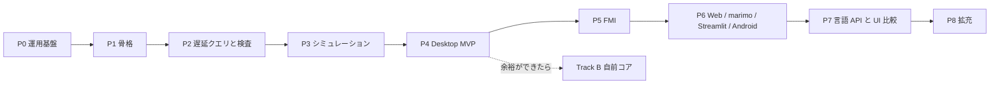

# GlobeMode ロードマップ

- 版: v0（2026-10-18、S001）。
- **P** は開発の段階（Phase）、**S** はセッション番号（`doc/sessions/SNNN-*`）。
- 1 つの Phase は複数のセッションにまたがる。セッションの数は目安。

## 全体

## Phase ごとの範囲と完了条件

| Phase | 範囲 | 完了条件 | 目安 |
| --- | --- | --- | --- |
| **P0 運用基盤** | 調査、計画、CLAUDE.md、スキル、セッション記録のフック、スライドと解説書の型 | S001 の成果物がそろう。フックが伏せ字版を出力する。リンク切れが 0 件 | S001 |
| **P1 骨格**（S003 で完了） | workspace 化、mise の rust の targets、cargo-deny、CI（Linux / Windows / wasm）。core / ir / frontend / cli。MSL の取得スクリプト。Python パッケージの改名 | `cargo deny check` が通る。MSL の例題 20 本で `globe check` の結果が Rumoca と一致する。frontend が wasm32 向けにビルドできる。[ADR-0003](adr/0003-toolchain.md) が Accepted になる | 3 回（workspace と CI / アダプタと CLI / wasm の確認） |
| **P2 遅延クエリと検査**（S004〜S010。完了条件は S008 で 3 つとも満たした。S9・S10 は S010 で足した。S10 の数値の部分は P3） | db、outline、class_index、connect_graph、`assert_simulatable` の S0〜S10 | 空白だけの編集の再検査が 50 ms 未満で、`flat` が再実行されない（salsa のイベントで確かめる）。MSL の全例題に判定が出て、panic は 0 件。S5 が omc と 95% 以上一致する | 4 回 |
| **P3 シミュレーション**（S011 で着手。完了条件の 1 つ目と 2 つ目は S011 で、3 つ目（wasm）は S012 で満たした。1 つ目と 2 つ目は S012 の既定（`auto`）で測り直した） | exec、driver、bdf / esdirk34 / tsit45 / dopri / 固定刻み、ResultStore | MSL の例題 153 本以上が実行できる。そのうち 90% 以上が参照結果のファネルに収まる。bdf が wasm で（Node 上で）動く | 5 回 |
| **P4 Desktop MVP** | CodeMirror 6 と LSP、ライブラリツリー、検査パネル、プロット、sigma.js の connect グラフ | ChuaCircuit で開く・検査・実行・プロットが通る。5k ノードのグラフが 30 fps 以上で動く。RSS の基準値を記録する。CI が .deb と .msi を作る | 6 回 |
| **P5 FMI** | Import（ME / CS / SE）とマスター。Export は P5a（Rumoca のテンプレート）の後に P5b（自前のランタイム） | Reference-FMUs が linux64 と win64 で一致する。Export した FMU が FMPy・fmusim・fmuCheck を通る。Clocks（SE）が往復できる | 8 回 |
| **P6 Web / marimo / Streamlit / Android** | WorkerBackend、MSL のパッケージ単位の分割読み込み、anywidget、wheel、APK | ブラウザが CSP `connect-src 'self'` のまま実行できる（サーバーで計算しない）。marimo の WASM で 2 GB 未満に収まる。Android API 34 のエミュレータで検査と実行が通る | 5 回 |
| **P7 言語 API と UI 比較** | C / Zig / Julia、Elixir / Gleam、Python。Leptos 版と Dioxus 版、負荷の測定ハーネス | 参照シナリオが 6 言語で通る。`doc/bench/ui.md` に 3 UI × 3 OS の比較を書く | 6 回 |
| **P8 拡充** | radau5、SUNDIALS、ESDIRK / CERK、SSP 2.0.1、Diagram ビュー、BLT デバッガ | ソルバの表がそろう。SSP が往復できる | 未定 |
| **Track B 自前コア** | B1 rowan の CST と寛容なパーサ → B2 resolve → B3 flatten → B4 DAE。`Frontend` の feature `native` として作る | 段階ごとに Rumoca 以上の数字を出す（parse 566 / flatten 562 / balanced 464 / simulate 153）。`xtask diff-frontend` で回帰が 0 件になったら既定を切り替える | P4 以降、余裕ができてから |

Track B の B1〜B2 は IDE の機能（補完、アウトライン）から先に使える。コンパイルのパイプラインは引き続き Rumoca が受け持つ。ただし AST が別物なので、両者を混ぜるのは「IDE 機能か、コンパイルか」の境目に限る。

## 進み具合

### S002（P1 の 1 回目、2026-10-18）で済んだこと

- ルートを virtual workspace にし、4 つの crate を作った: `globe-mode-core`、`globe-mode-ir`、`globe-mode-frontend`（Rumoca アダプタ）、`globe-mode-cli`（`globe outline` / `globe check`）。
- **Rumoca v0.10.2（`276e82bd`）の `rumoca-compile` が、stable 1.99.1 でビルドできることを確かめた**。
  - ネイティブでも `wasm32-unknown-unknown` でも `cargo check` が通る。
  - これで [ADR-0003](adr/0003-toolchain.md) を Accepted にした。
- `mise.toml` に wasm と Android の target、cargo-deny、`mise run check` / `mise run docs:check` を足した。
- `deny.toml` を作った。
  - ライセンス・bans・取得元はすべて ok。
  - `rumoca-compile` を使えるのはアダプタだけに限った（wrappers）。違反させて検出できることも確かめた。
- CI の雛形（`.github/workflows/ci.yml`）を作った。Linux・Windows・wasm・Python とスライドの検査の各ジョブ。**まだ push していないので、実行は確かめていない**。
- Python パッケージを `globe_mode`（`src/Python/mod/`）に改名した。

### P1 の残り（S003〜）

| 完了条件 | 状態 |
| --- | --- |
| `cargo deny check` が通る | 済（S002） |
| frontend が wasm32 向けにビルドできる | 済（S002、`cargo check`） |
| ADR-0003 が Accepted | 済（S002） |
| MSL の例題 20 本で `globe check` の結果が Rumoca と一致する | 済（S003、20 本中 20 本） |
| CI が GitHub 上で通る | 済（run 39093072719、全ジョブ成功） |

### S003（P1 の 2 回目、2026-10-18）で済んだこと

- `cargo xtask fetch-msl`: MSL 4.1.0 を sha256 で確かめて `data/msl/` に展開する。
- `cargo xtask fetch-rumoca`: Rumoca の CLI v0.10.2 を取得する（照合用。Linux の x86_64 と aarch64。S017 で aarch64 を足した）。
- `globe check --library data/msl -m <モデル>`: MSL の中のモデルを検査できるようにした。
- `cargo xtask msl-compare`: 例題 20 本で Rumoca の CLI と突き合わせた。**20 本すべて一致**（[報告](sessions/S003-msl-check/msl-compare.md)）。
- CI に `msl` ジョブを足した（全体を検査するときだけ）。
- これで **P1 の完了条件はすべて満たした**。

### S004（P2 の 1 回目、2026-10-18）で済んだこと

- `globe-mode-db`（salsa 0.28.5）を作った。クエリは `outline` → `outline_shape`（位置を落とした防火壁）→ `class_index` → `connect_graph`。
- `globe-mode-graph`: connect グラフを flatten せずに作る。
  - 辺の種類は flow / stream / real / boolean …。
  - depth で部分回路を展開できる。
  - 出力は graphology の JSON。CLI は `globe graph`。
- 検証用のパッケージ `src/Modelica/GlobeModeValidation` を作った。
  - Real の potential / flow、Real と Boolean の信号、Medium の流体ポート、階層、型の誤りのモデルを入れた。
  - OMEdit などでも開けるパッケージの構成にした。
- **空白とコメントだけの編集では、`class_index` と `connect_graph` が再実行されないことをテストで確かめた。**
  - 再計算は中央値 0.20 ms で、目標の 50 ms 未満。
- Rumoca v0.10.2 の制約を見つけた（ライブラリとして読んだクラスから別のライブラリを extends できない）。作業中のパッケージは文書として読んで回避した。

### S005（P2 の 2 回目、2026-10-18）で済んだこと

- **検査（S0〜S6）を salsa のクエリにした**（[ADR-0005](adr/0005-lazy-query-db.md) の結果）。
  - 防火壁 0 の `source_shape`（コメントを除き空白を畳んだ本文）を足した。計画では `outline` を防火壁にしていたが、Rumoca に渡せるのは本文なので直した。
  - クエリは `source_shape` → `check`（S0〜S5）→ `dae_shape`（防火壁 2）→ `structural`（S6）。診断の位置は `shape_map` で元の本文に戻す。
  - **空白とコメントだけの編集では `check` が再実行されない**ことをテストで確かめた。再検査は中央値 0.01 ms。
- **MSL は一度だけ読む**。`Checker` が、MSL を読んだ Rumoca の `Session` を使い回す。読んだあとの別のモデルの検査は 0.12 s。
- `globe-mode-analysis` を作った: Hopcroft–Karp と粗い Dulmage–Mendelsohn 分解（S6、Rumoca に依存しない）。
  - **S6 の判定は、`x` と `der(x)` を 1 つの列にまとめた二部グラフ**で行う。最初は der の形で判定し、MSL の正しい例題 166 本を構造特異にしてしまったので直した。der の形の結果は、S7 の情報 `GM-I7001`（微分インデックスが 1 より大きい見込み）にした。
- **GM-U の振り分けを決めた**（[ADR-0007](adr/0007-unsupported-classification.md)）: Rumoca のコードの規則（`GM-U0001` / `GM-U0002`）と、既知の制約の一覧 50 行（`GM-U0003`）の併用。omc との照合は任意（S005 では未実施。S008 で行い、一覧の 50 本は全部 omc で通った）。
- **MSL の全例題 566 本に判定を出した**（`cargo xtask msl-funnel`、[報告](sessions/S005-check-queries/msl-funnel.md)）。例題の選び方は Rumoca と同じ名前の規則で、本数も Rumoca の基準値と一致した。
  - 最終の結果: OK 369（うち S7 の情報 154）・NG 13（S5 1・S6 12）・GM-U 184・panic 0。S6 で止まった 12 本は、Examples の下にある接地の無い部品モデル（`OpAmpCircuits.*`、`FluxTubes…Components.*`）で、単体で検査すると電位が 1 つ決まらない。omc では未確認。
  - 最初の実行では flatten 532 / DAE 382 / balanced 381 本が通り、Rumoca の基準値（flatten 494 / DAE 305 / balanced 293）を上回った。基準値は Rumoca の別の commit（`b92932c0`）で記録されたものなので、差の内訳は確かめていない。
- 検証用のモデル `Invalid.StructurallySingular`（S6 で止まる）と `Invalid.HighIndexDuplicate`（S6 は通り、S7 の情報が出る）を足した。
- CLI: `globe check` を db 経由にし、S6 と GM-U を表示する。`globe flat` で flat モデルの要約を出す。

### S007（P2 の 3 回目、2026-10-18）で済んだこと

- 範囲は S007 の候補のうち `deps_closure`（1）、S7（3）、S8（4）。**omc との照合（5）はユーザーの指示で後回し**にした（omc 未導入。OpenModelica のサイトが重くて取得できない。入れたら再開する）。`Checker` のメモリ（2）は P4 のプロセス構成が決まってから、上流への報告（6）はユーザーが出す。`class_index` の残り（7）は import だけを扱った。
- **`deps_closure`**: `check` に渡すファイルを、モデルが使うものだけに絞った（[ADR-0005](adr/0005-lazy-query-db.md) の結果）。
  - 識別子の単純名と、ファイルが定義するトップレベルのクラスの名前を突き合わせ、固定点まで広げる。広めに見積もり、足りないことは無い。
  - `Connect.RealCircuit` の閉包は 5 / 23 ファイル。閉包だけの検査と全ファイルの検査は、検証用パッケージのモデル 20 本以上のすべてで一致した。
  - 使わないファイルの式を変えた後の再検査は、`check` 0 回で中央値 0.19 ms（MSL を使う `MediumFlow`、release）。代わりに、閉包の違うモデルへ初めて切り替えると、Rumoca が MSL ごと解決し直すので約 1.7 s かかる（全ファイルを渡したままなら 67 ms）。
  - CLI: `globe deps <files> -m <model>` で閉包を見られる。
- **S7（Pantelides 法と状態選択の候補）**と **S8（初期化系の検査）**を足した（[ADR-0009](adr/0009-structural-index-and-init.md)）。
  - S7 は情報にとどめる（`GM-I7001` インデックス 2 以上、`GM-I7002` 状態選択が要る）。打ち切りだけ `GM-E7001`。
  - S8 は初期条件の数と属性で判定する。要る数には S7 の動的な状態の数を使う。過剰は `GM-E8001`（離散変数を含むか、インデックスの低減で状態が減るときは、確定できないので警告 `GM-W8004`）、不足は `GM-W8001`・`GM-W8002`、値の無いパラメータは `GM-W8003`。
  - 検証用のモデル `Index.Pendulum`（インデックス 3、動的な状態 2 / 4）、`Index.ParallelCapacitors`（インデックス 2、動的な状態 1 / 2）、`Init.*` の 5 本を足した。`Invalid.HighIndexDuplicate` は、動的な状態が 0 で `fixed = true` が 1 つ余るので、S8 の警告 `GM-W8004` を出して通る。
  - `globe check` に S7・S8 の行と `--json` の `s7` / `s8` / `init`。`check_model` は S0〜S8。
- `msl:funnel` の報告の置き場を [msl-funnel.md](msl-funnel.md) に固定した。S7・S8 の列と集計を足した。
  - 最初の実行で、MSL の正しい例題 3 本（インデックス 2 で、拘束でつながった状態すべてに `fixed = true`）が S8 の Error になったので、過剰の規則を直した（[ADR-0009](adr/0009-structural-index-and-init.md)）。
  - 最終の結果: 566 本: OK 369（うち S7 の情報 154）・NG 13（S5 1・S6 12・S7 0・S8 0）・GM-U 184（82 / 52 / 50）・panic 0。OK・NG の本数は S005 と同じ。S7 を回した 369 本の構造インデックスは 1 が 215・2 が 58・3 が 95・4 以上が 1・打ち切り 0、状態選択が要るもの 154。S8 の 369 本は合う 111・過剰の見込み 3（`GM-W8004`。Error 0）・不足 255・入力なし 0、`GM-W8003` あり 2。S6 と Rumoca の照合 381 / 381。検査 833.0 s（1 本 1.47 s）、最大 RSS 7.2 GiB。
- テストは workspace 全体で 209 本が通過。clippy 0 件、fmt の差分 0。

### S008（P2 の 4 回目、2026-10-19）で済んだこと

- 範囲は S008 の候補のうち **omc との照合（1）だけ**。ユーザーが OpenModelica 1.27.1 を入れたので、S007 で後回しにした項目を最初に再開した。方法は [ADR-0010](adr/0010-omc-comparison.md)、報告は [omc-compare.md](omc-compare.md)。
- **`cargo xtask omc-compare`**（`mise run msl:omc`）: `msl-funnel --json` の結果を入力に、omc を別プロセスで呼んで `checkModel`（方程式数・変数数）と `translateModel`（バックエンドまで）の結果を突き合わせる。omc に読ませる MSL は `data/msl` の素の 4.1.0（omc 同梱の `+maint.om` ではない）。50 本ごとに 1 プロセス、落ちたら 1 本ずつ再実行。`--reuse` で omc を呼ばずに照合だけやり直せる。
- **結果（566 本、omc は 391 s）**: S5 は判定のある 382 本すべてで一致（**100%。P2 の完了条件を達成**）。GM-U 184 本は全部 omc の `checkModel` で数が合い、既知の制約の一覧（`GM-U0003`）の 50 本は全部 omc で通った。S6 は 363 本中 362 本、S8 の過剰は 355 本中 354 本が一致。globe が S6 で止めた 12 本のうち 7 本は omc も特異（残り 5 本は omc が手前の「fixed なパラメータに値が無い」で止まる）。globe の `GM-W8004` の 3 本は omc も「over specified」で、余分な本数まで同じ。
- 食い違い 2 本（`AdvancedSolenoid`: globe は通し omc は Pantelides の内部エラー。`NonCircularPipes`: globe は不足、omc は冗長な初期方程式 2 本）は S009 の候補にした。
- `msl:funnel` は JSON（`target/msl-funnel.json`、`counts.unknowns` を追加）も残すようにした。ファネルを回し直した本数は S007 と同じ（OK 369・NG 13・GM-U 184・panic 0）。

### S009（P2 の 5 回目、2026-10-19）で済んだこと

- 範囲は S009 の候補のうち **omc と食い違った 2 本の調査（1）** と **S8 の精密化（3）**。1 の調査で `NonCircularPipes` の食い違いが「数だけの S8 は冗長を見られない」ことだったので、3 をそのまま主な実装にした。方法は [ADR-0011](adr/0011-init-system-matching.md)。
- **`AdvancedSolenoid` は S6 の限界**（直さない）: 接地の無い部品の単体の検査で、枝 8 本 ≥ 節点 7 つなので二部グラフには完全マッチングがあるが、キルヒホッフの電流則が数値的に従属（電位は差しか決まらない）。omc は記号的な簡約の後に `0.0 = 0.0` を見つけて止める（`-d=bltdump`）。構造の検査では捕まえられないので、S10 のプリフライトで初期化のヤコビ行列の階数を見る候補にした。検証用のモデル `Invalid.UngroundedLoop` に記録（`Connect.Subsystem` のように枝 < 節点 なら構造でも特異で、S6 で止まる）。
- **S8 の精密化**: 初期化系（DAE とその微分 + 初期方程式 + `fixed = true`）を二部グラフにして、最大マッチングと DM 分解で**冗長な初期条件**（過剰な部分）と**初期条件の無い未知数**（不足している部分）を名指しする（`globe-mode-analysis/src/init_system.rs`）。数だけの判定は「不足 − 冗長」しか分からなかった。
  - `InitStructure` に初期方程式の参照（`der(x)`・代数、状態そのもの、パラメータ、離散）と、初期化で決めるパラメータへの DAE の方程式からの参照を足した。フロントエンドは `structure.rs` と同じ鍵で写す。
  - 過剰は、過剰な部分に DAE の行（拘束やその微分）があれば `GM-W8004`（整合する値なら冗長なだけ。omc も Warning で外す）、無ければ `GM-E8001`。不足は `GM-W8001` と、不足している部分の start の無い状態に `GM-W8002`。両方あれば両方出す。
  - `globe check` の S8 にマッチングの行、`--json` の `s8.matching`。`msl-funnel` の S8 の列に「冗長 k・決まらない m」、`omc-compare` の S8 の照合は「過剰 = 冗長が 1 つ以上」。
  - 検証用のモデル `Init.RedundantAndMissing`（数は 1 / 1 で合うが、冗長 1・決まらない 1）。
- **Rumoca v0.10.2 の制約を 2 つ見つけた**（どちらも S8 の入力が欠けたり誤ったりする。GlobeMode 側では直せないので記録し、上流への報告の候補にした）。(1) `outer` の参照を `inner` の修正ではなく型の既定で評価する。MSL の Fluid の例題 11 本は `inner Modelica.Fluid.System system(energyDynamics = FixedInitial)` の形なので、`PartialDistributedVolume` の `if` の中の初期方程式（`mediums.p = ps_start` など）が globe の DAE に無く、S8 が「不足」になる。`NonCircularPipes` で omc が冗長と言う 2 本はこれ（globe の入力に無い）。検証用のモデル `Init.OuterModification` と db のテスト（Rumoca が直ったら落ちる）に記録。(2) 例題の `wheelSet(theta1(fixed = true))` のような修正が、部品の中の同名の `wheelSetJoint.theta1`（MSL は `fixed = false` で外している）にも漏れる。`RollingWheelSetDriving` / `RollingWheelSetPulling` で S8 が「冗長 7」を出し、omc（過剰と言わない）と食い違うのはこのため。検証用のモデル `Init.ModifierScope` と db のテストに記録。
- **MSL の全例題**（`mise run msl:funnel`、[msl-funnel.md](msl-funnel.md)）: 566 本: OK 369・NG 13（S5 1・S6 12）・GM-U 184・panic 0（S007・S008 と同じ本数）。S8 まで来た 369 本すべてで初期化系をマッチングできた（射影の失敗 0）。S8 の分布は合う 111・過剰 6（すべて `GM-W8004` の見込み。Error 0）・不足 252（S008 は 合う 111・過剰 3・不足 255。冗長と不足を両方持つ 3 本が過剰に移った）。検査 723.8 s（1 本 1.28 s）、全体 748 s、最大 RSS 7.1 GiB。
- **omc との照合**（`cargo xtask omc-compare --reuse`。omc は S008 の結果を再利用、[omc-compare.md](omc-compare.md)）: S5 382 / 382、S6 362 / 363（`AdvancedSolenoid`。上の限界）、**S8（過剰）352 / 355**（S008 は 354 / 355）。不一致 3 本はどれも Rumoca の制約で入力が欠けるか誤るもの: `NonCircularPipes`（inner/outer で初期方程式が消え、omc の冗長 2 本が globe の入力に無い）、`RollingWheelSetDriving` / `RollingWheelSetPulling`（修正の漏れで別名の両方が `fixed = true` になり、globe が冗長 7 を出す）。globe の `GM-W8004` の 3 本（`GenerationOfFMUs` 2 本、`CompareLineTrunks`）は omc も過剰で、冗長の本数（2・3・1）まで一致した。
- テストは workspace 全体で 232 本が通過（S008 は 216 本）。clippy 0 件、fmt の差分 0。

### S010（P2 の 6 回目、2026-10-19）で済んだこと

- 範囲は S010 の候補のうち **S9・S10（3）**、**離散変数の when の区別（1）**、**閉包の切り替えの費用（2）**。5 つのサブエージェントが所有するファイルを分けて同時に作業した（S9 の BLT と tearing、S9 の線形・非線形の判定、S10、閉包、S8 の when）。`Checker` のメモリ（4）は P4 のプロセス構成が決まってから、上流への報告（5）はユーザーが出す。
- **S9（代数ループ）**（[ADR-0012](adr/0012-loops-and-preflight.md)）: BLT（Hopcroft–Karp と再帰を使わない Tarjan 法）で大きさ 2 以上のブロックを見つけ、貪欲な tearing で反復変数を選び、非線形のループの反復変数に start 値が無ければ `GM-W9001`（警告）。ループがあれば `GM-I9001`（情報）。インデックス 2 以上のモデルは Pantelides 法の最高階の系で数える（状態選択の前の見込み）。線形・非線形は、フロントエンドが残差の式木を族の単位で広めに判定する（`DaeStructure::nonlinear`）。
- **S10（プリフライトの静的な部分）**（[ADR-0012](adr/0012-loops-and-preflight.md)）: パラメータと start 値を Rumoca の評価器で評価し、非有限は `GM-E10001` / `GM-E10003`、関数の中の assert の失敗は `GM-E10002`。experiment annotation は Rumoca が不正な値を黙って捨てるので、根のクラスの本文を読み直して生の値で判定する（`GM-E10004` / `GM-W10001` / `GM-I10001`）。t0 の残差・初期化のヤコビ行列の階数・ソルバの能力は P3 の実行系ができてから。
- **S8 の離散変数の when の区別**（[ADR-0011](adr/0011-init-system-matching.md) の S010 の追記）: when の中で決まる・when の外の式で決まる・`when initial()` で決まるを分け、初期化でも成り立つ離散の方程式を行に足した（MLS §8.6）。決まり方の分かる離散変数の不足と冗長は確定させた。
- **閉包の切り替えの費用**（[ADR-0005](adr/0005-lazy-query-db.md) の結果）: `Checker` に文書の和集合を持たせた。一度検査したモデルへ編集なしで戻るときは約 2.1 s → **49 ms**。Rumoca の Session にはライブラリの解決だけを残す道が無いので、文書の組を変えないようにした。閉包の違うモデルを初めて検査するときは今も約 1.7〜2.0 s。
- 検証用のモデル 20 本: `Loops.*` 4 本、`Preflight.*` 10 本、`Init.Discrete*` 6 本（[src/Modelica/README.md](../src/Modelica/README.md)）。
- **MSL の全例題**（`mise run msl:funnel`、[msl-funnel.md](msl-funnel.md)）: 566 本: OK 369・NG 13（S5 1・S6 12）・GM-U 184・panic 0（S009 と同じ本数）。S8 の分布は **合う 269**・過剰 6（すべて `GM-W8004`）・**不足 94**（S009 は 111・6・252。離散変数の区別で StateGraph などの「不足」が「合う」に移った）。S9 は 369 本すべてで解析し、代数ループのあるもの 226・非線形のループのあるもの 142・`GM-W9001` のあるもの 57（反復変数 188 個）、一番大きいループは `MultiBody.Examples.Loops.EngineV6` の 4584 本（最高階の系）。**ループの大きさの一覧は Rumoca の構造解析と、微分の要らない 215 本すべてで一致**。S10 は Error 0（experiment annotation の無い 16 本に `GM-I10001`）。検査 849.8 s（1 本 1.50 s。S009 は 1.28 s。後半に `msl:compare` を同時に回したので揺れを含む）、最大 RSS 7.1 GiB。
- **omc との照合**（`mise run msl:omc`、omc を回し直した。[omc-compare.md](omc-compare.md)）: S5 382 / 382、S6 362 / 363、S8（過剰）352 / 355（S009 と同じ）。**S9（非線形のループの有無）282 / 355（79.4%）、S9（start の無い非線形の反復変数の有無）312 / 355（87.9%）**。omc は別名の消去と式の変形を先にするので有無だけを比べた。食い違いの主な見込みは、線形の判定が方程式ごとの集合しか持たないこと（`v = R*i` の `R` がループの外で決まっても非線形とみなす。`ShowVariableResistor`）。
- テストは workspace 全体で 324 本が通過（S009 は 232 本）。clippy 0 件、fmt の差分 0。`msl:compare` は 20 / 20。

### S011（P3 の 1 回目、2026-10-19）で済んだこと

- 範囲は S011 の候補 1（P3 の始め: 実行系と S10 の数値の部分）。Rumoca の実行系と参照結果の調べもの 2 つを先に並べ、その結果で骨格を固めてから、所有するファイルを分けた 3 つのサブエージェント（exec、sim、xtask）を同時に走らせた。
- **実行系 `globe-mode-exec`**（[ADR-0013](adr/0013-exec-backend.md)）: Phase A は Rumoca の実行系（`rumoca-sim`。diffsol の BDF と Rumoca の Dormand–Prince 5(4)）をそのまま使い、`globe-mode-exec` に閉じ込めた。Rumoca のモデルを自前の `HybridSystem` で包む公開の API が無いため、自前の driver は FMU（P5）と Track B で作る。diffsol は Rumoca が数値の修正を当てた版を `[patch]` で使う（Rumoca の CLI と同じ数値）。結果は中立の `SimRun`、失敗は `Stage::Run` の診断（`GM-E11001`〜`GM-E11006`、`GM-I11001`、`GM-W11001`、`GM-U0004` / `GM-U0005`）。
- **S10 の数値の部分**: start 値で評価して t0 で代数変数と導関数が有限か（`GM-W10002`。初期化で変わりうるので警告）、ソルバの名前（`GM-E10005` / `GM-I10003`）。初期化のヤコビ行列の階数は Rumoca に公開の API が無いので送った。
- **`globe-mode-sim`**: ソルバの名前の登録表（`bdf`・`dopri45`・`auto`、別名、未実装のもの）、設定の決定（指定 > experiment > 既定。出どころも返す）、CSV の読み書き、参照結果との比較（csv-compare の矩形の管を書き直したもの。許容差 0.002）。Rumoca に依存しない（wasm32 でビルドできる）。
- **`globe simulate`**: 検査（S0〜S10）を通してから実行し（Error があれば `--force` が無い限り実行しない）、`--output` に CSV を書く。db に `GlobeDb::compiled_model`（`check` と同じ文書で DAE を返す）。
- 検証用のモデル `Simulation.*` 12 本（[src/Modelica/README.md](../src/Modelica/README.md)）。
- **MSL の全例題の実行**（`mise run msl:sim`、[msl-sim.md](msl-sim.md)）: OK の 369 本のうち partial の 12 本を除く 357 本を別プロセスのワーカーで実行し、**303 本が終了時刻まで進んだ**。MAP-LIB の参照結果（v4.1.0）と比べた 302 本のうち **292 本（96.7%）が管に収まった**。止まった 54 本は、実行系が未対応 26・初期化 6・積分 6・時間切れ 5・実行系の内部エラー 4・外から停止（120 s）7。全体 31 分 52 秒、ワーカーの最大の常駐メモリ 3.5 GiB。
- テストは workspace 全体で 422 本が通過（S010 は 324 本）。`msl:compare` は 20 / 20。

### S012（P3 の 2 回目、2026-10-19）で済んだこと

- 範囲は S012 の候補のうち **bdf を wasm で動かす（1）** を中心に、**自前の積分器（3）**、**パラメータを変えた再実行と MAT v4（4）**、**止まった 54 本と管から外れた 10 本の調査（2）**。調べもの 3 つ（wasm の試作、積分器・再実行・MAT の調査、止まった例題の調査）を先に並べ、その結果で骨格を固めてから、所有するファイルを分けた 5 つのサブエージェント（実行系の本体、自前の積分器、wasm、sim と CLI、xtask）を同時に走らせた（ユーザーの指示で Opus・effort medium）。候補 5〜10 は持ち越した。
- **session の道**（[ADR-0014](adr/0014-session-route-wasm.md)）: Rumoca の FMI ME 風の host（公開の関数だけ）に数値積分のプラグイン（`MeIntegratorBackend`）を差して回す道を `globe-mode-exec` に 1 つ作り、wasm32 のすべてのソルバと自前の積分器に使う。ネイティブの `bdf`・`dopri45`・`auto` は S011 の型付きの道のまま。`Simulation.*` 12 本の bdf で、2 つの道は**ビット単位で同じ**（dopri45・auto も一致）。
- **wasm**（`globe-mode-wasm`、wasm32-unknown-unknown + wasm-bindgen 0.2.129）: 検査（S0〜S10）→ DAE への変換 → 実行が Node v24.22.0 で通った。ライブラリ（MSL）はファイルの組で 1 回だけ読む（Rumoca の in-memory の組）。`mise run wasm:compare` の 117 件（`Simulation.*` 13 本 × 9 ソルバ）のうち 114 件がネイティブと一致し、bdf・dopri45・auto は全件一致（最大 3 ulp）。MSL の `ChuaCircuit` も bdf で回った（Node で検査 2.8〜3.2 s・実行 0.45〜0.5 s。MSL の読み込みは 10.5〜11.9 s で 1 回だけ）。最適化した wasm は 14.5 MB（gzip 4.48 MB）。CI に Node のジョブ `wasm-node` を足した。
- **自前の積分器 6 つ**: diffsol の `esdirk34`・`trbdf2`・`tsit45`（Rumoca のプラグインを写して改変）と、固定刻みの `euler`・`heun`・`rk4`（`--step`、既定は出力の間隔）。使えるソルバは 9 つ。大域誤差の次数の実測は euler 1.03・heun 2.06・rk4 4.06。MSL の `Electrical.Analog.Examples` 54 本では bdf 50 本が実行・48 本が管、esdirk34 42・39、tsit45 40・36（予算 30 s）。
- **`auto` の切り替え**: BDF が積分に失敗したとき（`GM-E11002`）とサンプラが食い違ったときも dopri45 で回し直し、`GM-I11002` で知らせる（S011 は方向微分が作れないときだけ黙って切り替えていた）。MSL の `TwoMass` が通る。
- **パラメータの上書き**（再コンパイル無し）: `globe simulate --param NAME=VALUE`、`--list-parameters`。変えられないもの・無い名前・有限でない値は `GM-E10006`。プリフライトも上書きを反映する。検証用のモデル `Simulation.Parameters`。
- **結果の MAT v4**（`globe simulate --format mat`）: OpenModelica・Dymola の dsres の形。scipy・DyMat 0.7 で読め、omc 1.27.1 の実物と同じスクリプトで同じに読めた。Arrow IPC は持ち越し（OpenModelica の形式が 0.1 の開発版、依存が 25 増える）。
- **設定の検査**: 許容誤差が 1e-10 未満なら 1e-10 に上げる（`GM-W10003`）、固定刻みは許容誤差を使わない（`GM-I10004`）、刻み幅の検査（`GM-E10004`）。
- **止まった 54 本と外れた 10 本の調査**（[research/msl-sim-failures.md](research/msl-sim-failures.md)）: Rumoca の CLI では通るのに GlobeMode で止まるものは 0 本。GlobeMode で直せるもの（`auto` の切り替え、許容誤差の下限、時間切れの回し直し、比べる前のイベントの行の正規化、既知の外れの一覧、例題でないものを外す、ワーカーの段の知らせ）を直した。上流への報告の候補 9 つを分けた。
- **MSL の全例題の実行**（`mise run msl:sim`、既定 `auto`、時間切れは 180 s で回し直す）: 対象 356 本（partial の 12 本と例題でない `SpacePhasorLimiter` を除く）のうち **309 本が終了時刻まで進み**（S011 は 303 本、+6）、参照結果と比べた 308 本のうち **299 本（97.1%）が管に収まった**（S011 は 292 / 302 本、+7。信号の数で 1753 / 1772）。止まった 47 本（S011 は 54 本）は、実行系が未対応（GM-U0004）24・初期化 6・時間切れ 5・積分 4・イベント 1・外から停止 7（どれも実行系の段）。GM-U0005（サンプラの食い違い）は 4 → 0。時間切れの 6 本を予算 180 s で回し直して 1 本が通った。`auto` が dopri45 に切り替えたもの（GM-I11002）は 11 本で、うち 4 本が最後まで進んだ。管から外れた 9 本のうち 2 本は既知の外れ（`src/Modelica/msl-sim-known-deviations.txt`）。新しく実行できた 6 本のうち `GenerationOfFMUs` は、Rumoca と同じ規則（初期化で方向微分が作れない）で RK に切り替わって最後まで進むが、温度が動かず管から外れる（調査の上流への報告の候補 6「RK で黙って誤った結果」）。全体 2945.8 s（49 分。回し直しを含む。S011 は 31 分 52 秒）、ワーカーの最大の常駐メモリ 3.4 GiB（[msl-sim.md](msl-sim.md)）。
- テストは workspace 全体で 485 本が通過・10 本 ignore（S011 は 422 本）。clippy 0 件。

### S013（P3 の 3 回目、2026-10-19〜20）で済んだこと

- **`auto` は方向微分が作れないときに切り替えない**（[ADR-0015](adr/0015-auto-and-reference-tolerance.md)）: S011 から残っていた「組み立て・初期化で方向微分が作れなければ dopri45」をやめた。MSL で当たっていた `GenerationOfFMUs` は RK で温度が動かない誤った結果だったので、`GM-U0004` で止まるほうを選んだ。
- **参照結果と同じ許容誤差で突き合わせる**: `cargo xtask msl-sim --tolerance-scale <倍率>`。注釈に Tolerance があるモデルだけ倍率を掛け、無ければ 1e-6 のまま（MAP-LIB の参照結果の作り方と同じ）。`mise run msl:sim` は 0.1 で回す。`globe simulate` の既定は変えない。
- **既知の外れの一覧**に `DoublePendulumInitTip`（カオス的。許容誤差を 1/10 にすると悪くなる）を足した。
- **MSL の全例題の実行**（[msl-sim.md](msl-sim.md)）: 実行できた 309 → **308**（`GenerationOfFMUs` が止まる）、参照結果と比べた 307 本のうち **301 本（98.0%）** が管に収まった（S012 は 299 / 308、+2）。外れ 6 本のうち 3 本は既知の外れ。

### S014（P3 の 4 回目、2026-10-20）で済んだこと

- **プリフライトの lowering を 1 回にした**（[ADR-0016](adr/0016-preflight-on-build-lowering.md)）: bdf・auto と session の道は、組み立ての lowering の結果でプリフライトを行う（ネイティブの dopri45 だけは単独のまま）。`run` の時間（release）は `DoublePendulum` で 0.39 s、lowering で止まる `Fluid.Examples.HeatingSystem` で 4.26 s 減った。`FullRobot` は 111.6 s → 57.9 s。
- **実行系の中の段を知らせる**: `globe_mode_exec::run_with_progress` と `ExecStage`（プリフライト・lowering・組み立て・初期化・積分）。`msl-sim` のワーカーは親に送り、外から止めたものに最後の段を付ける。外から止めた 7 本は **7 本とも lowering の段**で止まっていた（[research/msl-sim-failures.md](research/msl-sim-failures.md) の節「S014 で直したもの」）。
- **MSL の全例題の実行**（[msl-sim.md](msl-sim.md)）: 356 本のうち 307 本が実行でき、300 / 306 本（98.0%）が管に収まった（S013 は 308 本・301 / 307 本。P3 の完了条件は満たしたまま）。減った 1 本の `LightningSegmentedTransmissionLine`（S013 で 115 s）は 120 s の外からの停止に変わった。機械の負荷（15 分の平均 10〜12、16 コア）のためで、同じ負荷では S013 の実行ファイルでも外から止まった（空いた機械では S014 のほうが速い）。外から止めた 9 本の最後の段は、S013 の 7 本が 7 本とも lowering、残りは `FullRobot` がプリフライト（lowering が約 118 s で終わった直後）、`LightningSegmentedTransmissionLine` が積分。

### S015（P3 の 5 回目、2026-10-20）で済んだこと

- **MSL の実行の上限と回し直し**（[ADR-0017](adr/0017-lowering-limit-and-hard-timeout-retry.md)、`cargo xtask msl-sim` の中だけ）: lowering の段に別の上限（`--lowering-kill-seconds`、既定 150 s）を掛け、外から止めたもの（その上限で止めたものを除く）も時間切れと同じく予算 180 s で回し直す。親は段ごとの秒を記録する（JSON の `stage_times`、報告の「lowering の段の長いもの」）。
- **外から止めた 7 本を 600 s で回した**（[research/msl-sim-failures.md](research/msl-sim-failures.md) の節「S015 で調べたこと」）: 3 本は lowering が終わらない、2 本は約 520 s で `GM-U0004`（EL005）、`EngineV6` は 169 s で終わる（lowering 64 s）、`DrumBoiler` は lowering が約 117 s で終わり、**GlobeMode のプリフライト（t0 の評価）が 481 s で終わらない**。120 s より短い上限では、終わる lowering と終わらない lowering を分けられないので、「早く見切る」はしなかった。
- **MSL の全例題の実行**（[msl-sim.md](msl-sim.md)、空いた機械）: 356 本のうち **309 本**が実行でき、**301 / 308 本**（97.7%）が管に収まった（S014 は 307 本・300 / 306 本）。増えたのは `EngineV6`（回し直しで。管は 2 / 4 で外れ）と `LightningSegmentedTransmissionLine`。全体の時間は 3733 s。

### S016（P3 の 6 回目、2026-10-21）で済んだこと

- **DrumBoiler のプリフライトが終わらない原因を調べた**（[research/msl-sim-failures.md](research/msl-sim-failures.md) の節「S016 で調べたこと」）: 止まっているのはプリフライトの評価（`eval_at`）ではなかった。Rumoca の実行時オブジェクトの組み立て（`SolveRuntime::new`）の中で、根の条件 31 本（計 59.7 万演算）の構造解析が終わらない。組み立ての段も同じ所を通るので、プリフライトに上限を掛けても実行できる本数は増えない。**上限は掛けず、上流に回した**（[ADR-0018](adr/0018-no-preflight-limit.md)）。コードは変えていない。
- **EngineV6 の管の外れの原因を調べた**（同じ節）: Rumoca の初期化の不具合。初期化方程式（`filter` の `initType=SteadyState`）を、関係式 `v_rel < 0` の既定値 false で解き、初期化の後に関係式が反転しても解き直さない。t = 0 で `filter.x` が 0.066（参照 563.19）。小さいモデル（`if v < 0` を読む `CriticalDamping`）で再現し、omc は正しい。既知の外れの一覧には載せず（実行系の不具合なので）、上流の候補にした。
- WSL のメモリが 3 GB の機械で回したので、`msl:funnel`・`msl:sim` の全体は回していない（コードも変えていない）。

### P3 の完了条件の進み具合

| 完了条件 | 状態 |
| --- | --- |
| MSL の例題 153 本以上が実行できる | **済**（S011）。303 本（[msl-sim.md](msl-sim.md)）。S012 の既定（`auto`、時間切れの回し直し）で測り直した: **309 本**（S011 から +6）。S013 で `auto` が方向微分の失敗で切り替えなくなり 308 本 |
| そのうち 90% 以上が参照結果のファネルに収まる | **済**（S011）。参照結果と比べた 302 本のうち 292 本（96.7%）。MAP-LIB の参照結果（v4.1.0）と csv-compare の矩形の管（許容差 0.002）。S012 で比べる前にイベントの行を整えるようにして測り直した: 308 本のうち **299 本（97.1%）**（+7） |
| bdf が wasm で（Node 上で）動く | **済**（S012）。`globe-mode-wasm`（wasm32-unknown-unknown + wasm-bindgen）を Node v24.22.0 で回し、`Simulation.*` 13 本の bdf がネイティブと全件一致（最大 3 ulp）、MSL の `ChuaCircuit` も bdf で回った（t = 3686 s まで一致し、その後はカオスで分かれる）。`Instant::now()` を呼ぶ型付きの道を避け、Rumoca の FMI ME 風の host に BDF のプラグインを差す session の道で回す（[ADR-0014](adr/0014-session-route-wasm.md)）。CI のジョブ `wasm-node` で Decay を回す |

### P2 の完了条件の進み具合

| 完了条件 | 状態 |
| --- | --- |
| 空白だけの編集の再検査が 50 ms 未満で、下流が再実行されない | **済**（S005）。S0〜S6 の再検査が中央値 0.01 ms（最大 0.02 ms、リリースビルド、20 回）。`check`（Rumoca の flatten を含む）は再実行されない（salsa のイベントで確かめた） |
| MSL の全例題に判定が出て、panic は 0 件 | **済**（S005）。566 本すべてに判定。panic 0 件。S007 で S0〜S8 にして回し直した: OK 369・NG 13・GM-U 184・panic 0（S005 と同じ本数。S7・S8 の Error は 0） |
| S5 が omc と 95% 以上一致する | **済**（S008）。omc 1.27.1 の `checkModel` と、判定のある 382 本すべてで一致（100%）。方程式数と未知数が同じ数なのは 307 本（違いは `Clocked` のクロック変数など、両側に同じだけ付く）。S6 は 363 本中 362 本、S8 の過剰は 355 本中 354 本が一致。報告は [omc-compare.md](omc-compare.md)、方法は [ADR-0010](adr/0010-omc-comparison.md) |

## 次のセッション

**S017** の候補（P3 の完了条件は 3 つとも満たした。P3 の残りは、止まった例題、ソルバの範囲の残り、ブラウザの前提）:

### S017（運用、2026-10-22）で済んだこと

- 範囲は「S017 の最初にやること」の 3 つ（下）。Claude の実行場所を Raspberry Pi（aarch64、4 コア、RAM 7.9 GiB、glibc 2.36）に移した。決定は [ADR-0019](adr/0019-rpi-aarch64-environment.md)。製品のコードは変えていない。
- **`fetch-rumoca` の aarch64**: `RUMOCA_ASSET: Option<(ファイル名, sha256)>` を `cfg!(target_arch)` の const で選び、`msl-compare` の `--rumoca` の既定も同じ名前にした。対応していない機械では `None`（ビルドは通し、実行時に断る）。RPi で `mise run msl:compare` は 20 / 20 本が一致（ビルド込み 1055 s）。
- **RPi の環境**: mise 本体（linux-arm64）、`mise install --locked` で rust 1.99.1・cargo-deny・wasm-bindgen・zig・julia・gleam・erlang・uv が入り、`uv sync` も通った。**elixir だけ失敗**（erlang の arm64 ビルドが hex.pm の ubuntu-26.04 向けで `GLIBC_2.38` を要求。RPi は 2.36）。`MISE_DISABLE_TOOLS=elixir` で外して進めた。`mise run check` は全段通過（3798 s。x86_64 よりかなり遅い）。
- **メモリ**: swap を dphys-swapfile の 512 MB から 8 GB にした（ユーザーの選択）。`mise run msl:funnel`（release）は RPi で **566 本: OK 369・NG 13・GM-U 184・panic 0**（S010 以降と同じ本数）。検査 1312.7 s（1 本 2.32 s。x86_64 は 1.50 s）、全体 24.6 分、最大 RSS 6.5 GiB（swap の使用 1.1 GiB）。テストは 487 本が通過・10 本 ignore。
- 持ち越し: elixir（erlang のソースビルドか apt）、`msl:sim`（実行系を変えていないので回していない。参照結果も未取得）。

### S018（P3 の 7 回目、2026-10-22）で済んだこと

- **初期化の解き直しの検査**（候補の 4。[ADR-0020](adr/0020-init-resettle-check.md)）: Rumoca は初期化方程式の残差を評価する関数を公開していない（`eval_initial_residual` は crate の中の trait）。代わりにプリフライトで初期化系を 2 回解き（1 回目は Rumoca の初期化と同じ順、2 回目はその結果から）、2 回目で動いた変数のうち実行が始まった t0 の値も違うものを警告 GM-W10004 で知らせる（`run` だけ。Rumoca の初期イベントの反復で解き直されるモデル `IMC_Initialize` を誤って拾わないため）。実行は変えない。最小の再現 `GlobeModeValidation.Simulation.InitRelationBranch`（x = 2 → 1）を足した。
- MSL での結果（RPi、`msl:sim`）: 356 本のうち実行できた 307、管に収まった 300 / 306、GM-W10004 は 0 本（EngineV6 は RPi では外から止まるので、単独で回して確かめた）。詳しくは [msl-sim.md](msl-sim.md) と作業記録。
- **次に残したこと**: 根の条件の無いモデルでは解き直しを省く（ADR-0020 の案 D。`LightningSegmentedTransmissionLine` は解き直しの分で RPi の 240 s の上限に当たるようになった）。レビューの指摘（解き直しの panic で GM-W10002 も消える、t0 の値との比較の単体試験）を直す。

### S019（P3 の 8 回目、2026-10-24）で済んだこと

- **解き直しの後始末**（[ADR-0021](adr/0021-resettle-only-when-relations-flip.md)）: 初期化の解き直しは、1 回目のあとに関係式の記憶が変わったモデルだけで行う（ADR-0020 の案 D を狭めた形）。S018 のレビューの指摘（解き直しの panic で GM-W10002 を失う、判定の単体試験が無い、差の式の重複、使っていない値、コメント）を直した。`mise run check` は 489 本が通り、失敗 0。
- **次に残したこと（ユーザーの決定、2026-10-24: 次回から作業は PC）**: 最初に `msl:funnel`・`msl:sim`・`wasm:node`・`wasm:compare` を回し、EngineV6 の警告、MSL で GM-W10004 が 0 本、`Lightning` の費用を確かめる（S019 は RPi で締めたので未実施。**S020 で済んだ**）。

### S020（P3 の 9 回目、2026-10-24〜25）で済んだこと

- S019 が PC に回した 4 つの検査を WSL（x86_64、RAM 3 GB + swap 16 GB）で回した。`msl:funnel` は 566 本: OK 369・NG 13・GM-U 184・panic 0（S017 と同じ）。`msl:sim` は 356 本のうち実行できた 309・管に収まった 301 / 308（97.7%。S015 と同じ）。**GM-W10004 は `EngineV6` の 1 本だけ**（`filter.x = 0.066 → 563`。ほかの 355 本は 0）。`wasm:node` は通り、`wasm:compare` は 126 件中 123 件が一致（既知の差 3、一致しない 0）。ADR-0021 は直さない。コードは変えていない。
- `msl:sim` を Claude Code の背景で回すとメモリ不足で止められる（2 回）。この PC ではユーザーの端末で `nohup` で回す。

### S021（P3 の 10 回目、2026-10-25）で済んだこと

- **自前の積分器の詰め**（候補 2）: esdirk34 が bdf で通る MSL の回路で落ちる原因は、diffsol の SDIRK が Newton 法の失敗を積分全体で累積して数え、既定の 50 回で止まること（BDF は 1 歩の中で数える）。SDIRK の問題を組むときに上限を外した（`rk.rs` の 1 行。刻みの下限が暴走を止める）。`Electrical.Analog.Examples` 54 本の esdirk34 は実行 42 → 45、管 39 → 42。全体 356 本は 実行 272・管 262 / 271（96.7%。auto は 309・301 / 308）。最小の再現 `GlobeModeValidation.Simulation.DiodeSwitching` と回帰の試験を足した。
- tsit45 の射影の失敗は硬い回路で最初の刻みから発散するもので、Rumoca の host が試しの点の射影の発散を復帰不能の失敗として記憶する。Rumoca 自身の dopri45 も同じ所で失敗するので直さない。heun の既定の刻みも変えない（`Rotational.Examples` 7 本で 3 / 7。`ElasticBearing` は発散）。上流への報告の候補 12・13（[research/msl-sim-failures.md](research/msl-sim-failures.md)）。
- **次に残したこと**: esdirk34 が `OvervoltageProtection` で終了時刻まで進むが誤った軌道になる（直す前も同じ軌道で止まっていた）。`CauerLowPassSC`・`HeatingRectifier`・`ThyristorBehaviourTest` の残り。 **S022 で OvervoltageProtection を直した。**

### S022（P3 の 11 回目、2026-10-27）で済んだこと

- **esdirk34 の残り**: `OvervoltageProtection` で黙って誤った軌道になる原因は、diffsol の SDIRK がヤコビ行列を段の未知数ではなく状態の点（`phi + c·y`、状態の約 1.4 倍）で取ること。指数で立ち上がるツェナーではその点の `J` が 1e15 になり、Newton 法と誤差の見積もりが潰れる。プラグインのヤコビ行列の閉包で刻みの始めの受理した状態を使うようにした（`rk.rs`）。esdirk34・trbdf2 とも bdf と一致（CL.v(0.4) = -0.00062）。上流への報告の候補 14。
- `Electrical.Analog.Examples` 54 本の esdirk34 は実行 45 → 48、管 42 → 46（`HeatingRectifier` も同じ直しで通る）。trbdf2 は 48・45。全体 356 本の esdirk34 は 実行 282・管 273 / 281（97.2%。S021 は 272・262 / 271）。残り: `CauerLowPassSC`（イベントの後の再開で刻みが縮む）、`ThyristorBehaviourTest`（esdirk34 だけ射影の発散）、`--param` で時間イベントのパラメータが効かない件。 **S023 で CauerLowPassSC を直し、`--param` の原因を確かめた。**

### S023（P3 の 12 回目、2026-10-27）で済んだこと

- **RK の再開の最初の刻み**: `CauerLowPassSC` の esdirk34・trbdf2 が t = 1.05 で止まる原因は、状態がほぼ 0 で導関数が大きい再開で diffsol の最初の刻みの見積もり（`0.01·‖y‖/‖f‖`）が 2e-16 になり、刻みの下限 1e-13 を割って 1 歩も試さないこと。`rk.rs` の `initial_state()` で下限の 10 倍まで持ち上げた。最小の再現 `GlobeModeValidation.Simulation.TinyStateRestart` と回帰の試験を足した。上流への報告の候補 15。全体 356 本の esdirk34 は 実行 282 → 286、管 273 → 277（サイリスタの整流器 4 本）。
- **`--param` で時間イベントの時刻が変わらない**: Rumoca の DAE の段が時刻を既定値で畳んで静的な時間イベントにするため（上流の候補 16）。直していない。手元で直すなら `Session::set_structural_overrides` で組み込んでコンパイルし直す道で、frontend・キャッシュ・wasm に届くので ADR を書いてから。
- 残り: `ThyristorBehaviourTest`（esdirk34 だけ射影の発散）。

### S024（P3 の 13 回目、2026-10-28）で済んだこと

- **パラメータの上書き**: `--param` は時間イベントだけでなく、同じ名前の修飾で写された値（`SineVoltage` の `f` など）にも届かず、黙って誤っていた（Rumoca の instantiate が外側の値を内側の束縛に書き込む）。上書きがあれば、ライブラリだけの session を複製して `set_structural_overrides` で組み込んでからコンパイルし直す（[ADR-0022](adr/0022-structural-parameter-overrides.md)）。CLI と wasm の両方。上流の候補 17・18。
- **`ThyristorBehaviourTest` の esdirk34**: 消弧の後の再開で最初の刻み（4.05e-6）が大きく、Newton 法の試しの点で host の射影が失敗し、復帰不能として記憶される（候補 19）。再開の刻みを抑えれば通るが、崖が見積もりのすぐ下にある調整なので入れていない。通しても diffsol の Hermite の補間が硬い変数で外れる（候補 20）。

### S025（P3 の 14 回目、2026-10-28）で済んだこと

- **配列のパラメータの上書き**（S024 の積み残し）: 要素（`a[2]`、`t[1]`）は実行時の上書きで直接使う配列と時間イベントに届く。配列全体（`a`）は以前 ED020 の「未対応」だったのを `GM-E10006` にした。同じ名前の修飾で内側へ写された配列の要素（`src.k[1]`）は内側に届かず黙って誤っていたので、変換の前に `GM-E10006` で断る（名前の形だけで見分ける。[ADR-0022](adr/0022-structural-parameter-overrides.md)）。Rumoca の構造的な上書きはスカラだけで、上流の候補 21。再現 `GlobeModeValidation.Simulation.ArrayParameters` と試験を足した。

### S026（P3 の 15 回目、2026-10-28）で済んだこと

- **固定刻みの陰的ソルバ**（候補 6 の一部）: `impeuler`（陰的 Euler 法）と `trapezoid`（台形公式）を θ 法として `plugins/fixed.rs` に差した。1 歩ごとに Newton 法で解き、ヤコビ行列は部品の方向微分から密に作る。解けなければ失敗にする。`Decay` で次数 0.97・2.00、硬い減衰（hλ = -100）で理論の増幅率と一致。

### S027（P3 の 16 回目、2026-10-29）で済んだこと

- **自前の係数表の SDIRK**（候補 6 の一部）: `esdirk23`（Jørgensen らの ESDIRK23。`trbdf2` と同じ方法）、`esdirk45`（Kennedy–Carpenter の ESDIRK5(4)7L[2]SA2）、`sdirk34hw`（Hairer–Wanner の SDIRK4。補間の係数つき）を diffsol の `Tableau::new` で SDIRK の道に差した。係数の写し間違いは、根つき木で 6 次までの次数条件を確かめる試験で捕まえる。

### S028（P3 の 17 回目、2026-10-29）で済んだこと

- **`dopri853`**（候補 6 の一部）: SciPy の DOP853 の係数を 13 段の FSAL の表にして、diffsol の陽的 RK に差した。誤差は 5 次の埋め込みだけで見積もる（Hairer の 5 次と 3 次の組み合わせではない）。刻みの間は 3 次の Hermite 補間。根つき木の次数条件の試験を 8 次まで広げた。

### S029（P3 の 18 回目、2026-10-29）で済んだこと

- **`cerk23`・`cerk34`・`cerk45`**（候補 6 の一部）: Owren–Zennaro の連続の陽的 RK 3(2)・4(3)・5(4)（OrdinaryDiffEq.jl の有理数の係数から生成）を diffsol の陽的 RK に差した。補間の多項式は `beta` に渡し、刻みの間も主解と同じ次数になる。主解・埋め込み・補間の次数条件を試験で確かめる。

### S030（P3 の 19 回目、2026-10-29）で済んだこと

- **`radau5`**（候補 6 の一部）: 自前の Radau IIA（3 段 5 次、刻み幅は自動）。簡略 Newton 法で 3n×3n の密な LU、誤差は 3 次の埋め込み（係数は自分で導いて試験で確かめる）、補間は Hermite。`DiodeSwitching` で `bdf` との差は最大 9.6e-7（許容誤差 1e-6 の内側）。

### S031（P3 の 20 回目、2026-10-30）で済んだこと

- **`qss`**（候補 6 の一部）: 自前の QSS2（量子化状態法の 2 次）。事象ごとに `f` 全体を呼び（依存の構造を持たない）、硬い系に弱い（LIQSS なし。壁時計の上限で止まる）。`DiodeSwitching` で `bdf` との差は v で最大 5.8e-7、`BouncingBall` は跳ねる回数が同じ。

### S032（P3 の 21 回目、2026-10-30）で済んだこと

- **`cvode`**（候補 6 の一部）: SUNDIALS 7.1.1 の CVODE（BDF、可変次数）を `sundials-sys` 0.6.2 で呼ぶ（feature `sundials`。同梱のソースを cmake で静的にビルドする）。密な線形ソルバと差分商のヤコビ行列だけで、根探索は使わない。feature を立てないビルド（既定・wasm・CI）は変わらない。`DiodeSwitching` で `bdf` との差は v で最大 9.4e-6、`BouncingBall` は跳ねる回数が同じ。CI は feature つきのビルドを回していない。

### S034（P3 の 22 回目、2026-10-30）で済んだこと

- **`ida`**（候補 6 の残り）: SUNDIALS 7.1.1 の IDA を同じ feature `sundials` に足した。ホストは ODE を渡すので残差 y' − f(t, y) として解き、`IDACalcIC` は呼ばず y'0 = f を導関数 1 回で求める。密な線形ソルバ、差分商のヤコビ行列、根探索なしは `cvode` と同じ。`DiodeSwitching` で `bdf` との差は v で最大 5.8e-7、`BouncingBall` は跳ねる回数が同じ。これで登録表の計画のソルバは feature `sundials` のビルドでは 0 になった。

### S035（P4 の準備、2026-10-30）で済んだこと

- **`globe-mode-protocol` と facade `globe-mode`**（[計画書](plan/2026-10-30-release-estimate-and-parallel-plan.md)の WP-0）: CLI の `--json` と wasm の `Request` / `Response` の形をそのまま protocol の serde 型（`CheckResponse`・`SimulateRequest`・`SimulateResponse`・`ParametersResponse`）に昇格させ、facade の `Workspace` が db の `check_model` / `compiled_model_with_overrides` と exec の `run` を呼ぶ。CLI と wasm はこの 2 つに依存する（wasm の直接の依存は facade だけ）。新しい計算は入れていない。JSON は 1 バイトも変えていない（CLI の snapshot 試験 `tests/snapshots/`）。例外は `simulate` が実行を断る文言の `--force` → `force`（facade は CLI のフラグ名を知らない）。
- 持ち越し: JSON Schema の書き出し（core・analysis の型に `JsonSchema` の derive が要る）。WP-A（LSP）・WP-B（ブラウザ UI）・WP-F（wasm の web target）・WP-G（Python）はここから同時に始められる。

### S044（P8 の 1 回目、2026-10-31）で済んだこと

- **v0.1 のリリース工程**（[計画書](plan/2026-10-30-release-estimate-and-parallel-plan.md)の WP-I）: `.github/workflows/release.yml`（タグ `v*` の push で `globe` を linux x86_64・linux aarch64（`ubuntu-24.04-arm`）・windows x86_64 でビルドし、`.tar.gz` / `.zip`（`globe`・LICENSE-MIT・LICENSE-APACHE・README）と `SHA256SUMS` を Release に付ける。手動は dry-run で artifact だけ。`sundials` は付けない。cargo-dist は使わない）、`CHANGELOG.md`（S001〜S041）、`[workspace.package]` の metadata（`publish = false` と version は変えない）、README の Install。ビルドは CI の dry-run で確かめる。
- 持ち越し: タグ `v0.1.0-rc1` の dry-run、配布物のサードパーティのライセンス表（cargo-about）、署名・deb・msi（WP-C と一緒に）。

### S042（P4 の 4 回目、2026-10-31）で済んだこと

- **実行とプロットの UI**（[計画書](plan/2026-10-30-release-estimate-and-parallel-plan.md)の WP-D、最小の形）: `App.svelte` に「実行」ボタン（`Backend.simulate`、`refused` と診断は既存の診断パネル）。`src/Svelte/src/lib/plot/` に CSV を列に分ける `csv.ts` と uPlot の `Plot.svelte`（信号のチェックボックス、既定は最初の 3 本。ズームは uPlot の既定）。npm は uPlot（MIT、依存なし）を足して 58 パッケージ、GPL・NC は 0。Playwright の試験に、Decay の実行でプロットの canvas と系列が出ること、選択を外すと系列が消えること、10 万点 × 4 状態の結果を描く時間の測定を足した。実装は Sonnet のサブエージェント 1 人。
- 持ち越し: 2 軸、凡例の凝った UI、MAT v4 の読み込み、ChuaCircuit のスクリーンショット試験、結果を列ごとに返す API（CSV の解析が 10 万点で約 0.3 s かかる）。

### S041（P4 の 3 回目、2026-10-31）で済んだこと

- **ブラウザ UI の骨格**（[計画書](plan/2026-10-30-release-estimate-and-parallel-plan.md)の WP-B）: `src/Svelte` に pnpm + Vite + Svelte 5 + TypeScript の最小の UI。`Backend { setFile, check, simulate }`、S036 の `GlobeWorker` を包む `WorkerBackend`（wasm を Web Worker で。CSP `connect-src 'self'`）、CodeMirror 6 のエディタ、検査パネル（診断を S0〜S10 と error / warning / info で並べ、押すとエディタの範囲へ）。`globe-mode-wasm` に `check`（実行しない検査）を足した。Playwright の試験 1 本（Decay は error 0、Bad は GM-E5002）、CI のジョブ `ui`、`mise.toml` に node・pnpm と `ui:check`。npm は 57 パッケージで GPL・NC は 0（MPL-2.0 の lightningcss はビルド時だけ）。`GlobeWorker` が起動で落ちた worker を無限に作り直す問題（worker.js が 404 で 8 秒に 914 回）を直した。実装は Sonnet のサブエージェント 1 人。
- 持ち越し: 実行の UI、プロット（WP-D）、グラフ（WP-E）、`TauriBackend`（WP-C）、protocol の JSON Schema からの型の生成、CodeMirror と `globe lsp` の接続。

### S040（P4 の 2 回目、2026-10-31）で済んだこと

- **ADR-0023 Desktop と Web のプロセス構成**（[計画書](plan/2026-10-30-release-estimate-and-parallel-plan.md)の WP-J、[adr/0023](adr/0023-desktop-and-web-process-layout.md)）: 検査と実行は UI のプロセスから分け、ワーカーは 1 つで 1 度に 1 要求、落ちたら作り直す。Desktop は `globe` の CLI を Tauri の sidecar にして `globe lsp` の stdio の枠に独自の要求を足す（専用のワーカー crate は作らない）。Web は Web Worker のまま、線形メモリの目標 128 MiB（MSL の後）/ 1 GiB（1 モデルの後）、上限 2 GiB で作り直し。`Checker` の内側に上限は入れない（持ち越し 9）。測定: ChuaCircuit の検査の最大 RSS 1.48 GiB、`globe lsp` の起動 3 ms / MSL あり 2.3〜2.8 s。architecture §4 を書き換えた。
- 持ち越し: sidecar の独自の要求の名前と形（WP-C）、Android の sidecar（P6）、線形メモリの上限の実測（P6）。
### S039（P7 の 1 回目、2026-10-31）で済んだこと

- **Python の wheel**（[計画書](plan/2026-10-30-release-estimate-and-parallel-plan.md)の WP-G）: 新しい crate `globe-mode-py`（PyO3 0.30、abi3-py312、facade だけに依存）を maturin で `src/Python/mod/globe_mode` の `_native` に入れた（`pyproject.toml` の build-backend を uv_build から maturin に）。`Workspace{set_file, load_dir, check, graph, simulate}` と `solvers()` の入出力は JSON の文字列で、`__init__.py` が `dict` と polars の表（`table()`）にする。参照シナリオ（`src/Python/tests/test_api.py`）: `load_dir(src/Modelica)` → `Decay` の check → `RealCircuit` の graph → `Decay` の simulate → x(1) が e⁻¹ と一致。wheel は 17.3 MB（linux x86_64）。CI の `python` のジョブに rust と `pytest`。実装は Sonnet のサブエージェント 1 人。
- 持ち越し: `graph` がライブラリとして読んだモデルを引けない、Arrow での結果の受け渡し、他の OS の wheel、anywidget。

### S038（P4 の 1 回目、2026-10-30）で済んだこと

- **`globe-mode-lsp`**（[計画書](plan/2026-10-30-release-estimate-and-parallel-plan.md)の WP-A）: stdio の LSP サーバ `globe lsp --library DIR`。`lsp-types` の型と自前の JSON-RPC で、診断（最上位の model / block / class を facade の `check` に通す）・documentSymbol・hover の 3 つだけ。実装は Sonnet のサブエージェント 1 人（計画書のモデル B）。CLI の統合試験が `Invalid.StructurallySingular` を開いて `GM-E6001` を受け取る。
- 持ち越し: パッケージの中のモデルの検査、hover の説明文字列、エディタでの動作確認、Tauri / Web Worker の transport。

### S036（P3 の 23 回目、2026-10-30）で済んだこと

- **ブラウザの Web Worker**（候補 3 の前半、[plan](plan/2026-10-30-release-estimate-and-parallel-plan.md) の WP-F）: `wasm:build` が同じ .wasm から `--target web` の糊も作る（`target/wasm-pkg/web`）。`globe-mode-wasm/web/worker.js` はブラウザの module Worker と Node の `worker_threads` で共用し、`client.js` の `GlobeWorker` が呼び出しを直列にする。panic（`WebAssembly.RuntimeError`）の後は Worker を捨てて作り直し、ライブラリとファイルを再生する。`mise run wasm:web`（Node と Playwright の Chromium）で Decay（bdf）の x(1) の誤差 2.7e-8、panic の後も同じ値。CI の `wasm-node` に Node の Worker の試験を足した。Rust は変えていない。
- 持ち越し: MSL を読んだ後の線形メモリを減らす分割読み込み。作り直しは MSL 全体の読み直しを含む（約 13 s）。

### S037（P3 の 24 回目、2026-10-31）で済んだこと

- **MSL の分割読み込み**（候補 3 の残り）: wasm の `Workspace` の既定を分割読み込みにした（`globe-mode-frontend` の `Checker::with_library_sources_split`、字句の走査は `split_library.rs`）。ライブラリのファイルは本文のまま持ち、検査のたびにモデルと作業中の文書から名前（絶対・字句的なスコープ・`import`）をたどって、使うファイルだけを Rumoca の Session に足す（足りないときは Session を作り直して文書を足し直す。読んだものは外さない）。`mise run wasm:node` で、読み込み後の線形メモリ 262 → 62 MiB、`ChuaCircuit` の後 513 → 113 MiB。全部を読む道は JS の `new Workspace(json, name, true)` で残した（1 ファイルに 2 つ以上のトップレベルのクラスがあるライブラリ向け）。ネイティブの CLI と `msl:funnel` の道は変えていない。
- **`msl:sim` を GitHub Actions で回す道**: `.github/workflows/msl-sim.yml`（手動だけ）。ランナーで `msl:funnel` と `msl:sim` を回し、報告と JSON を artifact `msl-sim` に残す。前回の `target/msl-sim.json` は actions/cache から戻す。
- 持ち越し: 分割読み込みの閉包が狭すぎると Rumoca の名前解決が失敗する。`msl-compare.txt` の 20 本で全部を読んだときと検査の結果が一致することは試験（`tests/split.rs`、`--ignored`）で確かめたが、566 本すべては確かめていない。

**S017 の最初にやること（ユーザーの指示、2026-10-22）**: Claude の実行場所を Raspberry Pi（aarch64）に移す。RPi での最初のセッションでは、下の候補より先に次を片付ける。**S017 で済んだ（上）。**

- **`cargo xtask fetch-rumoca` を aarch64 に対応させる**: 今は Linux x86_64 でないと断る（`src/Rust/xtask/src/main.rs:468`）。Rumoca の v0.10.2 には `rumoca-linux-aarch64` がある（sha256 `c12704c0f04af338dc32ab35801e45c322f9d64a26e0555a9f2b0b5901a2f7a9`、静的リンクの ELF。https://github.com/CogniPilot/rumoca/releases/tag/v0.10.2 、2026-10-22 確認。ARM の機械では動かしていない）。`target_arch` で URL・sha256・ファイル名を選び、`msl-compare` の `--rumoca` の既定も同じ名前にする。`mise run msl:compare` で突き合わせが通ることを確かめる。
- **RPi の環境をそろえる**: `mise install --locked`・`uv sync`（mise の各ツールに aarch64 の版があるか【未確認】）、`cargo xtask fetch-msl`、`mise run check` と CI と同じ検査が RPi で通るか。`msl:sim` の参照結果（約 1 GB）は要るときに取る。前回の `target/msl-sim.json` は Git に入っていないので、無ければ次の `msl:sim` は差を出さない。
- **メモリを確かめる**: `msl:funnel` は最大 RSS 7.2 GiB。RPi のメモリで回せるか、回せないなら全体の実行をどうするか（ADR に書く）を決める。

1. **止まった例題の残り**（[research/msl-sim-failures.md](research/msl-sim-failures.md)、[msl-sim.md](msl-sim.md)）: Rumoca の構造解析でインデックスの低減が足りない EL005 の 18 本、Solve IR への変換が終わらない Fluid の例題など。多くは上流の問題なので、上流への報告（8）と合わせて扱う。管から外れた 6 本のうち既知の外れでない 3 本（`Clocked` の `RotationalSample`・`LogicalSample` は t = 1 の状態イベントと時間イベントの重なり、`Dimmer_R` は窓の更新の時刻での高調波の位相）。
2. **自前の積分器の詰め**（**S021 で主な件を済ませた**。残りは S021 の節）: `esdirk34` が bdf で通る 5 本で落ちる（diffsol の非線形の失敗、刻みが小さすぎる）、`tsit45`・`esdirk34` の 5 本で射影が収束しない（`GM-E11002`）。固定刻みの既定の刻み（出力の間隔）では `heun` の精度が足りない（MSL の `Rotational.Examples` 7 本で 3 / 7）。陽的 RK もヤコビ行列つきで作っている（diffsol の `ClosureNoJac` が非公開）。
3. **ブラウザ**（P6 の前提。**S036 で Worker と作り直しを、S037 でメモリを済ませた**）: ~~`wasm-bindgen --target web` と Web Worker で回す。panic の後の `Workspace` は使えないので作り直す道を作る。MSL を読んだ後の線形メモリ 262 MiB（`ChuaCircuit` の後 513 MiB）を減らす（パッケージ単位の分割読み込み）。~~ 残りは UI（計画書の WP-B）。
4. **初期化の後の初期化方程式の検査**（S016。**S018 で済んだ**: 初期化系をもう一度解いて動けば GM-W10004。[ADR-0020](adr/0020-init-resettle-check.md)）: Rumoca の初期化は、初期化方程式が関係式を読むと、関係式の既定値で解いて解き直さないことがある（`EngineV6`。[research/msl-sim-failures.md](research/msl-sim-failures.md) の節「S016 で調べたこと」）。GlobeMode は初期化の後に初期化方程式の残差を見ていないので、誤った初期値のまま黙って積分する。初期化の後に残差を評価して警告する案を考える（Rumoca に初期化方程式の残差を評価する公開の入口があるか【未確認】）。`DrumBoiler`（実行時オブジェクトの組み立てが終わらない）と lowering が終わらない 5 本は上流（8）。
5. **Arrow IPC**（ResultStore）: OpenModelica の `arrow.modelica`（`modelica.format` 0.1）の形が固まるのを待つか、自前の形で先に書くかを決める（arrow-rs 60 で依存が 25 増える）。
6. **残りの計画のソルバ**（**S034 で済んだ**: feature `sundials` のビルドで計画だけのソルバは 0。既定のビルドでは `cvode`・`ida` が `GM-E10005`）。S034 で `ida`（SUNDIALS の IDA に残差 y' − f。IDA の本領の DAE は使わない）を、S032 で `cvode`（SUNDIALS、feature `sundials`。密な線形ソルバだけ、CI は feature つきを回していない）を、S031 で `qss`（自前の QSS2。依存の構造を持たず事象ごとに `f` 全体、LIQSS なし）を、S030 で `radau5`（自前の Radau IIA。複素変換・ヤコビ行列の使い回しは省いたので状態の数が多いと遅い）を、S029 で `cerk23`・`cerk34`・`cerk45`（Owren–Zennaro、補間つき）を足した。S026 で `impeuler`・`trapezoid` を、S028 で `dopri853`（diffsol の陽的 RK に自前の係数表。13 段の FSAL で 8 次。刻み幅の制御は 5 次の埋め込みだけで `dop853.f` と違い、Hairer の 7 次の補間は追加の 3 段が要り `beta` で表せないので Hermite のまま）を、S027 で `esdirk23`・`esdirk45`・`sdirk34hw`（diffsol の SDIRK に自前の係数表）を足した。`esdirk23` は TR-BDF2 と同じ方法で、刻みの端の値は `trbdf2` と一致する（補間だけが違う。Decay・Oscillator の終点は 12 桁以上一致）。`esdirk45` は刻みの間の補間が Hermite（3 次）のまま（5 次の補間の係数は未調達）。
7. **S10 の初期化のヤコビ行列の階数**（持ち越し）: `Invalid.UngroundedLoop` は実行しても誤りにならない。Rumoca に公開の API が無い。
8. **Rumoca の制約を上流に報告する**（ユーザーが出す）: S011 までの分に、S012 の分（型付きの道の `Instant::now()`（wasm）、Cranelift の可否の関数 `admitted_native_execution_backend` が非公開、diffsol の `ClosureNoJac` が非公開、[research/msl-sim-failures.md](research/msl-sim-failures.md) の 9 つ: インデックス 2 以上の EL005、サンプラの端点の判定の丸め、Solve IR への変換が終わらず予算の外、理想スイッチで射影の収束の判定、fixed = true の代数変数から状態を解かない、RK で黙って誤った結果、RK の道で壁時計の予算が守られない、関数呼び出しの Solve IR の契約、同時イベントと clock）と、S016 の 10・11（`DrumBoiler`: 実行時オブジェクトの組み立てで巨大な根の条件の構造解析が終わらない、lowering で assert の登録を何度も写す。`EngineV6`: 初期化方程式を関係式の既定値で解き、反転しても解き直さない。小さい再現 R1 あり）を足す。
9. **持ち越し**: S9 を omc と照らして詰める、閉包の切り替えの残り（初めて検査するモデルも速くする）、`Checker` のメモリの上限（**S040 の [ADR-0023](adr/0023-desktop-and-web-process-layout.md) で決めた**: 内側に上限を入れず、別プロセスのワーカーを外から止めて作り直す。検査は最大 RSS 7.1 GiB）、字面の 0 除算の振り分け、S8 の残り、`class_index` の残り。

## 運用上の決まり

- リリースまでの見積もりと、他のエージェントに渡す並行作業の指示書は [plan/2026-10-30-release-estimate-and-parallel-plan.md](plan/2026-10-30-release-estimate-and-parallel-plan.md)（S033）。

- 各セッションでは `doc/sessions/SNNN-<topic>/` に `slides.html` と `解説書.md` を作る（[sessions/README.md](sessions/README.md)）。
- 計画を変えたら、この文書と該当する ADR を同じコミットで直す。
