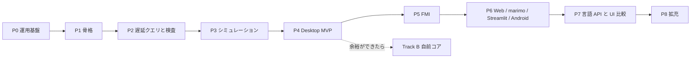

# GlobeMode ロードマップ

- 版: v0（2026-10-18、S001）。
- **P** は開発の段階（Phase）、**S** はセッション番号（`doc/sessions/SNNN-*`）。
- 1 つの Phase は複数のセッションにまたがる。セッションの数は目安。

## 全体

## Phase ごとの範囲と完了条件

| Phase | 範囲 | 完了条件 | 目安 |
| --- | --- | --- | --- |
| **P0 運用基盤** | 調査、計画、CLAUDE.md、スキル、セッション記録のフック、スライドと解説書の型 | S001 の成果物がそろう。フックが伏せ字版を出力する。リンク切れが 0 件 | S001 |
| **P1 骨格** | workspace 化、mise の rust の targets、cargo-deny、CI（Linux / Windows / wasm）。core / ir / frontend / cli。MSL の取得スクリプト。Python パッケージの改名 | `cargo deny check` が通る。MSL の例題 20 本で `globe check` の結果が Rumoca と一致する。frontend が wasm32 向けにビルドできる。[ADR-0003](adr/0003-toolchain.md) が Accepted になる | 3 回（workspace と CI / アダプタと CLI / wasm の確認） |
| **P2 遅延クエリと検査** | db、outline、class_index、connect_graph、`assert_simulatable` の S0〜S10 | 空白だけの編集の再検査が 50 ms 未満で、`flat` が再実行されない（salsa のイベントで確かめる）。MSL の全例題に判定が出て、panic は 0 件。S5 が omc と 95% 以上一致する | 4 回 |
| **P3 シミュレーション** | exec、driver、bdf / esdirk34 / tsit45 / dopri / 固定刻み、ResultStore | MSL の例題 153 本以上が実行できる。そのうち 90% 以上が参照結果のファネルに収まる。bdf が wasm で（Node 上で）動く | 5 回 |
| **P4 Desktop MVP** | CodeMirror 6 と LSP、ライブラリツリー、検査パネル、プロット、sigma.js の connect グラフ | ChuaCircuit で開く・検査・実行・プロットが通る。5k ノードのグラフが 30 fps 以上で動く。RSS の基準値を記録する。CI が .deb と .msi を作る | 6 回 |
| **P5 FMI** | Import（ME / CS / SE）とマスター。Export は P5a（Rumoca のテンプレート）の後に P5b（自前のランタイム） | Reference-FMUs が linux64 と win64 で一致する。Export した FMU が FMPy・fmusim・fmuCheck を通る。Clocks（SE）が往復できる | 8 回 |
| **P6 Web / marimo / Streamlit / Android** | WorkerBackend、MSL のパッケージ単位の分割読み込み、anywidget、wheel、APK | ブラウザが CSP `connect-src 'self'` のまま実行できる（サーバーで計算しない）。marimo の WASM で 2 GB 未満に収まる。Android API 34 のエミュレータで検査と実行が通る | 5 回 |
| **P7 言語 API と UI 比較** | C / Zig / Julia、Elixir / Gleam、Python。Leptos 版と Dioxus 版、負荷の測定ハーネス | 参照シナリオが 6 言語で通る。`doc/bench/ui.md` に 3 UI × 3 OS の比較を書く | 6 回 |
| **P8 拡充** | radau5、SUNDIALS、ESDIRK / CERK、SSP 2.0.1、Diagram ビュー、BLT デバッガ | ソルバの表がそろう。SSP が往復できる | 未定 |
| **Track B 自前コア** | B1 rowan の CST と寛容なパーサ → B2 resolve → B3 flatten → B4 DAE。`Frontend` の feature `native` として作る | 段階ごとに Rumoca 以上の数字を出す（parse 566 / flatten 562 / balanced 464 / simulate 153）。`xtask diff-frontend` で回帰が 0 件になったら既定を切り替える | P4 以降、余裕ができてから |

Track B の B1〜B2 は IDE の機能（補完、アウトライン）から先に使える。コンパイルのパイプラインは引き続き Rumoca が受け持つ。ただし AST が別物なので、両者を混ぜるのは「IDE 機能か、コンパイルか」の境目に限る。

## 次のセッション

**S002（P1 の 1 回目）** で行うこと:

1. ルートの `Cargo.toml` を virtual workspace にする。`src/main.rs` を `src/Rust/mod/globe-mode-cli` に移す。
2. `mise.toml` の rust に wasm と Android の `targets` を足す。`rust-toolchain.toml` は置かない（ツールの版は mise、依存は uv と cargo）。
3. `deny.toml`（許可リスト、`bans`、`wrappers`）と、CI の雛形（Linux / Windows / wasm）を作る。
4. Rumoca の `rev` を決めて `rumoca-compile` に依存させ、**stable でビルドできるか確かめる**。結果を ADR-0003 に書く。
5. Python パッケージを `20261018_globemode` から `globe_mode` に改名し、`src/Python/mod/` に移す。数字で始まる名前は import できないため。

## 運用上の決まり

- 各セッションでは `doc/sessions/SNNN-<topic>/` に `slides.html` と `解説書.md` を作る（[sessions/README.md](sessions/README.md)）。
- 計画を変えたら、この文書と該当する ADR を同じコミットで直す。
