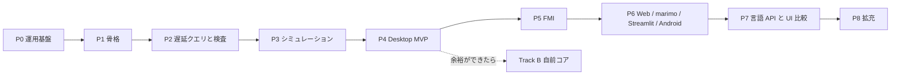

# GlobeMode ロードマップ

- 版: v0（2026-10-18、S001）。
- **P** は開発の段階（Phase）、**S** はセッション番号（`doc/sessions/SNNN-*`）。
- 1 つの Phase は複数のセッションにまたがる。セッションの数は目安。

## 全体

## Phase ごとの範囲と完了条件

| Phase | 範囲 | 完了条件 | 目安 |
| --- | --- | --- | --- |
| **P0 運用基盤** | 調査、計画、CLAUDE.md、スキル、セッション記録のフック、スライドと解説書の型 | S001 の成果物がそろう。フックが伏せ字版を出力する。リンク切れが 0 件 | S001 |
| **P1 骨格**（S003 で完了） | workspace 化、mise の rust の targets、cargo-deny、CI（Linux / Windows / wasm）。core / ir / frontend / cli。MSL の取得スクリプト。Python パッケージの改名 | `cargo deny check` が通る。MSL の例題 20 本で `globe check` の結果が Rumoca と一致する。frontend が wasm32 向けにビルドできる。[ADR-0003](adr/0003-toolchain.md) が Accepted になる | 3 回（workspace と CI / アダプタと CLI / wasm の確認） |
| **P2 遅延クエリと検査**（S004 から進行中） | db、outline、class_index、connect_graph、`assert_simulatable` の S0〜S10 | 空白だけの編集の再検査が 50 ms 未満で、`flat` が再実行されない（salsa のイベントで確かめる）。MSL の全例題に判定が出て、panic は 0 件。S5 が omc と 95% 以上一致する | 4 回 |
| **P3 シミュレーション** | exec、driver、bdf / esdirk34 / tsit45 / dopri / 固定刻み、ResultStore | MSL の例題 153 本以上が実行できる。そのうち 90% 以上が参照結果のファネルに収まる。bdf が wasm で（Node 上で）動く | 5 回 |
| **P4 Desktop MVP** | CodeMirror 6 と LSP、ライブラリツリー、検査パネル、プロット、sigma.js の connect グラフ | ChuaCircuit で開く・検査・実行・プロットが通る。5k ノードのグラフが 30 fps 以上で動く。RSS の基準値を記録する。CI が .deb と .msi を作る | 6 回 |
| **P5 FMI** | Import（ME / CS / SE）とマスター。Export は P5a（Rumoca のテンプレート）の後に P5b（自前のランタイム） | Reference-FMUs が linux64 と win64 で一致する。Export した FMU が FMPy・fmusim・fmuCheck を通る。Clocks（SE）が往復できる | 8 回 |
| **P6 Web / marimo / Streamlit / Android** | WorkerBackend、MSL のパッケージ単位の分割読み込み、anywidget、wheel、APK | ブラウザが CSP `connect-src 'self'` のまま実行できる（サーバーで計算しない）。marimo の WASM で 2 GB 未満に収まる。Android API 34 のエミュレータで検査と実行が通る | 5 回 |
| **P7 言語 API と UI 比較** | C / Zig / Julia、Elixir / Gleam、Python。Leptos 版と Dioxus 版、負荷の測定ハーネス | 参照シナリオが 6 言語で通る。`doc/bench/ui.md` に 3 UI × 3 OS の比較を書く | 6 回 |
| **P8 拡充** | radau5、SUNDIALS、ESDIRK / CERK、SSP 2.0.1、Diagram ビュー、BLT デバッガ | ソルバの表がそろう。SSP が往復できる | 未定 |
| **Track B 自前コア** | B1 rowan の CST と寛容なパーサ → B2 resolve → B3 flatten → B4 DAE。`Frontend` の feature `native` として作る | 段階ごとに Rumoca 以上の数字を出す（parse 566 / flatten 562 / balanced 464 / simulate 153）。`xtask diff-frontend` で回帰が 0 件になったら既定を切り替える | P4 以降、余裕ができてから |

Track B の B1〜B2 は IDE の機能（補完、アウトライン）から先に使える。コンパイルのパイプラインは引き続き Rumoca が受け持つ。ただし AST が別物なので、両者を混ぜるのは「IDE 機能か、コンパイルか」の境目に限る。

## 進み具合

### S002（P1 の 1 回目、2026-10-18）で済んだこと

- ルートを virtual workspace にし、4 つの crate を作った: `globe-mode-core`、`globe-mode-ir`、`globe-mode-frontend`（Rumoca アダプタ）、`globe-mode-cli`（`globe outline` / `globe check`）。
- **Rumoca v0.10.2（`276e82bd`）の `rumoca-compile` が、stable 1.99.1 でビルドできることを確かめた**。
  - ネイティブでも `wasm32-unknown-unknown` でも `cargo check` が通る。
  - これで [ADR-0003](adr/0003-toolchain.md) を Accepted にした。
- `mise.toml` に wasm と Android の target、cargo-deny、`mise run check` / `mise run docs:check` を足した。
- `deny.toml` を作った。
  - ライセンス・bans・取得元はすべて ok。
  - `rumoca-compile` を使えるのはアダプタだけに限った（wrappers）。違反させて検出できることも確かめた。
- CI の雛形（`.github/workflows/ci.yml`）を作った。Linux・Windows・wasm・Python とスライドの検査の各ジョブ。**まだ push していないので、実行は確かめていない**。
- Python パッケージを `globe_mode`（`src/Python/mod/`）に改名した。

### P1 の残り（S003〜）

| 完了条件 | 状態 |
| --- | --- |
| `cargo deny check` が通る | 済（S002） |
| frontend が wasm32 向けにビルドできる | 済（S002、`cargo check`） |
| ADR-0003 が Accepted | 済（S002） |
| MSL の例題 20 本で `globe check` の結果が Rumoca と一致する | 済（S003、20 本中 20 本） |
| CI が GitHub 上で通る | 済（run 39093072719、全ジョブ成功） |

### S003（P1 の 2 回目、2026-10-18）で済んだこと

- `cargo xtask fetch-msl`: MSL 4.1.0 を sha256 で確かめて `data/msl/` に展開する。
- `cargo xtask fetch-rumoca`: Rumoca の CLI v0.10.2 を取得する（照合用、Linux x86_64）。
- `globe check --library data/msl -m <モデル>`: MSL の中のモデルを検査できるようにした。
- `cargo xtask msl-compare`: 例題 20 本で Rumoca の CLI と突き合わせた。**20 本すべて一致**（[報告](sessions/S003-msl-check/msl-compare.md)）。
- CI に `msl` ジョブを足した（全体を検査するときだけ）。
- これで **P1 の完了条件はすべて満たした**。

### S004（P2 の 1 回目、2026-10-18）で済んだこと

- `globe-mode-db`（salsa 0.28.5）を作った。クエリは `outline` → `outline_shape`（位置を落とした防火壁）→ `class_index` → `connect_graph`。
- `globe-mode-graph`: connect グラフを flatten せずに作る。
  - 辺の種類は flow / stream / real / boolean …。
  - depth で部分回路を展開できる。
  - 出力は graphology の JSON。CLI は `globe graph`。
- 検証用のパッケージ `src/Modelica/GlobeModeValidation` を作った。
  - Real の potential / flow、Real と Boolean の信号、Medium の流体ポート、階層、型の誤りのモデルを入れた。
  - OMEdit などでも開けるパッケージの構成にした。
- **空白とコメントだけの編集では、`class_index` と `connect_graph` が再実行されないことをテストで確かめた。**
  - 再計算は中央値 0.20 ms で、目標の 50 ms 未満。
- Rumoca v0.10.2 の制約を見つけた（ライブラリとして読んだクラスから別のライブラリを extends できない）。作業中のパッケージは文書として読んで回避した。

### S005（P2 の 2 回目、2026-10-18）で済んだこと

- **検査（S0〜S6）を salsa のクエリにした**（[ADR-0005](adr/0005-lazy-query-db.md) の結果）。
  - 防火壁 0 の `source_shape`（コメントを除き空白を畳んだ本文）を足した。計画では `outline` を防火壁にしていたが、Rumoca に渡せるのは本文なので直した。
  - クエリは `source_shape` → `check`（S0〜S5）→ `dae_shape`（防火壁 2）→ `structural`（S6）。診断の位置は `shape_map` で元の本文に戻す。
  - **空白とコメントだけの編集では `check` が再実行されない**ことをテストで確かめた。再検査は中央値 0.01 ms。
- **MSL は一度だけ読む**。`Checker` が、MSL を読んだ Rumoca の `Session` を使い回す。読んだあとの別のモデルの検査は 0.12 s。
- `globe-mode-analysis` を作った: Hopcroft–Karp と粗い Dulmage–Mendelsohn 分解（S6、Rumoca に依存しない）。
  - **S6 の判定は、`x` と `der(x)` を 1 つの列にまとめた二部グラフ**で行う。最初は der の形で判定し、MSL の正しい例題 166 本を構造特異にしてしまったので直した。der の形の結果は、S7 の情報 `GM-I7001`（微分インデックスが 1 より大きい見込み）にした。
- **GM-U の振り分けを決めた**（[ADR-0007](adr/0007-unsupported-classification.md)）: Rumoca のコードの規則（`GM-U0001` / `GM-U0002`）と、既知の制約の一覧 50 行（`GM-U0003`）の併用。omc との照合は任意（未実施）。
- **MSL の全例題 566 本に判定を出した**（`cargo xtask msl-funnel`、[報告](sessions/S005-check-queries/msl-funnel.md)）。例題の選び方は Rumoca と同じ名前の規則で、本数も Rumoca の基準値と一致した。
  - 最終の結果: OK 369（うち S7 の情報 154）・NG 13（S5 1・S6 12）・GM-U 184・panic 0。S6 で止まった 12 本は、Examples の下にある接地の無い部品モデル（`OpAmpCircuits.*`、`FluxTubes…Components.*`）で、単体で検査すると電位が 1 つ決まらない。omc では未確認。
  - 最初の実行では flatten 532 / DAE 382 / balanced 381 本が通り、Rumoca の基準値（flatten 494 / DAE 305 / balanced 293）を上回った。基準値は Rumoca の別の commit（`b92932c0`）で記録されたものなので、差の内訳は確かめていない。
- 検証用のモデル `Invalid.StructurallySingular`（S6 で止まる）と `Invalid.HighIndexDuplicate`（S6 は通り、S7 の情報が出る）を足した。
- CLI: `globe check` を db 経由にし、S6 と GM-U を表示する。`globe flat` で flat モデルの要約を出す。

### P2 の完了条件の進み具合

| 完了条件 | 状態 |
| --- | --- |
| 空白だけの編集の再検査が 50 ms 未満で、下流が再実行されない | **済**（S005）。S0〜S6 の再検査が中央値 0.01 ms（最大 0.02 ms、リリースビルド、20 回）。`check`（Rumoca の flatten を含む）は再実行されない（salsa のイベントで確かめた） |
| MSL の全例題に判定が出て、panic は 0 件 | **済**（S005）。566 本すべてに判定。panic 0 件 |
| S5 が omc と 95% 以上一致する | 残り。**omc を入れていない**ので測れない。入れるかどうかはユーザーが決める |

## 次のセッション

**S006（P2 の 3 回目）** の候補:

1. **`deps_closure`**: Rumoca に渡すファイルを、モデルが使うものだけに絞る。今はワークスペースの全ファイルを渡すので、どのファイルの中身が変わっても `check` が再実行される。
2. **`Checker` のメモリの上限**: 同じ Session で多くのモデルを検査すると大きくなる（MSL の例題 566 本で最大 RSS 7.2 GiB。ただし大部分は 1 本の大きなモデル `Spice3BenchmarkFourBitBinaryAdder` が単独で使う 6.3 GiB で、50 本ごとの `reset()` では減らなかった）。IDE で使うなら、大きなモデルの扱いと `reset()` を呼ぶ条件を決める。
3. **S7**: Pantelides 法と状態選択。いまは「微分インデックスが 1 より大きい見込み」の情報だけ。
4. **S8（初期化）**: 初期化系のバランス、start 値の無い状態変数、fixed の過剰。
5. **omc との照合**（omc を入れた場合）: S5 の 95% の一致と、GM-U0003 の一覧の確かめ（ADR-0007 の C）。
6. **Rumoca の制約を上流に報告する**: ライブラリ間の extends（S004）、GM-U に振り分けたもの（ED001 の数え方、ET004 の次元など）。
7. **`class_index` の残り**: for や if の中の connect、import、継承したクラスの中の入れ子のクラス。

## 運用上の決まり

- 各セッションでは `doc/sessions/SNNN-<topic>/` に `slides.html` と `解説書.md` を作る（[sessions/README.md](sessions/README.md)）。
- 計画を変えたら、この文書と該当する ADR を同じコミットで直す。
