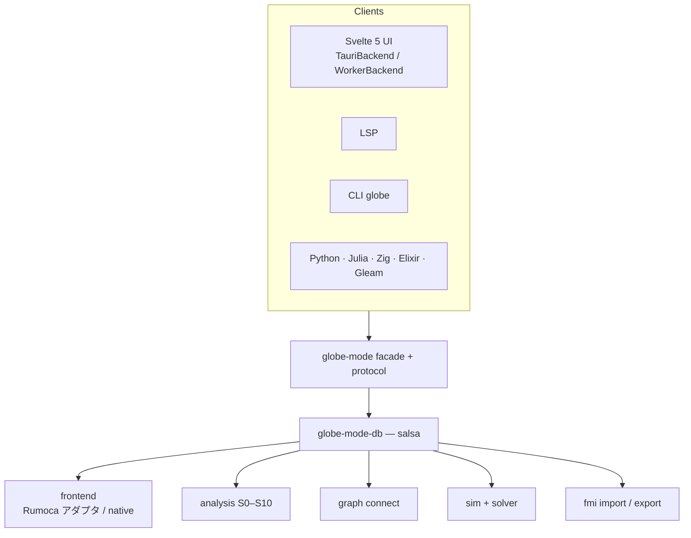
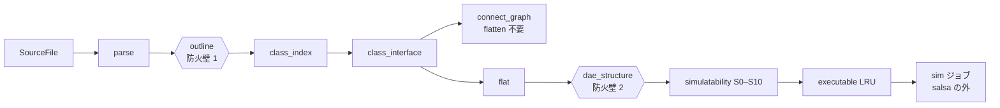
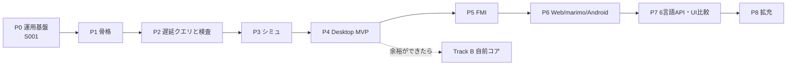
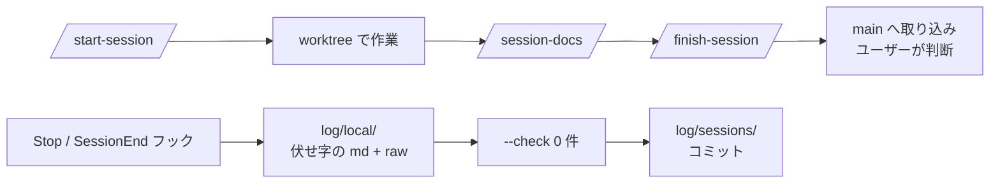

# S001 調査と計画、運用基盤

| | |
| --- | --- |
| セッション | S001 |
| 日付 | 2026-10-18 |
| ブランチ | `feature/s001-research-plan` |
| Phase | P0 運用基盤 |
| スライド | [slides.html](slides.html)（20 枚） |
| 作業記録 | [log/work/2026-10-18-s001-research-plan.md](../../../log/work/2026-10-18-s001-research-plan.md) |

## 1. 目的

Rust で OSS の Modelica IDE「GlobeMode」を作る。最初のセッションでは次の2つを行った。

1. **調査と計画**: OpenModelica と Rumoca を参考に、必要な機能を整理した。最新の技術（規格・Rust の crate・UI・言語バインディング）を調べて、アーキテクチャとロードマップを決めた。
2. **運用基盤**: 以降のセッションを同じ型で回すための仕組みを作った。CLAUDE.md、スキル（SKILL.md）、セッション記録のフック、セッションごとの HTML スライドと解説書の型。

Rust のコードはまだ書いていない（P1 から書く）。

### 要件

| 要件 | 対応方針（詳細） |
| --- | --- |
| 主要言語 Rust。API は Rust / Gleam / Elixir / Zig / Julia / Python | facade crate 1 つと 4 つの経路（[architecture.md §5](../../architecture.md#5-言語-api)） |
| デスクトップ・ブラウザ・CLI・Notebook（marimo） | Tauri 2 + Svelte 5、Web Worker の wasm、`globe`、anywidget（[§4](../../architecture.md#4-ターゲットごとの実行方法)） |
| ブラウザでは閲覧者の端末で計算する | 静的配信。サーバーでは計算しない |
| Debian 系・Windows 11・Android | Tauri 2 の .deb / .msi / .apk |
| connect から Obsidian 風のネットワークグラフ | `connect_graph` クエリと sigma.js（[§3.5](../../architecture.md#35-connect-のネットワークグラフ)） |
| OSS として公開。依存のライセンスに注意 | [licenses.md](../../licenses.md) と cargo-deny |
| Rumoca を参考にする | [research/rumoca.md](../../research/rumoca.md) |
| 遅延評価で軽く。シミュレーションできるかを実行時にアサート | salsa と `assert_simulatable`（[§3.2](../../architecture.md#32-遅延評価とシミュレーション前のアサーション)） |
| ソルバを複数（OpenModelica / Dymola のように） | `trait Integrator` と名前の登録表（[§3.3](../../architecture.md#33-ソルバ)） |
| FMI 2.0 / 3.0、Co-Simulation などは必須 | ME / CS / SE の Import と Export（[§3.4](../../architecture.md#34-fmi-20--30)） |

## 2. 決定と理由

### ユーザーと決めたこと

| 項目 | 決定 | 理由 |
| --- | --- | --- |
| FMI の版 | 2.0 と 3.0 の両対応。ME / CS / SE の Import と Export | 流通している FMU の多くはまだ 2.0。SE は 3.0 にしかない |
| ライセンス | MIT OR Apache-2.0 | Rust のエコシステムの標準。Apache-2.0 は特許条項を含む（[ADR-0001](../../adr/0001-license-policy.md)） |
| 名称 | GlobeMode | ディレクトリ名に合わせた |
| コンパイラ | Phase A は Rumoca を git 依存で使い、余裕ができたら自前のコア（Track B）に移る | Rumoca は想定以上に成熟している。自前で一から作ると時間がかかる（[ADR-0002](../../adr/0002-rumoca-adapter.md)） |
| UI | Tauri 2 + Svelte 5 が本線。Leptos と Dioxus は試験的に作る | エディタやグラフの良い部品は JS にそろっている。Rust だけで書く UI は負荷を測って比べる（[ADR-0004](../../adr/0004-ui-tauri-svelte.md)） |
| 配置 | 言語別の `src/<Lang>/` | ユーザーがセッション中に作った構成に合わせた |
| Streamlit | 含める（結果ダッシュボード） | ユーザーが `src/Python/streamlit` を作っていた |
| セッション記録 | 伏せ字にした整形版をコミットし、生ログは管理外 | 公開リポジトリにメールアドレスやローカルのパスを出さないため |

### Rumoca を git 依存にしてライセンス上問題ないか

**問題ない。** ただし配布時に守ることがある（[licenses.md](../../licenses.md)）。

- Rumoca は Apache-2.0。2026-10-18 に LICENSE を確認し、NOTICE ファイルが無いことも確かめた。寛容型なので、MIT OR Apache-2.0 のプロジェクトから依存してよい。
- 配布物には、推移的依存も含めたライセンス文と著作権表示を同梱する（cargo-about で生成する）。
- Rumoca を改変して同梱するなら、改変したファイルにその旨を書く（Apache-2.0 §4b）。
- 商標は許諾されないので、製品名に「Rumoca」を使わない。
- 注意すべきは推移的依存。umbrella crate `rumoca` の既定 feature は zenoh（EPL-2.0 OR Apache-2.0）・gamepad・UDP を引き込む。依存は `rumoca-compile` などに絞る。
- 本当のリスクはライセンスではなく、**nightly の固定**（`nightly-2026-02-27`）と**変化の速い API**。`rev` で固定し、アダプタ crate の中に閉じ込める。stable でビルドできるかは P1 で確かめる（[ADR-0003](../../adr/0003-toolchain.md)）。

### 調査から決めた設計

| 判断 | 理由（出典は doc/research/） |
| --- | --- |
| Rumoca の上に salsa のクエリ層を自前で置く | Rumoca にはインクリメンタル計算の基盤が無い。salsa は wasm でも動く（[rust-crates.md](../../research/rust-crates.md)） |
| 「コンパイラが未対応」を GM-U コードとして分ける | Rumoca は stream / expandable connector などに対応していない時期があった。これを「モデルの誤り」と混同させない |
| 既定のソルバは diffsol の BDF。SUNDIALS は feature | diffsol は MIT で wasm でも動く。SUNDIALS は BSD-3 だが wasm では使えない |
| russell_ode・KLU・symbolica・tree-sitter-modelica を使わない | GPL の UMFPACK・LGPL・source-available・AGPL |
| FMI 2 の Export は自前で作る | `fmi-export` は FMI 3 しか出力できない（[rust-crates.md](../../research/rust-crates.md#fmi)） |
| グラフは sigma.js、巨大なものは cosmos.gl | どちらも MIT。Cosmograph は NC なので使わない（[ui-bindings.md](../../research/ui-bindings.md)） |
| エディタは CodeMirror 6 | MIT でモバイルに強く、LSP を Worker に置ける |
| OpenModelica は別プロセスでの照合だけ | OSMC-PL / AGPL なのでリンクしない（[openmodelica-dymola.md](../../research/openmodelica-dymola.md)） |

必要な機能の全体の表は [features.md](../../features.md)、設計は [architecture.md](../../architecture.md)、順序は [roadmap.md](../../roadmap.md) にある。

## 3. 図

### 全体



### 遅延評価のクエリ連鎖



### ロードマップ



### セッションの運用



## 4. 再現手順

### 作ったもの

| 種類 | ファイル |
| --- | --- |
| 正典の文書 | `doc/features.md`、`doc/architecture.md`、`doc/roadmap.md`、`doc/licenses.md`、`doc/adr/0001`〜`0005` |
| 調査の記録 | `doc/research/{rumoca,openmodelica-dymola,standards,rust-crates,ui-bindings}.md` |
| セッション文書 | `doc/sessions/README.md`、`doc/sessions/_template/`、`doc/sessions/S001-research-plan/`、`doc/assets/slides.{css,js}` |
| 運用 | `CLAUDE.md`、`.claude/settings.json`、`.claude/hooks/save_session_log.py`、`.claude/skills/{start-session,finish-session,session-docs,add-dependency}/SKILL.md`、`.claude/skills/session-docs/check_docs.py` |
| 記録 | `log/README.md`、`log/work/_TEMPLATE.md`、`log/work/2026-10-18-s001-research-plan.md`、`log/sessions/` |
| その他 | `README.md`、`LICENSE-MIT`、`LICENSE-APACHE`、`.gitignore`、`src/*/README.md` |

### 検証のコマンド

```bash
# スライドと相対リンクの検査（見出しの anchor も含む）
python3 -I .claude/skills/session-docs/check_docs.py

# セッション記録を作り直してコピーし、伏せ字の取りこぼしを検査する
MAIN=$(git worktree list --porcelain | awk '/^worktree /{print $2; exit}')
MD=$(CLAUDE_PROJECT_DIR="$MAIN" python3 .claude/hooks/save_session_log.py --latest --out "$MAIN/log/local")
cp "$MD" log/sessions/
python3 .claude/hooks/save_session_log.py --check log/sessions/*.md

# フックの単体確認（壊れた入力でも終了コード 0）
echo 'notjson' | python3 .claude/hooks/save_session_log.py --out /tmp/x; echo $?
```

検証の結果（数字）は [作業記録](../../../log/work/2026-10-18-s001-research-plan.md#検証) にある。

## 5. 次回

**S002（P1 の 1 回目）**:

1. ルートの `Cargo.toml` を virtual workspace にする。
2. `rust-toolchain.toml` と `mise.toml` を置く。
3. `deny.toml` と CI の雛形を作る。
4. Rumoca の `rev` を決め、stable でビルドできるか確かめる。
5. Python パッケージを `globe_mode` に改名する。

詳しくは [roadmap.md の「次のセッション」](../../roadmap.md#次のセッション)。

**残したこと**:

- 調査文書の【未確認】の項目を、P1〜P5 で一次資料に当たって確かめる。
- main に未コミットの `.claude/settings.json` と `doc/mise-setup.html` がある（このセッションの外で作られたもの）。取り込み方は作業記録に書いた。
