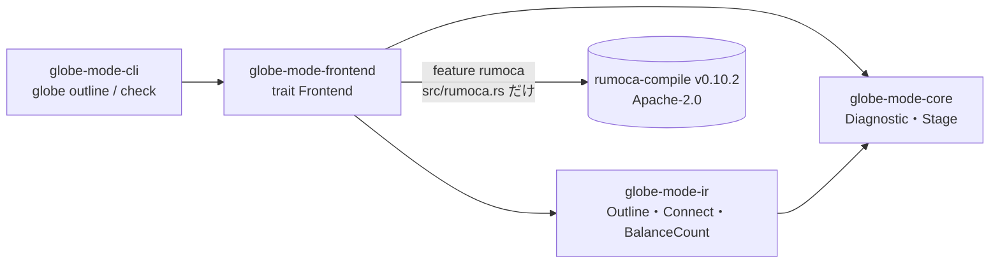

# S002 workspace の骨格

| | |
| --- | --- |
| セッション | S002 |
| 日付 | 2026-10-18 |
| ブランチ | `feature/s002-workspace-skeleton` |
| Phase | P1 骨格（1 回目） |
| スライド | [slides.html](slides.html)（11 枚） |
| 作業記録 | [log/work/2026-10-18-s002-workspace-skeleton.md](../../../log/work/2026-10-18-s002-workspace-skeleton.md) |

## 1. 目的

ユーザーの依頼は次の4つ。

1. S001 の worktree でコミットし、main の変更を確かめてマージする。
2. スライドのブラウザでの見た目を Playwright で確かめる。
3. 言語の管理を mise・uv・cargo で行う。
4. そのまま次へ進める。

4 は [roadmap.md](../../roadmap.md) の P1（骨格）の 1 回目として、次を行った。

- Rust の workspace にする。
- Rumoca を git 依存で取り込み、stable の Rust でビルドできるかを確かめる。
- cargo-deny と CI の雛形を作る。
- Python パッケージを改名する。

## 2. 決定と理由

### S001 の取り込み

- main に、ユーザーが mise を導入したコミット（`db789c4`）が入っていた。worktree で main を取り込み、衝突を解いてから main に `--no-ff` でマージした（`25f9dff`）。
- そのコミットには、worktree `.git-worktree/s001-research-plan` が **gitlink（mode 160000）** として入っていた。
  - クローンすると壊れたサブモジュールになるので、index から外した。
  - `.gitignore` に `.git-worktree/` があるので、今後は入らない。
- 衝突は `.claude/settings.json` と `.gitignore` の2件。どちらも S001 の版が main の内容を含む上位互換だったので、S001 の版を採った。
- S002 の途中で、main にさらに `.gitkeep` を足すコミット（`00dba82`）が入った。衝突なく取り込めた。
  - `src/Rust/mod/.gitkeep` を crate と誤認しないよう、workspace の members を `src/Rust/mod/globe-mode-*` に絞った。

### 言語の管理: mise・uv・cargo（[ADR-0003](../../adr/0003-toolchain.md)、Accepted）

| 道具 | 受け持つもの | ロックファイル |
| --- | --- | --- |
| mise | ツールの版（rust・uv・zig・julia・erlang・elixir・gleam・cargo-deny）とタスク（`mise run check` / `mise run docs:check`） | `mise.lock` |
| uv | Python 本体と Python の依存（Playwright を含む） | `uv.lock` |
| cargo | Rust の依存と workspace | `Cargo.lock` |

- `rust-toolchain.toml` は置かない。mise が設定する `RUSTUP_TOOLCHAIN` が優先され、無視されるため（mise の手順書と同じ方針）。
- wasm と Android の target は、`mise.toml` の rust の `targets` で宣言した。

### Rumoca は stable の Rust のまま使える

- **Rumoca v0.10.2（`276e82bd`）の `rumoca-compile` が、stable 1.99.1 でビルドできた。**
  - ネイティブでも wasm32-unknown-unknown でも、`cargo check` が通った。
  - Rumoca の `nightly-2026-02-27` の固定は、Rumoca 自身の wasm のスレッドのためだけで、git 依存として使う側には影響しなかった。
  - S001 で用意した「stable で通らなかったときの手順」は要らなかった。
- 依存は `rumoca-compile` だけ（`default-features = false`）。
- アダプタは `globe-mode-frontend` の `src/rumoca.rs` の 1 ファイルに閉じ込めた（[ADR-0002](../../adr/0002-rumoca-adapter.md)）。
- Rumoca を git で使う間は crates.io に公開できないので、`publish = false` にした。

### 診断コードの対応

Rumoca の失敗段階を、GlobeMode の検査段階（S0〜S5）と GM コードに対応づけた。

| Rumoca | 段階 | GM コード |
| --- | --- | --- |
| 構文の誤り | S0 | GM-E0001 |
| モデルが見つからない（候補を `notes` に出す） | S1 | GM-E1002 |
| Typecheck | S2 | GM-E2001 |
| Instantiate / NeedsInner | S3 | GM-E3001 / GM-E3002 |
| Flatten | S4 | GM-E4001 |
| ToDae（ED001 は「数が合わない」） | S5 | GM-E5001 / GM-E5002 |

### cargo-deny（[deny.toml](../../../deny.toml)）

- 結果は `advisories ok, bans ok, licenses ok, sources ok`。
- `rumoca-compile` を使えるのは frontend と exec だけ（wrappers）。
  - cli から直接依存させると `error[banned]` になることを確かめてから、元に戻した。
- 保守終了の勧告 2 件は、理由を書いて例外にした。どちらも Rumoca 経由で、脆弱性ではない。
  - bincode 1.x（RUSTSEC-2025-0141）
  - paste（RUSTSEC-2024-0436）

### Playwright でスライドを確かめる

- `.claude/skills/session-docs/render_slides.py` は、全スライドを3つの表示で開いて検査する。
  - 表示: ライト・ダーク（1600×900）とスマートフォン（390×844）
  - 検査すること: コンソールのエラー、はみ出し、ページ番号の隠れ、キーとハッシュでの移動
- 機械の検査が 0 件でも、スクリーンショットを目で見る。
- S001 のデッキでは、目で見て次の4つを見つけて直した。
  - ページ番号が操作ボタンに隠れていた（これは検査に加えた）。
  - スマートフォンで図が縮みすぎていた。
  - S17 の文が枠からはみ出していた。
  - S05 の文字が小さかった。
- S002 のデッキでは、S05 のラベルの重なりを直した。

## 3. 図




## 4. 再現手順

```bash
mise trust && mise install --locked && uv sync    # worktree ごとに
mise run check          # cargo fmt / clippy / test / deny と uv sync --locked
mise run docs:check     # check_docs.py と Playwright の render_slides.py

cargo run -p globe-mode-cli -- outline src/Modelica/GlobeModeExamples/package.mo
cargo run -p globe-mode-cli -- check src/Modelica/GlobeModeExamples/package.mo -m GlobeModeExamples.RC
cargo check --target wasm32-unknown-unknown -p globe-mode-core -p globe-mode-ir -p globe-mode-frontend
uv run globe-mode
```

検証の結果:

| 項目 | 結果 |
| --- | --- |
| テスト | 10 件すべて通過（core 3・ir 2・frontend 5） |
| clippy（`-D warnings`） | 警告 0 件 |
| cargo-deny | 4 項目とも ok |
| `globe check` RC | OK。方程式 20 本 / 変数 20 個（状態 1） |
| `globe check` Unbalanced | S5 で停止（GM-E5002、終了コード 1） |
| `globe check` SyntaxError | S0 で停止（GM-E0001、3 行 8 列、終了コード 1） |
| wasm32 の `cargo check` | 通過（3 分 18 秒） |
| Playwright | 3 デッキ × 3 表示で問題 0 件 |

CI（`.github/workflows/ci.yml`）は **まだ GitHub 上で実行していない**（push はユーザーの判断）。

## 5. 次回

**S003（P1 の 2 回目）**:

1. MSL 4.1.0 の取得スクリプトと、`globe check --library`。
2. MSL の例題 20 本で、Rumoca の CLI と結果を突き合わせる（`globe-mode-testkit`）。
3. `xtask`（bump-rumoca の雛形と、ライセンス一覧の生成）。
4. CI を GitHub で動かして直す。

**残したこと**:

- git の作者と `pyproject.toml` の authors に、個人のメールアドレスが入っている。公開前に GitHub の noreply アドレスに変えるかを決める。
- `outline` の connect は equation 節の直下だけを拾う。for や if の中は P2 で扱う。
- `Outline` はソース上の位置を含む。P2 の防火壁（Eq での比較）では、位置を落とした射影を使う。
