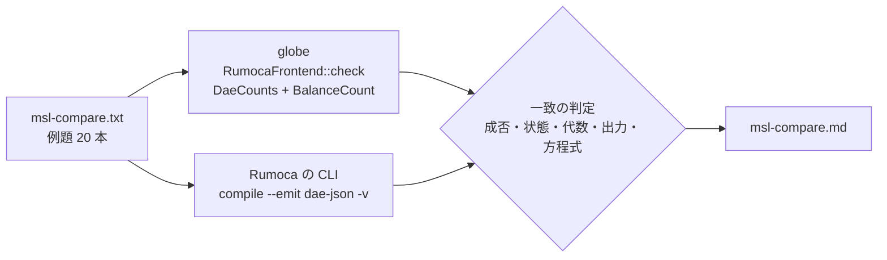

# S003 MSL で Rumoca と突き合わせ

| | |
| --- | --- |
| セッション | S003 |
| 日付 | 2026-10-18 |
| ブランチ | `feature/s003-msl-check` |
| Phase | P1 骨格（2 回目・完了） |
| スライド | [slides.html](slides.html)（11 枚） |
| 突き合わせの報告 | [msl-compare.md](msl-compare.md)（`cargo xtask msl-compare` の生成物） |
| 作業記録 | [log/work/2026-10-18-s003-msl-check.md](../../../log/work/2026-10-18-s003-msl-check.md) |

## 1. 目的

P1（骨格）の残りの完了条件「MSL の例題 20 本で `globe check` の結果が Rumoca と一致する」を満たすこと（[roadmap.md](../../roadmap.md)）。そのために次の 3 つを作った。

1. MSL 4.1.0 を取得する仕組み
2. `globe check` でライブラリ（MSL）を読む機能
3. Rumoca の CLI と突き合わせる仕組み

あわせて、ユーザーの依頼で「CI が通ったら 2 つ以上前の worktree を片付ける」手順を finish-session に加えた（S003 の前にマージ済み）。

## 2. 決定と理由

### 取得（`cargo xtask fetch-msl` / `fetch-rumoca`）

| 対象 | 取得元 | sha256 | 置き場所 |
| --- | --- | --- | --- |
| MSL 4.1.0（BSD-3-Clause） | 公式リリースの zip（21 MB） | `5409cfa17797c52d…` | `data/msl/` |
| Rumoca の CLI v0.10.2（Apache-2.0） | GitHub Releases（Linux x86_64） | `d6c9b51eb2074779…` | `data/rumoca/` |

- ダウンロードと展開の方法:
  - ダウンロードは `curl` を呼ぶ。Linux・Windows 10 以降・CI のランナーに入っているため。
  - 展開は `zip` crate で行う。`enclosed_name()` で、展開先の外を指す名前を拒む。
- **zip の版**: `cargo deny` が zip 2 系の脆弱性 3 件（RUSTSEC-2026-0367 / 0368 / 0369）を検出したので、修正済みの zip 9 に上げた。
  - どれも展開時のシンボリックリンクと権限ビットの扱いの問題。
  - xtask は `extract()` を使わないので該当しないが、脆弱な版には依存しない。
- **2 回目以降**: 展開済みの印（`.globe-mode-msl`）と sha256 が合っていれば、何もしない。
- `data/` は git 管理外にしてある。

### アダプタを Rumoca の CLI と同じ経路に合わせた（[ADR-0002](../../adr/0002-rumoca-adapter.md)）

- 最初は、MSL のモデルが **S1 で止まった**。
  - `model_names()` と `compile_model_phases()` が、MSL を解決するときの**警告**まで失敗として返していた。
  - 警告の例: WR006（関数の局所変数への Evaluate）、WR001（external 関数の pure の宣言）。
- 直したこと:
  - コンパイルを `compile_model_strict()` に替えた（Rumoca の CLI と同じ経路）。
  - モデル名の事前確認は、ユーザーのファイルだけのときに限った。
  - ライブラリは `load_source_root_tolerant`（`DurableExternal`）で読む。読めなければ S1 / GM-E1003。
- CLI に `--library`（`-L`、何度でも指定できる）を足した。モデルがライブラリの中にあるときは、ファイルを省略できる。

### 数え方の粒度

最初の突き合わせは **20 本中 16 本**の一致だった。不一致は、数え方の粒度の違いが原因だった。

| 数え方 | 出どころ | Pendulum（MultiBody） | 使い道 |
| --- | --- | --- | --- |
| スカラー（配列を展開） | `balance_detail` | 状態 13・代数 885・方程式 934 | S5 の釣り合い（MLS 4.7） |
| **DAE の変数（配列は 1 個）** | `Dae` の view、CLI の `-v` | 状態 7・代数 255・方程式 87 | **Rumoca の CLI との突き合わせ** |
| 方程式の「操作」 | `--emit dae-json` の operations | 方程式 262 | 使わない（配列や for で増える） |

- Rumoca の CLI の `-v` 自身が、方程式数を 87（DAE）と 262（operations）の 2 通りで表示していた。
- アダプタは `BalanceCount`（スカラー）と `DaeCounts`（配列ごと）の両方を返すようにした。
- 同じ粒度どうしで比べると、**20 本すべて一致**した。

### CI（[ADR-0006](../../adr/0006-incremental-ci.md)）

- CI の判定に `xtask` を加えた。
  - `msl-compare.txt` だけを変えたら、xtask だけを検査する（最初に当たった規則だけを使う）。
  - 判定のテストは 12 件から 15 件に増えた。
- `msl` ジョブを足した。
  - 動くのは全体を検査するときだけ。中身は fetch-msl → fetch-rumoca → msl-compare。
  - `data/` は actions/cache v6 で使い回し、報告は artifact に残す。

## 3. 図



## 4. 再現手順

```bash
mise run check            # fmt / clippy / test / deny / uv sync --locked
mise run msl:compare      # fetch-msl → fetch-rumoca → msl-compare（約 3 分）
cargo xtask msl-compare --report doc/sessions/S003-msl-check/msl-compare.md
globe check -L data/msl -m Modelica.Electrical.Analog.Examples.ChuaCircuit   # cargo run -p globe-mode-cli -- …
cargo xtask bump-rumoca
```

検証の結果:

| 項目 | 結果 |
| --- | --- |
| MSL での突き合わせ | **20 本中 20 本が一致**。両方とも成功が 17 本、両方とも同じ理由で失敗が 3 本（ED001 ×2、ED019） |
| Rust のテスト | 14 件すべて通過（core 3・ir 2・frontend 7・xtask 2） |
| CI の判定のテスト | 15 件すべて通過 |
| clippy・cargo-deny | 警告 0 件、4 項目とも ok |
| actionlint | 指摘 0 件 |
| Playwright | 問題 0 件（S05 の枠のはみ出しは、目で見つけて直した） |

## 5. 次回

**S004（P2 の 1 回目）**:

1. `globe-mode-db`: salsa のクエリ DB。`parse` → `outline`（Eq の防火壁）。
2. 空白だけの編集で、`outline` から先が再計算されないことをテストで確かめる。
3. `class_index` と `connect_graph(path, depth)` の最初の版（flatten 不要）。
4. GM-U の振り分け規則を検討する（下記）。

**残したこと**:

- 正しい例題が、**「モデルの誤り」として出る**。
  - CoupledClutches と Friction は MSL の正しい例題（OpenModelica では実行できる）。
  - Rumoca は ED001 で止まり、GlobeMode は S5 / GM-E5002 と出している。
  - クラッチや摩擦のモード切り替えを、Rumoca がまだ数え切れていないと考えられる【未確認】。
  - 「コンパイラが未対応」（GM-U）に振り分けるかを P2 で決め、上流にも報告する。Filter の ED019 も同じく調べる。
- S001 の調査（0.7 系では stream connector が未対応）と違い、v0.10.2 は Fluid の EmptyTanks も DAE まで通った。調査文書の【未確認】の項目を更新する。
- Rumoca の CLI の取得は Linux x86_64 だけ。`globe-mode-testkit` は作らず、突き合わせは xtask に置いた。
