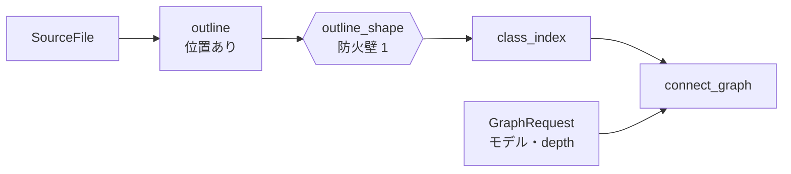
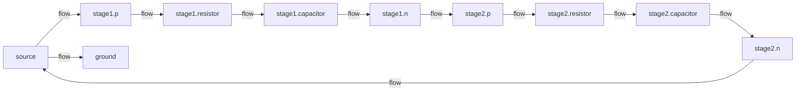

# S004 遅延クエリと connect グラフ

| | |
| --- | --- |
| セッション | S004 |
| 日付 | 2026-10-18 |
| ブランチ | `feature/s004-lazy-queries` |
| Phase | P2 遅延クエリと検査（1 回目） |
| スライド | [slides.html](slides.html)（11 枚） |
| 検証用パッケージ | [src/Modelica/README.md](../../../src/Modelica/README.md) |
| 作業記録 | [log/work/2026-10-18-s004-lazy-queries.md](../../../log/work/2026-10-18-s004-lazy-queries.md) |

## 1. 目的

[roadmap.md](../../roadmap.md) の S004（P2 の 1 回目）として、遅延評価の土台と connect グラフの最初の版を作った。

1. `globe-mode-db`: salsa のクエリ DB。`outline` から Eq の防火壁を置く。
2. 空白だけの編集で、下流が再計算されないことをテストで確かめる。
3. `class_index` と `connect_graph(path, depth)`（flatten しない）。
4. GM-U（コンパイラが未対応）の振り分けを検討する。

ユーザーからの依頼は次の 2 つ。

- connect のテストでは、型（Real、Boolean、Medium など）を試すモデルを `src/Modelica` に作る。
- そのディレクトリを Modelica のパッケージ（`…Validation/`）にし、ほかの Modelica の IDE でも開けるようにする。

## 2. 決定と理由

### 検証用パッケージ `GlobeModeValidation`

詳しい構成と、モデルごとの期待値は [src/Modelica/README.md](../../../src/Modelica/README.md) にある。

- **2 つの構成を混ぜた**: 1 ファイルのサブパッケージ（`Connectors.mo`、`Components.mo`）と、ディレクトリのサブパッケージ（`Connect/`、`Invalid/`。1 モデル 1 ファイルで、`package.order` あり）。読み込み側の両方の形を試すため。
- ほかの IDE で開くための決め事:
  - `src/Modelica` は MODELICAPATH の 1 項目として使えるようにした。
  - わざと構文を誤った `SyntaxError.mo` は、`globe-mode-frontend/tests/data/` に移した。ほかの IDE がライブラリを開けなくなるため。
- MSL への依存は、**Medium の 3 か所だけ**:
  - `package.mo` に `uses(Modelica(version="4.1.0"))` を書いた。OMEdit などで開けば MSL も読み込まれる。
  - `extends Modelica.Icons.*` はわざと書いていない。書くと、Real や Boolean だけのモデルの検査にも MSL が要るようになるため。
- **期待値は手で数えて確かめた**（例: BooleanSignals は変数 7 個で、うち Boolean の離散が 4）。

### salsa のクエリ（[ADR-0005](../../adr/0005-lazy-query-db.md)）

| クエリ | 入力 | 役割 |
| --- | --- | --- |
| `outline(file)` | `SourceFile`（パスと本文） | アウトライン（位置あり）。構文の誤りは S0 の診断 |
| `outline_shape(file)` | `outline` | **防火壁 1**。位置（`TextRange`）を 0 にした写し |
| `class_index(workspace)` | すべてのファイルの `outline_shape` | 完全修飾名の索引（`within` を反映）。字句的な名前解決と、extends を含むインターフェース |
| `connect_graph(workspace, request)` | `class_index`、`GraphRequest`（モデル、depth） | connect グラフ |

- 実行されたクエリは、salsa の `WillExecute` イベントで記録する（`GlobeDb::take_executed`）。テストと計測に使う。
- 新しい依存は salsa 0.28.5（Apache-2.0 OR MIT）。cargo deny は 4 項目とも ok だった。

### connect グラフ

- **ノード**: モデルの部品。connect に出てくる自分のコネクタもノードにする。
- **辺**: connect 文。継承した connect（`TwoPin` の p / n など）も含む。
- **辺の種類**: コネクタのクラスから決める（[architecture.md §3.5](../../architecture.md#35-connect-のネットワークグラフ)）。
  - `flow`: flow の変数がある（例: 電気のピン）。
  - `stream`: stream の変数がある（例: Medium の流体ポート）。
  - `real` / `boolean` など: 組み込みの型を継承している（`connector RealInput = input Real`）。
- **depth**: 2 以上なら、中に connect を持つ部品（部分回路）を展開する。その部品のコネクタは、つなぎ目のノード（`stage1.p`）にする。
- **出力**: graphology の JSON（`globe graph --json`）。P4 で sigma.js がそのまま読む。

### Rumoca の制約と回避

- **症状**: `MediumFlow` を `--library src/Modelica -L data/msl` で検査すると、`Modelica.Media.Interfaces.PartialMedium` が見つからない（ER003）。
- **切り分け**（最小のモデルで確かめた）: ライブラリ（source root）として読んだクラスが、別のライブラリのクラスを extends すると解決できない。
  - 単一ファイルのパッケージでも、複数ファイルのパッケージでも、MODELICAPATH でも同じだった。
  - コンパイルする文書そのものに書いた参照なら、解決できる。
- **回避**: 作業中のパッケージは文書として渡す。`globe check <DIR>` は、ディレクトリの下の `.mo` を文書として読む。
  - これで `MediumFlow` も通った（方程式 12 = 変数 12。stream と `inStream` も処理された）。
  - IDE としても、作業中のファイルをワークスペース（文書）として扱うのが自然。
- 記録は [ADR-0002](../../adr/0002-rumoca-adapter.md) と [research/rumoca.md](../../research/rumoca.md) にある。上流への報告は P2 の中で行う。

### GM-U の振り分け（検討のみ。S005 で決める）

| 案 | やり方 | 長所 | 短所 |
| --- | --- | --- | --- |
| A. コードで決める | Rumoca のエラーコードごとに、GM-U かどうかを決めておく | 単純 | ED001（数が合わない）はモデルの誤りでも出るので区別できない |
| B. 既知の制約の一覧 | MSL の例題と Rumoca のコードの組（S003 の CoupledClutches・Friction など）を一覧にし、当たれば GM-U | 誤りの出方を変えずに済む | MSL の外のモデルには効かない |
| C. omc と照合 | Rumoca で失敗したときだけ omc（別プロセス）で検査し、omc が通れば GM-U | 根拠がはっきりする | omc が要る。遅い |

**案**: B を既定にし、C は任意（omc があるときだけ）にする。

## 3. 図





## 4. 再現手順

```bash
cargo run -p globe-mode-cli -- graph src/Modelica/GlobeModeValidation -m GlobeModeValidation.Connect.Hierarchical -d 2
cargo run -p globe-mode-cli -- check src/Modelica/GlobeModeValidation -m GlobeModeValidation.Connect.BooleanSignals
cargo run -p globe-mode-cli -- check src/Modelica/GlobeModeValidation -L data/msl -m GlobeModeValidation.Connect.MediumFlow
cargo test --release -p globe-mode-db -- --ignored --nocapture    # 再計算の時間
mise run check
```

検証の結果:

| 項目 | 結果 |
| --- | --- |
| 防火壁（空白とコメントの編集） | `outline`・`outline_shape` は 1 回ずつ、`class_index`・`connect_graph` は **0 回** |
| 防火壁（別のファイルのコメント） | `class_index`・`connect_graph` は 0 回 |
| connect を足す編集 | `class_index`・`connect_graph` は 1 回ずつ。辺は 2 → 3 |
| 再計算の時間 | 中央値 **0.20 ms**、最大 0.30 ms（リリースビルド、20 回）。目標の 50 ms 未満 |
| Rust のテスト | 32 件すべて通過（core 3・db 13・frontend 10・ir 4・xtask 2）。計測用の無視指定のテストが 1 件 |
| CI の判定のテスト | 16 件すべて通過。actionlint の指摘 0 件 |
| wasm32 | graph と db（salsa を含む）の `cargo check` が通過 |
| cargo-deny | 4 項目とも ok |
| MSL での突き合わせ | 20 本中 20 本が一致（アダプタを変えたので回し直した） |
| Playwright | 問題 0 件（S05・S07 の文字のはみ出しは、目で見つけて直した） |

## 5. 次回

**S005（P2 の 2 回目）**:

1. `flat` と `check`（S0〜S5）を salsa のクエリにする。MSL は一度だけ読んで使い回す。
2. GM-U の振り分けを決めて ADR に書く（案 B を既定、案 C を任意）。
3. S6（構造特異）の最初の版: 完全マッチングと Dulmage–Mendelsohn 分解。
4. MSL の全例題に判定を出す（ファネルの計測）。

**残したこと**:

- 名前解決は字句的なスコープだけ。import と、継承したクラスの中の入れ子のクラスはまだ扱わない。
- for や if の中の connect はまだ拾わない。
- Rumoca の制約（ライブラリ間の extends）を上流に報告する。
