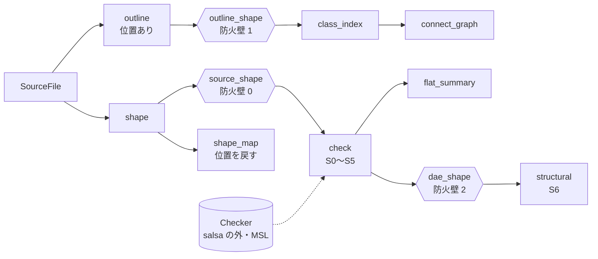
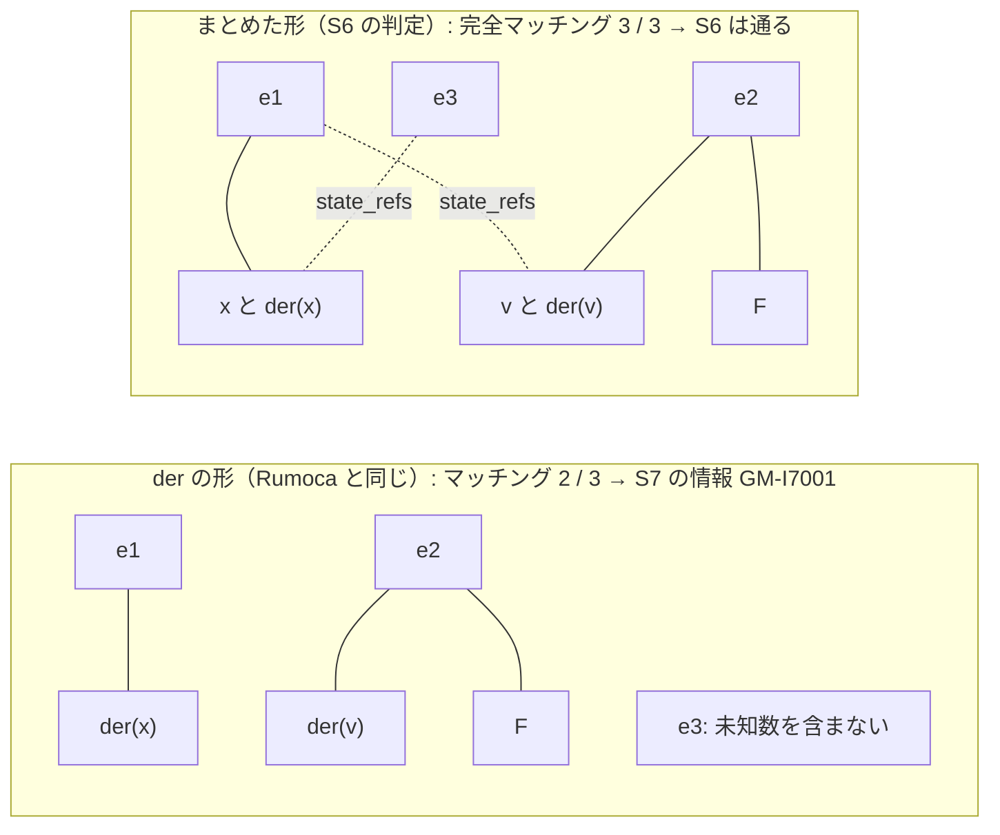

# S005 check のクエリ化・GM-U・S6・MSL の全例題

| | |
| --- | --- |
| セッション | S005 |
| 日付 | 2026-10-18 |
| ブランチ | `feature/s005-check-queries` |
| Phase | P2 遅延クエリと検査（2 回目） |
| スライド | [slides.html](slides.html)（14 枚） |
| MSL の全例題の報告 | [msl-funnel.md](msl-funnel.md)（`cargo xtask msl-funnel` が生成） |
| 設計の記録 | [ADR-0005](../../adr/0005-lazy-query-db.md) の結果、[ADR-0007](../../adr/0007-unsupported-classification.md)、[ADR-0002](../../adr/0002-rumoca-adapter.md) の結果 |
| 作業記録 | [log/work/2026-10-18-s005-check-queries.md](../../../log/work/2026-10-18-s005-check-queries.md) |

## 1. 目的

[roadmap.md](../../roadmap.md) の S005（P2 の 2 回目）として、検査を salsa のクエリに載せ、MSL の全例題に判定を出した。

1. `flat` と `check` を salsa のクエリにする。MSL は一度だけ読んで使い回す。
2. 「コンパイラが未対応」（GM-U）の振り分けを決める。
3. S6（構造特異）の最初の版: 完全マッチングと Dulmage–Mendelsohn 分解。
4. MSL の全例題に判定を出し、ファネルを数える。

ユーザーの依頼は「これまでの経緯を確かめて計画をレビューし、直す必要が無ければ Auto モードの Opus で S005 を続ける。並列で作業できるようにタスクを分けて、作業方針を出す」。

- 計画は 1 つの worktree で、所有ファイルを分けた Opus のサブエージェント 3 つに分けた。
  - A: frontend・db・cli
  - B: analysis と検証モデル
  - C: xtask と GM-U
- 共有の型（IR の `DaeStructure` など）は先に凍結した。文書（この解説書とスライド、正典の更新）は別のサブエージェントが書いた。

P2 の完了条件のうち、次の 2 つを満たした（[roadmap.md の進み具合](../../roadmap.md#p2-の完了条件の進み具合)）。

- 空白だけの編集の再検査が 50 ms 未満で、下流が再実行されない。
- MSL の全例題に判定が出て、panic は 0 件（最終の実行でも 0 件）。

## 2. 決定と理由

### 計画のレビューで直したこと

Rumoca v0.10.2 の API を調べてから、roadmap の S005 を次のように直した。調査の詳細と出典は [research/rumoca.md](../../research/rumoca.md#s005-で調べた-apiv0102) にある。

| roadmap の項目 | 直したこと | 理由 |
| --- | --- | --- |
| `flat` と `check` をクエリにする | **防火壁 0（`source_shape`）を足す** | ADR-0005 は `outline` を第 1 の防火壁としていた。しかし Rumoca のコンパイルに渡せるのは本文で、アウトラインではない |
| MSL は一度だけ読む | salsa の外の `Checker` が Session を持つ | MSL の読み込みは 6〜16 s かかる。Rumoca の `Session` は `Clone` でき、文書だけを差し替えられるので、MSL を読んだ Session を持ち続ければ読み直さずに済む |
| GM-U の振り分け | **A（コード）+ B（一覧）の併用** | S004 では B を既定にした。調べると、コードだけで「未対応」「内部エラー」と決まるもの（ED019・ED008 など）があった |
| S6 | **incidence を自前で組む** | Rumoca の `build_incidence` は `pub(crate)` で使えない |
| MSL の全例題 | Rumoca と同じ名前の規則で選ぶ（566 本） | Rumoca の基準値（566 / 494 / 305 / 293）と比べられるようにするため |

### 防火壁 0 と `Checker`（[ADR-0005](../../adr/0005-lazy-query-db.md)）

- **`source_shape`**（`globe_mode_core::normalize`）: `//` と `/* */` を除き、空白と改行を 1 個の空白に畳む。
  - 文字列 `"…"` と引用識別子 `'…'` の中は触らない。
  - 閉じていないコメントや文字列は、そこから末尾までをそのまま残す。構文の誤りを、Rumoca が元の本文と同じように見つけられるようにするため。
  - コメントは区切りとして扱う（`a/*c*/b` は `a b` になる）。
- **`shape_map`**: 正規化後の位置から元の本文の位置への対応表。`check` の依存に入れないので、空白の編集で位置がずれても `check` は再実行されない。診断の位置は `GlobeDb::check_model` が元の本文に戻す。
- **`Checker`**（`globe-mode-frontend`）: MSL を読んだ Rumoca の `Session` を `Arc<Mutex<_>>` で持つ、salsa の外の値。
  - 本文が変わった文書だけ `add_document` で差し替え、無くなった文書は `remove_document` する。差し替えると Rumoca は解決済みの状態を捨てるので、変わっていない文書には触らない。
  - panic で Mutex が毒されたら、ライブラリを読んだ直後の写し（pristine）に戻して続ける。
  - `reset()` は、モデルごとのキャッシュを捨てて pristine に戻す（1 回 0.4 s。pristine の写しを持つ分のメモリは約 50 MB）。MSL の例題 566 本を同じ Session で続けて検査すると最大 RSS が 7.5 GiB になったので足したが、50 本ごとに戻しても 7.2 GiB だった。大部分は 1 本の大きなモデル（`Spice3BenchmarkFourBitBinaryAdder`、単独で 6.3 GiB）の分で、キャッシュの成長ではなかった。
  - `Frontend::check` は、`Checker` を作って 1 回だけ呼ぶ薄い包みにした。
- **`dae_shape`（防火壁 2）**: 位置を落とした `DaeStructure`。パラメータの値の長さが変わって方程式の位置がずれても、S6 は再実行されない。

### S6 の判定を直した（[architecture.md §3.2](../../architecture.md#32-遅延評価とシミュレーション前のアサーション)）

- **最初の版**は、Rumoca の構造解析と同じ「der の形」で完全マッチングを調べた。
  - der の形の未知数は、状態ごとの `der(x)` と、代数・出力のスカラー。状態 `x`・パラメータ・入力・離散変数・`pre()`・`time` は既知とみなす。
- MSL の全例題を回すと、**正しい例題 166 本が構造特異（GM-E6001）になった**。
  - 例: `Mechanics.Rotational.Examples.First`（マッチング 52 / 54）、`Mechanics.MultiBody.Examples.Elementary.Pendulum`（891 / 898）、`Blocks.Examples.PID_Controller`（83 / 86）。
  - これらは微分インデックスが 1 より大きい DAE。der の形に完全マッチングが無いのは正常で、インデックスの低減（Pantelides 法）で解く。
- **直した版**: S6 は、`x` と `der(x)` を 1 つの列にまとめた二部グラフ（`DaeStructure::merged_incidence`）で判定する。
  - Pantelides 法が失敗するのは、このグラフに完全マッチングが無いときだけ。ここで無ければ、モデルの誤りとして `GM-E6001`（Error）を出す。
  - 過剰な方程式と不足している未知数は、粗い Dulmage–Mendelsohn 分解（マッチしていない頂点から交互路で届く部分）で求め、位置つきで示す。
  - der の形で完全マッチングが無いときは、**S7 の情報 `GM-I7001`**（微分インデックスが 1 より大きい見込み）を出す。実行は止めない。
  - IR の `DaeStructure` に `state_refs`（方程式が状態そのものを参照しているときの、その状態の `der(x)` の添字）を足した。
- Rumoca の `phase_structural::analyze` との照合は、der の形のまま行う。最初の実行では 381 本中 381 本が一致した。
- `globe-mode-analysis` は Rumoca に依存しない（core・ir・serde だけ）。wasm32 でもビルドできる。

### GM-U の振り分け（[ADR-0007](../../adr/0007-unsupported-classification.md)）

| 順 | 規則 | GM コード |
| --- | --- | --- |
| 1 | Rumoca のコードが「未対応の言語機能・実装の制限」（ED019・ED013・ED018 など 12 個） | `GM-U0001` |
| 1 | Rumoca のコードが「コンパイラの内部エラー」（ED008・EF023・EF025 など 20 個） | `GM-U0002` |
| 2 | 既知の制約の一覧（`src/Modelica/msl-known-unsupported.txt`）に（モデル, コード）がある | `GM-U0003` |
| — | どれにも当たらない（ED001・EF002・ER003 はコードだけでは決めない） | GM-E のまま |

- 一覧は 50 行（ED001 41・ET004 4・ED010 3・ER130 2）。`msl-funnel` の報告の「一覧の原稿」から、理由を確かめて移した。
- severity は Error のまま。`--force` 無しでは実行しない点は、モデルの誤りと同じ。CLI は `unsupported[GM-U0001]` のように表示して分ける。
- 案 C（omc と照合）は任意。omc を入れていないので S005 では行わなかった。

### MSL の全例題（`cargo xtask msl-funnel`）

- **例題の選び方**は Rumoca の MSL ハーネスと同じ名前の規則にした。
  - `Modelica.*.Examples.*` で、途中はすべて package。`Utilities`・`BaseClasses`・`Internal`・`Interfaces` の下は除く。クラスは model・block・class。
  - 566 本で、Rumoca の基準値と同じ。
  - **partial のモデル 13 本を含む**。計画には「partial でない」と書いたが、Rumoca の 566 本も partial を含んでいた（基準値の `partial_models` が 13）。報告では「（partial）」と印を付ける。
- 検査器（`Checker`）は 1 つで、MSL を一度だけ読む。モデルごとに `catch_unwind` で囲み、panic を数えて続ける。
- DAE まで通ったモデルは S6 も見て、Rumoca の `analyze` と照合する。
- `--reset-every N` で、N 本ごとに Session を読んだ直後に戻し、メモリを抑える。
- 時間がかかるので、CI には入れない（`mise run msl:funnel`）。

### 依存（[licenses.md](../../licenses.md)）

- `rumoca-ir-dae`・`rumoca-eval-dae`・`rumoca-core` を、`rumoca-compile` と同じ rev で `globe-mode-frontend` だけに足した（Apache-2.0）。
  - `rumoca-compile` の推移的依存なので、外部の依存は増えない。
- cargo-deny の `wrappers` には書けない。Rumoca の内部の crate からも使われるので、書くとその依存まで違反になる。
  - GlobeMode 側で直接依存するのが frontend だけであることは、Cargo.toml のレビューで守る。理由は `deny.toml` に書いた。

## 3. 図

クエリの連鎖と 3 つの防火壁（`globe-mode-db`）:



S6 の二部グラフ（位置を時間で与えた質点。`globe check` で確かめた）:

```modelica
model PrescribedMass
  parameter Real m = 1;
  Real x(start = 0, fixed = true);
  Real v(start = 1, fixed = true);
  Real F;
equation
  der(x) = v;        // e1
  m * der(v) = F;    // e2
  x = sin(time);     // e3
end PrescribedMass;
```



- der の形では、状態 `x` を既知とみなすので、e3 は未知数を 1 つも含まない。マッチングは 2 / 3 で、微分インデックスが 1 より大きい見込み（S7 の情報）。
- まとめた形では、e3 が `x`（と `der(x)`）の列を、e1 が `v` の列を、e2 が `F` を受け持てる。完全マッチングがあるので、S6 は通る（Pantelides 法で解ける）。
- `globe check` の出力: 「S6: 完全マッチング 3 / 3。der の形では 2 / 3（インデックス低減が要る見込み）」と `info[GM-I7001]`。

## 4. 再現手順

```bash
# MSL を取得し（初回だけ）、検証用モデルと MSL のモデルを検査する
cargo xtask fetch-msl
cargo run -p globe-mode-cli -- check src/Modelica/GlobeModeValidation -m GlobeModeValidation.Invalid.StructurallySingular
cargo run -p globe-mode-cli -- check src/Modelica/GlobeModeValidation -m GlobeModeValidation.Invalid.HighIndexDuplicate
cargo run --release -p globe-mode-cli -- check -L data/msl -m Modelica.Electrical.Analog.Examples.ChuaCircuit
cargo run --release -p globe-mode-cli -- flat -L data/msl -m Modelica.Electrical.Analog.Examples.ChuaCircuit

# 再検査の時間（無視指定のテスト）
cargo test --release -p globe-mode-db -- --ignored --nocapture

# MSL の全例題（release。CI には入れていない）
mise run msl:funnel

# まとめての検査と、MSL の例題 20 本での突き合わせ
mise run check
mise run msl:compare
```

検証の結果（2026-10-18 に計測）:

| 項目 | 結果 |
| --- | --- |
| 防火壁 0（空白とコメントの編集、別のファイルのコメント） | `check`・`dae_shape`・`structural` は **0 回** |
| 防火壁 2（パラメータの値の長さを変える） | `check`・`dae_shape` は 1 回、`structural` は **0 回** |
| 部品と connect を足す | `check`・`dae_shape`・`structural` が 1 回ずつ。方程式 5 → 7 |
| 空白だけの編集のあとの再検査（S0〜S6） | 中央値 **0.01 ms**、最大 0.02 ms（release、20 回、`RealCircuit`）。最初の検査は 17.2 ms |
| MSL の読み込み / 別のモデル / 同じモデルの再検査 | 6〜16 s・1.24 GB / 0.12 s / 0.08 s |
| `globe check -L data/msl -m …ChuaCircuit`（release、S6 込み、1 回限り） | 11.3 s・1.5 GB。S6 は完全マッチング 44 / 44 |
| `Invalid.StructurallySingular` | S6 / GM-E6001 が 2 件。過剰な方程式 `x = 2`（12 行目）と、不足している未知数 `der(z)`（9 行目、`z` の宣言）。終了コード 1 |
| `Invalid.HighIndexDuplicate` | S6 は通る（完全マッチング 3 / 3）。S7 の情報 GM-I7001（der の形で 2 / 3）。数値的な特異は見つからない |
| MSL の全例題（最終の実行） | 566 本: OK 369・NG 13（S5 1・S6 12）・GM-U 184（U0001 82・U0002 52・U0003 50）・S7 の情報 154・panic 0 |
| MSL の全例題（最終の実行）の照合と時間 | S6（der の形）と Rumoca の照合 381 / 381 一致。検査 1068.3 s（1 本 1.89 s）、最大 RSS 7.2 GiB（1 本の大きなモデル Spice3BenchmarkFourBitBinaryAdder が単独で 6.3 GiB。Session のキャッシュの成長ではない） |
| MSL の全例題（最初の実行、S6 を直す前） | OK 215・NG 167（S5 1・S6 166）・GM-U 184（82 / 52 / 50）・panic 0。照合 381 / 381。検査 1011.6 s（1 本 1.79 s）、最大 RSS 7.5 GiB |
| Rumoca の基準値との比較（最初の実行） | 構文 566 / flatten 532 / DAE 382 / 釣り合い 381。基準値は 566 / 494 / 305 / 293（別の commit `b92932c0` で記録） |
| Rust のテスト | core 13、ir 4、frontend 32（単体 13・結合 19）、db 25（ほかに計測の無視指定 2）、analysis 32、xtask 11 |
| CI の判定のテスト | 18 件 |
| wasm32 | core・ir・frontend・graph・db・analysis の `cargo check` が通過 |
| cargo-deny | advisories / bans / licenses / sources の 4 項目とも ok |
| MSL の例題 20 本での突き合わせ（`msl-compare`） | 20 本中 20 本が一致（両方とも成功 17 本） |

## 5. 次回

**S006（P2 の 3 回目）の候補**（[roadmap.md](../../roadmap.md#次のセッション)）:

1. `deps_closure`: `check` に渡すファイルを、モデルが使うものだけに絞る。今はワークスペースの全ファイルを渡すので、どのファイルの中身が変わっても `check` が再実行される。
2. `Checker` のメモリの上限。大きなモデル 1 本で 6 GiB を超えるので、IDE で使うときの扱い（別プロセスか、上限を決めて断るか）と `reset()` を呼ぶ条件を決める。
3. S7: Pantelides 法と状態選択。
4. S8: 初期化（初期化系のバランス、start 値の無い状態変数、fixed の過剰）。
5. omc との照合（omc を入れた場合）: S5 の 95% の一致と、GM-U0003 の一覧の確かめ。
6. Rumoca の制約を上流に報告する（ライブラリ間の extends、ED001 の数え方、ET004 の次元など）。
7. `class_index` の残り: for や if の中の connect、import、継承したクラスの中の入れ子のクラス。

**残したこと**:

- omc を入れていないので、P2 の完了条件「S5 が omc と 95% 以上一致」は測れていない。入れるかどうかはユーザーが決める。
- S6 で止まった MSL の 12 本（`Electrical.Analog.Examples.OpAmps.OpAmpCircuits.*` の 9 本と `Magnetic.FluxTubes.Examples.*.Components.*` の 3 本）は、Examples の下にある接地の無い部品モデルで、単体で検査すると電位が 1 つ決まらない。本当に単体では特異なのか、omc の `checkModel` で確かめる。
- 数値的な特異（`HighIndexDuplicate` の 2 本の同じ電圧則）は、構造（S6）では見つからない。S7 以降で扱う。
- `msl-funnel` は CI に入れていない。検査の段階・GM-U の振り分け・Rumoca の rev を変えたら、手で回す（[CLAUDE.md](../../../CLAUDE.md) §2）。
