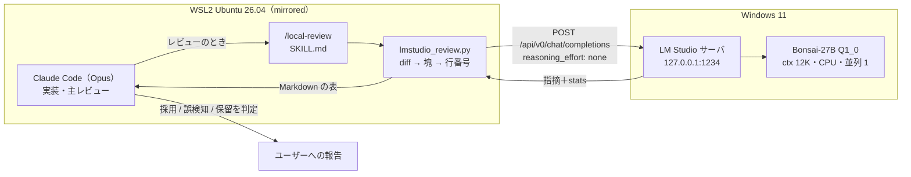
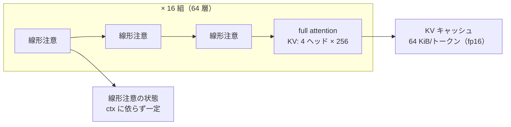

# S006 WSL2 の Claude Code から Windows の LM Studio を副レビュアーとして使う

| | |
| --- | --- |
| セッション | S006 |
| 日付 | 2026-10-18 |
| ブランチ | `dev/supervised-llms`（orca の worktree。ユーザーの決定で S 番号の命名から外れる） |
| 番号 | 並行したセッションが S005（check のクエリ化）と ADR-0007 を先に使ったので、マージの前に S006・ADR-0008 に振り直した |
| Phase | 運用（開発環境） |
| スライド | 全体 [slides.html](slides.html)、トピック別 [01 WSL2 のネットワーク](01-wsl-network.html)・[02 LM Studio のサーバ](02-lmstudio-server.html)・[03 Bonsai の調整](03-bonsai-tuning.html)・[04 /local-review](04-review-skill.html)・[05 ほかの方式との比較](05-alternatives.html) |
| 調査記録 | [doc/research/lmstudio-wsl2-review.md](../../research/lmstudio-wsl2-review.md) |
| 判断 | [ADR-0008](../../adr/0008-local-llm-reviewer.md) |
| スキル | [.claude/skills/local-review/SKILL.md](../../../.claude/skills/local-review/SKILL.md) |
| 作業記録 | [log/work/2026-10-18-s006-local-llm-review.md](../../../log/work/2026-10-18-s006-local-llm-review.md) |

## 1. 目的

ユーザーの依頼は次のとおり。

> orca で作業しているが、WSL2-Ubuntu 26.04 内で Claude Code と Win 側 LM Studio サーバーを使いたい。基本的な実装は Claude Code で、レビュー時に副次的に LM Studio サーバーを使用する。手順を包括的に調査し詳細に解説してください。
>
> - LM Studio のモデルは Bonsai（既インストール）
> - PC リソースが小さいためコンテキスト長や KV キャッシュなど調整して
> - これまでと同様に HTML スライド（全体 1 枚、個別でそれぞれのページ）と解説書の .md 作成

この PC の構成は次のとおり（実機で確かめた）。

| 項目 | 値 |
| --- | --- |
| CPU / RAM | AMD Ryzen 7 7730U（8 コア 16 スレッド）/ 31GB（WSL から見えるのは約 14 GiB） |
| GPU | AMD Radeon 内蔵 GPU。Vulkan で見える専用 VRAM は 3.00 GiB |
| WSL | Ubuntu 26.04.1、カーネル 6.18、**mirrored モード**（`dnsTunneling`、`hostAddressLoopback` も有効） |
| Claude Code | 2.1.302 |
| LM Studio | サーバはポート 1234、llama.cpp の Vulkan 版ランタイム 2.60.0。CLI の `lms.exe` は WSL の PATH に無い |
| モデル | `prism-ml/bonsai-27b`（GGUF Q1_0、3.8 GB と mmproj 0.9 GB）。ほかに 11 モデルがダウンロード済み |

ユーザーと決めたことは次の 4 つ。

1. ブランチは orca の worktree の `dev/supervised-llms` のまま。
2. 範囲は「文書＋スキル＋MCP 版の比較」。
3. スライドは「全体デッキ＋トピック別デッキ」。
4. LM Studio のモデルは `lms.exe` で読み込み直してよい。サーバの GUI の設定（待ち受け・認証・ログ）は手順を書き、ユーザーが変える。

## 2. 決定と理由

### 2.1 全体の方式: Claude が主、ローカル LLM は助言だけ（[ADR-0008](../../adr/0008-local-llm-reviewer.md)）

レビューに LM Studio を組み込む方法を 4 つ比べた。表の数字は実機で測った値。

| 案 | やり方 | 実測・事実 | 判定 |
| --- | --- | --- | --- |
| **A. スキル＋スクリプト** | `/local-review` が `git diff` を塊に分け、REST（`/api/v0/chat/completions`）に送る。Claude が指摘を裁く | 依存なし（標準ライブラリだけ）。分割、除外、推論の切り替え、所要時間の見積もりを自分で制御できる | **採用** |
| B. MCP（houtini-lm） | Claude Code が MCP のツール（`code_task` など）としてローカル LLM を呼ぶ | 登録すると `✔ Connected`。仕込んだバグの差分で 105.9 秒、指摘 1 件で、行番号がずれた。houtini-lm 自身のタイムアウトで出力が切れた（§4.4） | 比較のみ |
| C. 2 つ目の Claude Code | `ANTHROPIC_BASE_URL=http://localhost:1234 claude --bare -p` | "pong" と返すだけで 179 秒（入力 1,197 トークン）。Claude Code はコンテキストを 200K と仮定する。Claude 以外のモデルは Anthropic のサポート外 | 不採用 |
| D. hooks | Stop フックなどで自動実行 | 1 回が 10 分以上かかり、会話を止める | 不採用 |

- サブエージェントの `model` は Claude のモデルしか選べず、接続先を変える欄が無い。そのため「LM Studio を使うサブエージェント」は作れない（[調査 §4](../../research/lmstudio-wsl2-review.md#4-claude-code-側の選択肢)）。
- 指摘を Claude が裁くのは、1-bit の小さいモデルには、行番号のずれや、存在しない問題の指摘が出るため（§4.3 の実例）。

### 2.2 ネットワーク: mirrored ＋ localhost（[01](01-wsl-network.html)）

- この PC は mirrored モードなので、WSL から `http://localhost:1234` で Windows の LM Studio に届く。追加の設定は要らない。
- **LM Studio は 127.0.0.1 だけで待ち受ければ十分。** いまは `0.0.0.0`（Serve on Local Network）で、同じ LAN や Tailscale の相手からも、認証なしで使える状態になっている。
- NAT モードの PC では次の 3 つが要る。
  - `ip route` の既定ゲートウェイを接続先にする
  - LM Studio を 0.0.0.0 で待ち受ける
  - Windows のファイアウォールでポート 1234 の受信を許す。同時に認証も有効にする

### 2.3 LM Studio のサーバ設定（[02](02-lmstudio-server.html)）

ユーザーが Windows の GUI で変える項目は次のとおり。

| 項目 | いま | 推奨 |
| --- | --- | --- |
| Serve on Local Network | 有効（0.0.0.0） | **無効**（127.0.0.1） |
| プロンプトの全文ログ（`logSensitiveData`、`logIncomingTokens`） | 有効 | **無効**。差分がそのままログに残るため |
| Require Authentication | 無効 | 127.0.0.1 なら任意。0.0.0.0 にするなら必須 |
| Auto Unload Unused JIT Models | 3600 秒 | 1800 秒 |

### 2.4 Bonsai-27B の調整（[03](03-bonsai-tuning.html)）

**推奨の読み込み**: `lms load prism-ml/bonsai-27b -c 12288 --gpu off --parallel 1 --ttl 1800 -y`

| 設定 | 値 | 理由（実測） |
| --- | --- | --- |
| コンテキスト長 | **12,288** | KV は 0.75 GiB で軽い。律速は計算で、prompt 処理が約 9 tok/s しか出ない。差分 6,000 ＋ system ＋ 出力 768 が収まる長さにした。16K の入力は読むだけで約 30 分 |
| GPU オフロード | **off** | GPU max でも速さは同じ（prompt 9.8 / 9.5 tok/s、生成 2.24 / 2.31 tok/s）。読み込みは 53 秒対 8.5 秒。専用 VRAM の 3 GiB にモデルが収まらない |
| 並列 | **1** | 既定は 4。レビューは 1 本ずつ送る。線形注意の状態（約 144 MiB）は並列の数だけ要ると考えられる |
| TTL | **1800 秒** | 使い終わったら RAM を返す |
| 推論（thinking） | **切る**（リクエストに `reasoning_effort: "none"`） | 切らないと、短い質問でも推論だけで 126 秒かかった。`chat_template_kwargs` は無視された |
| KV キャッシュの量子化 | 既定（fp16） | q8_0 にしても、12K で 0.35 GiB しか減らない。GUI でしか変えられない |
| Flash Attention | on | REST の load（`--load`）で有効にする |

**KV キャッシュが軽い理由**: GGUF のメタデータを読むと、Bonsai-27B は `qwen35` のハイブリッド構成だった。

- 64 層のうち `full_attention_interval=4` で、full attention は 16 層だけ。残りの 48 層は線形注意で、KV キャッシュを持たない。
- KV キャッシュの大きさは `2 × 16 層 × 4 KV ヘッド × 256 次元 × 2 B` で、1 トークンあたり 64 KiB になる。同じ大きさの dense モデルの 4 分の 1。
- 262K まで広げても KV は 16 GiB。ただし、JIT の既定（この PC は「最大」）で読み込まれると、それだけで RAM を使い切る。**ctx は必ず指定して読み込む。**

### 2.5 `/local-review` の設計（[04](04-review-skill.html)）

- **送る範囲**: 既定は `main` との merge-base から作業ツリーまで（未追跡のファイルを含む）。`--range`、`--staged`、`--path` で絞る。
- **除外**: ロックファイル、`data/`、`log/`、`target/`、`.env*`、鍵らしいファイル（`*.pem`、`*.key`、`*secret*`、`*credentials*`）、画像とバイナリ。
- **行番号の注釈**: 差分の各行の前に、新しいファイルでの行番号を付ける（例: 新しいファイルの 11 行目に足した行は、行頭に `11 +` を付けて送る）。小さいモデルは `@@ -10,3 +10,4 @@` から行番号を数えられないため。
- **分割**:
  - ファイル単位で塊にまとめ、1 塊は既定で 6,000 トークン以内にする。
  - 大きいファイルは @@ ごとに分ける。新しいファイルのように 1 つの @@ が予算を超えるときは、行番号を引き継いだ「(continued)」の @@ に分ける。
  - 1 行だけで予算を超える行に限り、その行を切り詰める。
- **トークンの見積もり**: ASCII は 3 文字で 1、それ以外は 1 文字で 1 と、多めに見積もる。実測では、Rust のソースは 3.0〜3.3 文字で 1 トークンだった。
- **未読み込みなら止まる**: 終了コード 2。JIT で最大の ctx に読み込まれる事故を防ぐ。
  - LM Studio のモデル一覧（`/api/v0/models`）は、14〜63 秒かかることがあった。待ち時間を 120 秒にし、直前に確かめたときは `--ctx` で確認を省けるようにした。
- **出力**: 指摘は `path:line — 重大度 — 指摘 — 直し方` の形を正規表現で拾い、表にする。形式に合わない行は「形式に合わなかった出力」として残す。統計（入力と出力のトークン数、最初のトークンまでの秒数、tok/s）を付ける。
- **見積もり**: `--dry-run` で、塊の一覧と所要時間（既定は prompt 8 tok/s、生成 2 tok/s で計算）を、モデルに送らずに出す。

## 3. 図

### 3.1 全体の流れ



### 3.2 1 つの塊の時間の内訳（実測からの見積もり）

```mermaid
gantt
  dateFormat  s
  axisFormat  %M:%S
  title 6,000 トークンの塊 1 個（prompt 約 9 tok/s、生成 約 2.3 tok/s）
  section LM Studio
  入力の処理（約 6,400 トークン） :a1, 0, 710s
  出力の生成（最大 768 トークン）   :a2, after a1, 330s
```



### 3.3 Bonsai-27B の層と KV キャッシュ



## 4. 再現手順

### 4.1 Windows 側（ユーザーが行う）

1. `%UserProfile%\.wslconfig` が mirrored であることを確かめる（この PC は設定済み）。

   ```ini
   [wsl2]
   networkingMode=mirrored
   dnsTunneling=true

   [experimental]
   hostAddressLoopback=true
   ```

2. LM Studio の Developer → Server Settings で、**Serve on Local Network を切る**。プロンプトの全文ログも切る。サーバを Start する。
3. （任意）Require Authentication を有効にしてトークンを発行し、WSL の `~/.zshrc` に `export LMSTUDIO_API_TOKEN=...` と書く。リポジトリには書かない。
4. （任意）My Models → bonsai-27b の歯車 → Load で、CPU Thread Pool Size を物理コア数（8）にする。

### 4.2 WSL 側

```bash
# lms.exe を WSL から呼べるようにする（パスにユーザー名が入るので ls で探す）
alias lms="$(ls /mnt/c/Users/*/.lmstudio/bin/lms.exe | head -1)"

# 届くか
curl -s -m 5 http://localhost:1234/v1/models | head -c 300

# 推奨の設定で読み込み直す
lms unload --all
lms load prism-ml/bonsai-27b -c 12288 --gpu off --parallel 1 --ttl 1800 -y
lms ps

# スキルのスクリプトで確かめる
python3 -I .claude/skills/local-review/lmstudio_review.py --check
python3 -I .claude/skills/local-review/lmstudio_review.py --dry-run

# レビュー（Claude Code の中では「/local-review」で、Claude が実行と判定をする）
python3 -I .claude/skills/local-review/lmstudio_review.py --path 'src/Rust/**' --max-chunks 2 --out log/local/local-review.md

# 単体テスト（LM Studio が無くても通る）
python3 -I -m unittest discover -s .claude/skills/local-review -p 'test_*.py'
```

### 4.3 実際にかけた結果

実際に 2 回かけた（2026-10-18、ctx 12,288・GPU off・並列 1・推論なし）。

| 対象 | 入力 | 最初のトークンまで | 合計 | 結果 |
| --- | --- | --- | --- | --- |
| このセッションの `lmstudio_review.py`（塊 2 個のうち 1 個目、`--max-chunks 1`） | 6,154 トークン | 1,155 秒 | **19.4 分** | `NO_FINDINGS` |
| バグを 3 つ仕込んだ小さい差分（`tools/stats.py`、24 行） | 620 トークン | 37 秒 | **91 秒** | 指摘 1 件 |

- 見積もり（5,636 ＋ system）は実際の入力（6,154）とよく合った。
- 長い入力では prompt 処理が約 5.3 tok/s まで落ちた。短い入力では約 17 tok/s だった。

仕込んだ差分への指摘を、Claude が裁いた結果は次のとおり。

| # | 場所 | ローカル LLM の指摘 | 判定 | 理由 |
| --- | --- | --- | --- | --- |
| 1 | `tools/stats.py:6` | high — ファイルを閉じない（`with open` を使う） | 採用 | 6 行目の `f = open(path)` は閉じられていない。行番号も正しい |
| — | `tools/stats.py:13` | （指摘なし） | 見逃し | `range(len(values) - window)` は最後の窓を落とす（`+ 1` が要る）。仕込んだバグ |
| — | `tools/stats.py:22` | （指摘なし） | 見逃し | `window >= len(values)` のとき `avg` が空で、`avg[-1]` が IndexError。仕込んだバグ |
| — | `tools/stats.py:23` | （指摘なし） | 見逃し | `values` が空なら ZeroDivisionError。`window <= 0` の検査も無い |

**読み方**:

- 1-bit の 27B は、分かりやすい問題（資源の解放漏れ）は正しい行番号で拾った。
- 境界の計算（off-by-one、空の入力）は見逃した。
- 「指摘なし」は「問題なし」を意味しない。主のレビューは Claude が行い、ローカル LLM は追加の目として使う。

### 4.4 MCP（houtini-lm）を試す手順（採用はしない）

```bash
# 登録（local scope: このプロジェクトのこの PC だけ。~/.claude.json に書かれ、リポジトリには入らない）
claude mcp add --scope local houtini-lm \
  -e HOUTINI_LM_ENDPOINT_URL=http://localhost:1234 \
  -e HOUTINI_LM_MODEL=prism-ml/bonsai-27b \
  -e HOUTINI_LM_THINKING=off \
  -e HOUTINI_LM_MIN_TOKENS=512 \
  -- npx -y @houtini/lm@3.3.4
claude mcp list            # houtini-lm: … - ✔ Connected
# 使い終わったら外す
claude mcp remove --scope local houtini-lm
```

実機の結果（Claude のトークンを使わずに測るため、MCP の stdio に JSON-RPC を直接送った）は次のとおり。

| 項目 | 値 |
| --- | --- |
| 起動 | npx の初回 19.5 秒、2 回目 1.7 秒。ツールは 8 個（`chat`、`custom_prompt`、`code_task`、`code_task_files`、`discover`、`list_models`、`embed`、`stats`） |
| `code_task`（上と同じ仕込んだコード） | 105.9 秒。指摘は同じ 1 件（ファイルを閉じない）だが、**行番号が 4（正しくは 6）** |
| 出力 | houtini-lm のソフトタイムアウトで途中で切れた（`TRUNCATED (soft timeout - partial result)`） |
| 出力の上限 | `max_tokens: 512` を渡しても「推論モデル」とみなされ、2,512 に増やされた。`HOUTINI_LM_MIN_TOKENS` の既定は 4096 |

- 不採用の理由は 3 つ。この PC の遅さでは、MCP サーバ側のタイムアウトで結果が切れること。行番号の注釈が無いこと。分割と除外を制御できないこと。
- ツールの説明には「コードを省略せず全部渡せ」と書いてある。Claude が大きなファイルをそのまま渡すと、1 回で数十分かかる。

### 4.5 検証

| 検査 | 結果 |
| --- | --- |
| `lmstudio_review.py` の単体テスト | 13 件すべて通過（HTTP はモック。LM Studio が無くても通る） |
| `check_docs.py` | デッキ 11 件すべて OK（S006 の 6 件を含む）、相対リンク 235 件中の切れ 0 件、トピック別デッキの相互リンクも OK |
| `render_slides.py`（Playwright） | デッキ 11 件 × 3 表示で問題 0 件。スクリーンショットを目で確かめ、コードの見切れ（02・03・01・全体の各 1 枚）を直した |
| `uv sync --locked` | 通過（Rust は触っていないので cargo の検査は省いた） |
| markdownlint（新しい Markdown 5 件） | MD013（行の長さ）以外は 0 件。MD013 は既存の解説書でも出ていて、リポジトリとして扱っていない |
| セッション記録の `--check` | 取りこぼし 0 件。Windows のプロファイル名、LAN と Tailscale の IP を伏せ字にする規則をフックに足した |
| 実機 | `--check` で読み込みと ctx を表示。仕込んだバグの差分で 91 秒、指摘 1 件（§4.3） |

## 5. 次回

- **速いモデルとの比較**: インストール済みの MoE（`openai/gpt-oss-20b`、`google/gemma-4-26b-a4b`）や小さい `nvidia/nemotron-3-nano-4b` を同じ差分で測る。速さと指摘の質が見合えば、`LMSTUDIO_MODEL` の推奨を替える。
- **CPU のスレッド数**: GUI の CPU Thread Pool Size で prompt 処理が速くなるかを測る。
- **ユーザーの作業**: LM Studio の待ち受けを 127.0.0.1 にし、全文ログを切る（§2.3）。
- **実際の変更で使う**: [roadmap.md](../../roadmap.md) の P2 の続き（Rust の変更）のレビューで `/local-review` を使い、採用率を作業記録に残す。
