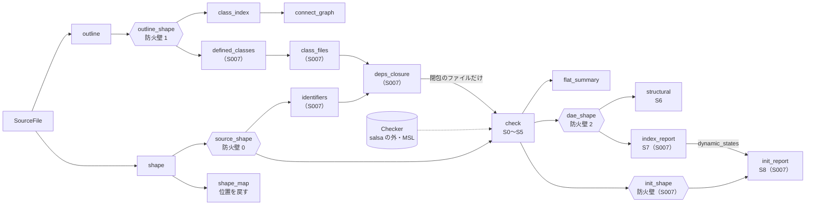
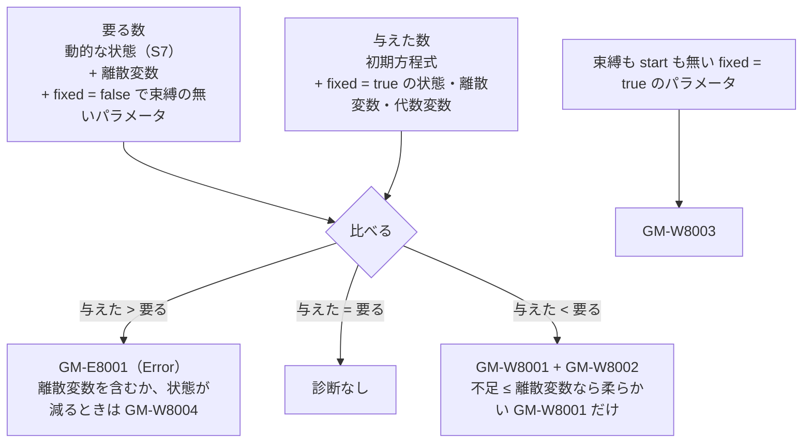

# S007 deps_closure・S7 Pantelides・S8 初期化

| | |
| --- | --- |
| セッション | S007 |
| 日付 | 2026-10-18 |
| ブランチ | `feature/s007-deps-index-init` |
| Phase | P2 遅延クエリと検査（3 回目） |
| スライド | [slides.html](slides.html)（15 枚） |
| MSL の全例題の報告 | [doc/msl-funnel.md](../../msl-funnel.md)（`cargo xtask msl-funnel` が生成。S007 から置き場を固定） |
| 設計の記録 | [ADR-0005](../../adr/0005-lazy-query-db.md) の結果（`deps_closure`）、[ADR-0009](../../adr/0009-structural-index-and-init.md)（S7・S8） |
| 調査 | [research/rumoca.md の「S007 で調べた API」](../../research/rumoca.md#s006-で調べた-apiv0102) |
| 作業記録 | [log/work/2026-10-18-s007-deps-index-init.md](../../../log/work/2026-10-18-s007-deps-index-init.md) |

## 1. 目的

[roadmap.md](../../roadmap.md) の S007（P2 の 3 回目）として、候補 7 つのうち次の 3 つを行った。

1. **`deps_closure`**: `check` に渡すファイルを、モデルが使うものだけに絞る。S005 ではワークスペースの全ファイルを渡していたので、どのファイルの中身が変わっても `check`（Rumoca のコンパイル）が再実行されていた。
2. **S7**: Pantelides 法で構造インデックスを見積もり、状態選択の候補を出す。S005 の S7 は「微分インデックスが 1 より大きい見込み」の情報だけだった。
3. **S8**: 初期化系の検査（初期条件の過不足、start 値の無い状態、値の無いパラメータ）。

ユーザーの依頼は「S007 を進めよ。OpenModelica のサイトが重くてアクセスできないため、omc との照合は後回しにして先に進めたい。インストール後に再開するため、このような区切りごとにリマインドしてください。」。

- **omc との照合（候補 5）は後回し**にした。omc は未導入で、入れたら再開する（[5. 次回](#5-次回)）。
- `Checker` のメモリの上限（候補 2）は、IDE のプロセス構成（P4）が決まってから決める。
- Rumoca への上流報告（候補 6）は、ユーザーが出す。
- `class_index` の残り（候補 7）は、import だけを `deps_closure` のついでに扱った。

進め方は S005 と同じにした。1 つの worktree で、所有ファイルを分けた Opus のサブエージェント 3 つに分けた。

| 担当 | 受け持ち |
| --- | --- |
| A | `deps_closure`、db の S7・S8 の配線、CLI |
| B | Pantelides 法、`Index.*` の検証モデル、funnel の S7・S8 の列 |
| C | S8 の抽出（frontend）と判定（analysis）、`Init.*` の検証モデル |
| D | 文書（この解説書とスライド、正典の更新） |

- 共有の型（`ClassOutline.imports`、`InitStructure`、`IndexReport`、`InitReport`、診断コード）は先に凍結した。

## 2. 決定と理由

決めたことの全文は[作業記録の「決めたこと」](../../../log/work/2026-10-18-s007-deps-index-init.md#決めたこと)にある。設計の正典は ADR に書いた。

### `deps_closure`（[ADR-0005](../../adr/0005-lazy-query-db.md) の結果）

- **識別子の単純名の一致で、ファイル単位に広めに見積もる。**
  - アウトライン（extends・部品の型・import）だけでは、式の中の関数・定数・redeclare の参照を拾えない。
  - そこで、閉包の中のファイルの本文（`source_shape`）に現れる識別子と、各ファイルが定義するトップレベルのクラスの単純名を突き合わせ、固定点まで広げる。
  - 余計に入ることはあるが、足りないことは無い（別のトップレベルのクラスを参照するときは、必ずその名前を綴るため）。
- 新しいクエリは 4 つ（`globe-mode-db`）。

  | クエリ | 入力 | 中身 |
  | --- | --- | --- |
  | `identifiers(file)` | `source_shape` | 本文の識別子の集合。キーワードも残す。文字列 `"…"` の中は除く。引用識別子は両方の綴り。数の中の英字は除く |
  | `defined_classes(file)` | `outline_shape`（防火壁 1） | トップレベルのクラスの単純名。構文の誤りがあれば空 |
  | `class_files(workspace)` | `defined_classes` | 単純名 → 定義するファイルの表と、構文の誤りのあるファイルの一覧 |
  | `deps_closure(workspace, request)` | `class_index`・`class_files`・`identifiers` | 固定点。パスの昇順 |

- **入れ子のクラスは `defined_classes` に入れない。**
  - `Components.mo` の `replaceable package Medium` が、`MediumFlow.mo` の入れ子の `Medium` と同じ名前で、無関係のファイルが入ってしまうため。
  - トップレベルだけで足りる根拠は、doc コメントに書いた（入れ子のクラス `T.N` に届く道には、必ず `T` か、`T` を名指すファイルが現れる）。
- **構文の誤りのあるファイルは、いつも閉包に入れる。** 何を定義しているか分からないため。S0 で止まる。
- **モデルがワークスペースに無い**（MSL の中のモデル、存在しないモデル）**ときは、閉包は空**にする。「見つからない」の診断には、ワークスペースのモデルを候補として足す（Rumoca は渡した文書の中からしか候補を出さないため）。
- IR の `ClassOutline` に `imports` を足した（`import A.B.C;`、`import D = A.B.C;`、`import A.B.*;`、`import A.B.{C,D};`）。今は保持するだけで、`deps_closure` は本文の識別子で import の名前も拾う。
- CLI に `globe deps <files> -m <model> [--json]` を足した。
- **閉包の違うモデルへの切り替えの費用は、トレードオフとして受け入れた。**
  - Rumoca は、渡す文書の組が変わるたびに MSL ごと解決し直す（約 1.5〜1.8 s）。
  - 本文の編集で文書を差し替えたときにも同じことが起きるので、費用の種類は増えない。
  - 数字は [4. 再現手順](#4-再現手順)。和らげる案は S008 の候補にした。

### S7: Pantelides 法（[ADR-0009](../../adr/0009-structural-index-and-init.md)）

- `DaeStructure`（der の形の `incidence` と `state_refs`）の上で回す。`globe-mode-analysis` は Rumoca に依存しない（wasm32 でもビルドでき、Track B にもそのまま使える）。
- 未知数の族ごとに階数つきのノードを持ち、最高階だけをマッチングする。der の形の Hopcroft–Karp から始め、交互路はスタックで探す。
- 結果は `IndexReport { index, differentiations, orders, dummy_candidates, n_differentiated, dynamic_states, failed }`。
- **`dynamic_states` = 状態の数 + Σ（新しく作った微分のノード）− Σ（方程式の微分回数）**。拡張した系の「未知数 − 方程式」で、積分器の数にあたる。
- **情報にとどめ、実行を止めない。** インデックスが 2 以上なのはモデルの誤りではない。

  | コード | 重さ | 条件 |
  | --- | --- | --- |
  | `GM-I7001` | Info | インデックス 2 以上。構造インデックスの見込みと、微分した方程式とその回数 |
  | `GM-I7002` | Info | 動的な状態 < 状態の数。状態選択（dummy derivative）の候補 |
  | `GM-E7001` | Error | 打ち切り。S6 を通った構造では起きないはず |

- S6 の `StructuralReport::diagnostics` から `GM-I7001` を外し、S7 の診断は `IndexReport` に一本化した。S7 は S6 が構造特異でない（regular）ときだけ回す。

### S8: 初期化（[ADR-0009](../../adr/0009-structural-index-and-init.md)）

- **数と属性だけで判定する。** 初期方程式の incidence（どの初期方程式がどの変数を決めるか）は持たない。S008 以降の候補にした。
- 入力の `InitStructure` は、frontend が Rumoca の DAE から取り出す（`globe-mode-frontend/src/init.rs`）。Rumoca の振る舞いで確かめたことは [research/rumoca.md](../../research/rumoca.md#s006-で調べた-apiv0102) にある。
  - `fixed = true` の start は、ToDae では初期方程式にならない。2 重に数えない。
  - `start()` はほぼ常に Some（Rumoca が既定の start を補う）ので、`has_start` は「明示された start」と定義した。
  - Real でない `fixed = false` のパラメータを決める式（`initial_parameter_values()`）と、定数で決まる離散値・初期アルゴリズムの代入（`initial_discrete_values()`）も、初期方程式として数える。
- **数え方**:

  | | 数えるもの |
  | --- | --- |
  | 要る数 | 動的な状態（S7。無ければ状態の数）+ 離散変数 + `fixed = false` で束縛の無いパラメータ |
  | 与えた数 | 初期方程式 + `fixed = true` の状態・離散変数・代数変数 |

- **Error は確かなときだけにする。**

  | 場合 | 診断 |
  | --- | --- |
  | 過剰で、離散変数が無く、動的な状態 = 状態の数 | `GM-E8001`（Error） |
  | 過剰で、離散変数がある、または動的な状態 < 状態の数 | `GM-W8004`（初期条件が多い見込みだが確定できない） |
  | 不足 ≤ `fixed = false` の離散変数の数 | 柔らかい `GM-W8001`（「離散変数の pre の初期値に start を使えば足りる。MLS 8.6」）。`GM-W8002` は出さない |
  | それより多く不足 | `GM-W8001` と、start の無い状態ごとに `GM-W8002` |
  | 束縛も start も無い `fixed = true` のパラメータ | `GM-W8003` |

- 近似である理由は 2 つある。
  - when の外の式で決まる離散変数（MLS 8.6 の暗黙の `pre(v) = v` で初期条件が要らない）か、when の中で決まるかを、`InitStructure` では区別できない。
  - インデックスの低減で状態が減るとき、余った `fixed = true` が拘束と矛盾しない（整合する冗長な初期条件）かは、数値でしか決まらない。
- S8 は S0〜S7 に Error が無いときだけ回す。

### 作業の途中で直したこと

| 見つけたこと | 直したこと |
| --- | --- |
| `Index.Pendulum`（状態 4、自由度 2）に「2 個足りない」、`Index.ParallelCapacitors`（状態 2、自由度 1）に「1 個足りない」と誤った警告が出た（C が A の配線後の CLI で見つけた） | 要る数に S7 の動的な状態の数を使う（`analyze_init_with_index`）。S7 が打ち切りなら状態の数で代用する |
| 動的な状態の数の最初の式「状態の数 − Σ（状態の階数 − 1）」が、並列コンデンサで 2 になった（正しくは 1） | 「状態の数 + Σ 新しい微分のノード − Σ 微分回数」に直した。状態選択の候補は「1 回以上微分した方程式が参照する状態」にした |
| MSL の `DemonstrateContinuousSignalExtrema`（要る 3 に対し与えた 9）と `DemonstrateSignalExtrema` が、誤って `GM-E8001` になった | 離散変数を要る数に、`fixed = true` の離散変数・代数変数を与えた数に入れた。21 / 21、11 / 11 になった |
| 最初の全例題のファネルで、MSL の正しい例題 3 本が S8 の `GM-E8001` になった: `Electrical.Analog.Examples.GenerationOfFMUs`（与えた 8 / 要る 6）、`Electrical.Analog.Examples.Lines.CompareLineTrunks`（60 / 57）、`Thermal.HeatTransfer.Examples.GenerationOfFMUs`（4 / 3）。どれもインデックス 2 で、拘束でつながった状態すべてに `fixed = true` がある | `GM-E8001` は「離散変数が無く、動的な状態 = 状態の数」のときだけにし、それ以外の過剰は警告 `GM-W8004` にした。余った fixed が整合する冗長な初期条件かは、構造の検査では決まらないため |

- `Invalid.HighIndexDuplicate` は動的な状態が 0 なので、`vC(fixed = true)` が 1 つ余る。インデックスの低減で状態が減るので確定させず、**S8 の警告 `GM-W8004` を出して通る**。[src/Modelica/README.md](../../../src/Modelica/README.md) の行と .mo のコメントは、この規則に合わせて直してある。

### そのほか

- `msl:funnel` の報告の置き場を `doc/msl-funnel.md` に固定した（`mise.toml`）。セッションの文書はそのセッションの間だけ編集するものなので、セッションの下に置くと毎回動かすことになる。S005 の報告（[S005-check-queries/msl-funnel.md](../S005-check-queries/msl-funnel.md)）はそのまま残す。
- `globe_mode_core::codes` に `GM-I7002`、`GM-E7001`、`GM-E8001`、`GM-W8001`〜`GM-W8004` を足した。

## 3. 図

クエリの連鎖（`globe-mode-db`。S007 で足したものは `deps_closure` の周りと、`index_report`・`init_shape`・`init_report`）:



Pantelides 法の例（`Index.Pendulum`。直交座標の平面の振り子）:

```modelica
  Real x(start = 0.6, fixed = true);
  Real y(start = -0.8);
  Real vx(start = 0, fixed = true);
  Real vy(start = 0);
  Real lambda;
equation
  der(x) = vx;
  der(y) = vy;
  der(vx) = lambda * x;
  der(vy) = lambda * y - g;
  x ^ 2 + y ^ 2 = L ^ 2;
```

| 方程式 | 微分の回数 |
| --- | ---: |
| `der(x) = vx` | 1 |
| `der(y) = vy` | 1 |
| `der(vx) = lambda * x` | 0 |
| `der(vy) = lambda * y - g` | 0 |
| `x ^ 2 + y ^ 2 = L ^ 2`（拘束） | 2 |

- der の形（状態を既知とみなす）では、拘束は状態だけを含むので、どの未知数とも対応づかない（マッチング 4 / 5）。
- Pantelides 法は、拘束を 2 回、`der(x) = vx` と `der(y) = vy` を 1 回ずつ微分する。構造インデックスは 2 + 1 = 3。
- 最高階は `x`・`y` が 2 階、`vx`・`vy` が 1 階、`lambda` が 0 階。新しく作った微分のノードは 2 つ。
- 動的な状態 = 4 + 2 − 4 = **2**。状態選択の候補は x, y, vx, vy（`GM-I7002`）。
- fixed は x と vx の 2 つにした。糸が水平（x = L）で x を固定すると ∂(x² + y²)/∂y = 2y = 0 で y が決まらないので、x = 0.6 から静かに放す形にした。

動的な状態の数の式の確かめ:

| モデル | 状態 | 新しい微分のノード | Σ 微分回数 | 動的な状態 | 最初の式（状態 − Σ（階数 − 1）） |
| --- | ---: | ---: | ---: | ---: | ---: |
| `Index.Pendulum` | 4 | 2 | 4 | 2 | 2 |
| `Index.ParallelCapacitors` | 2 | 0 | 1 | 1 | 2（誤り） |
| `Invalid.HighIndexDuplicate` | 1 | 1 | 2 | 0 | — |

S8 の数え方:



## 4. 再現手順

```bash
# 閉包と、S7・S8 の出力
globe deps  src/Modelica/GlobeModeValidation -m GlobeModeValidation.Connect.RealCircuit
globe check src/Modelica/GlobeModeValidation -m GlobeModeValidation.Index.Pendulum
globe check src/Modelica/GlobeModeValidation -m GlobeModeValidation.Index.ParallelCapacitors --json
globe check src/Modelica/GlobeModeValidation -m GlobeModeValidation.Init.OverDetermined   # 終了コード 1
globe check src/Modelica/GlobeModeValidation -m GlobeModeValidation.Invalid.HighIndexDuplicate   # S8 の警告 GM-W8004 だけで通る

# MSL のモデル（MSL を取得してから）
cargo xtask fetch-msl
cargo run --release -p globe-mode-cli -- check -L data/msl -m Modelica.Blocks.Examples.PID_Controller

# deps_closure の計測（無視指定のテスト）
cargo test --release -p globe-mode-db --test deps -- --ignored --nocapture

# MSL の全例題（release。CI には入れていない。報告は doc/msl-funnel.md）
mise run msl:funnel

# まとめての検査
mise run check
```

`globe check` の出力の例（`Index.Pendulum`、デバッグビルドの `target/debug/globe` で取った）:

```text
src/Modelica/GlobeModeValidation/Index/Pendulum.mo:28:3: info[GM-I7001] S7 インデックス: 構造インデックス 3 の見込み（Pantelides 法: 方程式 3 本を微分し、最大 2 回）
    note: 微分した方程式（3 本）: `x ^ 2 + y ^ 2 = L ^ 2`（2 回）, `der(x) = vx`（1 回）, `der(y) = vy`（1 回）
src/Modelica/GlobeModeValidation/Index/Pendulum.mo:18:3: info[GM-I7002] S7 インデックス: 状態 4 個のうち動的な状態は 2 個の見込み。状態選択（dummy derivative）が要る
    note: 候補の状態（4 個）: `x`, `y`, `vx`, `vy`
    note: 2 階以上の微分が現れる状態（2 個）: `x`（2 階）, `y`（2 階）
GlobeModeValidation.Index.Pendulum: 方程式 5 / 変数 5（状態 4・代数 1・出力 0・離散 0）
GlobeModeValidation.Index.Pendulum: DAE の変数（配列は 1 個）: 状態 4・代数 1・出力 0・連続方程式 5
GlobeModeValidation.Index.Pendulum: S6: 完全マッチング 5 / 5。der の形では 4 / 5（インデックス低減が要る見込み）
GlobeModeValidation.Index.Pendulum: S7: 構造インデックス 3 の見込み（微分した方程式 3 本、最大 2 回）。動的な状態 2 / 4、状態選択の候補: x, y, vx, vy
GlobeModeValidation.Index.Pendulum: S8: 初期条件 2 / 2（動的な状態 2 / 状態 4・離散 0・初期方程式 0・fixed = true の状態 2・離散 0・代数 0・fixed = false のパラメータ 0）
GlobeModeValidation.Index.Pendulum: OK（S0〜S8 を通過）
```

検証の結果（2026-10-18）:

| 項目 | 結果 |
| --- | --- |
| `deps_closure(Connect.RealCircuit)` | 5 / 23 ファイル（`package.mo`、`Connectors.mo`、`Components.mo`、`Connect/package.mo`、`Connect/RealCircuit.mo`）。`Index.Pendulum` は 3 / 23 |
| 閉包だけの検査と全ファイルの検査 | 検証用パッケージの索引のモデルとブロック 20 本以上のすべてで一致 |
| 使わないファイル（`Invalid/StructurallySingular.mo`）の式を変える | `source_shape`・`deps_closure`・`check`・`structural` は **0 回** |
| 閉包の中のファイル（`Components.mo`）のパラメータを変える | `check` 1 回。`index_report`・`init_report` は 0 回 |
| MSL の読み込み | 中央値 3822 ms（1 回目は 13096 ms） |
| (a) `Connect.MediumFlow` の最初の検査 | 1963 ms |
| (b) 使わないファイルの式を変えた後の再検査 | 中央値 **0.19 ms**、最大 0.35 ms（`check` 0 回） |
| (c) 閉包の中のファイルを変えた後の再検査 | 中央値 1815 ms、最大 1879 ms（参考: 全ファイルを渡す S005 の方式で 1746 ms / 1856 ms） |
| (d) 編集の後に MediumFlow → RealCircuit | 中央値 1485 ms、最大 1543 ms |
| (e) 編集なしで、閉包の違うモデルを初めて検査 | 中央値 1700 ms、最大 2851 ms（参考: 全ファイルを渡したままなら 67 ms / 122 ms） |
| S7（Pantelides 法） | テスト 17 本と funnel の 1 本。乱択 3000 件で「`index_reduction_needed` ⇔ `index >= 2`」、乱択 1916 件で微分の回数が Pryce の Σ 法の最小のオフセットと一致 |
| 検証用のモデルの S7・S8 | [ADR-0009 の結果](../../adr/0009-structural-index-and-init.md#結果)の表のとおり。`Init.OverDetermined` は S8（`GM-E8001`）で止まり、終了コード 1。`Invalid.HighIndexDuplicate` は S8 の警告 `GM-W8004` だけで通る |
| MSL の S8 | `ChuaCircuit` 3 / 3、`Rotational.Examples.First`（インデックス 3、動的な状態 4 / 8）4 / 4、`PID_Controller`（インデックス 3、動的な状態 6 / 10、離散 3）は与えた 6 / 要る 9 で柔らかい `GM-W8001` だけ。`DemonstrateContinuousSignalExtrema` 21 / 21、`DemonstrateSignalExtrema` 11 / 11 |
| MSL の全例題（最初の実行。過剰の規則を直す前） | 566 本: OK 366・NG 16（S5 1・S6 12・S8 3）・GM-U 184・panic 0。S7 を回した 369 本の構造インデックスは 1 が 215・2 が 58・3 が 95・4 以上が 1（`Blocks.Examples.FilterWithDifferentiation`、微分 14 本・最大 3 回）・打ち切り 0、状態選択が要るもの 154。S8 の 369 本は合う 111・過剰 3・不足 255・入力なし 0、`GM-W8003` 2 本。照合 381 / 381。検査 881.8 s（1 本 1.56 s）、最大 RSS 7.1 GiB |
| MSL の全例題（最終の実行。S0〜S8） | 566 本: OK 369（うち S7 の情報 154）・NG 13（S5 1・S6 12・S7 0・S8 0）・GM-U 184（82 / 52 / 50）・panic 0。OK・NG の本数は S005 と同じ。S7 を回した 369 本の構造インデックスは 1 が 215・2 が 58・3 が 95・4 以上が 1・打ち切り 0、状態選択が要るもの 154。S8 の 369 本は合う 111・過剰の見込み 3（`GM-W8004`。Error 0）・不足 255・入力なし 0、`GM-W8003` あり 2。S6 と Rumoca の照合 381 / 381。検査 833.0 s（1 本 1.47 s）、最大 RSS 7.2 GiB |
| Rust のテスト | workspace 全体で 209 本が通過（analysis 68、db 58（7 + 11 + 16 + 11 + 13）、frontend 52（23 + 20 + 9）、ir 6、core 13、xtask 12）。db の端から端までのテスト `tests/stages.rs` は 11 本 |
| clippy・fmt | 警告 0 件、差分 0 |

## 5. 次回

> **リマインド: omc は未導入。** OpenModelica のサイトが重くて取得できず、ユーザーの指示で照合を後回しにした。omc を入れたら、次の照合を最初に再開する。

**S008（P2 の 4 回目）の候補**（[roadmap.md](../../roadmap.md#次のセッション)）:

1. **omc を入れて照合する**: S5 が omc と 95% 以上一致するか（P2 の完了条件の残り）、S6 で NG の MSL 12 本（接地の無い部品モデル）が単体で本当に特異か、GM-U0003 の一覧が本当に Rumoca の制約か（ADR-0007 の C）。
2. **閉包の切り替えの費用を和らげる**: `Checker` に文書の和集合を持たせて、文書の組が変わらないようにする、など。
3. **S8 を精密にする**: 初期方程式の incidence を持ち、S7 で微分した拘束と合わせて初期化系をマッチングする。
4. **離散変数の when の区別**と、**インデックスの低減で余った fixed の扱い**: `GM-W8004` と柔らかい `GM-W8001` を確定させる。
5. **S9（代数ループ）・S10（プリフライト）**。
6. **`Checker` のメモリの上限**（P4 のプロセス構成が決まってから）。
7. **Rumoca の制約の上流報告**（ユーザーが出す）。
8. **`class_index` の残り**: for や if の中の connect、継承したクラスの中の入れ子のクラス。

**残したこと**:

- S8 は数と属性だけを見る近似。数が合っていても、決まらない変数や重複した初期方程式は見つけられない。
- 離散変数が when の中で決まるかどうかは区別していない。
- S7 の結果を Rumoca 自身のインデックス低減と照合することは、していない。
- 数値的な特異（`HighIndexDuplicate` の 2 本の同じ電圧則）は、構造の検査では見つからない（S8 の `GM-W8004` は、動的な状態が 0 になって fixed が 1 つ余るために出る警告）。
- `msl-funnel` は CI に入れていない。検査の段階・GM-U の振り分け・Rumoca の rev を変えたら、手で回す（[CLAUDE.md](../../../CLAUDE.md) §2）。
