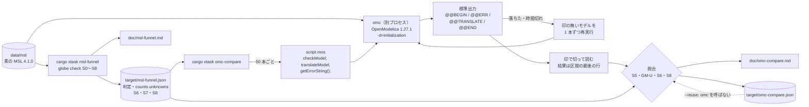

# S008 omc との照合

| | |
| --- | --- |
| セッション | S008 |
| 日付 | 2026-10-19 |
| ブランチ | `feature/s008-omc-compare` |
| Phase | P2 遅延クエリと検査（4 回目） |
| スライド | [slides.html](slides.html)（14 枚） |
| 照合の報告 | [doc/omc-compare.md](../../omc-compare.md)（`cargo xtask omc-compare` が生成。手で編集しない） |
| 設計の記録 | [ADR-0010](../../adr/0010-omc-comparison.md)（照合の方法と規則、結果） |
| 調査 | [research/openmodelica-dymola.md の「S008 で確かめた omc 1.27.1 のスクリプト API」](../../research/openmodelica-dymola.md#s008-で確かめた-omc-1271-のスクリプト-api) |
| 作業記録 | [log/work/2026-10-19-s008-omc-compare.md](../../../log/work/2026-10-19-s008-omc-compare.md) |

## 1. 目的

ユーザーの依頼は「OpenModelica のインストールが完了し omc を導入したので、確認したのち作業を進めてください」。

S007 では omc が入っておらず、ユーザーの指示で omc との照合を後回しにしていた（[S007 の解説書の「次回」](../S007-deps-index-init/解説書.md#5-次回)）。S008 では、[roadmap.md](../../roadmap.md) の S008 の候補のうち **1（omc を入れて照合する）だけ**を行った。候補 2〜8 は触っていない。

確かめたかったことは 3 つ（どれも S005・S007 では未確認だった）。

1. **S5（方程式数と未知数）が omc と 95% 以上一致するか。** P2 の完了条件の残りの 1 つ（[roadmap.md の「P2 の完了条件の進み具合」](../../roadmap.md#p2-の完了条件の進み具合)）。
2. **S6 で NG にした MSL の 12 本**（`OpAmpCircuits.*`、`FluxTubes…Components.*`。接地の無い部品モデル）が、単体で本当に構造特異か。
3. **既知の制約の一覧（`GM-U0003`、`src/Modelica/msl-known-unsupported.txt` の 50 行）が、本当に Rumoca の制約か**（omc では通るか）。[ADR-0007](../../adr/0007-unsupported-classification.md) の C「omc と照合する」にあたる。

ついでに、S8 の「初期条件の過剰」も omc の警告と比べた。

使った omc:

| 項目 | 値 |
| --- | --- |
| 実行ファイル | `/usr/bin/omc`（WSL2 の Ubuntu に apt で導入） |
| 版 | `OpenModelica 1.27.1~2-g6db4671`（`omc --version`） |
| 同梱の MSL | `Modelica 4.1.0+maint.om`（OpenModelica 向けの修正入り。照合には使わない） |
| 照合に使った MSL | `data/msl` の素の MSL 4.1.0（globe check と同じもの） |

- OpenModelica は OSMC-PL / AGPL なので、**リンクもコードの複製もしない。別プロセスで呼ぶ照合用途だけ**にした（[CLAUDE.md](../../../CLAUDE.md) の 3、[licenses.md](../../licenses.md)）。

## 2. 決定と理由

決めたことの全文は[作業記録の「決めたこと」](../../../log/work/2026-10-19-s008-omc-compare.md#決めたこと)に、設計の正典は [ADR-0010](../../adr/0010-omc-comparison.md) にある。

| 項目 | 決定 | 理由 |
| --- | --- | --- |
| 範囲 | omc との照合（roadmap の S008 の候補 1）だけ | S007 で後回しにした項目を、omc を入れたら最初に再開する約束だった |
| omc の呼び方 | `cargo xtask omc-compare` が omc を**別プロセス**で呼ぶ。入力は `msl-funnel --json` の結果 | ファネルに omc を組み込むと、ファネルが omc の有無に依存する。omc が無い環境では `omc-compare` だけが動かない |
| omc に読ませる MSL | `data/msl` の素の 4.1.0 | omc 同梱の `+maint.om` は中身が違い、照合にならない |
| S5 の一致の定義 | 「合う / 合わない」の**判定**が同じなら一致。globe に S5 の判定が無いもの（GM-U、S4 以前で止まったもの）は分母に入れない | omc の `checkModel` は数が合わなくても「completed successfully」なので、数から判定を作るしかない |
| 数が同じか | 副次的な指標にする。そのために `msl-funnel` の JSON の `counts` に `unknowns`（スカラーの未知数の総数）を足した | 最初の JSON には配列を 1 個と数えた状態・代数・出力しか無く、omc の変数数と比べられなかった |
| S6 | omc の `translateModel` の失敗の文言で比べる | omc は構造特異をバックエンドの Error として出す |
| S7 | 比べない | omc は構造インデックスの数を出さない |
| S8 | **過剰だけ**比べる（「over specified」の警告） | omc は不足を黙って start 値で埋め、警告を出さない |
| CI | 入れない。報告は `doc/omc-compare.md`、タスクは `mise run msl:omc` | ランナーに omc が無い。`msl:funnel` と同じ扱い |

### `cargo xtask omc-compare` の仕組み（`src/Rust/xtask/src/omc.rs`）

- `target/msl-funnel.json`（globe check の S0〜S8 の判定）を読む。
- 50 本ごとに 1 つの `.mos` スクリプトを書き、`omc script.mos` を実行する。
  - 先頭で `setModelicaPath("<data/msl>")`、`loadModel(Modelica, {"4.1.0"})`、`setCommandLineOptions("-d=initialization")`。
  - 1 本ごとに `checkModel(M);` と `translateModel(M);` を**文として**呼び、そのあとに `getErrorString();`。`print` は印（`@@BEGIN` / `@@ERR` / `@@TRANSLATE` / `@@END`）を出すだけに使う。
- 標準出力を印で切って、モデルごとの結果にする。`@@END` まで出力が無いモデルは「落ちた」とみなす。
- omc が落ちたり時間切れ（既定 900 s / プロセス）になったりしたら、印の無いモデルを 1 本ずつ再実行し、それでも駄目なら「結果なし」にして続ける。
- `--reuse <json>` で、前に `--json` で書いた omc の結果を読み、**omc を呼ばずに照合だけやり直せる**。
- 単体テストは 7 本（印の読み取りと dump の後の `true`、omc の文字列の引用の外し方、文言の分類、`.mos` が文として呼ぶこと、S5 の規則、S6・S8 の規則、funnel の JSON の読み取り）。

引数（`src/Rust/xtask/src/main.rs` の `OmcCompare`）:

| 引数 | 既定 | 意味 |
| --- | --- | --- |
| `--msl` | `data/msl` | omc に読ませる MSL |
| `--funnel-json` | `target/msl-funnel.json` | `msl-funnel --json` が書いたファイル |
| `--omc` | `omc` | omc の実行ファイル（名前かパス） |
| `--report` | なし | Markdown の報告 |
| `--json` | なし | omc の生の結果と照合の結果 |
| `--reuse` | なし | omc を呼ばず、前の `--json` を読んで照合だけやり直す |
| `--chunk` | 50 | 1 つの omc プロセスで検査する本数 |
| `--timeout` | 900 | omc プロセス 1 つの制限時間（秒） |
| `--filter` / `--limit` | なし | 名前で絞る / 先頭から N 本 |
| `--work-dir` | `target/omc-compare` | スクリプトと omc の生成物の置き場（`translateModel` はカレントディレクトリに C のコードを書く） |
| `--no-translate` | 偽 | `checkModel` だけ（S5 の照合だけなら速い） |

### omc の振る舞いで分かったこと

手元で確かめた事実と出典は[調査記録](../../research/openmodelica-dymola.md#s008-で確かめた-omc-1271-のスクリプト-api)にある。照合の作りに効いたものだけを挙げる。

| omc の振る舞い | 対応 |
| --- | --- |
| `checkModel` は partial や数が合わないモデルでも「completed successfully」で、数だけが違う（`PartialOpAmp` は 23 / 27） | 合う / 合わないは**数で判断**する |
| `print(String(translateModel(M)))` のように式の中で呼ぶと、失敗したときの `getErrorString()` が空になる | **文として呼び**、`print` は印だけに使う |
| `-d=initialization` を付けると、反復変数の一覧が `true` / `false` の前に標準出力へ出る | 結果は**区間の最後の行**で読む。最初の全例題の実行では 52 本を「失敗」と読み違えた。直して単体テストを足した |
| 初期条件の不足は、黙って start 値で埋めて警告を出さない（`-d=initialization` でも） | S8 は**過剰だけ**比べる |
| 過剰は `The initial conditions are over specified` と、`-d=initialization` で冗長な初期方程式の本数 | 本数も globe の差と比べる |
| 構造インデックスの数を出さない | S7 は比べない |

## 3. 図

照合の流れ（`mise run msl:funnel` → `mise run msl:omc`）:



照合の規則（[ADR-0010](../../adr/0010-omc-comparison.md) の決定）:

| 段階 | globe check 側 | omc 側 | 比べ方 |
| --- | --- | --- | --- |
| S5 | 判定があるもの（OK、または S5 以降で止まったもの） | `checkModel` の方程式数 = 変数数 | 「合う / 合わない」が同じなら一致。数が同じかは副次的に数える |
| GM-U | GM-U にしたモデル | `checkModel` の数が合う、`translateModel` が通る | omc で通れば Rumoca の制約（ADR-0007 の C） |
| S6 | S6 で止めた（特異）か、通ったか | `translateModel` の失敗の種類（「structurally singular」「pantelidesIndexReduction failed」「imbalanced number of equations」は特異） | 特異 ↔ 特異、通る ↔ 通る なら一致。omc が別の理由で失敗したものは比べない |
| S7 | — | — | 比べない |
| S8 | 与えた初期条件 > 要る数（過剰）か | 「over specified」の警告 | 過剰だけ比べる。omc の `translateModel` が失敗したものは比べない |

`.mos` の 1 本分の形（`omc.rs` の `script()`）:

```text
print("@@BEGIN Modelica.Electrical.Analog.Examples.ChuaCircuit\n");
checkModel(Modelica.Electrical.Analog.Examples.ChuaCircuit);
print("@@ERR\n"); getErrorString();
print("@@TRANSLATE\n");
translateModel(Modelica.Electrical.Analog.Examples.ChuaCircuit);
print("@@ERR\n"); getErrorString();
print("@@END\n");
```

## 4. 再現手順

```bash
# omc が PATH にあることを確かめる
omc --version                     # OpenModelica 1.27.1~2-g6db4671

# 1. MSL の全例題に globe check の判定を出す（release。JSON が target/msl-funnel.json に残る）
mise run msl:funnel               # 約 14〜15 分（S007 の検査 833.0 s、S008 の回し直しは 913.7 s）

# 2. omc と突き合わせる（omc を別プロセスで呼ぶ。報告は doc/omc-compare.md）
mise run msl:omc                  # 約 7 分（S008 は 424 s）

# 3. omc を呼ばずに照合だけやり直す（照合の規則を変えたとき）
cargo xtask omc-compare --reuse target/omc-compare.json \
  --funnel-json target/msl-funnel.json --report doc/omc-compare.md

# 一部だけ（名前で絞る）
cargo xtask omc-compare --filter OpAmpCircuits --report target/omc-opamp.md
```

検証の結果（2026-10-19。数字は [omc-compare.md](../../omc-compare.md) と [ADR-0010 の結果](../../adr/0010-omc-comparison.md#結果)）:

- **omc の実行**: 566 本、12 プロセス（50 本ごと）、424 s。時間切れ 0・異常終了 0・再実行 0・結果なし 0。`checkModel` は 566 本すべてで数が出た。
- **S5（P2 の完了条件「omc と 95% 以上一致」）**: 比べた 382 本中 **382 本で判定が一致（100%）。達成。**
  - 382 本 = globe の OK 369 + S5 で NG 1（`OpAmpCircuits.PartialOpAmp`、23 / 27。omc も 23 / 27）+ S6 で NG 12。
  - 方程式数と未知数（スカラーの総数）が omc と同じ数なのは 307 / 382（80.4%）。
  - 違う 75 本のうち 72 本は `Clocked.Examples.*` で、omc の方が 2〜30 多い（+2 が 16 本、+3 が 48 本、+5 が 5 本、+6・+11・+30 が 1 本ずつ）。残り 3 本は `Fluid.Examples.InverseParameterization`（+8）、`Magnetic.QuasiStatic.FundamentalWave.Examples.ExampleUtilities.SpacePhasorLimiter`（+2）、`Media.Examples.TwoPhaseWater.BaseProperties`（+2）。
  - 差はどれも方程式数と変数数の両方に同じだけ付くので、合う / 合わないの判定は変わらない。omc が余分に数えているもの（クロックの変数など）の内訳は調べていない【未確認】。
- **GM-U（コンパイラが未対応）184 本**: omc の `checkModel` で数が合うのは 184 本（100%）、`translateModel` も通るのは 180 本（97.8%）。
  - **既知の制約の一覧（`GM-U0003`）の 50 本は、すべて omc で通った**（`checkModel` で数が合い、`translateModel` も通る）。一覧は Rumoca の制約として正しい（ADR-0007 の C を実施）。
  - 通らない 4 本: `Magnetic.FluxTubes.Examples.Hysteresis.Components.Transformer1PhaseWithHysteresis` と `…Transformer3PhaseYyWithHysteresis`（接続の無い部品モデルで、omc も特異）、`Magnetic.QuasiStatic.FundamentalWave.Examples.ExampleUtilities.FieldWeakeningController`（omc 側の別の失敗）、`Utilities.Examples.ReadRealMatrixFromFile`（omc が `modelica://` のファイルを開けない）。
- **S6（構造特異）**: 比べた 363 本中 **362 本が一致（99.7%）**。
  - globe が S6 で止めた 12 本のうち 7 本は omc も特異（下の表）。
  - 残り 5 本（`OpAmpCircuits.Der` / `Derivative` / `FirstOrder` / `Integrator` / `PI`）は、omc が手前の「Parameter f（または T）has neither value nor start value, and is fixed during initialization」で止まるので比べられない。globe なら S8 の `GM-W8003` になるが、S6 で止まるので S8 に来ない。
  - 不一致は 1 本（下の表）。
- **S8（初期条件の過剰だけ）**: 比べた 355 本中 **354 本が一致（99.7%）**。
  - globe が「過剰の見込み」（`GM-W8004`）にした 3 本は omc も「over specified」で、余分な初期方程式の本数も globe の差と同じだった（下の表）。
  - 不一致は `Fluid.Examples.NonCircularPipes` の 1 本: globe は「不足 4 / 40」（与えた 4 / 要る 40。インデックス 2、動的な状態 6 / 8）、omc は「過剰 2」（冗長な初期方程式 2 本）。数だけで見る S8 は、与えられた初期条件の中の冗長さを見られない。
  - 参考: `Magnetic.FluxTubes.Examples.Hysteresis.ThreePhaseTransformerWithRectifier` は omc が「過剰 2」だが、globe は GM-U（ED019）で S8 の判定が無いので比べていない。
- **globe が OK なのに omc の `translateModel` が失敗した 13 本**:
  - 12 本は partial の `Electrical.PowerConverters.Examples.*.ExampleTemplates.*`（omc は「Illegal to instantiate partial class」）。globe は Rumoca のハーネスと同じく partial も数えて判定する。
  - 1 本は `SpacePhasorLimiter`（omc は「Parameter yMax has neither value nor start value」を Error にする）。globe は同じことを S8 の警告 `GM-W8003` にしている。
- **`translateModel` の内訳**: 通る 535・失敗 21・特異 10（566 本）。
- **ファネルの回し直し**（`counts.unknowns` を足した JSON のため）: 566 本で OK 369・NG 13（S5 1・S6 12）・GM-U 184・panic 0。S6 と Rumoca の照合 381 / 381。S007 と同じ本数。検査 913.7 s、最大 RSS 7.2 GiB。
- **検証用モデル**（[src/Modelica/README.md](../../../src/Modelica/README.md) に追記した）:
  - `Invalid.StructurallySingular`: omc でも `checkModel` は 3 / 3 で通り、`translateModel` が「An independent subset of the model has imbalanced number of equations (1) and variables (2)」で失敗する（globe は S6 の `GM-E6001`）。
  - `Invalid.HighIndexDuplicate`: omc は「Model is structurally singular, error found sorting equations」と「The initial conditions are over specified」を出す（globe は S8 の警告 `GM-W8004` だけで通る）。

globe が S6 で止めた 12 本と omc:

| モデル（`Modelica.` を略す） | omc の `checkModel` | omc の `translateModel` | omc の文言（先頭） |
| --- | --- | --- | --- |
| `Electrical.Analog.Examples.OpAmps.OpAmpCircuits.Add` | 58 / 58 | 特異 | `Internal error IndexReduction.pantelidesIndexReduction failed! Found empty set of continuous equations` |
| `…OpAmpCircuits.Buffer` | 45 / 45 | 特異 | `Found equation without time-dependent variables: opAmp.in_p.i = 0.0` |
| `…OpAmpCircuits.Feedback` | 67 / 67 | 特異 | `Found equation without time-dependent variables: r4.i = 0.0` |
| `…OpAmpCircuits.Gain` | 45 / 45 | 特異 | `Internal error IndexReduction.pantelidesIndexReduction failed! Found empty set of continuous equations` |
| `Magnetic.FluxTubes.Examples.MovingCoilActuator.Components.ConstantActuator` | 84 / 84 | 特異 | `Found equation without time-dependent variables: n.i = 0.0` |
| `…MovingCoilActuator.Components.PermeanceActuator` | 133 / 133 | 特異 | `Found equation without time-dependent variables: n.i = 0.0` |
| `Magnetic.FluxTubes.Examples.SolenoidActuator.Components.SimpleSolenoid` | 202 / 202 | 特異 | `Found equation without time-dependent variables: n.i = 0.0` |
| `…OpAmpCircuits.Der` | 43 / 43 | 失敗（比べない） | `Parameter f has neither value nor start value, and is fixed during initialization (fixed=true).` |
| `…OpAmpCircuits.Derivative` | 52 / 52 | 失敗（比べない） | `Parameter T has neither value nor start value, …` |
| `…OpAmpCircuits.FirstOrder` | 52 / 52 | 失敗（比べない） | `Parameter T has neither value nor start value, …` |
| `…OpAmpCircuits.Integrator` | 43 / 43 | 失敗（比べない） | `Parameter f has neither value nor start value, …` |
| `…OpAmpCircuits.PI` | 51 / 51 | 失敗（比べない） | `Parameter T has neither value nor start value, …` |

S6 の不一致（1 本）:

| モデル | globe check | omc |
| --- | --- | --- |
| `Magnetic.FluxTubes.Examples.SolenoidActuator.Components.AdvancedSolenoid` | OK。S5 は 292 / 292（omc も 292 / 292）。S6 は x と der(x) をまとめた二部グラフで 290 / 290 の完全マッチング（der の形では 287 / 290）。S7 でインデックス 2（方程式 175 本を 1 回ずつ微分、動的な状態 5 / 8） | `translateModel` が「Internal error IndexReduction.pantelidesIndexReduction failed! Found empty set of continuous equations」で失敗 |

- **どちらが正しいかは未確認。** omc の `-d=bltdump` と、globe の S6・S7 の詳細を見る（S009 の候補 1）。

S8 で過剰とした（どちらかが）モデル:

| モデル（`Modelica.` を略す） | globe check の S8（与えた / 要る） | omc |
| --- | --- | --- |
| `Electrical.Analog.Examples.GenerationOfFMUs` | 過剰 8 / 6（`GM-W8004`、差 2） | 過剰 2 |
| `Electrical.Analog.Examples.Lines.CompareLineTrunks` | 過剰 60 / 57（`GM-W8004`、差 3） | 過剰 3 |
| `Thermal.HeatTransfer.Examples.GenerationOfFMUs` | 過剰 4 / 3（`GM-W8004`、差 1） | 過剰 1 |
| `Fluid.Examples.NonCircularPipes` | 不足 4 / 40 | 過剰 2（**不一致**） |
| `Magnetic.FluxTubes.Examples.Hysteresis.ThreePhaseTransformerWithRectifier` | -（GM-U） | 過剰 2（比べない） |

- S007 で「余った fixed が整合する冗長な初期条件かは、構造の検査では決まらない」として `GM-E8001` から `GM-W8004` に下げた 3 本は、omc も同じ本数を冗長として取り除いていた。

## 5. 次回

**S009（P2 の 5 回目）の候補**（[roadmap.md](../../roadmap.md#次のセッション)）:

1. **omc と食い違った 2 本を調べる**:
   - `SolenoidActuator.Components.AdvancedSolenoid` の真偽（omc の `-d=bltdump`、globe の S6・S7 の詳細を見る）。
   - `Fluid.Examples.NonCircularPipes`（globe は不足、omc は冗長な初期方程式 2 本。下の 3 と同じ話）。
   - omc が手前の「fixed なパラメータに値が無い」で止めるモデル（globe の `GM-W8003` 相当、`OpAmpCircuits.Der` など 5 本）を、S6 より前で報告するかも決める。
2. **閉包の切り替えの費用を和らげる**（`Checker` に文書の和集合を持たせる、など）。
3. **S8 を精密にする**: 初期方程式の incidence で初期化系をマッチングし、与えられた初期条件の中の冗長さも見る（`NonCircularPipes`）。
4. **離散変数の when の区別**（`GM-W8004` と柔らかい `GM-W8001` を確定させる）。
5. **S9（代数ループ）・S10（プリフライト）**。
6. **`Checker` のメモリの上限**（P4 のプロセス構成が決まってから。MSL の例題 566 本で最大 RSS 7.2 GiB）。
7. **Rumoca の制約の上流報告**（ユーザーが出す。`GM-U0003` の 50 本は omc で通ることを確かめた）。
8. **`class_index` の残り**（for や if の中の connect、継承したクラスの入れ子）。

**残したこと**（[作業記録の「残したこと」](../../../log/work/2026-10-19-s008-omc-compare.md#残したこと)）:

- `AdvancedSolenoid` は、globe と omc のどちらが正しいか分かっていない。
- 数の差（`Clocked` の 72 本などで omc が 2〜30 多い）の内訳は調べていない。判定には影響しない。
- S7（構造インデックス）は omc と比べていない（omc が数を出さない）。S8 の不足も比べていない（omc が報告しない）。
- `omc-compare` は CI に入れていない（ランナーに omc が無い）。`msl:funnel` のあと、omc が入っていれば手で `mise run msl:omc` を回す（[CLAUDE.md](../../../CLAUDE.md) §2）。
- 検証用モデル `Invalid.*` を omc で検査することは自動化していない（手で確かめて README に書いた）。
- omc は照合にだけ使い、globe check の判定には使わない（ライセンス、速さ、依存の方針は変えない）。
