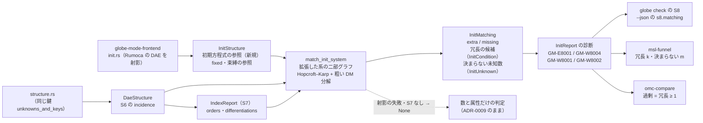

# S009 omc と食い違った 2 本の調査と、S8 の精密化（初期化系のマッチング）

| | |
| --- | --- |
| セッション | S009 |
| 日付 | 2026-10-19 |
| ブランチ | `feature/s009-init-matching` |
| Phase | P2 遅延クエリと検査（5 回目） |
| スライド | [slides.html](slides.html)（15 枚） |
| 設計の記録 | [ADR-0011](../../adr/0011-init-system-matching.md)（初期化系の組み方、診断の規則、結果） |
| 調査 | [research/rumoca.md の「S009 で調べた API（v0.10.2）」](../../research/rumoca.md#s009-で調べた-apiv0102)、[research/openmodelica-dymola.md の「S009 で確かめた omc 1.27.1 の診断の文言」](../../research/openmodelica-dymola.md#s009-で確かめた-omc-1271-の診断の文言) |
| 検証用のモデル | [src/Modelica/README.md](../../../src/Modelica/README.md)（`Init.RedundantAndMissing`、`Init.OuterModification`、`Init.ModifierScope`、`Invalid.UngroundedLoop`、`Connect.Subsystem`） |
| 報告 | [doc/msl-funnel.md](../../msl-funnel.md)、[doc/omc-compare.md](../../omc-compare.md)（どちらも xtask が生成。手で編集しない） |
| 作業記録 | [log/work/2026-10-19-s009-init-matching.md](../../../log/work/2026-10-19-s009-init-matching.md) |

## 1. 目的

ユーザーの依頼は「s009を進めて」だけ。範囲は [roadmap.md](../../roadmap.md#次のセッション) の S009 の候補から既定のまま選んだ。

- **候補 1: S008 で omc と食い違った 2 本を調べる。** [S008 の解説書の「次回」](../S008-omc-compare/解説書.md#5-次回)に残した問い。
  - `Magnetic.FluxTubes.Examples.SolenoidActuator.Components.AdvancedSolenoid`: globe は S6 を通し（290 / 290）S7 でインデックス 2、omc は Pantelides の内部エラーで止まる。どちらが正しいか。
  - `Fluid.Examples.NonCircularPipes`: globe は S8 で「不足 4 / 40」、omc は「冗長な初期方程式 2 本」。
- **候補 3: S8 を精密にする。** 初期方程式の incidence で初期化系をマッチングし、与えられた初期条件の中の冗長さも見る。1 の調査で `NonCircularPipes` の食い違いが「数だけの S8 は冗長を見られない」ことだったので、3 をそのまま主な実装にした。
- 候補 4（離散変数の when の区別）は入力（Rumoca の when の構造）の調査が別に要るので、S010 へ送った。候補 2・5〜8 は触っていない。

S8 は [ADR-0009](../../adr/0009-structural-index-and-init.md) で「要る数（動的な状態 + 離散変数 + 初期化で決めるパラメータ）と与えた数（初期方程式 + `fixed = true`）を比べるだけ」と決めていて、ADR-0009 自身が「数が合っていても、決まらない変数や重複した初期方程式は見つけられない」を残した近似に挙げていた。数だけでは「不足 − 冗長」の差しか分からない。

P2 の完了条件 3 つは S008 までに済んでいる（[roadmap.md の「P2 の完了条件の進み具合」](../../roadmap.md#p2-の完了条件の進み具合)）。S009 はその上で、検査の精度（S8）と omc との照合の説明のつかない食い違いを減らす作業にあたる。

## 2. 決定と理由

決めたことの全文は[作業記録の「決めたこと」](../../../log/work/2026-10-19-s009-init-matching.md#決めたこと)に、設計の正典は [ADR-0011](../../adr/0011-init-system-matching.md) にある。ユーザーの指示は「s009を進めて」だけなので、どれも既定のまま進めた。

| 項目 | 決定 | 理由 |
| --- | --- | --- |
| 範囲 | roadmap の候補 1（食い違いの調査）と 3（S8 の精密化） | 1 の調査で、`NonCircularPipes` の食い違いが 3 と同じ話だと分かった |
| `AdvancedSolenoid` | **S6 の限界。直さない。** 検証用のモデル `Invalid.UngroundedLoop` に記録し、S10（プリフライト）で初期化のヤコビ行列の階数を見る候補にした | 接地の無い部品の単体の検査で、枝 8 本 ≥ 節点 7 つなので二部グラフには完全マッチングがある。キルヒホッフの電流則の数値的な従属は構造（二部グラフ）では見えない |
| S8 のマッチング | **拡張した系（DAE とその微分）+ 初期方程式 + `fixed = true`** を二部グラフにし、最大マッチング（Hopcroft–Karp）と粗い DM 分解で過剰と不足を別々に出す | 初期方程式だけの小さなグラフでは、拘束で決まる状態の冗長（`NonCircularPipes` の形）を見られず、`Index.Pendulum` に「2 個足りない」と誤る。S7 の Pantelides 法の結果（微分の回数と族の最高階）がそのまま使える |
| 過剰の診断 | 過剰な部分に DAE の行（拘束やその微分）があるか離散変数を含めば `GM-W8004`、無ければ `GM-E8001` | 整合する冗長（MSL の `GenerationOfFMUs` など 3 本）を Error にしない。omc も Warning で冗長な初期方程式を外して進む。ADR-0009 の「Error は確かなときだけ」 |
| 初期化で決めるパラメータの参照 | `InitStructure` 側に持つ（`equation_parameter_refs`。そのパラメータがあるときだけ DAE の方程式をもう一度歩く）。束縛を通した依存も閉包で追い、束縛を行にする（`parameter_binding_refs`） | `DaeStructure`（S6・S7 の入力）を変えない。束縛を追わないと `InitSpringConstant` に偽の「冗長 1・決まらない 61」が出る（最初のファネルで起きた） |
| omc が手前で止めるモデル（`GM-W8003` 相当。`OpAmpCircuits.*` の 5 本） | S8 の警告のまま。S6 より前では報告しない | 構造の検査は値を使わない（S6・S7）。部品の単体の検査で値を与えないのは普通。omc との照合では「比べられない」のまま |
| Rumoca v0.10.2 の制約 2 つ | 直さず記録する（検証用のモデル `Init.OuterModification`・`Init.ModifierScope`、db のテスト 2 本、research/rumoca.md）。上流への報告はユーザーが出す | Rumoca の flatten の問題で、GlobeMode 側では直せない。S8 の omc との不一致 3 本はこの 2 つで説明がつく |

### `AdvancedSolenoid` は S6 の限界（候補 1）

- 電気側に接地が無い部品モデルで、外に出したピン p・n は単体の検査では未接続（flow が 0）。枝（抵抗・コイル・コンデンサ）8 本に対して節点 7 つなので、二部グラフには完全マッチングがあり S6 を通る。しかし p と n のキルヒホッフの電流則は各枝の電流の保存を通して数値的に従属で、電位は差しか決まらない。
- omc は記号的な簡約（alias の除去）の後に `0.0 = 0.0` の方程式を見つけて「structurally singular」で止まる（`-d=bltdump` で確かめた。[調査記録](../../research/openmodelica-dymola.md#s009-で確かめた-omc-1271-の診断の文言)）。omc の「structurally」は簡約の後の構造を指す。
- globe が S6 で止めた 7 本（`Connect.Subsystem` のように枝 < 節点）は構造でも特異。枝 ≥ 節点 だと構造では見えない。`Connect.Subsystem` の README の行は S004 の「OK」のままだった（S6 は S005 から）ので直した。
- 検証用のモデル `Invalid.UngroundedLoop`（2 本の抵抗を並列にして外のピンにつないだ。枝 2 ≥ 節点 2）は globe では OK（S6 は 16 / 16）、omc 1.27.1 は「Circular Equalities Detected」と「System is structurally singular」で止まる。

### 初期化系のマッチング（候補 3、[ADR-0011](../../adr/0011-init-system-matching.md#決定)）

| | 中身 |
| --- | --- |
| 列（未知数） | 未知数の族ごとに階数 0..=top（状態 `x` は `x`、`der(x)`、…。代数 `z` も同じ。top は S7 の `IndexReport::orders`）+ `fixed = false` で束縛の無いパラメータ + 束縛が推移的にそれを参照するパラメータ + 離散変数（`d` と `pre(d)` は 1 列） |
| 行（方程式） | (1) DAE の方程式 e と、それを 1..=d[e] 回微分したもの（d は S7 の `differentiations`。j 回微分した行は元の参照の階数 o..=o+j を参照）。(2) 初期方程式（フロントエンドが `InitStructure` に出した参照。`der(x)` は階数 1、`x` と `pre(x)` は階数 0、代数、パラメータ、離散）。(3) `fixed = true` の `v = start`。(4) パラメータの束縛 `s.k = c` |
| 不変量 | 列 − 行 = 動的な状態 + 離散変数 + 初期化で決めるパラメータ − 与えた初期条件 = **要る数 − 与えた数**。数だけの判定と食い違わない |
| 過剰な部分 | 対応の無い行から交互路で届く行と列。行が `extra` 本多く、この部分の初期条件が冗長の候補。DAE の行を含む（`over_with_dae`）なら、初期条件が拘束と同じ変数を決めている |
| 不足している部分 | 対応の無い列から届く列と行。列が `missing` 個多く、この部分の未知数には初期条件が無い |
| 組まないとき | 初期方程式の式を 1 つでも射影できなければ `has_incidence = false`、S7 が無いか打ち切り、長さが合わないときも None。S8 は数と属性だけで判定する（S007 と同じ結果。モデルを止めない）。MSL の例題では 0 本 |

診断（`InitReport::diagnostics`、マッチングがあるとき）:

| 場合 | 診断 |
| --- | --- |
| `extra > 0`、過剰な部分に DAE の行が無く、離散変数も含まない | `GM-E8001`（Error）。位置は最初の冗長の候補、補足に一覧 |
| `extra > 0`、過剰な部分に DAE の行がある（拘束と重なる）か、離散変数を含む | `GM-W8004`（Warning。整合する値なら冗長なだけ）。補足に冗長の候補と理由 |
| `missing > 0`、不足 ≤ 不足している部分の `fixed = false` の離散変数の数 | 柔らかい `GM-W8001`（ADR-0009 と同じ約束） |
| `missing > 0`、それより多い | `GM-W8001`（補足に初期条件の無い未知数の一覧）と、不足している部分の start の無い状態ごとに `GM-W8002` |
| 両方 | 両方を出す（数だけの判定では片方しか出なかった） |

- 離散変数の列は DAE の行から参照されない（`DaeStructure` は離散変数を既知として数える）ので、初期条件の無い離散変数は常に不足している部分に入る。when の外の式で決まる離散変数には初期条件が要らない（MLS §8.6）が、その区別はまだ無い（S010 の候補 1）。
- 表示と集計: `globe check` の S8 に「方程式 / 未知数 / マッチング、冗長 k・決まらない m」の行と `--json` の `s8.matching`。`msl-funnel` の S8 の列に「（冗長 k・決まらない m）」を添え、分布は冗長が 1 つでもあれば過剰（S007 までは与えた数と要る数の差で分けていた）。`omc-compare` の S8 の照合は「過剰 = 冗長が 1 つ以上」。
- 入力: `InitStructure`（`globe-mode-ir`）に `initial_incidence` / `initial_state_refs` / `initial_parameter_refs` / `initial_discrete_refs` / `equation_parameter_refs` / `parameter_binding_refs` / `has_incidence` を足した。位置ではなく構造なので `without_ranges`（`init_shape` の防火壁）でも残る。フロントエンドは `structure.rs` の未知数の鍵（`unknowns_and_keys` に切り出した）を共有して写すので、添字が `DaeStructure` と揃う。db の `init_report` は `init_shape` に加えて `dae_shape` と `index_report` を読む。Rumoca v0.10.2 の初期方程式の式と座標の API は[調査記録](../../research/rumoca.md#s009-で調べた-apiv0102)。

### 最初のファネルで見つけて直したこと

1 回目のファネルで `Mechanics.MultiBody.Examples.Elementary.InitSpringConstant` に偽の「冗長 1・決まらない 61」が出た（omc は過剰と言わない）。初期化で決めるパラメータ `spring.c`（`fixed = false`）は、部品の束縛 `spring.spring.c = c` を通してしか DAE に現れず、DAE の方程式は `spring.spring.c` を参照する。`c` の列がどの行にも繋がらないので、「決まらない」と「冗長」が 1 つずつ偽に出た。束縛が（推移的に）初期化の未知数を参照するパラメータも未知数にし、その束縛を行にして直した（`parameter_binding_refs`。フロントエンドのテスト `free_parameter_reached_through_a_binding_is_an_initialization_unknown`）。直した後は「不足 3 / 63（冗長 0・決まらない 60）」で、omc との S8 の一致は 351 / 355 から 352 / 355 に戻った。

### Rumoca v0.10.2 の制約 2 つ

事実と切り分けの経緯は[調査記録](../../research/rumoca.md#s009-で調べた-apiv0102)（確認日 2026-10-19）。どちらも S8 の入力が欠けるか誤るもので、マッチングの誤りではない。

| 制約 | 中身 | MSL への影響 | 記録 |
| --- | --- | --- | --- |
| **inner の修正が outer に伝わらない** | `inner System system(energyDynamics = FixedInitial)` を部品の `outer System system` から読むと、Rumoca は型の既定（`Free`）で評価する。`initial equation` の `if d == FixedInitial then p = ps_start; end if;` が消え（`initialization_owners()` に無い）、型の既定を `FixedInitial` にすれば現れる。outer を使わない連鎖は正しい（`IfInit4` の 5 通りで切り分けた） | Fluid の例題 11 本が `inner Modelica.Fluid.System system(energyDynamics = FixedInitial)` の形。`NonCircularPipes` で omc が冗長と言う `mediums[1].p = 1e6`（`PartialDistributedVolume` の `if massDynamics == FixedInitial then mediums.p = ps_start`）が globe の DAE に無く（2 本の配管で 8 本）、S8 は「不足 4 / 40（冗長 0・決まらない 36）」になる | `Init.OuterModification`（正しくは 2 / 2、Rumoca では 0 / 2 の `GM-W8001`）、db のテスト `outer_modification_is_lost_by_the_compiler` |
| **外からの修正が部品の中の同名の変数に漏れる** | `Part` が `Real theta1(fixed = true)` と `Joint joint(theta1(fixed = false))` を持ち `joint.theta1 = theta1` で結ぶとき、`Part part(theta1(fixed = true))` と修正すると `part.joint.theta1` と `part.joint.der_theta1` も `fixed = true` になる（`VariableView::fixed_scalar`）。修正しなければ正しい | `RollingWheelSetDriving` / `RollingWheelSetPulling` が `wheelSet(theta1(fixed = true), …)` と修正し、MSL の `Parts.RollingWheelSet` は中で `wheelSetJoint(theta1(fixed = false))` と外している。別名の両方が `fixed = true` になるので、マッチングは正しく「冗長 7」を出す。omc は別名を 1 つにまとめてから数えるので過剰と言わない | `Init.ModifierScope`（正しくは 2 / 2、Rumoca では「冗長 2」の `GM-W8004`）、db のテスト `modifier_leaks_into_subcomponents_in_the_compiler` |

- db のテスト 2 本は、Rumoca が直ったら落ちる。落ちたら [src/Modelica/README.md](../../../src/Modelica/README.md) と research/rumoca.md の記録を直す。
- 上流への報告はユーザーが出す（roadmap の S010 の候補 5。S004 の extends、GM-U の項目と合わせて 3 項目になった）。

## 3. 図

S8 のマッチングの流れ（入力は 3 つ。どれも位置を落とした写しなので、空白だけの編集では再計算されない）:



初期化系の二部グラフの形（スライドの S05 に図がある）:

| | 行（方程式） | 列（未知数） |
| --- | --- | --- |
| 中身 | DAE の方程式 e、その微分 e'（S7 の回数）、初期方程式、`fixed = true` の `v = start`、パラメータの束縛 | 状態の族 `x` の階数 0..=top、代数 `z`、`fixed = false` のパラメータ `c`、離散変数 `d`（`pre(d)` と 1 列） |
| 過剰な部分 | `fixed = true` が拘束 e と同じ変数を決める → 冗長の候補（DAE の行を含むので `GM-W8004`） | |
| 不足している部分 | | 行から参照されない `d` → 初期条件が無い（`GM-W8001`。離散変数だけなら柔らかく） |

S008 で omc と食い違った 2 本の行き先:

| モデル | S008 | S009 で分かったこと | 行き先 |
| --- | --- | --- | --- |
| `AdvancedSolenoid` | globe は S6 を通し、omc は Pantelides の内部エラー | 枝 8 ≥ 節点 7 で構造では特異でないが、電流則が数値的に従属。構造の検査では見えない | S6 の限界として記録（`Invalid.UngroundedLoop`）。S10 の初期化のヤコビ行列の階数で |
| `NonCircularPipes` | globe は不足 4 / 40、omc は冗長 2 | S8 を精密にしても「冗長 0・決まらない 36」。omc が冗長と言う初期方程式が Rumoca の inner/outer の制約で globe の入力に無い | Rumoca の制約として記録（`Init.OuterModification`）。上流に報告 |

## 4. 再現手順

```bash
# 1. コードの検査（fmt / clippy / test / deny / uv sync）
mise run check

# 2. MSL の全例題に globe check の判定を出す（release。JSON が target/msl-funnel.json に残る）
cargo xtask msl-funnel --report doc/msl-funnel.md --json target/msl-funnel.json   # mise run msl:funnel と同じ。S009 は全体 748 s

# 3. omc と突き合わせる。omc の結果は S008 のものを再利用して、照合だけやり直す
cargo xtask omc-compare --funnel-json target/msl-funnel.json --report doc/omc-compare.md \
  --json target/omc-compare.json --reuse target/omc-compare-s008.json
mise run msl:omc                  # omc を呼び直すなら（約 7 分）

# 4. 1 本ずつ見る（S8 に「方程式 / 未知数 / マッチング、冗長 k・決まらない m」の行が出る）
globe check -L data/msl -m Modelica.Fluid.Examples.NonCircularPipes                        # 冗長 0・決まらない 36
globe check src/Modelica/GlobeModeValidation -m GlobeModeValidation.Init.RedundantAndMissing   # 冗長 1・決まらない 1
```

omc で調べるとき（`.mos` スクリプト）: `setCommandLineOptions("-d=bltdump,initialization")` を書いてから `translateModel(Modelica.…)` を呼ぶ。`bltdump` で `0.0 = 0.0` の方程式（`AdvancedSolenoid`）、`initialization` で「Assuming fixed start value for the following N variables」（不足。S008 では「不足は何も出ない」としていたが、このフラグで分かる）と「The following N initial equations are redundant」（冗長）が読める。`dumpInitialSystem` は 1.27.1 には無い（[調査記録](../../research/openmodelica-dymola.md#s009-で確かめた-omc-1271-の診断の文言)）。

検証の結果（2026-10-19。数字は [msl-funnel.md](../../msl-funnel.md)、[omc-compare.md](../../omc-compare.md)、[ADR-0011 の結果](../../adr/0011-init-system-matching.md#結果)、[作業記録の「検証」](../../../log/work/2026-10-19-s009-init-matching.md#検証)）:

- **コードの検査**（`mise run check`）: fmt の差分 0、clippy 0 件、テスト 232 本すべて通過（S008 は 216 本。analysis 74・frontend 24 + 20 + 12・db 7 + 11 + 16 + 17 + 13・ir 6・core 13・xtask 19）、`cargo deny` 4 項目 ok、`uv sync --locked` ok。
- **MSL の全例題**（`cargo xtask msl-funnel`、2 回目。1 回目は束縛の閉包を入れる前）: 566 本: OK 369・NG 13（S5 1・S6 12）・GM-U 184・panic 0（S007・S008 と同じ本数）。
  - S8 まで来た 369 本すべてで初期化系をマッチングできた（初期方程式の射影の失敗 0）。
  - S8 の分布は合う 111・過剰 6（すべて `GM-W8004`。Error 0）・不足 252。S008 は 111・3・255 で、冗長と不足を両方持つ 3 本（`AdvancedSolenoid`、`RollingWheelSetDriving`、`RollingWheelSetPulling`）が過剰に移った。
  - 検査 723.8 s（1 本 1.28 s）、全体 748.4 s、最大 RSS 7.1 GiB（1 回目は 938.1 s / 7.5 GiB）。
- **omc との照合**（`cargo xtask omc-compare --reuse target/omc-compare-s008.json`。omc の 566 本の結果は S008 のものを再利用、390.8 s）:
  - S5 382 / 382（P2 の完了条件。S008 と同じ）、数が同じ 307 / 382、GM-U 184 / 184、S6 362 / 363（`AdvancedSolenoid`。上の限界）。
  - **S8（過剰）352 / 355**（S008 は 354 / 355。1 回目は 351 / 355 で、`InitSpringConstant` の偽の冗長を直して 1 本戻った）。不一致 3 本は `NonCircularPipes`（inner/outer）と `RollingWheelSetDriving` / `RollingWheelSetPulling`（修正の漏れ）で、どれも Rumoca の制約。
  - globe の `GM-W8004` の 3 本（`Electrical.Analog.Examples.GenerationOfFMUs` 冗長 2、`Lines.CompareLineTrunks` 冗長 3、`Thermal.HeatTransfer.Examples.GenerationOfFMUs` 冗長 1）は omc の「冗長な初期方程式」の本数（2・3・1）と同じ。
  - `AdvancedSolenoid` の S8（過剰 5 / 7、冗長 1・決まらない 3）は omc が特異で止まるので比べていない。
- **検証用のモデル**（`globe check`）: `Init.RedundantAndMissing` 冗長 1・決まらない 1（`GM-W8004` + `GM-W8001` + `GM-W8002`）、`Init.OuterModification` 0 / 2（`GM-W8001`。Rumoca の制約）、`Init.ModifierScope` 冗長 2（`GM-W8004`。Rumoca の制約）、`Invalid.UngroundedLoop` OK（S6 16 / 16。限界の記録）、`Connect.Subsystem` S6 で停止（README を直した）。omc 1.27.1: `UngroundedLoop` と `Subsystem` は特異で停止、`RedundantAndMissing` は「Assuming fixed start value for y」。
- `check_docs.py`: デッキ 15 件 OK（S009 は 15 枚）/ 文書 80 件、相対リンク 439 件中の切れ 0 件
- Playwright（`render_slides.py`）: デッキ 15 件 / 問題 0 件（ライト・ダーク・スマートフォンのスクリーンショットを目で確認。スマートフォンの図は `slides.css` の既定どおり横スクロール）
- セッション記録の `--check`: 検査 4 件 / 取りこぼし 0 件
- ステージした差分の漏洩検査: 0 件（37 ファイル）

S8 で過剰とした（どちらかが）モデル（[omc-compare.md](../../omc-compare.md) の S8 の表から）:

| モデル（`Modelica.` を略す） | globe check の S8（与えた / 要る） | omc | 一致 |
| --- | --- | --- | --- |
| `Electrical.Analog.Examples.GenerationOfFMUs` | 過剰 8 / 6（冗長 2・決まらない 0、`GM-W8004`） | 過剰 2 | ○ |
| `Electrical.Analog.Examples.Lines.CompareLineTrunks` | 過剰 60 / 57（冗長 3・決まらない 0、`GM-W8004`） | 過剰 3 | ○ |
| `Thermal.HeatTransfer.Examples.GenerationOfFMUs` | 過剰 4 / 3（冗長 1・決まらない 0、`GM-W8004`） | 過剰 1 | ○ |
| `Fluid.Examples.NonCircularPipes` | 不足 4 / 40（冗長 0・決まらない 36） | 過剰 2 | ×（inner/outer で初期方程式が globe の入力に無い） |
| `Mechanics.MultiBody.Examples.Elementary.RollingWheelSetDriving` | 過剰 14 / 88（冗長 7・決まらない 81、`GM-W8004`） | 過剰でない | ×（修正の漏れで別名の両方が `fixed = true`） |
| `Mechanics.MultiBody.Examples.Elementary.RollingWheelSetPulling` | 過剰 16 / 93（冗長 7・決まらない 84、`GM-W8004`） | 過剰でない | ×（同上） |
| `Magnetic.FluxTubes.Examples.SolenoidActuator.Components.AdvancedSolenoid` | 過剰 5 / 7（冗長 1・決まらない 3、`GM-W8004`） | 失敗（特異） | 比べない |
| `Magnetic.FluxTubes.Examples.Hysteresis.ThreePhaseTransformerWithRectifier` | –（GM-U） | 過剰 2 | 比べない |

## 5. 次回

**S010（P2 の 6 回目）の候補**（[roadmap.md](../../roadmap.md#次のセッション)）:

1. **離散変数の when の区別**: when の外の式で決まる離散変数（MLS 8.6 の暗黙の `pre(v) = v`）か、when の中で決まるかを分け、S8 の `GM-W8004` と柔らかい `GM-W8001` を確定させる。マッチングでは離散変数の列が DAE の行から参照されないので、初期条件の無い離散変数は常に不足している部分に入る（MSL の `MultiBody` の例題で「決まらない 60〜84」の大半は `pre(world.axisColor…)` のような離散変数）。
2. **閉包の切り替えの費用を和らげる**（`Checker` に文書の和集合を持たせる、など）。
3. **S9（代数ループ）・S10（プリフライト）**: S10 に**初期化のヤコビ行列の階数**（構造では見えない数値的な特異。`Invalid.UngroundedLoop`、MSL の `AdvancedSolenoid`）を入れる。
4. **`Checker` のメモリの上限**（P4 のプロセス構成が決まってから。最大 RSS 7.1〜7.2 GiB）。
5. **Rumoca の制約を上流に報告する**（ユーザーが出す）: S004 の extends、GM-U に振り分けたもの、**inner の修正が outer に伝わらない**（`Init.OuterModification`）、**外からの修正が部品の中の同名の変数に漏れる**（`Init.ModifierScope`）。
6. **`class_index` の残り**（for や if の中の connect、継承したクラスの入れ子）。
7. **S8 の精密化の残り**: 初期方程式の射影に失敗したときの扱い（S009 のファネルでは 0 本）、`fixed = true` の start 値が拘束と整合するかの数値の検査（S10 と合わせて）。

**残したこと**（[作業記録の「残したこと」](../../../log/work/2026-10-19-s009-init-matching.md#残したこと)）:

- `AdvancedSolenoid` の S8（冗長 1・決まらない 3）は、omc が特異で止まるので照合できない。
- omc との S8 の照合で、別名の両方に `fixed = true` があるときの扱い（omc は別名を 1 つにまとめてから数える）。Rumoca の修正の漏れが直れば `RollingWheelSet*` は消えるが、本当に両方に fixed を書いたモデルでは食い違いが残る。
- Rumoca が直ったら db のテスト 2 本（`outer_modification_is_lost_by_the_compiler`、`modifier_leaks_into_subcomponents_in_the_compiler`）が落ちるので、README と research/rumoca.md の記録を直す。
- スクラッチの小さなモデル（`IfInit*`、`Alias*`）はコミットしない。検証用のパッケージには代表の 2 本（`OuterModification`、`ModifierScope`）だけ入れた。
- omc は照合にだけ使い、globe check の判定には使わない（ライセンス、速さ、依存の方針は変えない。[CLAUDE.md](../../../CLAUDE.md) の 3）。
