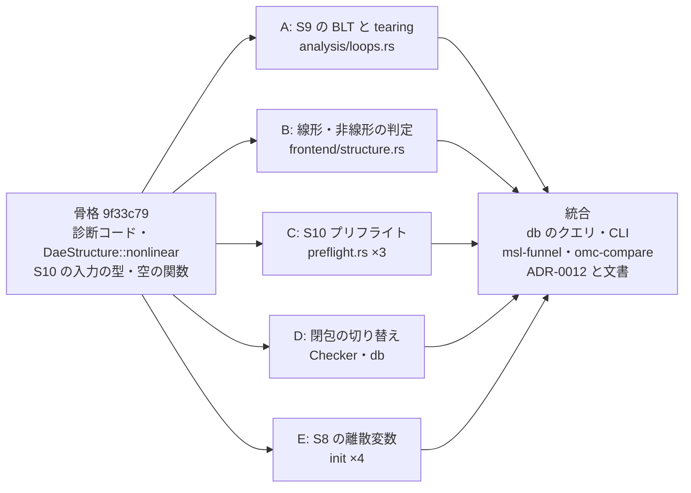
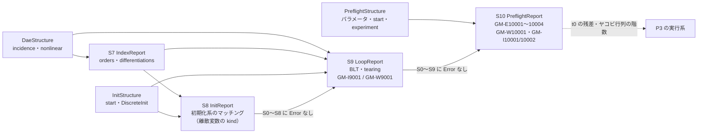

# S010 S9（代数ループ）と S10（プリフライトの静的な部分）、S8 の離散変数、閉包の切り替え

| | |
| --- | --- |
| セッション | S010 |
| 日付 | 2026-10-19 |
| ブランチ | `feature/s010-loops-preflight` |
| Phase | P2 遅延クエリと検査（6 回目） |
| スライド | [slides.html](slides.html)（16 枚） |
| 設計の記録 | [ADR-0012](../../adr/0012-loops-and-preflight.md)（S9・S10）、[ADR-0011 の「S010 の追記」](../../adr/0011-init-system-matching.md#s010-の追記-離散変数の決まり方を区別する2026-10-19)（S8 の離散変数）、[ADR-0005 の結果](../../adr/0005-lazy-query-db.md#結果)（閉包の切り替え）、[ADR-0010](../../adr/0010-omc-comparison.md#結果)（S9 の omc との照合） |
| 調査 | [research/rumoca.md の「S010 で調べた API（v0.10.2）」](../../research/rumoca.md#s010-で調べた-apiv0102)、[research/openmodelica-dymola.md の「S010 で確かめた omc 1.27.1 の代数ループとプリフライトの文言」](../../research/openmodelica-dymola.md#s010-で確かめた-omc-1271-の代数ループとプリフライトの文言) |
| 検証用のモデル | [src/Modelica/README.md](../../../src/Modelica/README.md)（`Loops.*` 4 本、`Preflight.*` 10 本、`Init.Discrete*` 6 本） |
| 報告 | [doc/msl-funnel.md](../../msl-funnel.md)、[doc/omc-compare.md](../../omc-compare.md)（どちらも xtask が生成。手で編集しない） |
| 作業記録 | [log/work/2026-10-19-s010-loops-preflight.md](../../../log/work/2026-10-19-s010-loops-preflight.md) |

## 1. 目的

ユーザーの依頼は「S010を進めてください。サブエージェントは`/effort`を`medium`で複数並列実行してください。」。範囲は [roadmap.md](../../roadmap.md#次のセッション) の S010 の候補から、並列にできる独立した作業が 5 つ取れる組を選んだ。

- **候補 3: S9（代数ループ）・S10（プリフライト）。** [architecture.md](../../architecture.md) §3.2 の検査の段階 S0〜S10 のうち、残っていた 2 段。S9 は「非線形の反復変数に start 値が無い」、S10 は「パラメータの評価、t0 で残差が有限か、ソルバの能力、experiment annotation が妥当か」。
- **候補 1: S8 の離散変数の when の区別。** S009 で入力の調査が別に要るとして送ったもの（[S009 の解説書の「次回」](../S009-init-matching/解説書.md#5-次回)）。S009 のマッチングでは離散変数の列が DAE の行から参照されず、初期条件の無い離散変数は常に「不足」に入っていた。
- **候補 2: 閉包の切り替えの費用を和らげる。** S007 で受け入れたトレードオフ（閉包の違うモデルへ切り替えると約 1.7 s）を、`Checker` に文書の和集合を持たせて和らげる。
- 候補 4（`Checker` のメモリの上限）は P4 のプロセス構成が決まってから、5（Rumoca の制約の上流報告）はユーザーが出す、6（`class_index` の残り）と 7（S8 の精密化の残り）は送った。

P2 の完了条件 3 つは S008 までに済んでいる（[roadmap.md の「P2 の完了条件の進み具合」](../../roadmap.md#p2-の完了条件の進み具合)）。S010 は P2 の範囲（`assert_simulatable` の S0〜S10）の残りを埋め、P3 に進む前の土台を作る作業にあたる。

## 2. 決定と理由

決めたことの全文は[作業記録の「決めたこと」](../../../log/work/2026-10-19-s010-loops-preflight.md#決めたこと)に、設計の正典は [ADR-0012](../../adr/0012-loops-and-preflight.md) にある。ユーザーの指示は範囲（S010 を進める）と並列の仕方（effort medium のサブエージェントを複数並列）だけなので、ほかは既定のまま進めた。

| 項目 | 決定 | 理由 |
| --- | --- | --- |
| 範囲 | roadmap の候補 3（S9・S10）、1（離散変数の when の区別）、2（閉包の切り替えの費用） | 所有するファイルを分けられる独立した作業が 5 つ取れる |
| 並列の分け方 | 1 つの worktree で、所有するファイルを分けた 5 つのサブエージェント（effort medium）を同時に走らせる。共有の型は先に骨格として固め、コミットした（`9f33c79`） | 共有の型を後から変えると、5 つの作業がぶつかる |
| S9 の解く系 | インデックス 1 なら der の形、2 以上なら Pantelides 法の最高階の系（状態選択の前の見込み。`reduced` の印） | 状態選択の後の系は dummy derivative の選び方が要る。P3 へ送った |
| S9 の重さ | Error を出さない。`GM-I9001`（情報）と `GM-W9001`（警告）だけ | start 値の無い反復変数は既定の 0 から反復するだけで、解けないとは限らない（omc も警告） |
| 線形・非線形 | 族（変数）の単位で広めに判定する。`abs`・`min`・`max` も非線形 | 誤るのは「線形なのに非線形」の側（警告が多めに出る側）だけ。要素ごとに展開すると MSL の大きなモデルで遅い |
| S9 の実装の場所 | analysis crate に自前で書く。Rumoca の構造解析は照合にだけ使う | analysis crate は Rumoca に依存しない約束（wasm32、Track B の自前コアでも同じ検査を使う） |
| S10 の範囲 | 静的な部分だけ（パラメータと start 値の評価、experiment annotation） | Rumoca の評価器は実行時の座標を評価しない。t0 の残差と初期化のヤコビ行列の階数は P3 の実行系と一緒にする（二重に作らない） |
| experiment | 根のクラスの本文を Rumoca の parser で読み直し、生の値で判定する。StopTime = StartTime は誤りにしない | Rumoca は不正な値を黙って捨てる。MSL の `Inverse_sine` が `StopTime = 0` を使う |
| S8 の離散変数 | when の中・when の外・`when initial()`・不明 の 4 通りに分け、初期化でも成り立つ離散の方程式を行に足す | MLS 3.6 §8.6。決まり方の分かる離散変数の不足と冗長は確定できる |
| 閉包の切り替え | `Checker` に文書の和集合を持たせ、結果が閉包だけの検査と変わる文書（本文の変わった・消えた・名前のぶつかる文書）は取り除く | Rumoca の Session にライブラリの解決だけを残す道が無い（D が調べた）。文書の組を変えないしかない |
| 字面の 0 除算 | Rumoca の `ED019` → `GM-U0001` の振り分けは変えない。候補に残す | [ADR-0007](../../adr/0007-unsupported-classification.md) のコードの規則を文言で例外にするのは方針の変更 |
| Rumoca との S9 の照合 | ES002 の警告の文言からループの大きさを読む | Rumoca の `algebraic_loops` は空のまま（B が見つけた） |

### 並列の分け方

骨格（Phase 0、`9f33c79`）で固めたもの: core の診断コード（`GM-I9001`・`GM-W9001`・`GM-E10001`〜`GM-E10004`・`GM-W10001`・`GM-I10001`・`GM-I10002`）、ir の `DaeStructure::nonlinear` と `preflight.rs`、analysis と frontend の空の `loops.rs` / `preflight.rs`、`CheckReport::preflight`、`ReferenceStructure::loops`、検証用のパッケージ `Loops`・`Preflight` の器。

| 担当 | 作業 | 所有したファイル | テスト |
| --- | --- | --- | ---: |
| A | S9 の BLT と tearing | `globe-mode-analysis/src/loops.rs` | 12 |
| B | S9 の線形・非線形の判定 | frontend の `structure.rs`、`tests/loops.rs`、`Loops/*.mo` | 7 |
| C | S10 | ir・frontend・analysis の `preflight.rs`、`tests/preflight.rs`、`Preflight/*.mo` | 32 |
| D | 閉包の切り替え | `rumoca.rs` の `Checker`、`globe-mode-db/src/lib.rs`、`tests/switching.rs` | 12 |
| E | S8 の離散変数 | frontend と analysis の init の 4 ファイル、`Init/Discrete*.mo` | 19 |
| 統合 | db のクエリ（`loop_report` / `preflight_shape` / `preflight_report`、`check_model` の S9・S10）、CLI の S9・S10 の行と `--json`、`msl-funnel` の S9・S10、`omc-compare` の S9、ES002 の読み取り、文書 | db・CLI・xtask・`doc/` | db 9、funnel と omc 4 |

B・C・E は途中で API の使用量の上限で止まり、上限が戻ってから続きを頼んだ。

### S9（代数ループ。[ADR-0012](../../adr/0012-loops-and-preflight.md#決定)）

| 手順 | 中身 |
| --- | --- |
| 解く系 | インデックス 1 以下なら der の形の incidence（未知数は `der(x)` と代数・出力）。微分が要るなら Pantelides 法の最高階の系: 行は方程式 e の `differentiations[e]` 回目の微分、列は各族の最高階 `orders[u]`。行 e^(c) は、元の参照（階数 o）が c 回の微分で o+c になり、それが `orders[u]` と等しいものだけを参照する |
| BLT | 完全マッチング（Hopcroft–Karp）→ 依存グラフ（方程式 e が、別の方程式 e' にマッチした未知数を参照するなら e は e' に依存）→ 強連結成分（再帰を使わない Tarjan 法、O(E)）。ブロックの分け方はマッチングの選び方によらない（Duff 1981。並べ替えの乱択テストで確かめた） |
| 線形・非線形 | ブロックのどれかの方程式が、ブロックの未知数を非線形に参照していれば非線形のループ。最高階の系では、c ≥ 1 の行は最高階について線形（連鎖律）、c = 0 の行は `DaeStructure::nonlinear` に従う |
| tearing | 貪欲法（最適な tearing は NP 困難）。残りの未知数が 1 つで、それが線形に現れる方程式があれば解く。無ければ tearing 変数を 1 つ選ぶ（start 値のある代数・出力 → start の無い代数・出力 → `der(x)` と階数 1 以上の列。同じ組では出現の多い順）。O(E + k log k) |
| start 値 | 非線形のループの tearing 変数のうち、階数 0 の代数・出力で start の無いものに `GM-W9001`。`der(x)` と高階の列は start を書けないので除く |

- 解析できない（S7 の打ち切り、長さの不一致、完全マッチングが無い）ときは理由を `LoopReport::skipped` に残し、診断は出さない。MSL では 0 本。
- 線形・非線形の判定（`DaeStructure::nonlinear`、B）は残差の式木を族の単位で歩く。積は両辺に未知数があれば両辺とも、商は分母に未知数があれば全部、冪は底に未知数があり指数がリテラル 1 でないか指数に未知数があれば全部、関数は引数の全部。if 式の条件の関係演算はイベントで凍結されるので非線形にしないが、`noEvent` の中の条件は凍結しないので全部を非線形にする。規則の全文は [ADR-0012](../../adr/0012-loops-and-preflight.md#決定)。`ChuaCircuit` の extract は 0.97 ms から 1.5〜2.3 ms になった。
- db のクエリ `loop_report` は `dae_shape`・`index_report`・`init_shape` を読む（どれも位置を落とした写し）。`check_model` は S0〜S8 に Error が無く S7 の結果があるときだけ回す。

### S10（プリフライトの静的な部分）

| 対象 | 取り出し（frontend） | 判定（analysis） |
| --- | --- | --- |
| パラメータ | 定数とパラメータを Rumoca の `NumericEvaluator::initial_value` で変数ごとに評価。`fixed = false` のパラメータと、それに推移的に依存するものは評価しない（初期化で決まる。仮の start で偽の 0 除算を出さない）。参照先の失敗を受け継いだだけの失敗は落とす | 非有限 → `GM-E10001`。関数の中の `assert` の失敗 → `GM-E10002`。外部関数 → `GM-I10002`（1 つにまとめる） |
| start 値 | 状態・代数・出力・離散変数の start を評価。値が無いのは既定の 0 なので失敗にしない | 非有限 → `GM-E10003` |
| experiment annotation | 根のクラスを定義するファイルを `Dae::source_map()` から探し、Rumoca の parser で読み直して生の値と位置を取る（見つからなければ Rumoca の値で代える） | 無い → `GM-I10001`。StopTime < StartTime・Tolerance ≤ 0・Interval ≤ 0 → `GM-E10004`。Interval が区間より長い・Tolerance ≥ 0.1・数の字面でない → `GM-W10001` |

- 残差が t0 で有限か、初期化のヤコビ行列の階数（S009 の `Invalid.UngroundedLoop`・MSL の `AdvancedSolenoid` の数値的な特異）、ソルバの能力は、P3 の実行系（`globe-mode-exec`）ができてからにする。
- 検証用の `Preflight.*` のうち S10 の 9 本は、omc 1.27.1 の `checkModel` がすべて通し、`simulate` で初めて失敗するか黙って進む（[調査記録](../../research/openmodelica-dymola.md#s010-で確かめた-omc-1271-の代数ループとプリフライトの文言)）。たとえば `Preflight.StopBeforeStart` は omc では警告だけで進み、`Preflight.InvalidExperiment`（`Tolerance = 0`）は `simulate` で「DASKR-- ALL ELEMENTS OF RTOL AND ATOL ARE ZERO」で失敗する。
- 字面の 0 除算（`parameter Real T = 1 / a`、a = 0）は S10 に届かない。Rumoca が DAE への変換で `ED019` で止め、`GM-U0001` になるため。検証用のモデルは `sqrt(-1)` で NaN になるパラメータにした。

### S8 の離散変数の when の区別（[ADR-0011 の「S010 の追記」](../../adr/0011-init-system-matching.md#s010-の追記-離散変数の決まり方を区別する2026-10-19)）

MLS 3.6 §8.6（[equations.html](https://specification.modelica.org/maint/3.6/equations.html)、2026-10-19 に確認）では、when の式が初期化で働くのは `when initial()` か `when {…, initial(), …}` の形だけで、働かない when の式 `v = expr` には初期化のために `v = pre(v)` が加わる。

| `kind` | 決まり方 | 初期化系の列 |
| --- | --- | --- |
| `When` | when の中 | `d` と `pre(d)` を 1 列（初期条件が 1 つ要る） |
| `Always` | when の外の式 | 離散の方程式の行が `d` を決める。`pre(d)` が初期化で働く式に参照されるか `fixed = true` のときだけ、`pre(d)` を別の列にする |
| `InitialWhen` | `when initial()` の枝 | `Always` と同じ |
| `Unknown` | 取り出せない（クロックの区間の変数など） | S009 と同じく 1 列 |

- 診断の規則: 過剰を確定しない理由の「離散変数を含む」は `Unknown` が関わるときだけにした。柔らかい `GM-W8001` で数えるのも `Unknown` で `fixed = false` のものだけ。決まり方の分かる離散変数の不足は確定した `GM-W8001`、離散の方程式の行は DAE の行として扱う（`b = x > 0` に `initial equation b = true` も書くと `GM-W8004`）。
- Rumoca の癖: 初期方程式の `pre(a) = pre(b)` の連なり（MSL の StateGraph の `PartialStep`）は対象ごとの定義に取り分けられ、位置はどれも 1 本目になる。偽の冗長が出たので、本文が `pre(` で始まり、位置と部品が同じ k 個の定義を k − 1 行に束ねた。
- 検証用のモデル: `Init.DiscreteWhen`（不足 2、omc も「Assuming fixed start value for the following 2 variables」）、`DiscreteOutsideWhen`（合う）、`DiscreteEdge`（`edge(b)` の `pre(b)` が不足 1、omc も同じ）、`DiscreteWhenInitial`（合う）、`DiscretePreInitial`（合う）、`DiscreteRedundant`（`GM-E8001`、omc も over specified）。

### 閉包の切り替え（[ADR-0005 の結果](../../adr/0005-lazy-query-db.md#結果)）

- Rumoca v0.10.2 の `add_document` と `remove_document` は毎回 `invalidate_resolved_state` で解決済みの状態を捨て、解決は Session の全文書（MSL を含む）をまとめてやり直す。source root ごとの解決を使い回す道は、外から足した文書が 1 つでもあると使われない（[調査記録](../../research/rumoca.md#s010-で調べた-apiv0102)）。
- `Checker::check_retaining`（db の `check` クエリが使う）は、渡された文書のうち本文が変わったものだけ差し替え、渡されなかった文書も Session に残す。閉包だけの検査と結果を変えないように、本文が変わった・消えたファイルの文書（db が `Checker::document_changed` で知らせる）、トップレベルのクラスの名前がぶつかる文書、ほかの DB が足した文書（`Checker::new_handle`）は取り除く。知らせを止めると、改名したファイルの古い定義が残ってテスト 4 本が落ちた。
- salsa の依存は閉包の本文のままなので、使わないファイルの編集で `check` が再実行されない性質は保つ。

## 3. 図

S010 の作業の流れ（骨格を先に固め、5 つの担当が並列に作り、統合で集めた）:



検査の段階のつながり（S9・S10 が足された後）:



S8 の分布の変化（S8 まで来た 369 本。[msl-funnel.md](../../msl-funnel.md)）:

| | 合う | 過剰（すべて `GM-W8004`） | 不足 |
| --- | ---: | ---: | ---: |
| S009 | 111 | 6 | 252 |
| S010 | 269 | 6 | 94 |

## 4. 再現手順

```bash
# 1. コードの検査
cargo fmt --all --check
cargo clippy --workspace --all-targets -- -D warnings
cargo test --workspace                 # mise run check にまとまっている

# 2. フロントエンドを変えたので、MSL の例題 20 本を Rumoca の CLI と突き合わせる
mise run msl:compare

# 3. MSL の全例題に globe check の判定を出す（release。JSON が target/msl-funnel.json に残る）
cargo xtask msl-funnel --report doc/msl-funnel.md --json target/msl-funnel.json   # mise run msl:funnel と同じ

# 4. omc と突き合わせる（S9 の一覧が S008 の保存に無いので、omc を回し直す）
mise run msl:omc

# 5. 閉包の切り替えの計測（release）
cargo test --release -p globe-mode-db --test switching -- --ignored --nocapture

# 6. 1 本ずつ見る
globe check src/Modelica/GlobeModeValidation -m GlobeModeValidation.Loops.NonlinearLoopWithoutStart   # GM-I9001 + GM-W9001
globe check src/Modelica/GlobeModeValidation -m GlobeModeValidation.Preflight.StopBeforeStart         # GM-E10004
globe check src/Modelica/GlobeModeValidation -m GlobeModeValidation.Init.DiscreteWhen                 # 確定した GM-W8001
```

omc で S9 を調べるとき（`.mos` スクリプト）: `setCommandLineOptions("-d=initialization,iterationVars")` を書いてから `translateModel(…)` を呼ぶ。`iterationVars` で系ごとの反復変数の一覧と属性の `start` が `getErrorString()` に出る。`initialization` を付けると「Nonlinear iteration variables with default zero start attribute」は警告ではなく標準出力に出る（[調査記録](../../research/openmodelica-dymola.md#s010-で確かめた-omc-1271-の代数ループとプリフライトの文言)）。

検証の結果（2026-10-19。数字は [msl-funnel.md](../../msl-funnel.md)、[omc-compare.md](../../omc-compare.md)、[ADR-0012 の結果](../../adr/0012-loops-and-preflight.md#結果)、[作業記録の「検証」](../../../log/work/2026-10-19-s010-loops-preflight.md#検証)）:

- **コードの検査**: `cargo fmt --all --check` 差分 0、`cargo clippy --workspace --all-targets -- -D warnings` 0 件、`cargo test --workspace` 324 本通過・6 本 ignore（S009 は 232 本）。`mise run check` は締めで回す。
- **`mise run msl:compare`**: 20 本中 20 本が一致（両方とも成功 17 本）。
- **MSL の全例題**（`cargo xtask msl-funnel`、release）: 566 本: OK 369・NG 13（S5 1・S6 12）・GM-U 184・panic 0（S009 と同じ本数。S9・S10 で止まったものは 0）。
  - S8: 合う 269・過剰 6（すべて `GM-W8004`）・不足 94（S009 は 111・6・252）。
  - S9: 369 本すべてで解析（解析なし 0、最高階の系で数えたもの 154）。代数ループのあるもの 226・非線形のループのあるもの 142・`GM-W9001` のあるもの 57（反復変数 188 個）。ループは線形 254 個・非線形 260 個、一番大きいのは `MultiBody.Examples.Loops.EngineV6` の 4584 本。ループの大きさの一覧は、微分の要らない 215 本すべてで Rumoca の構造解析（ES002）と一致。
  - S10: Error 0、`GM-I10001`（experiment が無い）16 本。
  - 検査 849.8 s（1 本 1.50 s。S009 は 723.8 s・1.28 s。後半に `msl:compare` を同時に回したので揺れを含む）、全体 14 分 42 秒、最大 RSS 7.1 GiB。
- **omc との照合**（`mise run msl:omc`。omc 1.27.1 を回し直した。12 プロセス、omc 370.2 s（照合を含む全体は 6 分 11 秒）、時間切れ 0・結果なし 0）:
  - S5 382 / 382（100%）、数が同じ 307 / 382、GM-U 184 本すべて omc で数が合う、S6 362 / 363、S8（過剰）352 / 355（S009 と同じ）。
  - **S9（非線形のループの有無）282 / 355（79.4%。両方 103・globe だけ 38・omc だけ 35）**。
  - **S9（start の無い非線形の反復変数の有無）312 / 355（87.9%。両方 29・globe だけ 28・omc だけ 15）**。
  - 最初は omc の「Nonlinear iteration variables with default zero start attribute」と比べて 303 / 355 だった。この文言は MSL で 5 本にしか出ない（属性に start の無い非線形の反復変数は 81 本にある）ので同じものを数えていないと判断し、反復変数の一覧の属性と比べるように直して `--reuse` で照合だけやり直した。zero start は参考の列に残した。
  - 食い違いの主な見込みは、線形の判定が方程式ごとの「非線形に現れる未知数の集合」しか持たないこと（`Electrical.Analog.Examples.ShowVariableResistor` は `v = R*i` の `R` がループの外で決まるのに、globe は非線形 2、omc は線形 2）。omc だけが非線形の系を持つ 35 本（`SwitchWithArc` など）は確かめていない。
- **閉包の切り替え**（D の計測、release、MSL 4.1.0。ほかの作業と同時に動かしたので揺れがある）:

  | 計測 | S007 の方式 | S010 |
  | --- | ---: | ---: |
  | 一度検査したモデルへ、編集なしで切り替え（6 本） | 2099 ms | 49 ms（最大 90 ms） |
  | 両方が使う `Components.mo` を変えた後 | 1825 ms | 95 ms |
  | 閉包の違うモデルを初めて検査 | 1791 ms | 1950 ms |
  | 使わないファイルを変えた後（`check` 0 回） | 0.19 ms | 0.45 ms |

- `check_docs.py`、Playwright（`render_slides.py`）、セッション記録の `--check`、ステージした差分の漏洩検査の結果は[作業記録の「検証」](../../../log/work/2026-10-19-s010-loops-preflight.md#検証)に締めで書く。

## 5. 次回

**S011 の候補**（[roadmap.md](../../roadmap.md#次のセッション)。P2 の S0〜S10 は、S10 の数値の部分を除いてそろった。P3 に進むかどうかを決める）:

1. **P3 の始め（実行系 `globe-mode-exec` と driver）**: Rumoca の実行の道具（`rumoca-sim` など）を使うか、自前の評価器を作るかを決める（ADR）。S10 の数値の部分（t0 の残差、**初期化のヤコビ行列の階数**、ソルバの能力）もそこで入れる。
2. **S9 を omc と照らして詰める**: 食い違いの切り分け（tearing の選び方、`abs`・`min`・`max` を非線形とみなす広めの判定）。積の項ごとの未知数の組を持ち、ループの未知数だけで線形かを判定する案。状態選択（dummy derivative）の後の系で数えるかも決める。
3. **閉包の切り替えの残り**: ワークスペースの全ファイルを最初に一度だけ Session に入れ、初めて検査するモデルも速くする。
4. **`Checker` のメモリの上限**（P4 のプロセス構成が決まってから。最大 RSS 7.1 GiB）。
5. **Rumoca の制約を上流に報告する**（ユーザーが出す）: S004 の extends、GM-U に振り分けたもの、inner/outer（S009）、修正の漏れ（S009）、**`phase_structural::analyze` が `algebraic_loops` を埋めない**（S010）。
6. **字面の 0 除算の振り分け**: `ED019` → `GM-U0001` を、文言（"division by zero"）で GM-E に戻すかを決める。
7. **S8 の残り**: アルゴリズムの `when {…, initial()}` で読み出しが `pre` になる形（MSL の `Interaction1`。globe は不足 1、omc は何も言わない）、DAE の連続の方程式の中の `pre(d)`、クロックの区間の変数（`Unknown` のまま）。
8. **`class_index` の残り**: for や if の中の connect、継承したクラスの中の入れ子のクラス。

**残したこと**（[作業記録の「残したこと」](../../../log/work/2026-10-19-s010-loops-preflight.md#残したこと)）:

- S9 は状態選択の前の最高階の系で数える（インデックス 2 以上の 154 本）。dummy derivative の後の系は P3 で。
- S9 の線形の判定は族の単位で広め。`abs`・`min`・`max`、`smooth` の中の条件も非線形にしている。
- S10 の t0 の残差・初期化のヤコビ行列の階数・ソルバの能力は P3。
- 閉包の違うモデルを初めて検査するときは今も約 1.7〜2.0 s。
- omc は照合にだけ使い、globe check の判定には使わない（ライセンス、速さ、依存の方針は変えない。[CLAUDE.md](../../../CLAUDE.md) の 3）。
