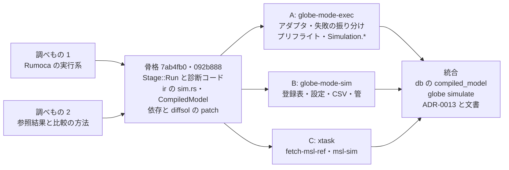
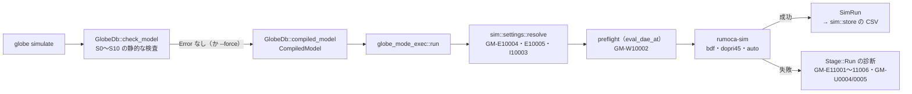

# S011 P3 の実行系の着手（Rumoca の実行系、`globe simulate`、参照結果の管）

| | |
| --- | --- |
| セッション | S011 |
| 日付 | 2026-10-19 |
| ブランチ | `feature/s011-exec-backend` |
| Phase | P3 シミュレーション（1 回目） |
| スライド | [slides.html](slides.html)（17 枚） |
| 設計の記録 | [ADR-0013](../../adr/0013-exec-backend.md)（実行系、S10 の数値の部分、結果の型、参照結果との比較、MSL の一括実行） |
| 調査 | [research/rumoca.md の「S011 で調べた実行系（v0.10.2）」](../../research/rumoca.md#s011-で調べた実行系v0102)、[research/openmodelica-dymola.md の「S011 で調べた参照結果と比較の方法」](../../research/openmodelica-dymola.md#s011-で調べた参照結果と比較の方法) |
| 検証用のモデル | [src/Modelica/README.md の GlobeModeValidation.Simulation](../../../src/Modelica/README.md#globemodevalidationsimulation)（12 本） |
| 報告 | [doc/msl-sim.md](../../msl-sim.md)（`cargo xtask msl-sim` が生成。手で編集しない） |
| 作業記録 | [log/work/2026-10-19-s011-exec-backend.md](../../../log/work/2026-10-19-s011-exec-backend.md) |

## 1. 目的

ユーザーの依頼は「P3の実行系の着手」。S010 の締めで挙げた S011 の候補 1（P3 の始め: 実行系 `globe-mode-exec` と driver、S10 の数値の部分）にあたる。ほかの指示は無いので、範囲や方式は既定のまま進めた（サブエージェントの effort も指定が無かったので既定のまま）。

P3 の完了条件（[roadmap.md](../../roadmap.md#p3-の完了条件の進み具合)）は次の 3 つ。S011 は、最初の 2 つを測れるところまで作ることを目標にした。

| 完了条件 | S011 の後 |
| --- | --- |
| MSL の例題 153 本以上が実行できる | 済。303 本 |
| そのうち 90% 以上が参照結果のファネルに収まる | 済。参照結果と比べた 302 本のうち 292 本（96.7%） |
| bdf が wasm で（Node 上で）動く | 未着手（S012 の候補 1） |

P3 の範囲（exec、driver、bdf / esdirk34 / tsit45 / dopri / 固定刻み、ResultStore）のうち、S011 で作ったのは exec（Rumoca の実行系のアダプタ）、`bdf`・`dopri45`・`auto`、ResultStore の CSV。driver は Rumoca のものを使い、自前の driver は FMU の Import（P5）で作る。`esdirk34` などは名前の登録表にだけある。S010 の候補 2〜8（S9 を omc と照らす、閉包の切り替えの残りなど）は S012 に持ち越した。

## 2. 決定と理由

設計の正典は [ADR-0013](../../adr/0013-exec-backend.md)、決めたことの全文は[作業記録の「決めたこと」](../../../log/work/2026-10-19-s011-exec-backend.md#決めたこと)にある。

| 項目 | 決定 | 理由 |
| --- | --- | --- |
| 実行系 | Phase A は Rumoca の実行系（`rumoca-sim`。feature は `solver-diffsol` と `solver-rk45` だけ）を、`globe-mode-exec` の feature `rumoca-exec` の中だけで使う | 公開の API では Rumoca のモデルを自前の `HybridSystem` で包めない。自前の評価器と driver では P3 の 1 回目で MSL を回せない |
| diffsol | Rumoca が数値の修正を 4 件当てた diffsol 0.13.2 を、ワークスペースのルートの `[patch.crates-io]` で Rumoca の git から使う | Rumoca の CLI と同じ数値になる。`[patch]` はルートでしか効かないので、git 依存では修正前の版が入る |
| モデルの渡し方 | フロントエンドが `CompiledModel`（Rumoca の DAE と生の experiment annotation）を作る。db は `GlobeDb::compiled_model`（salsa の外） | db は wasm でビルドするので、exec に依存しない。`check` と同じ文書を渡すので、検査の直後なら Rumoca のキャッシュから返る |
| 結果 | 中立の `SimRun`（`globe-mode-ir::sim`）で返し、Rumoca の型は外へ出さない | 保存・比較・UI を Rumoca から切り離す |
| S10 の数値の部分 | start 値で評価して t0 で代数変数と導関数が有限か（`rumoca_sim::eval_dae_at`）を見て、有限でなければ**警告** `GM-W10002` | 初期化の残差ではないので、`fixed = false` の状態など初期化で動く値を誤って止めうる。最初は Error にしていたが、骨格の段階（`092b888`）で警告に変えた |
| 初期化のヤコビ行列の階数 | 後回し | Rumoca に公開の API が無い（SVD の数値の階数を tracing の debug に出すだけ）。tracing を拾うのは安定しない |
| 実行の失敗 | `Stage::Run` を足し、`GM-E11001`〜`GM-E11006`・`GM-I11001`・`GM-W11001`・`GM-U0004` / `GM-U0005` で返す | 検査段階ではないが、CLI と JSON で検査と同じ形にする |
| ソルバ | 名前の登録表（`globe-mode-sim::solvers`）で引く。実装は `bdf`（既定）・`dopri45`・`auto` | OpenModelica・Dymola の名前（`dassl` など）を別名で受け付け、計画だけのものは「未実装」と言える |
| 設定 | 項目ごとに「利用者の指定 > experiment annotation > 既定値」 | 出どころを表示できる。既定値は Rumoca のハーネスと同じ |
| 参照結果 | MAP-LIB の v4.1.0 を固定したコミット（`dac67829`）から、要るモデルの分だけ取る。コミットしない | 全部で約 2.7 GB。リポジトリに LICENSE が無い（再配布の条件は【未確認】） |
| 比較 | csv-compare の既定の矩形の管（許容差 0.002）を、アルゴリズムの記述から書き直す。試験側に無い信号と、参照の区間を覆わない信号は不合格 | P3 の「ファネル」は MSL の参照結果の管で測る。Rumoca の比較（平均の誤差）はずっと緩い |
| MSL の一括実行 | 別プロセスのワーカーで回し、親が 120 s で応答の無いワーカーを止める。協調型の予算は 30 s。partial の 12 本は実行しない | Rumoca の時間切れは協調型で、初期化と積分器の 1 歩の内側では止まらない |

選ばなかった案（自前の実行系、自前の `HybridSystem` で包む、crates.io の diffsol、協調型の予算だけ、Rumoca の比較の指標、参照結果を zip で取る）と理由は [ADR-0013 の「選ばなかった案」](../../adr/0013-exec-backend.md#選ばなかった案)。

### 並列の分け方

調べもの 2 つ（Rumoca の実行系、参照結果と比較の方法）を先に並べ、その結果で骨格を固めてコミットした（`7ab4fb0`、`092b888`）。骨格で固めたもの: core の `Stage::Run` と診断コード、ir の `sim.rs`（`SimSettings`・`ResolvedSettings`・`Trajectory`・`SimRun` など）、frontend の `CompiledModel` と `Checker::compile_retaining`、exec と sim の空の関数、依存と diffsol の patch、deny.toml・`.gitignore`・ci_plan・mise の `msl:sim`、検証用のパッケージ `Simulation` の器。そのあと所有するファイルを分けた 3 つのサブエージェントを同時に走らせた。

| 担当 | 作業 | 所有したファイル | テスト |
| --- | --- | --- | ---: |
| A | 実行系のアダプタ、失敗の振り分け、プリフライト、検証用のモデル | `globe-mode-exec/src/{lib.rs,rumoca.rs}`、`tests/simulate.rs`、`Simulation/*.mo` | 単体 13・結合 19 |
| B | ソルバの登録表、設定の決定、CSV、管の比較 | `globe-mode-sim/src/*` | 49 |
| C | 参照結果の取得、MSL の一括実行（ワーカー、親の監視、報告） | xtask の `reference.rs`・`sim.rs`・`main.rs` | 37（新しいもの 14） |
| 統合 | db の `compiled_model`、CLI の `globe simulate`、`comparisonSignals.txt` の `//` の行の読み飛ばし、文書 | db・CLI・`doc/` | db 3 |

### 実行系（`globe-mode-exec`）

Rumoca v0.10.2（rev `276e82bd`）の実行系で確かめた事実（出典の行番号は[調査記録](../../research/rumoca.md#s011-で調べた実行系v0102)）:

- 外の driver から Rumoca のモデルを回す公開の API は無い。FMI-ME 風の核 `SolveMeKernel` の set_time・状態・導関数・イベント指標・イベント更新は `pub(crate)` で、外から差し替えられるのは数値積分のプラグイン `MeIntegratorBackend` だけ。
- `simulate_with_diagnostics` は失敗を文字列にする。型付きの道 `build_simulation` → `check_prepared_initialization` → `run_prepared_simulation` は BDF だけで、失敗の段（`SimFailureStage`）が分かる。
- 時間切れは協調型（`TimeoutBudget::check()` は積分の繰り返しと根探索でだけ見る）。Rumoca 自身の MSL のハーネスも、別プロセスのワーカーを監視から止めている。
- wasm 以外では Cranelift の JIT（`rumoca-exec-cranelift`）が必ず付く。`Cargo.lock` の外部の package は 101 増えた（GlobeMode の crate 2 つを含めると 325 → 428）。ライセンスはすべて許可の区分（[licenses.md](../../licenses.md)）。

ソルバごとの呼び方:

| ソルバ | 呼び方 |
| --- | --- |
| `bdf` | 型付きの道（組み立て → 初期化の確認 → 実行）。Rumoca の MSL のワーカーと同じ道で、どこで失敗したかがこちらの呼んだ位置で分かる |
| `dopri45` | `rk45::simulate`（組み立てから積分までを 1 回で呼ぶ。準備の時間は 0 と記録される） |
| `auto` | Rumoca の選び方をなぞる。BDF で組み立てて初期化し、初期の線形化（方向微分）が作れないときだけ陽的 RK に切り替える |

失敗は、Rumoca が付けた段（`SimFailureStage`・`MeStage`）→ エラーの種類（`SimError::kind`、`MeSessionError`・`MeIntegrationError`・`MeError` を型で match）→ こちらが呼んだ位置、の順に見て振り分ける。型に無い 4 つ（時刻、有限でない変数の名前、文言の中の位置、rk45 の lowering の `[EX…]` の印）だけを文言から読むので、Rumoca の rev を上げたら exec のテストで確かめる。panic は `catch_unwind` で拾い、Rumoca の積分器の期限切れの panic は時間切れ、それ以外は内部エラーにする。

### S10 の数値の部分と、実行の診断コード

| コード | 段階 | 意味 | 検証用のモデル |
| --- | --- | --- | --- |
| `GM-W10002` | S10 | start 値で評価した t0 の値が有限でない（警告） | `NotFiniteAtStart` |
| `GM-E10005` / `GM-I10003` | S10 | ソルバが使えない / 別名を置き換えた | （`--solver esdirk34` / `--solver dassl`） |
| `GM-E11001` | 実行 | 初期化に失敗した | `InitNoSolution`、`NotFiniteAtStart` |
| `GM-E11002` | 実行 | 積分に失敗した | （MSL の 6 本） |
| `GM-E11003` | 実行 | イベントの反復が収束しない | `EventNotSettling` |
| `GM-E11004` | 実行 | assert で止まった | `RuntimeAssert` |
| `GM-E11005` | 実行 | 時間切れ（協調型の予算） | （MSL の 5 本） |
| `GM-E11006` | 実行 | 結果に NaN・inf が出た | — |
| `GM-I11001` | 実行 | `terminate()` で終了時刻の前に終わった（失敗ではない） | `Terminate` |
| `GM-W11001` | 実行 | 実行が止まらない警告（warning レベルの assert。Rumoca の WX001） | `WarningAssert` |
| `GM-U0004` / `GM-U0005` | 実行 | 実行系が未対応（lowering・組み立て）/ 実行系の内部エラー（panic・契約違反） | （MSL の 26 本 / 4 本） |

- `GM-W10002` は MSL で 3 本に出た。`Thermal.FluidHeatFlow.Examples.TestCylinder` と `TestOpenTank` は `GM-E11001` で止まり、その補足にプリフライトの警告が付く。`TwoTanks` は終了時刻まで進み、管にも収まった。警告にとどめた判断どおりの例になった。
- 初期化のヤコビ行列の階数を見る例として S009 で挙げた 2 本: MSL の `Magnetic.FluxTubes.Examples.SolenoidActuator.Components.AdvancedSolenoid` は Rumoca の構造解析で止まり `GM-U0004` になった（[msl-sim.md](../../msl-sim.md)）。`GlobeModeValidation.Invalid.UngroundedLoop` は、文書をまとめるときに `globe simulate`（debug ビルド）で回すと、終了時刻まで進み、表示された最後の値（10 個）はすべて 0 だった（誤りは出ない）。この形の数値的な特異は、実行しても診断にならない。

検証用のモデル `Simulation.*` の 12 本（どれも `globe check` は S0〜S10 を通る正しいモデル。値は [src/Modelica/README.md](../../../src/Modelica/README.md#globemodevalidationsimulation)）:

| モデル | 結果 |
| --- | --- |
| `Decay`・`HarmonicOscillator` | 成功。解析解と比べる（`Decay` の x(1) は bdf 0.367879468、dopri45 0.367879443、解析解 0.367879441） |
| `NonlinearLoop`・`NoStates` | 成功（積分の各点で解く非線形のループ、状態の無いモデル） |
| `BouncingBall`・`SampleCounter` | 成功（状態イベントの `reinit`、時刻イベントの `sample`） |
| `Terminate`・`WarningAssert` | 成功。`GM-I11001` / `GM-W11001` |
| `RuntimeAssert`・`EventNotSettling` | `GM-E11004` / `GM-E11003`（どちらも t = 0.5） |
| `NotFiniteAtStart`・`InitNoSolution` | `GM-W10002` のあと `GM-E11001` / `GM-E11001` |

### ソルバと設定（`globe-mode-sim`）

`globe-mode-sim` は Rumoca にも実行系にも依存しない（wasm32 でビルドできる）。

| 名前の種類 | 名前 | 診断 |
| --- | --- | --- |
| 実装あり | `bdf`（既定。diffsol の BDF）、`dopri45`（Rumoca の Dormand–Prince 5(4)）、`auto` | — |
| 別名 | `dassl`・`lsodar` → `bdf`、`rk45`・`dopri5` → `dopri45` | `GM-I10003`（同等の手法で、結果は一致しない） |
| 表にあって未実装 | `ida`・`cvode`・`esdirk34`・`trbdf2`・`tsit45`・`dopri853`・`euler`・`rk4`・`radau5` など 19 個 | `GM-E10005`（代わりの名前を添える） |
| 表に無い | — | `GM-E10005`（編集距離の近い名前を 3 つまで） |

設定の既定値は StartTime 0、StopTime は開始 + 1、Tolerance 1e-6（相対と絶対の両方。Rumoca の MSL のハーネスと同じ）、Interval は区間の 1/500、ソルバ `bdf`。experiment annotation の StopTime が StartTime と同じ（MSL の `Modelica.Math.Examples.Inverse_sine` の `StopTime = 0`）ときだけは、Rumoca と同じく開始 + 1 まで回して `GM-W10001` を出す。指定した StopTime が StartTime と同じなら誤り（`GM-E10004`）。値がどこから来たか（指定・experiment・既定）も返し、`globe simulate` は失敗しても使った設定を表示する。

ソルバ名の対応表は [architecture.md §3.3](../../architecture.md#33-ソルバ) にある。

### 参照結果との比較（管）

参照結果と比べ方の調査は[調査記録](../../research/openmodelica-dymola.md#s011-で調べた参照結果と比較の方法)にある。

- MSL 4.1.0 用の参照結果は `modelica/MAP-LIB_ReferenceResults` のブランチ `v4.1.0`（先頭 `dac67829`）。`Modelica/` の下に 534 本。作った設定は Dymola の Dassl で、Tolerance は注釈の 0.1 倍と、experiment annotation より厳しい。
- 比較は csv-compare（BSD-3-Clause）の既定の Rectangle の管を、アルゴリズムの記述から書き直した（コードは写していない）。半幅は時間 δt = tol·max(t_N − t_0, |t_0|, 1e-12)、値 δy = tol·max(y_max − y_min, |y_min|, 0.001)、tol = 0.002。
- 管の上の縁は、窓 |s − t| ≤ δt での参照の折れ線の最大 + δy、下の縁は最小 − δy（この言い換えは GlobeMode での導出）。窓の最大・最小をセグメント木で引くので、参照 n 点・試験 m 点で信号 1 つあたり O(n + m log n)。
- 参照の区間の外の点は判定しない。試験側に無い信号と、参照の区間を覆わない（途中で止まった）信号は不合格にする（csv-compare は警告で飛ばす）。
- 比べる信号は `comparisonSignals.txt`。`//` で始まる行は比べないことにした信号なので読み飛ばす。最初の実行では 3 本（`HoldWithDAeffects1`・`HoldWithDAeffects2`・`IMS_Start`）がこの行を信号と読んで「参照に無い信号」で落ちた。

### MSL の全例題の実行（`cargo xtask msl-sim`）

- 入力は `msl:funnel` の JSON（S010 のもの。OK 369 本）。partial のテンプレート 12 本を除いた 357 本を実行する（Rumoca のハーネスも除く）。
- 親（`msl-sim`）がワーカー（隠しサブコマンド `msl-sim-worker`）に 1 本ずつ要求を送る。標準入出力の JSON の行で話し、Rumoca などが標準出力に書いても混ざらないよう、ワーカーの行には接頭辞を付ける。
- ワーカーは MSL を一度だけ読み、1 本ごとに `compile_retaining` → `globe_mode_exec::run`（協調型の予算 30 s。Rumoca のハーネスは 12 s）→ 参照結果があれば管で比べる。panic は `catch_unwind` で拾い、50 本ごとに `Checker::reset` で Session を戻す。
- 親は 120 s 応答の無いワーカーを kill して立て直す（落ちたときも立て直す）。
- 参照結果は `cargo xtask fetch-msl-ref` が固定したコミットの raw の URL から `data/msl-ref/` に取る。`.part` に書いてから名前を変え、参照結果の無いモデルにも印を置く。

## 3. 図

S011 の作業の流れ（調べものの結果で骨格を固め、3 つの担当が並列に作り、統合で集めた）:



`globe simulate` の流れ（Rumoca の型は `globe-mode-exec` の中だけ）:



MSL の全例題の結果（357 本。[msl-sim.md](../../msl-sim.md)）:

| 結果 | 本数 |
| --- | ---: |
| 終了時刻まで進んだ | 303 |
| `GM-U0004` 実行系が未対応（構造解析 19・Solve IR への変換 3・実行系の組み立て 2・方向微分の準備 2） | 26 |
| `GM-E11001` 初期化 | 6 |
| `GM-E11002` 積分 | 6 |
| `GM-E11005` 協調型の時間切れ | 5 |
| `GM-U0005` 実行系の内部エラー（実行時の契約違反） | 4 |
| 外から停止（120 s。Fluid の 5 本と `EngineV6`・`EngineV6_analytic`） | 7 |

## 4. 再現手順

```bash
# 1. コードの検査（fmt・clippy・test・deny・uv sync --locked）
mise run check

# 2. フロントエンドに compile_retaining を足したので、MSL の例題 20 本を Rumoca の CLI と突き合わせる
mise run msl:compare

# 3. MSL の例題を実行して参照結果と比べる（target/msl-funnel.json が要る。初回は参照結果を約 1 GB 取得する）
mise run msl:sim
#   = cargo xtask fetch-msl
#     cargo xtask msl-sim --funnel-json target/msl-funnel.json --fetch-ref --report doc/msl-sim.md --json target/msl-sim.json

# 4. 1 本ずつ見る
globe simulate src/Modelica/GlobeModeValidation -m GlobeModeValidation.Simulation.BouncingBall -o ball.csv
globe simulate src/Modelica/GlobeModeValidation -m GlobeModeValidation.Simulation.RuntimeAssert            # GM-E11004
globe simulate src/Modelica/GlobeModeValidation -m GlobeModeValidation.Simulation.Decay --solver dassl     # GM-I10003
globe simulate src/Modelica/GlobeModeValidation -m GlobeModeValidation.Simulation.Decay --solver esdirk34  # GM-E10005

# 5. MSL の 1 本だけを一括実行の道で回す（名前に含む文字列で選ぶ）
cargo xtask msl-sim --only CauerLowPassSC --report target/one.md
```

`msl:funnel` は回し直していない（S0〜S10 の判定の規則は変えていない。frontend は関数を足しただけ）。次に Rumoca の rev か検査を変えたら、`msl:funnel` → `msl:sim` の順に回す（[CLAUDE.md](../../../CLAUDE.md) の 2）。

検証の結果（2026-10-19。数字は [msl-sim.md](../../msl-sim.md)、[ADR-0013 の結果](../../adr/0013-exec-backend.md#結果)、[作業記録の「検証」](../../../log/work/2026-10-19-s011-exec-backend.md#検証)）:

- **コードの検査**: `mise run check` 通過。`cargo test --workspace` 422 本通過・7 本 ignore（S010 は 324 本・6 本）。新しいテストは exec 32 本（単体 13・結合 19。MSL の `ChuaCircuit` の 1 本は ignore）、sim 49 本、xtask 37 本（うち新しい 14 本）、db の `compiled_model` 3 本。`cargo check --target wasm32-unknown-unknown`（core・ir・frontend・graph・db・analysis・sim）と、`globe-mode-exec` の `--no-default-features` も通る。
- **`mise run msl:compare`**: 20 本中 20 本が一致（両方とも成功 17 本）。
- **参照結果の取得**（`cargo xtask fetch-msl-ref`、release、4 並列）: 参照結果のある 353 本の分、1010 MB を 66 s。参照結果の無いもの 16 本（partial の 12 本と `BusUsage_Utilities.Part`・`AdvancedSolenoid`・`SpacePhasorLimiter`・`TwoPhaseWater.BaseProperties`）。
- **MSL の例題の実行**（`cargo xtask msl-sim`、release、協調型の予算 30 s、外から止めるのは 120 s）:
  - 357 本: **終了時刻まで 303**・実行 NG 47・外から停止 7・ワーカーの異常終了 0・panic 0。止まった 54 本の内訳は上の表。`GM-W10002` は 3 本。
  - **参照結果と比べた 302 本のうち 292 本（96.7%）が管に収まった**。外れ 10、参照結果なし 1（`BusUsage_Utilities.Part`）。信号の数では 1713 本中 1687 本。
  - 全体 1911.7 s（31 分 52 秒）。コンパイル 183.7 s・実行系の準備 139.8 s・初期化と積分 159.5 s・比較 5.6 s。残りの多くは外から止めた 7 本（各 120 s）と時間切れの 5 本。ワーカーの起動 8 回（MSL の読み込みは合計 18.9 s）、ワーカーの最大の常駐メモリ 3.5 GiB。
  - 1 回目（`//` の行を直す前）は 302 本・288 / 301 本（95.7%）。`CauerLowPassSC` は 1 回目が 33 s で時間切れ、2 回目は 16.3 s で通った（予算 30 s のぎりぎり）。
- **基準値**（物差しが違うので並べるだけ）: Rumoca（rev `276e82bd` の `msl_quality_baseline.json`）は試した 286 本で simulate 216（予算 12 s）。OpenModelica master（2026-10-17）は 534 本中 533 本を実行し、510 本が参照結果と一致。
- `check_docs.py`、Playwright（`render_slides.py`）、セッション記録の `--check`、ステージした差分の漏洩検査の結果は[作業記録の「検証」](../../../log/work/2026-10-19-s011-exec-backend.md#検証)に締めで書く。

管から外れた 10 本（原因は確かめていない。見込みはイベントの時刻のずれ、極値の追跡、発振の位相）:

| モデル | 外れ方（[msl-sim.md](../../msl-sim.md) の「管から外れたモデル」） |
| --- | --- |
| `Clocked.Examples.Elementary.ClockSignals.LogicalSample`・`RotationalSample` | 向きの信号などが t ≈ 1.40 から外れる |
| `Electrical.PowerConverters.Examples.ACAC.Dimmer_R` | `vH01.y_arg`・`iH01.y_arg`（83780 点中 1370 点） |
| `Electrical.PowerConverters.Examples.DCAC.PolyphaseTwoLevel.PolyphaseTwoLevel_R`・`_RL` | 信号ごとに 1 点だけ外れる |
| `Blocks.Examples.DemonstrateSignalExtrema` | 極値の信号 `y_min`・`y_max` |
| `Electrical.Analog.Examples.OpAmps.Multivibrator` | 3 本とも t ≈ 0.03 から外れる |
| `Blocks.Examples.DemoSignalCharacteristic` | `harmonic.mean1.y`（はみ出しは 5.6e-5 だが、1051 点中 1006 点） |
| `Electrical.Analog.Examples.DemoPowerSupplyWithBuffer` | 電流 2 本が t ≈ 0.52 で外れる |
| `Mechanics.MultiBody.Examples.Elementary.DoublePendulumInitTip` | `revolute1.phi`（501 点中 3 点、t = 4.83） |

## 5. 次回

**S012 の候補**（[roadmap.md](../../roadmap.md#次のセッション)。P3 の完了条件は wasm の 1 つが残る）:

1. **bdf を wasm で（Node 上で）動かす**（P3 の残りの完了条件）: `globe-mode-exec` を wasm32 でビルドする（getrandom の `wasm_js`、`Instant::now()` を呼ばない道）。Node で `Simulation.Decay` と MSL の例題 1 本を回す。
2. **止まった 54 本と外れた 10 本を調べる**: 実行系が未対応の 26 本（S7 のインデックスと照らす）、初期化の 6 本（S8・S9 の警告と照らす）、外から止めた 7 本（初期化が協調型の予算の外という見込み【未確認】）、イベントの時刻のずれ。上流に報告するものを分ける。
3. **自前の積分器**: `esdirk34`・`tsit45`・固定刻みを、Rumoca の数値積分のプラグイン（`MeIntegratorBackend`）として差し込めるか試す。
4. **パラメータを変えた再実行**（再コンパイル無し。Rumoca の `param_overrides`）と、ResultStore の MAT v4 / Arrow IPC。
5. **S10 の残り**: 初期化のヤコビ行列の階数。上流に提案するか、tracing の出力を拾うかを決める（`UngroundedLoop` は実行しても診断にならないことを上で確かめた）。
6. **S9 を omc と照らして詰める**、**閉包の切り替えの残り**（S011 の候補 2・3 の持ち越し）。
7. **`Checker` のメモリの上限**（P4 のプロセス構成が決まってから）。検査は最大 RSS 7.1 GiB、実行のワーカーは 3.5 GiB。
8. **Rumoca の制約を上流に報告する**（ユーザーが出す）: S010 までの分に、S011 の分（外の driver から回す API（`SolveMeKernel`）が非公開、diffsol の修正の上流への取り込み、初期化のヤコビ行列の階数の API、wasm で `Instant::now()`）を足した。
9. **字面の 0 除算の振り分け**、**S8 の残り**、**`class_index` の残り**（持ち越し）。

**残したこと**（[作業記録の「残したこと」](../../../log/work/2026-10-19-s011-exec-backend.md#残したこと)）:

- `globe-mode-exec` は native だけ。
- `dopri45` は組み立てから積分までを 1 回で呼ぶので、準備の時間（`build_seconds`）が 0 になる。
- プリフライトは lowering を 1 回余計にする（`eval_dae_at` が自分で lowering する）。MSL の大きなモデルでは無視できない見込み。
- Rumoca の文言から読んでいる 4 つ（評価と Solve IR の文言の時刻、有限でない値の変数名、文言の中の位置、rk45 の lowering の `[EX…]` の印）は、Rumoca の rev を上げたら exec のテストで確かめる。
- 参照結果はコミットしない（MAP-LIB のリポジトリに LICENSE が無い）。`data/msl-ref/` は `.gitignore` 済み。
