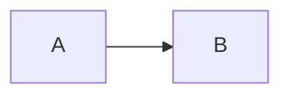

# S011 実行系の着手

| | |
| --- | --- |
| セッション | S011 |
| 日付 | 2026-10-19 |
| ブランチ | `feature/s011-exec-backend` |
| Phase | P3 |
| スライド | [slides.html](slides.html) |
| 作業記録 | `log/work/2026-10-19-s011-exec-backend.md` |

## 1. 目的

依頼の要約と、どの Phase のどの完了条件に向けた作業か。

## 2. 決定と理由

| 項目 | 決定 | 理由 |
| --- | --- | --- |
| … | … | … |

## 3. 図



## 4. 再現手順

```bash
# 同じ結果を得るためのコマンド
```

検証の結果（数字）:

- …

## 5. 次回

- 積み残し
- 次のセッションでやること
