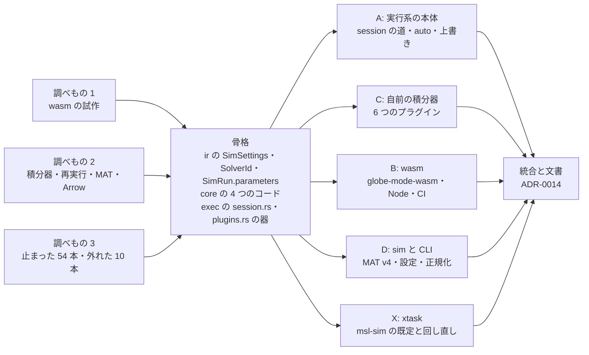
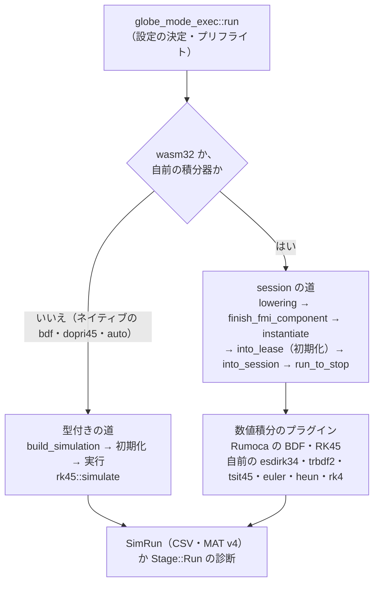
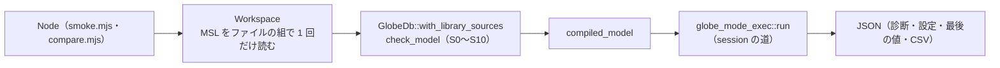

# S012 P3 の 2 回目（bdf を wasm で Node 上で動かす、自前の積分器、パラメータの上書きと MAT v4、止まった例題の調査）

| | |
| --- | --- |
| セッション | S012 |
| 日付 | 2026-10-19 |
| ブランチ | `feature/s012-wasm-solvers` |
| Phase | P3 シミュレーション（2 回目） |
| スライド | [slides.html](slides.html)（17 枚） |
| 設計の記録 | [ADR-0014](../../adr/0014-session-route-wasm.md)（session の道、wasm、自前の積分器、`auto` の切り替え、パラメータの上書き、MAT v4）。[ADR-0013](../../adr/0013-exec-backend.md) の「結果」に追記 |
| 調査 | [research/rumoca.md の「S012 で調べた実行系の公開の道（v0.10.2）」](../../research/rumoca.md#s012-で調べた実行系の公開の道v0102)、[research/openmodelica-dymola.md の「S012 で調べた結果の形式（MAT v4 と Arrow）」](../../research/openmodelica-dymola.md#s012-で調べた結果の形式mat-v4-と-arrow)、[research/msl-sim-failures.md](../../research/msl-sim-failures.md)（止まった 54 本と外れた 10 本） |
| 検証用のモデル | [src/Modelica/README.md の GlobeModeValidation.Simulation](../../../src/Modelica/README.md#globemodevalidationsimulation)（13 本。S012 で `Parameters` を足した） |
| 報告 | [doc/msl-sim.md](../../msl-sim.md)（`cargo xtask msl-sim` が生成。手で編集しない） |
| 作業記録 | [log/work/2026-10-19-s012-wasm-solvers.md](../../../log/work/2026-10-19-s012-wasm-solvers.md) |

## 1. 目的

ユーザーの依頼は「進めて。サブエージェントはOpusのeffort-medium」（S011 の報告の後）。S011 の締めで挙げた S012 の候補のうち、1（bdf を wasm で Node 上で動かす。P3 の残りの完了条件）を中心に、3（自前の積分器）、4（パラメータを変えた再実行と ResultStore の MAT v4）、2（止まった 54 本と管から外れた 10 本の調査）を進めた。範囲は既定のまま決め、5〜10 は持ち越した。

P3 の完了条件（[roadmap.md](../../roadmap.md#p3-の完了条件の進み具合)）:

| 完了条件 | S011 の後 | S012 の後 |
| --- | --- | --- |
| MSL の例題 153 本以上が実行できる | 済。303 本 | 済。新しい既定（`auto`、時間切れの回し直し）で測り直した: 309 本（+6） |
| そのうち 90% 以上が参照結果のファネルに収まる | 済。292 / 302 本（96.7%） | 済。比べる前にイベントの行を整えて測り直した: 299 / 308 本（97.1%、+7） |
| bdf が wasm で（Node 上で）動く | 未着手 | **済**。Node v24.22.0 で `Simulation.*` 13 本の bdf がネイティブと全件一致（最大 3 ulp）、MSL の `ChuaCircuit` も回った |

P3 の範囲（exec、driver、bdf / esdirk34 / tsit45 / dopri / 固定刻み、ResultStore）のうち、S012 で `esdirk34`・`tsit45`・固定刻み（と `trbdf2`）、ResultStore の MAT v4 を足した。driver は引き続き Rumoca の host のもの。

## 2. 決定と理由

設計の正典は [ADR-0014](../../adr/0014-session-route-wasm.md)、決めたことの全文は[作業記録の「決めたこと」](../../../log/work/2026-10-19-s012-wasm-solvers.md#決めたこと)にある。

| 項目 | 決定 | 理由 |
| --- | --- | --- |
| 実行の道 | Rumoca の FMI ME 風の host（公開の関数だけ）に数値積分のプラグイン（`MeIntegratorBackend`）を差す **session の道**を 1 つ作り、wasm32 のすべてのソルバと自前の積分器に使う | 型付きの道は std の `Instant::now()` を呼び、wasm32 で panic する。host の道は呼ばず、時間切れも wasm で効く。積分器だけを替えられる |
| ネイティブの bdf・dopri45・auto | S011 の型付きの道のまま | Rumoca の CLI と同じ道で、S011 の MSL の数字と比べられる。session の道は Cranelift の JIT を使えない |
| 2 つの道が同じか | `Simulation.*` 12 本の bdf で**ビット単位で同じ**（dopri45・auto も一致）ことを確かめた | wasm の正しさの根拠にする |
| wasm の target | wasm32-unknown-unknown + wasm-bindgen 0.2.129（Node で確かめる。ブラウザは後で） | wasm32-wasip1 は wasm-bindgen が使えず、ブラウザでは WASI の shim が要る。P6 の目標はブラウザの Worker |
| wasm-bindgen の版 | Cargo.toml で `=0.2.129`、CLI も mise で同じ版 | 版がずれると糊が作れない |
| ライブラリの渡し方 | MSL はファイルの組で 1 回だけ読む（Rumoca の in-memory の組、`with_library_sources`） | wasm32 にファイルシステムが無い。文書として渡すより速い（Node で 1 本 24.0 s → 検査 2.8〜3.2 s） |
| 自前の積分器 | diffsol の `esdirk34`・`trbdf2`・`tsit45`、固定刻みの `euler`・`heun`・`rk4` | P3 の範囲。diffsol の SDIRK と陽的 RK は Rumoca のプラグインを写して改変すれば差せる。固定刻みは係数と補間を Rumoca に依存しない `globe-mode-sim` に置き、wasm32 でもビルドできる |
| `auto` | BDF が積分に失敗したとき・サンプラが食い違ったときも dopri45 で回し直し、`GM-I11002` で知らせる。積分の途中で方向微分が作れない失敗では切り替えない。初期化で方向微分が作れないときの切り替え（S011 の規則、Rumoca と同じ）は残し、`GenerationOfFMUs` はこれで RK に切り替わって誤った結果になる（S013 で見直す） | 止まった例題の調査で +3 本の見込み（全体の回し直しで +3 本を確かめた）。`GenerationOfFMUs` は RK で誤った結果になる（`GM-I11002` は出る） |
| パラメータの上書き | `param_overrides`（DAE は使い回し、lowering はやり直す）。使えないものは `GM-E10006` | 再コンパイルが要らない。変えられるのは tunable なパラメータだけ |
| 許容誤差 | 1e-10 未満は 1e-10 に上げ、`GM-W10003` | Rumoca のサンプラの照合が丸めの床を持たない（`SimpleTriacCircuit`） |
| 結果の形式 | MAT v4（dsres）を足し、Arrow IPC は持ち越す | MAT v4 は omc・Dymola・scipy・DyMat で読める。OpenModelica の Arrow は 0.1 の開発版で、依存が 25 増える |
| `msl:sim` の既定 | ソルバ `auto`、時間切れだけ 180 s で回し直す、前回との差、既知の外れの一覧 | 止まった例題の調査の結論 |

選ばなかった案（試作の「文言を読み直す道」`simulate_fmi_component`、ネイティブもすべて session の道、wasm32-wasip1、上流の修正を待つ、Arrow、新しい crate `globe-mode-solver`）と理由は [ADR-0014 の「選ばなかった案」](../../adr/0014-session-route-wasm.md#選ばなかった案)。

### 並列の分け方

S011 と同じ形で進めた。調べもの 3 つ（wasm の試作、積分器・再実行・MAT の調査、止まった例題の調査）を先に並べ、その結果で骨格（ir の `SimSettings.step`・`parameters`、`SolverId` の 6 つと `is_fixed_step`、`TrajectoryVariable.description`、`SimRun.parameters`、`TunableParameter`、core の 4 つのコード、sim の登録表、exec の `session.rs` と `plugins.rs` の器）を固め、所有するファイルを分けた 5 つのサブエージェント（Opus・effort medium）を同時に走らせた。wasm の試作は他のビルドとロックを取り合わないよう `CARGO_TARGET_DIR=target/spike-wasm` でビルドした。

| 担当 | 作業 | 主に所有したファイル |
| --- | --- | --- |
| A 実行系の本体 | session の道、`auto` の切り替え、パラメータの上書き、プリフライトの上書き、`tunable_parameters`、`Simulation.Parameters` | `globe-mode-exec/src/{lib.rs,rumoca.rs,rumoca/session.rs}`、`tests/simulate.rs`、`Simulation/Parameters.mo` |
| C 自前の積分器 | 6 つのプラグイン、固定刻みの係数と Hermite 補間 | `globe-mode-exec/src/rumoca/{plugins.rs,plugins/}`、`tests/integrators.rs`、`globe-mode-sim/src/integrators.rs` |
| B wasm | `globe-mode-wasm`、in-memory のライブラリ、Node の smoke と突き合わせ、mise のタスク、CI のジョブ | `globe-mode-wasm/`、frontend と db の `with_library_sources`、`mise.toml`、`ci.yml`、`ci_plan.py` |
| D sim と CLI | MAT v4、設定の検査、比べる前のイベントの正規化、`globe simulate` の新しい選択肢 | `globe-mode-sim/src/{mat.rs,settings.rs,compare.rs,solvers.rs,store.rs}`、`globe-mode-cli/src/simulate.rs`、`tests/simulate.rs` |
| X xtask | `msl-sim` の既定 `auto`、回し直し、既知の外れ、前回との差、段の知らせ、補足、例題でないもの | `xtask/src/{sim.rs,main.rs}`、`src/Modelica/msl-sim-known-deviations.txt` |

### session の道と、2 つの道の使い分け

Rumoca v0.10.2（rev `276e82bd`）の FMI ME 風の host の生成・実行の関数はどれも公開されている（行番号は[調査記録](../../research/rumoca.md#s012-で調べた実行系の公開の道v0102)）。session の道はこれを順に呼ぶ: lowering（パラメータの上書きを入れる）→ `finish_fmi_component` → `MeModelArtifact::new` → `instantiate` → `into_lease`（初期化）→ `numerical_setup` → `into_session`（プラグインを差す）→ `run_to_stop` → `finish`。呼んだ位置で、どの段で止まったかが分かる。

| ソルバ | ネイティブ | wasm32 |
| --- | --- | --- |
| `bdf` | 型付きの道（`build_simulation`。S011 と同じ） | session の道 + Rumoca の BDF のプラグイン |
| `dopri45` | `rk45::simulate`（S011 と同じ） | session の道 + Rumoca の RK45 のプラグイン |
| `auto` | 型付きの道で BDF、失敗したら `rk45::simulate` | session の道で BDF、失敗したら RK45 のプラグイン |
| 自前の 6 つ | session の道 + 自前のプラグイン | 同じ |

### wasm（`globe-mode-wasm`）

- JS から: `new Workspace(libraryJson?, name?)`（ライブラリを 1 回だけ読む）、`set_file`・`remove_file`・`files()`・`simulate(requestJson)`。関数 `simulate`・`solvers()`・`version()`・`memory_bytes()`・`last_panic()`。入出力は JSON の文字列。
- ネイティブの `globe simulate` と同じ道（`GlobeDb::check_model` → `compiled_model` → `globe_mode_exec::run`）。時計は `performance.now()`。
- panic=abort なので `catch_unwind` は効かない。panic の文言は `set_hook` で残し、`last_panic()` で読む。panic の後の `Workspace` は使えない（持ち越し）。
- getrandom 0.3 は `.cargo/config.toml` の cfg と、exec が wasm32 のときだけ有効にする feature `wasm_js` の両方が要る。

`ChuaCircuit`（bdf）の時間:

| 道 | MSL の読み込み | 検査 | コンパイル | 実行 |
| --- | ---: | ---: | ---: | ---: |
| ネイティブ・in-memory | 6.9 s（1 回だけ） | 2.0 s | 0.06 s | 0.19 s |
| ネイティブ・文書 | — | 14.4 s | 3.2 s | — |
| Node・in-memory | 10.5〜11.9 s（1 回だけ） | 2.8〜3.2 s | 0.09 s | 0.45〜0.5 s |
| Node・文書 | 1 本で 24.0 s | | | |

参考: ネイティブの CLI の `-L data/msl` は合計 5.2 s（RSS 1.5 GB）。wasm の線形メモリは MSL を読んだ後 262 MiB、`ChuaCircuit` の後 513 MiB（CSV を返すと 634 MiB）、Node の RSS 886 MiB。`Decay` だけなら 3 MiB。

wasm の大きさ: 既定の release 28.2 MB（gzip 7.07 MB）、最適化（`lto = "fat"`・`codegen-units = 1`・`opt-level = "s"`・`strip`）で 14.5 MB（gzip 4.48 MB）。`opt-level = "s"` は 3 より 10〜20% 遅い。最適化した版を空からビルドして 283 s。Node の `Decay` の 1 本目は 228〜293 ms（うち検査 164〜203 ms）、2 本目以降は約 5 ms。最適化は `mise run wasm:build` の環境変数で与え、`[profile.release]` は変えていない。

### 自前の積分器

| 名前 | 中身 |
| --- | --- |
| `esdirk34` | diffsol の SDIRK（ESDIRK 3(4)）。陰的、刻み幅の制御あり |
| `trbdf2` | diffsol の SDIRK（TR-BDF2）。2 次、L 安定 |
| `tsit45` | diffsol の Tsitouras 5(4)。陽的。diffsol の `ClosureNoJac` が非公開なので、ヤコビ行列つきの `rhs_implicit` で作る |
| `euler`・`heun`・`rk4` | 固定刻み（1・2・4 次）。格子は t0 + k·h、イベントや切り詰めの後も同じ格子に戻る。刻みの棄却は失敗にする。刻みの間は 3 次の Hermite 補間 |

- `plugins/rk.rs` は Rumoca の `crates/rumoca-solver-diffsol/src/me_integrator.rs`（Apache-2.0）を写して改変した（ファイルの先頭に明記。[licenses.md](../../licenses.md)）。
- 精度（`Simulation.Decay`、Tolerance 1e-8 の x(1) の誤差）: euler（h 0.1）は 0.9^10 との差 −1.7e-16、tsit45 7.3e-10、esdirk34 −1.1e-7、trbdf2 −3.2e-7、rk4 は h 0.1 で 3.3e-7・h 1/500 で 4.8e-14。大域誤差の次数の実測は euler 1.03・heun 2.06・rk4 4.06。`HarmonicOscillator` は tsit45 3.6e-10、rk4（h 0.01）2.4e-9。`BouncingBall` は 6 つとも跳ねた回数 3。
- MSL（予算 30 s、回し直し無し）:

  | 対象 | bdf | esdirk34 | tsit45 |
  | --- | --- | --- | --- |
  | `Electrical.Analog.Examples` 54 本（実行・管） | 50・48 | 42・39（時間切れ 2） | 40・36（時間切れ 7） |
  | 最後まで進んだ 39 本の積分時間の合計 | 10.7 s | 10.9 s | 36.7 s |

  `Rotational.Examples` 7 本は tsit45・trbdf2・rk4 で 7/7、heun（h = 出力の間隔）は 3/7。

### `auto`・パラメータの上書き・設定の検査

| コード | 段階 | 意味 | 確かめたもの |
| --- | --- | --- | --- |
| `GM-E10006` | S10 | パラメータの上書きが使えない（構造パラメータ・`final`・`Evaluate = true`・定数、tunable なパラメータに無い名前、有限でない値） | `Simulation.Parameters` の `n`・`e`・`f`・`g`・`x`・無い名前・NaN |
| `GM-W10003` | S10 | 許容誤差を下限 1e-10 に上げた（指定でも experiment でも） | MSL の `SimpleTriacCircuit`（1e-12） |
| `GM-I10004` | S10 | 固定刻みのソルバは許容誤差を使わない（許容誤差の指定か experiment の Tolerance があるとき） | sim の設定の試験 |
| `GM-I11002` | 実行 | `auto` で BDF が失敗したので dopri45 で回し直した | MSL の `TwoMass`（管 5/5） |

- パラメータの上書きは、プリフライトにも反映する。Rumoca の `eval_dae_at` は上書きを見ないので、`lower_for_simulation_with_overrides` と `SolveRuntime::eval_at`（許容誤差 1e-10、反復 32 回）に置き換えた。そのため lowering は 2 回のまま（プリフライトの時間は `ChuaCircuit` 0.020 s・組み立て 0.038 s、`DoublePendulum` 0.94 s・2.07 s、`Fluid.HeatingSystem` 5.86 s。release）。
- `SimRun.parameters`（使ったパラメータの値）は、session の道は lowering の結果から、ネイティブの bdf・auto は `build_simulation_with_stage_timing_and_lowered_model` の observer で取る（lowering は増えない）。ネイティブの dopri45 だけ空で、MAT を書くとき CLI が `tunable_parameters` で補う。
- 刻み幅が有限でない・0 以下・区間より長いは `GM-E10004`、固定刻みでないソルバに `--step` は `GM-W10001`。

### 結果の MAT v4 と比べる前の正規化（`globe-mode-sim`）

- `mat.rs` の `write_mat4` / `read_mat4`。形は dsres（配置は[調査記録](../../research/openmodelica-dymola.md#s012-で調べた結果の形式mat-v4-と-arrow)）。値がすべて同じ列は別名、符号だけ反対の列は負の別名に畳む。単位は omc の流儀に合わせて「説明 [単位]」（time は `Simulation time [s]`）。依存は増やしていない。
- scipy・DyMat 0.7 で読め、omc 1.27.1 の実物と同じスクリプトで同じに読めた。omc との違いは、変数の並び、omc は最後の時点を 2 回書く、omc はイベントの 2 行目の時刻を 1.5e-10 ずらす、の 3 つ。
- 比べる前の正規化 `normalize_events`: `1e-12·max(1, |t|)` 以内に続く 3 行以上は最初と最後だけ、終了時刻の瞬間は最初の 1 行だけを残す。S011 の結果を比べ直すと管 292 → 294 本（`PolyphaseTwoLevel_R` 24/24、`_RL` 47/47）。

### 止まった 54 本と外れた 10 本の調査

記録は [research/msl-sim-failures.md](../../research/msl-sim-failures.md)。

- **Rumoca の CLI では通るのに GlobeMode で止まるものは 0 本**（54 本はどれも Rumoca の基準値の `sim_ok` 216 本に入っていない）。
- 分類: 構造解析の EL005（インデックスの低減が足りない。18 本すべて S7 でインデックス 2 以上）18、構造解析のその他・Solve IR・組み立て 6、方向微分が作れない 2、初期化 6、積分 6、時間切れ 5、`GM-U0005`（サンプラの端点の食い違い）4、外から停止（Solve IR への変換が終わらない）7。
- GlobeMode で直したもの（[調査記録の「S012 で直したもの」](../../research/msl-sim-failures.md#s012-で直したもの)）: `auto` の切り替え（見込み +3）、許容誤差の下限（+1）、時間切れの回し直し（+1）、比べる前のイベントの行の正規化（管 +2）、例題でないもの（`SpacePhasorLimiter`）を外す、既知の外れの一覧（`DemoSignalCharacteristic`・`Multivibrator`）、ワーカーの段の知らせと補足。
- 上流への報告の候補は 9 つ（[roadmap.md の S013 の候補 9](../../roadmap.md#次のセッション)）。

## 3. 図

S012 の作業の流れ（調べものの結果で骨格を固め、5 つの担当が並列に作った）:



2 つの道（Rumoca の型は `globe-mode-exec` の中だけ）:



wasm の呼び出し（Node）:



## 4. 再現手順

```bash
# 1. コードの検査（fmt・clippy・test・deny・uv sync --locked）
mise run check

# 2. wasm をビルドして Node で回す（wasm-bindgen の CLI は mise で入る）
mise run wasm:build      # target/wasm-pkg/node に糊を作る
mise run wasm:node       # Decay を bdf・dopri45・auto で。data/msl があれば ChuaCircuit も
mise run wasm:compare    # Simulation.* を 9 つのソルバで wasm とネイティブの両方で回して突き合わせる

# 3. MSL の例題を実行して参照結果と比べる（既定 auto、時間切れは 180 s で回し直し、前回との差）
mise run msl:sim

# 4. 1 本ずつ見る
globe simulate src/Modelica/GlobeModeValidation -m GlobeModeValidation.Simulation.Decay --solver rk4 --step 0.01
globe simulate src/Modelica/GlobeModeValidation -m GlobeModeValidation.Simulation.Parameters --param k=2 -o p.mat
globe simulate src/Modelica/GlobeModeValidation -m GlobeModeValidation.Simulation.Parameters --list-parameters
globe simulate src/Modelica/GlobeModeValidation -m GlobeModeValidation.Simulation.Parameters --param n=3   # GM-E10006
globe simulate --list-solvers
cargo xtask msl-sim --only TwoMass --report target/one.md      # auto → dopri45（GM-I11002）
```

検証の結果（2026-10-19。数字は [ADR-0014 の結果](../../adr/0014-session-route-wasm.md#結果)、[作業記録の「検証」](../../../log/work/2026-10-19-s012-wasm-solvers.md#検証)）:

- **テスト**: workspace 全体で 485 本が通過・10 本 ignore・0 失敗（S011 は 422 本）。clippy 0 件。`mise run check`（fmt・deny・`uv sync --locked` を含む）: `test_ci_plan.py` 20 本 OK、fmt の差分 0、clippy 0 件、テスト 485 本が通過・10 本 ignore・0 失敗、`cargo deny check` は advisories・bans・licenses・sources とも ok、`uv sync --locked` ok（`msl:sim` の後に回した）。
- **2 つの道**: `Simulation.*` 12 本の bdf で、型付きの道と session の道はビット単位で同じ（成功 8 本の行数・終わり方・全変数の最後の値、失敗 4 本の診断の全体）。dopri45・auto も一致。
- **wasm**（Node v24.22.0、`mise run wasm:compare`）: 13 本 × 9 ソルバの 117 件のうち 114 件がネイティブと一致。bdf・dopri45・auto は全件一致（最大 3 ulp）、自前の 6 つは最大 1588 ulp。一致しない 3 件はどれも `BouncingBall` のイベントの近くの自前の積分器（esdirk34 の相対差 9.4e-4、trbdf2 と tsit45 で行数が 1 違う）。`ChuaCircuit` は t = 3686 s まで一致し、その後はカオスで分かれる。`Decay` の x(1) の誤差は bdf 2.7e-8、dopri45 1.9e-9。
- **CI**: ジョブ `wasm-node` を足した（Actions の上では未確認。Node は runner の既定の版の見込み）。
- **MSL の例題の実行**（`mise run msl:sim`）: 対象 356 本（partial の 12 本と例題でない `SpacePhasorLimiter` を除く）のうち **309 本が終了時刻まで進み**（S011 は 303 本、+6）、参照結果と比べた 308 本のうち **299 本（97.1%）が管に収まった**（S011 は 292 / 302 本、+7。信号の数で 1753 / 1772）。止まった 47 本（S011 は 54 本）は、実行系が未対応（GM-U0004）24・初期化 6・時間切れ 5・積分 4・イベント 1・外から停止 7（どれも実行系の段）。GM-U0005（サンプラの食い違い）は 4 → 0。時間切れの 6 本を予算 180 s で回し直して 1 本が通った。`auto` が dopri45 に切り替えたもの（GM-I11002）は 11 本で、うち 4 本が最後まで進んだ。管から外れた 9 本のうち 2 本は既知の外れ（`src/Modelica/msl-sim-known-deviations.txt`）。新しく実行できた 6 本のうち `GenerationOfFMUs` は、Rumoca と同じ規則（初期化で方向微分が作れない）で RK に切り替わって最後まで進むが、温度が動かず管から外れる（調査の上流への報告の候補 6「RK で黙って誤った結果」）。全体 2945.8 s（49 分。回し直しを含む。S011 は 31 分 52 秒）、ワーカーの最大の常駐メモリ 3.4 GiB（[msl-sim.md](../../msl-sim.md)）。
- **`mise run msl:compare`**（frontend に `with_library_sources` を足したので回す）: 20 本中 20 本が一致（両方とも成功 17 本）、199 s。
- `--only` で確かめた（`msl-sim`）: `TwoMass` は auto → dopri45 で管 5/5、`ThyristorBridge2mPulse_RLV_Characteristic` は回し直し 133 s で 25/25、`SpacePhasorLimiter` は対象外、`FilterWithDifferentiation` は補足に EL005、`Multivibrator` は既知の外れ、`DrumBoiler` は実行系の段で外から停止。
- `check_docs.py`、Playwright（`render_slides.py`）、セッション記録の `--check`、ステージした差分の漏洩検査の結果は[作業記録の「検証」](../../../log/work/2026-10-19-s012-wasm-solvers.md#検証)に締めで書く。

`msl:funnel` は回し直していない（S0〜S10 の判定の規則は変えていない。S10 の新しいコードは実行の設定にだけ当たる）。

## 5. 次回

**S013 の候補**（[roadmap.md](../../roadmap.md#次のセッション)。P3 の完了条件は 3 つとも満たした）:

1. **止まった例題の残り**: EL005 の 18 本、Solve IR への変換が終わらない Fluid の例題など（多くは上流）。管の外れ 9 本のうち既知でない 7 本。`auto` の初期化での切り替え（`GenerationOfFMUs` だけが当たり、結果が誤り）の見直し。
2. **自前の積分器の詰め**: `esdirk34` の失敗 5 本、`tsit45`・`esdirk34` の射影の収束 5 本、固定刻みの既定の刻み（`heun` の精度）。
3. **ブラウザ**: `--target web`、Web Worker、panic の後の作り直し、メモリ（MSL を読んで 262 MiB）。
4. **プリフライトの lowering が 2 回**、**exec の中の段の知らせ**。
5. **Arrow IPC**、**残りの計画のソルバ**（`radau5`・`ida` など）。
6. **S10 の初期化のヤコビ行列の階数**、**S9 を omc と照らす**、**閉包の切り替えの残り**、**`Checker` のメモリ**。
7. **上流への報告**（ユーザーが出す。S012 の分: 型付きの道の `Instant::now()`、`admitted_native_execution_backend` と `ClosureNoJac` が非公開、調査の 9 つ）。
8. **字面の 0 除算の振り分け**、**S8 の残り**、**`class_index` の残り**（持ち越し）。

**残したこと**（[作業記録の「残したこと」](../../../log/work/2026-10-19-s012-wasm-solvers.md#残したこと)）:

- サンプラの食い違いの判定は文言頼み（`MeSessionError::Contract` の文言）。
- 型付きの道で Cranelift の JIT が本当に使われているかは【未確認】（session の道（インタプリタ）とビット単位で同じだった）。
- panic の後の `Workspace` は使えない。ブラウザ（`--target web`）は未試験。
- CI の `wasm-node` は Actions の上では未確認。
