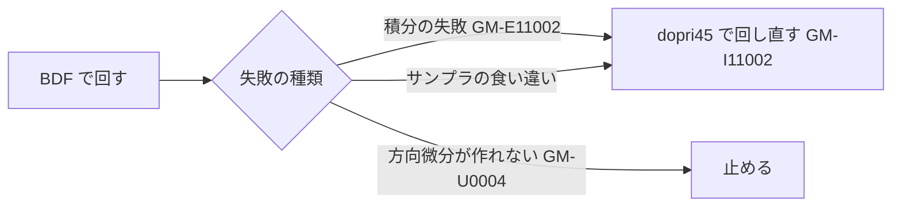

# S013 止まった例題と管の外れの残り

| | |
| --- | --- |
| セッション | S013 |
| 日付 | 2026-10-19〜20 |
| ブランチ | `feature/s013-sim-leftovers` |
| Phase | P3 |
| スライド | [slides.html](slides.html) |
| 作業記録 | `log/work/2026-10-19-s013-sim-leftovers.md` |

## 1. 目的

依頼は「進めて。別のエージェントが /ponytail-review を実行中。衝突しないように注意して」。S012 の「次回」の候補 1（止まった例題・管の外れの残り、`auto` の初期化での切り替えの見直し）を選んだ。P3 の完了条件は S012 で満たしており、その先の質を上げる作業。途中で止まり、2026-10-20 に「再開して」で締めた。

## 2. 決定と理由

設計は [ADR-0015](../../adr/0015-auto-and-reference-tolerance.md)。調査は [research/msl-sim-failures.md](../../research/msl-sim-failures.md) の節「S013 で直したもの」。

| 項目 | 決定 | 理由 |
| --- | --- | --- |
| `auto` の切り替え | 方向微分が作れない失敗（`GM-U0004`）では、組み立て・初期化でも dopri45 に切り替えない | MSL で当たるのは `GenerationOfFMUs` の 1 本だけで、RK では温度が 293.15 K のまま動かない誤った結果だった |
| 突き合わせの許容誤差 | `cargo xtask msl-sim --tolerance-scale`。注釈に Tolerance があるときだけ倍率を掛ける。`mise run msl:sim` は 0.1 | MAP-LIB の参照結果は注釈の 0.1 倍（無ければ 1e-6）で作られている |
| `globe simulate` の既定 | 変えない | Tolerance はモデルの作者が決める値。倍率は比べ方の設定 |
| 既知の外れ | `DoublePendulumInitTip` を一覧に足した | カオス的で、許容誤差を 1/10 にすると 3/4 → 2/4 に悪くなる |

## 3. 図



## 4. 再現手順

```bash
mise run check
mise run wasm:node && mise run wasm:compare
mise run msl:sim   # --tolerance-scale 0.1。報告は doc/msl-sim.md
```

検証の結果（数字。S012 の結果と、両方にある 356 本で比べた。報告は [msl-sim.md](../../msl-sim.md)）:

- 実行できた 309 → 308（`GenerationOfFMUs` が `GM-U0004` で止まる）
- 管に収まった 299 → 301（参照結果と比べた 307 本のうち 98.0%）。新しく収まったのは `DemonstrateSignalExtrema`・`DemoPowerSupplyWithBuffer`。収まらなくなったものは無い
- 管の外れ 6 本のうち 3 本は既知の外れ

## 5. 次回

[roadmap.md](../../roadmap.md#次のセッション) の S014 の候補。

- 既知でない管の外れ 3 本（`Clocked` の `RotationalSample`・`LogicalSample`、`Dimmer_R`）。許容誤差では変わらない
- 止まった例題の残り（EL005 の 18 本など。多くは上流）
- 自前の積分器の詰め、ブラウザ、プリフライトの lowering を 1 回にする
