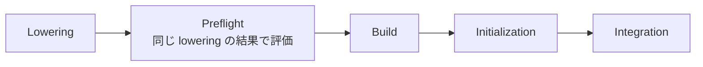

# S014 実行系の段

| | |
| --- | --- |
| セッション | S014 |
| 日付 | 2026-10-20 |
| ブランチ | `feature/s014-exec-stages` |
| Phase | P3 |
| スライド | [slides.html](slides.html) |
| 作業記録 | `log/work/2026-10-20-s014-exec-stages.md` |

## 1. 目的

依頼は「進めて」。[roadmap.md](../../roadmap.md) の S014 の候補から、4（プリフライトと組み立てで lowering が 2 回）と 5（実行系の中の段の知らせ）を選んだ。どちらも `globe-mode-exec` の中で閉じ、効果を数字で測れる。残りの管の外れ 3 本は、調査で Rumoca の意味の問題と分かっているので後に回した。

## 2. 決定と理由

設計は [ADR-0016](../../adr/0016-preflight-on-build-lowering.md)。

| 項目 | 決定 | 理由 |
| --- | --- | --- |
| プリフライトの評価 | bdf・auto と session の道は、組み立ての lowering の結果（Rumoca の `observe_lowered_model` の口、session の道は自分で呼ぶ lowering）で評価する | lowering を 1 回にできる。評価するモデルも実行と同じになる |
| ネイティブの dopri45 | 実行の前に単独のプリフライト（lowering は 2 回のまま） | `rk45::simulate` は lowering から積分までを 1 回で呼び、口が無い |
| 単独の `preflight` | 組み立てと同じ `lower_correlated_for_simulation_with_overrides` を使う | 依存（`rumoca-ir-solve`）を足さずに `LoweredSolveModel` で評価でき、どの道でも同じモデルになる |
| 段の知らせ | `run_with_progress` と `ExecStage`（Preflight・Lowering・Build・Initialization・Integration）。`msl-sim` のワーカーは `WorkerStage` に写して親に送る | 外から止めたものが、実行系の中のどこで止まったかを分ける |
| Rumoca の細かい段の名前 | そのまま出さず、GlobeMode の段に丸める | Rumoca の内部の名前は版で変わる |

## 3. 図



ネイティブの dopri45 は Preflight（単独）→ Integration。

## 4. 再現手順

```bash
mise run check
mise run wasm:node && mise run wasm:compare
cargo test --release -p globe-mode-exec --test simulate msl_preflight_time -- --ignored --nocapture
mise run msl:sim   # 報告は doc/msl-sim.md
```

検証の結果（数字）:

- `run` と単独のプリフライト（S013 までの `run` が毎回余分に払っていた分）の時間（release）: `DoublePendulum` は run 1.07 s・単独のプリフライト 0.39 s、`Fluid.Examples.HeatingSystem`（lowering で止まる）は run 4.00 s・単独のプリフライト 4.26 s、`ChuaCircuit` は 0.02 s・0.01 s
- `msl:sim`: 356 本のうち 307 本が実行でき、300 / 306 本（98.0%）が管に収まった（S013 は 308 本・301 / 307 本。P3 の完了条件は満たしたまま）。減った 1 本の `LightningSegmentedTransmissionLine`（S013 で 115 s）は 120 s の外からの停止に変わった。機械の負荷（15 分の平均 10〜12、16 コア）のためで、同じ負荷では S013 の実行ファイルでも外から止まった（空いた機械では S014 のほうが速い）。外から止めた 9 本の最後の段は、S013 の 7 本が 7 本とも lowering、残りは `FullRobot` がプリフライト（lowering が約 118 s で終わった直後）、`LightningSegmentedTransmissionLine` が積分。

## 5. 次回

[roadmap.md](../../roadmap.md#次のセッション) の S015 の候補。

- lowering が終わらない例題を早く見切る: 外から止めた 7 本は 7 本とも lowering の段で 120 s を使い切る。lowering の段に別の上限を設け、`GM-U` として数えるか決める
- 止まった例題の残り（EL005 の 18 本など。多くは上流）、既知でない管の外れ 3 本
- 自前の積分器の詰め、ブラウザ（Web Worker）
