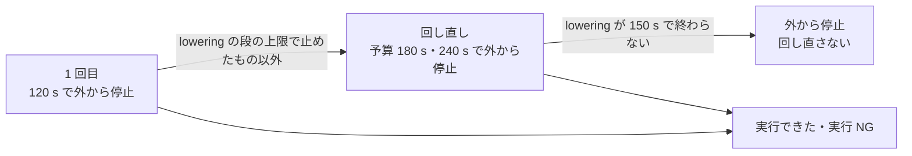

# S015 lowering の段の上限

| | |
| --- | --- |
| セッション | S015 |
| 日付 | 2026-10-20 |
| ブランチ | `feature/s015-lowering-limit` |
| Phase | P3 |
| スライド | [slides.html](slides.html) |
| 作業記録 | `log/work/2026-10-20-s015-lowering-limit.md` |

## 1. 目的

依頼は「進めて」。S014 の報告で次に挙げた 2 つを選んだ。

- lowering が終わらない例題を早く見切る（[roadmap.md](../../roadmap.md) の S015 の候補 4）
- 120 s 近いモデルが、機械の負荷で外からの停止に変わる（S014 で実行できた本数が 1 本減った原因）

どちらも `cargo xtask msl-sim`（MSL の全例題の実行）の中の話で、製品の実行系は変えない。

## 2. 決定と理由

設計は [ADR-0017](../../adr/0017-lowering-limit-and-hard-timeout-retry.md)。調べた事実は [research/msl-sim-failures.md](../../research/msl-sim-failures.md) の節「S015 で調べたこと」。

| 項目 | 決定 | 理由 |
| --- | --- | --- |
| lowering の段の上限 | `--lowering-kill-seconds`、既定 150 s（段に入ってから） | 終わるもので最も長い lowering は `EngineV6` の 64 s（空いた機械）。負荷で 2 倍近くになっても落とさない幅 |
| 「早く見切る」 | しない（120 s より短い上限は掛けない） | 120 s の内側では、終わる lowering と終わらない lowering を分けられない |
| 外から止めたもの | 時間切れと同じく予算 180 s で回し直す。lowering の段の上限で止めたものは回し直さない | 負荷で 120 s を超えたものと `EngineV6` を拾う |
| CPU 時間で止める | しない | ワーカーは 1 スレッドで CPU を使い、負荷（ハイパースレッドの取り合い）で CPU 時間も延びる |
| 分類 | 「外から停止」のまま。`GM-U` の診断にしない | `GM-*` は製品の診断で、製品の実行系には lowering の上限が無い |
| 段ごとの秒 | 親が段の知らせの間隔で測り、JSON の `stage_times` と報告の表に残す | 次に上限を決める材料 |

## 3. 図



外から止めた 7 本を 600 s で回した結果:

| 例題 | 結果 |
| --- | --- |
| `MomentumBalanceFittings`・`MeasuringTemperature`・`NonCircularPipes` | lowering が 600 s で終わらない |
| `InverseParameterization`・`EngineV6_analytic` | 約 520 s で `GM-U0004`（EL005） |
| `EngineV6` | 169 s で終了時刻まで（全体の実行では lowering 64 s） |
| `DrumBoiler` | lowering は約 117 s で終わり、プリフライト（t0 の評価）が 481 s で終わらない |

## 4. 再現手順

```bash
mise run check
cargo test -q -p xtask
mise run msl:sim   # 報告は doc/msl-sim.md
# 1 本を長い上限で回す（例）
cargo xtask msl-sim --tolerance-scale 0.1 --only Loops.EngineV6 --wall-seconds 600 --kill-seconds 600 --retry-wall-seconds 0 --report /tmp/r.md --json /tmp/r.json
```

検証の結果（数字）:

- `msl:sim`（空いた機械、負荷の平均 1.1〜2.3）: 356 本のうち **309 本**が実行でき、**301 / 308 本**（97.7%）が管に収まった（S014 は 307 本・300 / 306 本）。増えたのは `EngineV6`（回し直しで 139 s。管は 2 / 4）と `LightningSegmentedTransmissionLine`。外から止めたのは 6 本（lowering の段の上限で 5 本、`DrumBoiler` はプリフライトで 240 s）。回し直しは 12 本。全体の時間は 3733 s。
- lowering の段の長いもの（終わったもの）: `DrumBoiler` 117 s（その後プリフライトで止まる）、`EngineV6` 64 s、`FullRobot` 44 s、`BaseProperties` 20 s、`Engine1b_analytic` 14 s。

## 5. 次回

[roadmap.md](../../roadmap.md#次のセッション) の S016 の候補。

- `DrumBoiler` のプリフライトが終わらない（GlobeMode の側で直せる。評価に上限を掛けるか、遅い原因を調べる）
- 新しく管から外れた `EngineV6`（`filter.x[1]`・`filter.x[2]` が t = 0 から外れる）
- lowering が終わらない 5 本は上流（EL005 の類）。止まった例題の残り、自前の積分器の詰め、ブラウザ（Web Worker）
