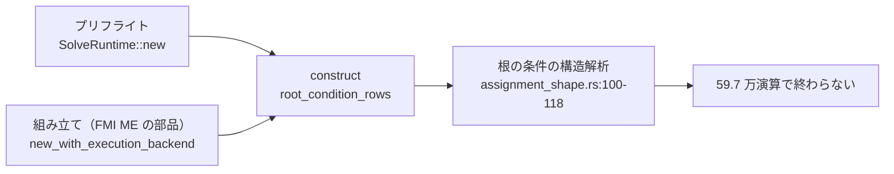
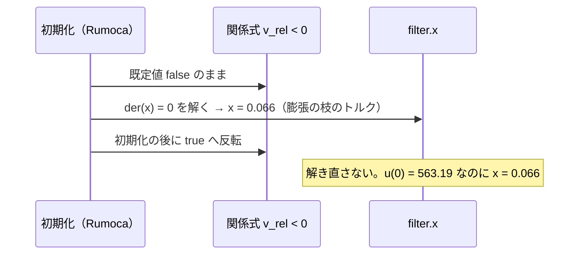

# S016 プリフライトの上限

| | |
| --- | --- |
| セッション | S016 |
| 日付 | 2026-10-20〜21 |
| ブランチ | `feature/s016-preflight-limit` |
| Phase | P3 |
| スライド | [slides.html](slides.html) |
| 作業記録 | [2026-10-20-s016-preflight-limit.md](../../../log/work/2026-10-20-s016-preflight-limit.md) |

## 1. 目的

- S015 の残しの 1 つ目に取り組んだ。MSL の `DrumBoiler` では、lowering の後の S10 のプリフライト（t0 の評価）が 481 s を過ぎても終わらない。プリフライトは警告しか出さないので、上限を掛ける見込みだった（[roadmap.md](../../roadmap.md) の S016 の候補 4）。
- 同じ候補の後半として、S015 で新しく管から外れた `EngineV6` の原因も調べた。
- P3 の完了条件は 3 つとも満たしている。今回は「止まった例題の残り」の調べ。

## 2. 決定と理由

| 項目 | 決定 | 理由 |
| --- | --- | --- |
| プリフライトの上限 | 掛けない（ユーザーと決めた。[ADR-0018](../../adr/0018-no-preflight-limit.md)） | 時間は `eval_at` ではなく、その前の `SolveRuntime::new` の中の、根の条件 31 本（計 59.7 万演算）の構造解析で使われていた。組み立ての段も同じ `construct` を通るので、上限を掛けても実行できる本数は増えない。ほかの 355 本のプリフライトは最大 1.9 s |
| 比べた案 | 別のスレッドと待ちの打ち切り、Rumoca の締め切り、反復の上限、組み立ての後に回す | どれも本数は増えず、コードと危険だけが増える（打ち切ったスレッドは止められない、締め切りを確かめる所が無い、など）。詳しくは ADR-0018 |
| EngineV6 | 既知の外れの一覧に載せない（既定のまま進めた） | 原因は Rumoca の初期化の不具合。一覧はモデル・参照・比べ方の限界に限っているので、外れとして数え続ける |
| 上流への報告 | 候補 10・11 を足した | [research/msl-sim-failures.md](../../research/msl-sim-failures.md) の「上流に報告する候補」 |
| 全体の実行 | `msl:funnel`・`msl:sim` は回さない（ユーザーと決めた） | コードを変えていない。WSL のメモリは 3 GB |
| サブエージェント | Opus・effort medium で調べもの 3 つ（ユーザーの指示） | メモリの都合で、release のビルドと MSL の実行は一度に 1 人に限った |

事実の詳細（標本、表、コードの位置）は [research/msl-sim-failures.md](../../research/msl-sim-failures.md) の節「S016 で調べたこと」にある。

## 3. 図



EngineV6 の初期化で起きていること:



## 4. 再現手順

```bash
# DrumBoiler（報告と JSON は doc/ と target/ 以外に出す）
cargo xtask msl-sim --funnel-json target/msl-funnel.json --only DrumBoiler.DrumBoiler \
  --wall-seconds 600 --kill-seconds 900 --lowering-kill-seconds 900 --retry-wall-seconds 0 \
  --tolerance-scale 0.1 --report <dir>/r.md --json <dir>/r.json
# 走っているワーカー（pgrep -x xtask -n）に perf record -F 199 -p <pid>

# EngineV6（約 5 分 40 秒、最大 RSS 1.37 GB）
target/release/globe simulate -L data/msl -m Modelica.Mechanics.MultiBody.Examples.Loops.EngineV6 \
  --stop-time 0.01 --tolerance 1e-7 --timeout 600 -o e6.csv

# 小さい再現 R1（モデルは research/msl-sim-failures.md の節「S016 で調べたこと」）
target/release/globe simulate X.mo -L data/msl -m X.R1 --stop-time 0.01 -o R1.csv
```

検証の結果:

- DrumBoiler: 5 回とも外から停止。プリフライトの段では `SolveRuntime::new` から戻らない。根の条件の先頭の 1 本の解析が 900 s で終わらない。
- EngineV6: t = 0 で `filter.x` が 0.066（参照 563.19）、`der(filter.x[1])` が 27487.7。Rumoca の CLI v0.10.2 も同じ値。
- R1: t = 0 で `u = 1` なのに `filter.x = 2`（omc は 1）。
- コードは変えていないので、MSL の数字は S015 のまま（309 本が実行でき、301 / 308 本が管に収まる。[msl-sim.md](../../msl-sim.md)）。

## 5. 次回

- 初期化の後に初期化方程式の残差を見て警告する（[roadmap.md](../../roadmap.md) の S017 の候補 4）。
- 上流への報告に 10・11 を足す（ユーザーが出す。候補 8）。
- 確かめていないこと: DrumBoiler の根の条件 1 本の解析が実際に何秒で終わるか。組み立ての段が最後まで終わるか。
