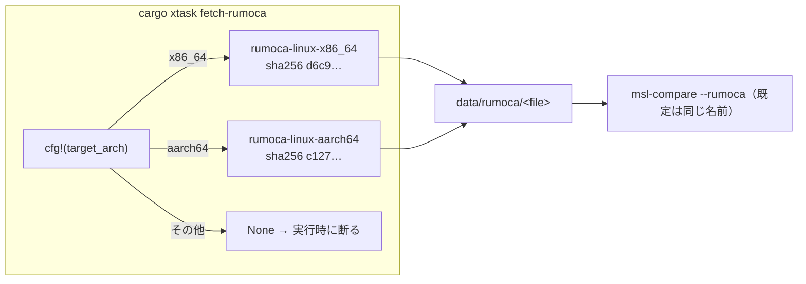

# S017 Claude の実行場所を Raspberry Pi（aarch64）に移す

| | |
| --- | --- |
| セッション | S017 |
| 日付 | 2026-10-22 |
| ブランチ | `feature/s017-rpi-aarch64` |
| Phase | P3（運用） |
| スライド | [slides.html](slides.html) |
| 作業記録 | `log/work/2026-10-22-s017-rpi-aarch64.md` |

## 1. 目的

S016 までは x86_64 の機械で作業していた。ユーザーの指示（2026-10-22）で Claude の実行場所を Raspberry Pi（aarch64、4 コア、RAM 7.9 GiB、glibc 2.36）に移し、[roadmap.md](../../roadmap.md) の「S017 の最初にやること」の 3 つを片付ける。

1. `cargo xtask fetch-rumoca` を aarch64 に対応させる
2. RPi の環境をそろえる（mise・uv・MSL・`mise run check`）
3. `msl:funnel` のメモリ（x86_64 で最大 RSS 7.1 GiB）を RPi で回せるようにする

製品のコード（検査・実行系）は変えない。決定は [ADR-0019](../../adr/0019-rpi-aarch64-environment.md)。

## 2. 決定と理由

| 項目 | 決定 | 理由 |
| --- | --- | --- |
| 作業ツリー（ユーザーと決めた） | 規約どおり main から `feature/s017-rpi-aarch64` を切る | orca が作った worktree（`asari300/acornworm`）だと finish-session の手順と合わない |
| mise のツール（ユーザーと決めた） | 全部入れる | roadmap の「環境をそろえる」そのもの。aarch64 の版が無いものは報告する |
| `fetch-rumoca` の aarch64 | `RUMOCA_ASSET: Option<(ファイル名, sha256)>` を `cfg!(target_arch)` の const で選ぶ。`--rumoca` の既定も連動 | URL・sha256・ファイル名を 1 か所で持てる。対応していない機械（Windows の CI）でもビルドは通る |
| メモリ（ユーザーと決めた） | swap を 512 MB → 8 GB（dphys-swapfile） | RAM 7.9 GiB のうち約 2.7 GiB をデスクトップが使い、7.1 GiB の山は収まらない。分割実行は山が 1 本の巨大なモデルなら効かない |
| elixir | このセッションでは入れない（`MISE_DISABLE_TOOLS=elixir`） | erlang の arm64 ビルド（hex.pm の ubuntu-26.04 向け）が `GLIBC_2.38` を要求し、RPi の 2.36 では動かない。Elixir のラッパを触るときに決める |
| CI | 変えない（x86_64 と Windows のまま） | aarch64 の検査は RPi の手元で足りる |

## 3. 図



RPi の環境:

```mermaid
flowchart TB
  M["mise install --locked"] --> R["rust 1.99.1 / cargo-deny / wasm-bindgen / zig / julia / gleam / uv"]
  M --> ER["erlang 27.3.4.19（入るが glibc 2.38 が要る）"]
  ER -.x.-> EL["elixir（失敗 → 外す）"]
  U["uv sync"] --> P[".venv"]
  S["swap 8 GB"] --> FUN["msl:funnel（最大 RSS 7.1 GiB）"]
```

## 4. 再現手順

```bash
# RPi（aarch64）で
curl -fsSL https://mise.run | sh                      # ~/.local/bin/mise
cd .git-worktree/s017-rpi-aarch64
mise trust && MISE_DISABLE_TOOLS=elixir mise install --locked
uv sync
export MISE_DISABLE_TOOLS=elixir                      # elixir は erlang の glibc で入らない
mise run msl:compare                                  # fetch-msl → fetch-rumoca（aarch64）→ 20 本
mise run check                                        # fmt / clippy / test / deny / uv sync --locked

# メモリ（sudo）
sudo sed -i -E 's/^CONF_SWAPSIZE=.*/CONF_SWAPSIZE=8192/' /etc/dphys-swapfile
echo 'CONF_MAXSWAP=8192' | sudo tee -a /etc/dphys-swapfile
sudo dphys-swapfile swapoff && sudo dphys-swapfile setup && sudo dphys-swapfile swapon
mise run msl:funnel                                   # release で 566 本
```

検証の結果（数字）:

- `mise run msl:compare`: 20 本中 20 本が一致（両方とも成功 17 本）。`rumoca-linux-aarch64` は 57,065,304 バイト、sha256 一致。xtask の debug ビルドを含めて 1055 s。
- `mise run check`: 全段通過（`cargo deny`: advisories / bans / licenses / sources ok）。3798 s。
- `mise run msl:funnel`（release、swap 8 GB）: 566 本: OK 369・NG 13（S5 1・S6 12）・GM-U 184・panic 0（x86_64 の S010 以降と同じ本数）。検査 1312.7 s（1 本 2.32 s。x86_64 は 1.50 s）、全体 1476 s（24.6 分）、最大の常駐メモリ（VmHWM）6.5 GiB、終了時の swap の使用 1.1 GiB。
- テスト: workspace 全体で 487 本が通過・10 本 ignore。
- `mise install --locked`: 9 ツールのうち 8 つ。elixir だけ失敗。

## 5. 次回

- elixir: erlang を kerl でソースビルドする（`mise.toml` の `compile = true`、apt の依存が要る）か、apt の erlang を使うか。Elixir のラッパを触るセッションで決める。
- `msl:sim` は実行系を変えていないので回していない。参照結果（約 1 GB）も未取得。実行系を触る次のセッションで `mise run msl:sim` を回す（前回の `target/msl-sim.json` は Git に無いので差は出ない）。
- RPi では debug ビルド込みの `mise run check` に約 63 分かかる。CI と同じ検査を回す前に、変えた crate だけ `cargo test -p` で先に確かめると早い。
- S017 の候補の残り（止まった例題、自前の積分器、ブラウザ、初期化の後の検査、Arrow IPC、ソルバの残り、上流への報告）は [roadmap.md](../../roadmap.md) の S017 の候補のまま。
