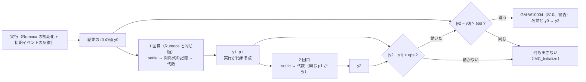

# S018 初期化の結果を初期化系にもう一度入れて確かめる（GM-W10004）

| | |
| --- | --- |
| セッション | S018 |
| 日付 | 2026-10-22 |
| ブランチ | `feature/s018-init-resettle-check` |
| Phase | P3（実行系） |
| スライド | [slides.html](slides.html) |
| 作業記録 | `log/work/2026-10-22-s018-init-resettle-check.md` |

## 1. 目的

S016 で、MSL の `EngineV6` の `filter.x` が t = 0 から参照結果と外れる原因が Rumoca の初期化にあると分かった（初期化方程式が読む関係式 `v_rel < 0` を既定値 false の枝で解き、反転しても解き直さない。[research/msl-sim-failures.md](../../research/msl-sim-failures.md) の節「S016 で調べたこと」）。GlobeMode は初期化の後に初期化方程式を見ていないので、誤った初期値のまま黙って積分していた。

[roadmap.md](../../roadmap.md) の候補 4「初期化の後の初期化方程式の検査」を片付ける。Rumoca に初期化方程式の残差を評価する公開の入口があるかを確かめ、無ければ別の方法で使う人に知らせる。決定は [ADR-0020](../../adr/0020-init-resettle-check.md)。実行系の結果は変えない。

## 2. 決定と理由

| 項目 | 決定 | 理由 |
| --- | --- | --- |
| 残差か解き直しか | 初期化系を 2 回解き、2 回目で動いた変数を警告 GM-W10004 で知らせる | Rumoca rev 276e82bd の `eval_initial_residual` は crate の中の trait `AlgebraicProjectionModel` の実装で、公開されていない（公開は方向微分だけ）。`settle_initialization_system`・`update_relation_memory_from_state`・`refresh_algebraic_and_output_slots` は公開 |
| 1 回目の作り方 | Rumoca の FMI ME の kernel（`exit_initialization_mode`）と同じ順と許容誤差で解く | 実行が始まる点をそのまま再現する。関係式の記憶はパラメータの枠（`ScalarSlot::P`）にあり、2 回目に引き継がれる |
| 動いたと見る差 | `|y2 − y1| > max(10 × 許容誤差, 1e-6) × max(1, |y1|, |y2|)` | Newton の丸め（許容誤差の桁）を拾わず、EngineV6（0.066 → 563）や再現（2 → 1）は拾う |
| 警告の判定（最初の実装を MSL の結果で直した） | 2 回目と**実行が始まった t0 の値**（結果の最初の行）が違うものだけを警告する。`run` だけが出し、単独の `preflight` は出さない | 1 回目との差で警告すると、MSL の `IMC_Initialize` で 169 変数が出る。ところが結果の t = 0 は 2 回目の値で管も収まる。Rumoca の FMI ME の host は初期化のあとの初期イベントの反復で、離散変数のあるモデルでは解き直す |
| 2 回目の失敗 | 黙る | `TanksWithOverflow` は、解いた点から homotopy の λ = 0 の掃引をやり直すと収束しない。失敗は始まる点の誤りを示さない |
| 実行 | 変えない | FMI ME の host にも `PreparedSimulation` にも、初期化の後の状態を差し替える公開の入口が無い。Rumoca の CLI と結果が食い違うのも避ける |
| 対象 | 全部のモデル | 根の条件があるモデルに限ると、関係式の記憶が原因の分しか見ない。固定点でない初期化のほかの原因も拾う。費用は `msl:sim` の段ごとの秒で測る |
| 置き場 | プリフライト（組み立ての lowering の結果で 1 回。[ADR-0016](../../adr/0016-preflight-on-build-lowering.md)） | GM-W10002 と同じ実行時オブジェクト（`SolveRuntime::new`）を使い回す。どの道（bdf・dopri45・auto・自前の積分器・session）でも 1 回 |
| 作業ツリーの用意（既定のまま） | S017 の worktree の `target/`（18 GB）と `data/` を `cp -a` で写す | RPi では依存のビルドに約 1 時間かかる。依存の fingerprint は worktree のパスに依らない |

## 3. 図



EngineV6 と `InitRelationBranch` で起きること: 1 回目は関係式 false の枝で x を解いたあとに記憶が true に反転する。Rumoca はここで止まり、x は古い枝の値のまま。2 回目は true の枝で解き直すので x が動く。

最小の再現 `GlobeModeValidation.Simulation.InitRelationBranch`（MSL に依らない）:

```modelica
Real s(start = 0, fixed = true);  Real v;  Real u;  Real x(start = 0);
parameter Real T = 0.1;
equation
  der(s) = v;  v = -0.5 * cos(s);          // t = 0 で v = -0.5
  u = if v < 0 then 1 else 2;
  der(x) = (u - x) / T;
initial equation
  der(x) = 0;                               // 定常: x = u = 1
```

| t = 0 | 正しい値 | Rumoca（実行） | 2 回目 |
| --- | --- | --- | --- |
| `u` | 1 | 1 | 1 |
| `x` | 1 | **2** | 1 |

プリフライトの本文: `初期化の結果を初期化系にもう一度入れると t = 0 で値が変わる: x = 2 → 1`。補足に「2 回目の値のほうが正しい見込み」と回避（初期化方程式が関係式を読まないようにする）を書く。

## 4. 再現手順

```bash
export MISE_DISABLE_TOOLS=elixir
mise x -- cargo test -p globe-mode-exec --test simulate   # an_initialization_that_reads_a_relation_flipped_at_t0_is_warned を含む
mise run check                                           # fmt / clippy / test / deny / uv sync --locked
mise run msl:sim                                         # 実行系を変えたので全体（RPi。初回は参照結果 約 1 GB を取得）
mise run wasm:node && mise run wasm:compare              # exec を変えたので（InitRelationBranch は package.order から自動で入る）
```

検証の結果（数字）:

- `mise run check`: fmt・clippy・deny・`uv sync --locked` が通り、`cargo test --workspace` は 488 本通過・0 失敗・10 ignore（RPi では `CARGO_BUILD_JOBS=2` で 29 分。4 本並べるとリンカがメモリ不足で止まった）。
- `mise run msl:sim`（判定を直した版）: 356 本のうち実行できた 307、管に収まった 300 / 306（98.0%）、GM-W10004 は 0 本。プリフライトの段は合計 93.6 s、最大 45.9 s（`LightningSegmentedTransmissionLine`）。
- EngineV6 を単独で回すと GM-W10004 が `filter.x[1] = 0.065992 → 563.186238` ほか計 7 個で出る（S016 で参照結果と見比べた値と一致）。
- `mise run wasm:node` は ok。`mise run wasm:compare` は 123 / 126 件が一致、既知の差 3 件、一致しない 0 件。`InitRelationBranch` は 9 つのソルバすべてで wasm でも GM-W10004 が出て、結果も一致した。

## 5. 次回

- 根の条件の無いモデルでは解き直しを省く（ADR-0020 の案 D）。`LightningSegmentedTransmissionLine` は解き直しの分（初期化の約 2 回分）で RPi の 240 s の上限に当たるようになった。
- レビューの指摘を直す: 解き直しが panic すると GM-W10002 の結果も捨てられる（`resettle` だけを別の `catch_unwind` で包む）、t0 の値との比較（`resettle_diagnostic`）の単体試験、`tests/simulate.rs` のコメントの取り違えと「12 本」。
- 上流への報告（候補 8）に、初期化方程式の残差の評価の公開と、関係式の反転での解き直しを足す。公開されたら、この検査を残差の評価に置き換える（ADR-0020 の結果）。
- S017 の候補の残り（止まった例題、自前の積分器、ブラウザ、Arrow IPC、ソルバの残り）は [roadmap.md](../../roadmap.md) のまま。
