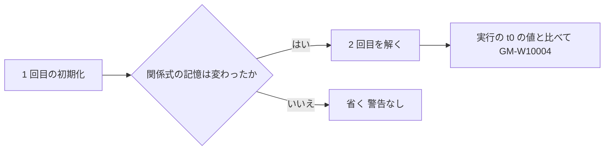

# S019 初期化の解き直しの後始末

| | |
| --- | --- |
| セッション | S019 |
| 日付 | 2026-10-24 |
| ブランチ | `feature/s019-resettle-followups` |
| Phase | P3（実行系） |
| スライド | [slides.html](slides.html) |
| 作業記録 | `log/work/2026-10-23-s019-resettle-followups.md` |

## 1. 目的

[S018](../S018-init-resettle-check/解説書.md) で次回に残した、[ADR-0020](../../adr/0020-init-resettle-check.md) の案 D と、レビューの指摘を片付ける。新しい機能は足さない。あわせて、RPi の `target/` は 1 つだけ持って次のセッションに `mv` で渡す、という扱いをユーザーと決めた。

## 2. 決定と理由

| 項目 | 決定 | 理由 |
| --- | --- | --- |
| 解き直しを省く条件 | 1 回目のあと `update_relation_memory_from_state` が `false`（記憶が変わらない）なら 2 回目を省く | EngineV6 の仕組みは関係式の反転だけ。記憶が変わらなければ 2 回目も同じ枝で同じ方程式を解く。決定は [ADR-0021](../../adr/0021-resettle-only-when-relations-flip.md) |
| 失うもの | 記憶が変わらないまま 2 回目が動く原因の検出 | ADR-0020 の時点でも MSL では見つかっていない |
| panic | 解き直しを別の `catch_unwind` に入れた（指摘 1） | 解き直しの panic で GM-W10002 の評価まで失わないため |
| 判定の試験 | `resettle_diagnostic` の単体試験を足した（指摘 2） | 「2 回目と実行の t0 の値が同じなら黙る」規則（`IMC_Initialize` の形）に試験が無かった |
| 重複と未使用 | 差の式を `differs` にまとめ、`Resettle.moved` から 1 回目の値を落とした（指摘 4・5） | 同じ式が 2 か所にあり、1 回目の値は使っていなかった |
| コメント | 試験の doc コメントの取り違えと、`VALIDATION_MODELS` の本数を直した（指摘 6・7） | S018 の試験が隣の試験の 1 行目を奪っていた |
| 重い検査 | PC に回す（ユーザーの決定、次回から作業は PC） | RPi では `msl:sim` が PC の約 2 倍（5845 s と 2945.8 s）かかり、時間切れの本数が機械で変わる |

## 3. 図



## 4. 再現手順

```bash
export PATH="$HOME/.local/bin:$PATH" MISE_DISABLE_TOOLS=elixir
CARGO_BUILD_JOBS=2 mise run check      # RPi。PC では CARGO_BUILD_JOBS は要らない
```

検証の結果（RPi、2026-10-24）:

- `mise run check`: 通った。`cargo test` は 489 本が通り、失敗 0、無視 10（S018 は 488 本。足したのは単体試験 1 本）。fmt、clippy、deny、`uv sync --locked` も通った。
- `an_initialization_that_reads_a_relation_flipped_at_t0_is_warned`（再現のモデル `InitRelationBranch`）は、案 D を狭めた後も通る。
- **通していない**: `msl:funnel`、`msl:sim`、`wasm:node`、`wasm:compare`。MSL での GM-W10004 の本数と `Lightning` の費用は、まだ確かめていない。

## 5. 次回

次のセッションは PC で行う。

- 最初に、通していない 4 つ（`msl:funnel`、`msl:sim`、`wasm:node`、`wasm:compare`）を回し、本数を S019 の作業記録に書く。
- 確かめること: `EngineV6` で GM-W10004 が出る（`filter.x = 0.066 → 563`）、MSL で GM-W10004 が 0 本のまま、`LightningSegmentedTransmissionLine` のプリフライトが下がる。
- 結果が違えば ADR-0021 を直す（ほかの原因で動くモデルが見つかったときは覆す）。
