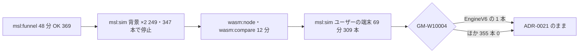

# S020 PC での重い検査

| | |
| --- | --- |
| セッション | S020 |
| 日付 | 2026-10-24〜25 |
| ブランチ | `feature/s020-pc-heavy-checks` |
| Phase | P3 |
| スライド | [slides.html](slides.html) |
| 作業記録 | `log/work/2026-10-24-s020-pc-heavy-checks.md` |

## 1. 目的

[S019](../S019-resettle-followups/解説書.md) は RPi で行い、重い検査 4 つ（`msl:funnel`、`msl:sim`、`wasm:node`、`wasm:compare`）を PC に回した。このセッションは RPi の作業を pull した WSL（x86_64、RAM 3 GB + swap 16 GB）でその 4 つを回し、[ADR-0021](../../adr/0021-resettle-only-when-relations-flip.md)（初期化の解き直しは関係式の記憶が変わったときだけ）の条件でも次が成り立つことを確かめる。コードは変えない。

- `EngineV6` で GM-W10004 が出る（`filter.x = 0.066 → 563`）
- MSL のほかの例題で GM-W10004 が 0 本
- `LightningSegmentedTransmissionLine` のプリフライトの費用

P3 の完了条件（[roadmap](../../roadmap.md)。実行できた本数と管に収まった率）の確認でもある。

## 2. 決定と理由

| 項目 | 決定 | 理由 |
| --- | --- | --- |
| ADR-0021 | 直さない | EngineV6 は検出でき（GM-W10004 が S018 と同じ 7 個の値で出た）、ほかの 355 本で GM-W10004 は出なかった |
| `msl:sim` の回し方 | ユーザーの端末で `nohup` で回す | Claude Code は、セッションが待ち状態のときにメモリが少ないと背景のコマンドを殺す（249 本と 347 本で 2 回止まった。Linux の OOM ではない）。ユーザーの端末のプロセスには関与しない |
| 順番 | `wasm:node`・`wasm:compare` を先に、`msl:sim` を後に | ユーザーの選択。wasm はビルド込み 12 分で終わる |
| `log/mise/` | `.gitignore` に足す | ユーザーが置いた mise のログの置き場。コミットしない |
| 前回との差 | 書かない | 前回の `target/msl-sim.json` はこの PC に無い（RPi の target は `mv` で次のセッションに渡す決まり、S019）。S015（PC）と S018（RPi）の作業記録と手で比べた |

## 3. 図



## 4. 再現手順

```bash
cd .git-worktree/s020-pc-heavy-checks
mise run msl:funnel                                   # release で 566 本。48 分（取得・ビルド込み）
mise run wasm:node && mise run wasm:compare           # 12 分
nohup mise run msl:sim &> log/mise/msl-sim.log &      # ユーザーの端末で。69 分
target/release/globe simulate -L data/msl \
  -m Modelica.Mechanics.MultiBody.Examples.Loops.EngineV6 --stop-time 0.01 --tolerance 1e-7   # 165 s
```

検証の結果（WSL x86_64、2026-10-24〜25）:

- `msl:funnel`: 566 本: OK 369・NG 13・GM-U 184・panic 0。S017 と同じ本数。
- `msl:sim`（全体 4132 s）: 356 本: 実行できた 309・管に収まった 301 / 308（97.7%）・実行 NG 41（うち時間切れ 4）・外から停止 6・panic 0。S015（PC、2026-10-20）と同じ本数。P3 の完了条件は満たす。
- **GM-W10004 は `EngineV6` の 1 本だけ**（回し直しで終了時刻まで、管 2 / 4 で `filter.x[1]`・`filter.x[2]` が t = 0 から外れる）。S018 の RPi では EngineV6 が外から止まって報告に入らなかった。ほかの 355 本は 0 本。
- `EngineV6` 単体: GM-W10004 が `filter.x[1] = 0.065992 → 563.186238` ほか 7 個で出た。S018 と同じ値。
- プリフライトの段の合計 45.2 s（356 本、中央値 0.007 s）。最大は `LightningSegmentedTransmissionLine` 15.1 s、次いで `EngineV6` 10.3 s。S018 の RPi（合計 98.5 s、Lightning 33.6 s）の約半分だが、PC は RPi の約 2 倍速いので、ADR-0021 で費用が下がったかはこの数字からは言えない。Lightning は関係式の記憶が変わるので解き直しは省かれていない。
- `wasm:node`: 通った（Decay を bdf・dopri45・auto、MSL の ChuaCircuit、panic の文言）。`wasm:compare`: 126 件中 123 件が一致、既知の差 3 件、一致しない 0 件。`InitRelationBranch` は 9 ソルバすべてで wasm とネイティブの両方が GM-W10004 を出す。
- Rust のコードは触っていないので `mise run check` は回していない。

## 5. 次回

- ADR-0021 の費用の効果（Lightning のプリフライト）は、同じ機械での前後の比較が無く未確認。確かめるなら S017 の rev と S019 の rev を同じ PC で回して比べる。
- この PC（RAM 3 GB）で `msl:sim` を回すときは、ユーザーの端末で `nohup` で回すか、`CLAUDE_CODE_DISABLE_BG_SHELL_PRESSURE_REAP=1` を付けて Claude Code を起こす。
- main に残ったユーザーの `log/mise/msl-sim.log`（未追跡）を片付ける。
- [roadmap](../../roadmap.md) の P3 の次の候補へ。
