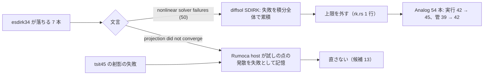

# S021 自前の積分器の詰め

| | |
| --- | --- |
| セッション | S021 |
| 日付 | 2026-10-25 |
| ブランチ | `feature/s021-solver-tuning` |
| Phase | P3 |
| スライド | [slides.html](slides.html) |
| 作業記録 | `log/work/2026-10-25-s021-solver-tuning.md` |

## 1. 目的

[roadmap](../../roadmap.md) の「次のセッション」の候補 2。S012 で足した自前の積分器（`esdirk34`・`trbdf2`・`tsit45`・`euler`・`heun`・`rk4`）が MSL の例題で落ちる 3 つの件を調べ、GlobeMode の側で直せるものを直す。

- `esdirk34` が bdf で通る例題で落ちる（diffsol の非線形の失敗・刻みが小さすぎる）
- `tsit45`・`esdirk34` で代数の射影が収束しない（GM-E11002）
- 固定刻みの既定の刻み（出力の間隔）で `heun` の精度が足りない（`Rotational.Examples` 7 本で 3 / 7）

P3 の完了条件は満たしたまま（既定のソルバ `auto` は触らない）。ソルバの範囲の詰めは [architecture](../../architecture.md) の「ソルバ」の表に対応する。

## 2. 決定と理由

| 項目 | 決定 | 理由 |
| --- | --- | --- |
| esdirk34・trbdf2 の Newton 法の失敗の上限 | 外す（`max_nonlinear_solver_failures = usize::MAX`） | diffsol の SDIRK は失敗を積分全体で累積して数え、既定の 50 回で止まる（BDF は 1 歩の中で数える）。切り替えの多い回路では 50 回をすぐ使い切る。刻みの下限が 1 歩の暴走を止める |
| tsit45 の射影の失敗 | 直さない | 硬い回路で最初の刻みから状態が発散し、試しの点の射影の発散を Rumoca の host が復帰不能の失敗として記憶する。Rumoca 自身の `dopri45` も同じ所で失敗する。陽的 RK の限界で、プラグインの不具合ではない |
| heun の既定の刻み | 変えない | 7 本で 3 / 7 のまま。`ElasticBearing` は既定の刻みで発散する（陽的 2 次の固定刻みの不安定）。精度は刻みで決まると文書にあり、`--step` で選べる |
| 回帰の試験 | `DiodeSwitching`（最小のモデル）を足し、esdirk34 で確かめる | 直す前の binary で t = 0.0027 に止まることを確かめた。trbdf2 は debug で 60 s を超えるので試験から外した（release では通る） |
| `msl:sim` の全体 | `--solver esdirk34` で回す。既定（`auto`）は回さない | 直したのは SDIRK の 1 行で、`auto` の道は通らない |
| 上流への報告 | 候補 12・13 を [research](../../research/msl-sim-failures.md) に足す | diffsol の失敗の数え方と、陽的 RK の試しの点の射影の発散。ユーザーが出す |

## 3. 図



## 4. 再現手順

```bash
cd .git-worktree/s021-solver-tuning
mise run check                                                    # 490 本通過
cargo xtask msl-sim --only Modelica.Electrical.Analog.Examples --solver esdirk34 \
  --tolerance-scale 0.1 --wall-seconds 30 --retry-wall-seconds 0 --json target/sim-esdirk34.json
cargo xtask msl-sim --only Modelica.Mechanics.Rotational.Examples --solver heun \
  --tolerance-scale 0.1 --wall-seconds 30 --retry-wall-seconds 0 --json target/sim-heun.json
cargo xtask msl-sim --solver esdirk34 --tolerance-scale 0.1 --wall-seconds 30 --retry-wall-seconds 0 \
  --json target/sim-esdirk34-all.json                             # 全体 356 本
mise run wasm:node && mise run wasm:compare
target/release/globe simulate -L src/Modelica -m GlobeModeValidation.Simulation.DiodeSwitching --solver esdirk34
```

検証の結果（WSL x86_64、2026-10-25）:

- 直す前後（`DiodeSwitching`）: 直す前は esdirk34 が t = 0.0027、trbdf2 が t = 5e-6 で「nonlinear solver failures (50)」。直した後は 3 つとも終了時刻まで進み、v(0.0985) は bdf 0.053737・esdirk34 0.053724・trbdf2 0.053739。
- `Electrical.Analog.Examples` 54 本の esdirk34: 直す前 実行 42・管 39 → 直した後 **実行 45・管 42**。`AmplifierWithOpAmpDetailed`・`Differentiator` が通るようになった。`OvervoltageProtection` は終了時刻まで進むが管 0/1（ツェナーの降伏から参照とずれる。直す前も同じ軌道で t = 0.31 に止まっていた）。
- 同 54 本の tsit45（コードは変えていない）: 実行 41・管 38。射影の失敗 7 本は硬い回路。
- `Rotational.Examples` 7 本の heun（既定の刻み）: 実行 7・管 3（S012 と同じ）。`ElasticBearing` は 1e139 に発散。
- `msl:sim` の全体 356 本の esdirk34: **356 本: 実行できた 272・管に収まった 262 / 271（96.7%）・実行 NG 76（うち時間切れ 31）・外から停止 8・panic 0**（57 分。既定の auto は S020 で 309・301 / 308。直す前の esdirk34 の全体の数字は無いので比較は Analog 54 本で）
- `wasm:node`: 通った。`wasm:compare`: 135 件中 132 件が一致・既知の差 3・一致しない 0（47 s）
- `mise run check`: 490 本通過・0 失敗・10 ignore、clippy・fmt・deny OK。

## 5. 次回

- esdirk34 が `OvervoltageProtection` で黙って誤った軌道になる件（SDIRK の段の Newton 法が強い非線形の代数ループで別の枝に落ちる見込み【未確認】）。trbdf2 は同じ所で止まる。
- esdirk34 の残り（`CauerLowPassSC` の刻みの下限、`HeatingRectifier`・`ThyristorBehaviourTest` の射影）。
- 固定刻みの発散（有限のまま大きくなる）を知らせる検査の要否。
- 上流への報告の候補 12・13（ユーザーが出す）。
- [roadmap](../../roadmap.md) の候補 1（止まった例題の残り）・3（ブラウザ）・ADR-0021 の費用の前後比較。
