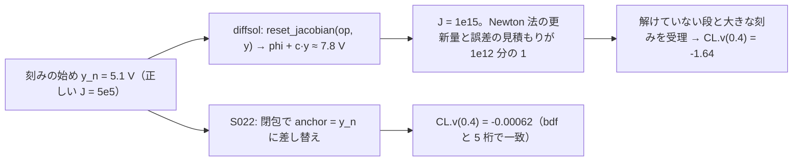

# S022 esdirk34 の残り

| | |
| --- | --- |
| セッション | S022 |
| 日付 | 2026-10-27 |
| ブランチ | `feature/s022-esdirk34-leftovers` |
| Phase | P3 |
| スライド | [slides.html](slides.html) |
| 作業記録 | `log/work/2026-10-27-s022-esdirk34-leftovers.md` |

## 1. 目的

S021 が残した esdirk34 の件を続ける。`OvervoltageProtection` で終了時刻まで進むが黙って誤った軌道になる（CL.v(0.4) = -1.64 V、参照 -0.0006 V）件の機構と直し、残りの 3 本（`CauerLowPassSC`・`HeatingRectifier`・`ThyristorBehaviourTest`）の原因の分類。P3 の完了条件は満たしたまま（既定のソルバ `auto` は触らない）。ソルバの節は [architecture](../../architecture.md)、原因の記録は [research/msl-sim-failures.md](../../research/msl-sim-failures.md) の「S022 で直したもの」。

調査はユーザーの指示でサブエージェント（Sonnet、effort high）2 本に分けた。1 本が `OvervoltageProtection` の機構と直し、もう 1 本が 3 本の分類（読むだけ）。

## 2. 決定と理由

| 項目 | 決定 | 理由 |
| --- | --- | --- |
| SDIRK のヤコビ行列を取る点 | diffsol が渡す点を使わず、刻みの始めの受理した状態（`anchor`）で `directional_derivative_into` を呼ぶ | diffsol の SDIRK は段の未知数 `x` の位置に状態 `y` を渡し、`phi + c·y`（状態の約 1.4 倍）で `f'` を取る。ツェナーの指数ではその点の J が 1e15 になり、Newton 法の更新量と誤差の見積もりが 1e12 分の 1 に潰れて、解けていない段と大きな刻みを受理する。一歩分だけ古い行列になるが、SDIRK はもともと刻みの中で行列を使い回す。`rk.rs` の閉包だけで済み、vendor を patch しない |
| 試しの点の番人 | 入れない | 受理点から 1e3 倍以上離れた試しの点で host を呼ばず NaN を返す案は、許容誤差 1e-5 の残りの失敗に効いたが、閾値が恣意的で、0 の近くから始まる状態を誤って棄てうる |
| 回帰の試験 | `DiodeSwitching` の esdirk34 と bdf の差の許容を 1e-4 → 1e-5 | 直す前の差は 1.3e-5 で落ち、直した後は 1.3e-6。MSL は試験で使えず、新しいモデルを足すより小さい |
| `CauerLowPassSC`・`ThyristorBehaviourTest` | 分類だけ。直さない | 前者はイベントの後の再開で刻みが縮む（未分類、確信は低い）。後者は esdirk34 だけ消弧の逆回復で射影が発散（trbdf2 は通る）。どちらも計測が要る |
| `msl:sim` の全体 | `--solver esdirk34` だけ。既定（`auto`）は回さない | 直したのは SDIRK のヤコビ行列の閉包で、`auto` の道は通らない |

## 3. 図



## 4. 再現手順

```bash
cd .git-worktree/s022-esdirk34-leftovers
target/release/globe simulate -L data/msl -m Modelica.Electrical.Analog.Examples.OvervoltageProtection \
  --solver esdirk34 --timeout 120 -o target/ovp.csv --json      # final の CL.v
cargo xtask msl-sim --only Modelica.Electrical.Analog.Examples --solver esdirk34 \
  --tolerance-scale 0.1 --wall-seconds 30 --retry-wall-seconds 0 --json target/sim-esdirk34-s022.json
cargo xtask msl-sim --only Modelica.Electrical.Analog.Examples --solver trbdf2 \
  --tolerance-scale 0.1 --wall-seconds 30 --retry-wall-seconds 0 --json target/sim-trbdf2-s022.json
cargo xtask msl-sim --solver esdirk34 --tolerance-scale 0.1 --wall-seconds 30 --retry-wall-seconds 0 \
  --json target/sim-esdirk34-all-s022.json                      # 全体 356 本
mise run wasm:node && mise run wasm:compare
mise run check
```

検証の結果（WSL x86_64、2026-10-27）:

- `OvervoltageProtection`: esdirk34 の CL.v(0.4) は直す前 -1.64 → 直した後 -0.00061562（bdf -0.00061563）。t = 0.02 の CL.v・zDiode.i・Rv.i が bdf と 5 桁で一致（5.3956・-0.02141・0.02411）。trbdf2 も -0.00061640 で通る（直す前は射影の発散で停止）。`--tolerance 1e-7`（直す前は GM-U0005「made no progress beyond roundoff」）も通る。`--tolerance 1e-5` は esdirk34・trbdf2 とも t ≈ 0.225 で射影の発散のまま。
- `DiodeSwitching`: esdirk34・trbdf2・bdf とも v(0.0985) = 0.05373688、k = 98。bdf との軌道の差は 1.3e-6・1.9e-6（直す前は終点で 1.3e-5）。
- `Electrical.Analog.Examples` 54 本の esdirk34: S021 の 実行 45・管 42 → **実行 48・管 46**。新たに通った: `OvervoltageProtection`・`HeatingRectifier`・`DifferenceAmplifier`（時間切れから）。管の外れ 2 本は S021 と同じ（`DemoPowerSupplyWithBuffer` の t = 0.5 の電流の尖り、`Multivibrator` は既知）。残る失敗: `CauerLowPassSC`・`ThyristorBehaviourTest`、bdf でも落ちる `HeatingNPN_NORGate`・`HeatingPNP_NORGate`・`InvertingSchmittTrigger`、時間切れ `LightningSegmentedTransmissionLine`。
- 同 54 本の trbdf2（S022 で初めて計測）: 実行 48・管 45（外れは上の 2 本と `CompareLineTrunks` の 2 点）。失敗は esdirk34 と同じ 4 本と時間切れ 2 本（`Lightning`・`SimpleTriacCircuit`）。
- `msl:sim` の全体 356 本の esdirk34: 356 本: 実行できた 282・管に収まった 273 / 281（97.2%）・実行 NG 67（うち時間切れ 24）・外から停止 7・panic 0（50 分。S021 は 272・262 / 271。管に入った: `OvervoltageProtection`・`PlanarFourbar`。新たに実行できて外れた: `Dimmer_RL`（S021 は時間切れ。`vH01.y_arg` の位相、既知の `Dimmer_R` と同じ種類）。既定の auto は S020 で 309・301 / 308）。
- `wasm:node`: 通った。`wasm:compare`: 135 件中 132 件が一致・既知の差 3・一致しない 0。
- `mise run check`: 490 本通過・0 失敗・10 ignore、fmt・clippy・deny OK（42 分）。

## 5. 次回

- `CauerLowPassSC`: t = 1.05 のイベントの後の再開で刻みが下限まで縮む。許容誤差 3e-6 で通り 2e-6 で落ちる。再開の後の刻みの列と NaN の回数を計測する（`advance` は `step()` の誤りを先に返すので、host が記憶した失敗が「刻みが小さすぎる」の文言で出ている可能性）。
- `ThyristorBehaviourTest`: esdirk34 だけ消弧の逆回復（t ≈ 5.4e-5）で射影が発散。trbdf2 は通る。
- `globe simulate --param V.startTime=…` が効かない（`--list-parameters` には載る）。時間イベントのパラメータの上書き。
- 上流への報告の候補 14（diffsol の SDIRK がヤコビ行列を状態の点で取る。ユーザーが出す）。
- [roadmap](../../roadmap.md) の候補 1（止まった例題の残り）・3（ブラウザ）・ADR-0021 の費用の前後比較。
