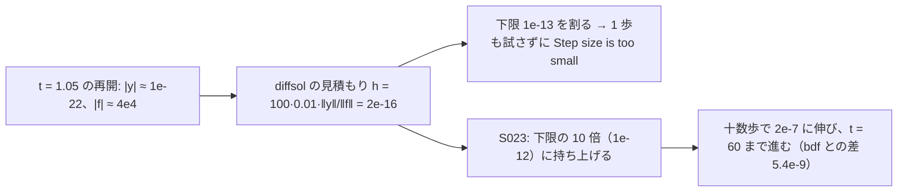

# S023 パラメータの上書きと CauerLowPassSC

| | |
| --- | --- |
| セッション | S023 |
| 日付 | 2026-10-27 |
| ブランチ | `feature/s023-param-override-cauer` |
| Phase | P3 |
| スライド | [slides.html](slides.html) |
| 作業記録 | `log/work/2026-10-27-s023-param-override-cauer.md` |

## 1. 目的

S022 の残しを続ける。`globe simulate --param V.startTime=…` が効かない件の原因と、esdirk34・trbdf2 の `CauerLowPassSC` が t = 1.05 のイベントの後の再開で「Step size is too small」で止まる件の機構と直し。P3 の完了条件は満たしたまま（既定のソルバ `auto` は触らない）。ソルバの節は [architecture](../../architecture.md)、原因の記録は [research/msl-sim-failures.md](../../research/msl-sim-failures.md) の「S023 で直したもの」。

調査はユーザーの指示でサブエージェント（Sonnet、effort high）2 本に分けた。1 本が `--param` の原因、もう 1 本が `CauerLowPassSC` の計測と直し。

## 2. 決定と理由

| 項目 | 決定 | 理由 |
| --- | --- | --- |
| RK の最初の刻み | diffsol の見積もり（`set_step_size`）が刻みの下限の 10 倍を下回れば 10 倍に持ち上げる（`rk.rs` の `initial_state()`） | 状態がほぼ 0 で導関数が大きい再開では `h0 = 0.01·‖y‖/‖f‖` が 2e-18、刻みが 2e-16 になり、下限 1e-13 を割って最初の `step()` が 1 歩も試さずに失敗する。使えない刻みを持ち上げるだけで、通っていた例題の出力は変わらない |
| 持ち上げる先 | 下限の 10 倍 | 下限そのものだと、最初の歩が棄てられて刻みを縮めた瞬間にまた下限を割る。刻みは受理ごとに伸び、十数歩で必要な刻みに届く |
| 回帰の試験 | `GlobeModeValidation.Simulation.TinyStateRestart`（x = 3e-11 から t = 1 で der(x) が 0 → 1e5）を足し、esdirk34・trbdf2・tsit45 で x(2) = 1e5 を確かめる | 直す前の 3 つとも同じ所で落ちる最小の形。MSL は試験で使えない |
| `--param` の時間イベント | 直さない。上流の候補 16 にする | 原因は Rumoca の DAE の段（`time_event_instant` が調整できるパラメータを既定値で畳む）。手元で直すなら `Session::set_structural_overrides` でコンパイルし直す道で、frontend・キャッシュ・wasm に届く設計の変更になる |
| `msl:sim` の全体 | `--solver esdirk34` だけ。既定（`auto`）は回さない | 直したのは RK のプラグインの関数で、`auto`（Rumoca の BDF と dopri45）の道は通らない |

## 3. 図



## 4. 再現手順

```bash
cd .git-worktree/s023-param-override-cauer
target/release/globe simulate src/Modelica/GlobeModeValidation/Simulation/TinyStateRestart.mo -m TinyStateRestart \
  --solver esdirk34 --timeout 30 -o target/tiny.csv      # 直す前は t = 1 で失敗
cargo test -p globe-mode-exec --release --test integrators
for s in esdirk34 trbdf2 tsit45; do
  cargo xtask msl-sim --only Modelica.Electrical.Analog.Examples --solver $s \
    --tolerance-scale 0.1 --wall-seconds 30 --retry-wall-seconds 0 --json target/sim-$s-s023.json
done
cargo xtask msl-sim --only Modelica.Electrical.Analog.Examples.CauerLowPassSC --solver esdirk34 \
  --tolerance-scale 0.1 --wall-seconds 120 --retry-wall-seconds 0
cargo xtask msl-sim --solver esdirk34 --tolerance-scale 0.1 --wall-seconds 30 --retry-wall-seconds 0 \
  --json target/sim-esdirk34-all-s023.json                      # 全体 356 本
mise run wasm:node && mise run wasm:compare
mise run check
```

検証の結果（WSL x86_64、2026-10-27）:

- `TinyStateRestart`: 直す前は esdirk34・trbdf2・tsit45 とも t = 1 の再開で失敗、直した後は 3 つとも x(2) = 1e5。`integrators` の試験 9 本通過。
- `CauerLowPassSC`: esdirk34 は t = 60 まで進み、bdf との差は全信号で |x−y|/(1+|y|) ≤ 5.4e-9（trbdf2 は 1.2e-8）。`msl-sim` で予算 120 s にすると積分 40 s で終わり、管に収まる。予算 30 s の掃引では時間切れ（直す前は GM-E11002）。
- `OvervoltageProtection`・`HeatingRectifier` の esdirk34 の出力は直す前とバイト単位で同じ。
- `Electrical.Analog.Examples` 54 本: esdirk34 は 実行 48・管 46、trbdf2 は 48・45（どちらも S022 と同じ。違いは `CauerLowPassSC` が GM-E11002 → 時間切れの 1 本だけ）。tsit45 は S021 の 41・38 → 42・39（違いは予算の境目の `LightningSegmentedTransmissionLine` が時間切れ → 通る）。
- `msl:sim` の全体 356 本の esdirk34: 356 本: 実行できた 286・管に収まった 277 / 285（97.2%）・実行 NG 64（うち時間切れ 26）・外から停止 6・panic 0（S022 は 282・273 / 281）。新たに実行できて管に収まった 4 本はサイリスタの整流器（`PowerConverters.Examples.ACDC` の `HalfControlledBridge2mPulse`・`ThyristorBridge2mPulse_R`・`ThyristorCenterTap2mPulse_R`・`ThyristorCenterTapmPulse_R`。直す前は GM-E11002）。`CauerLowPassSC` は GM-E11002 → 時間切れ、`EngineV6` は外から停止 → 時間切れ（予算の境目）。管の外れ 8 本は S022 と同じ数
- `wasm:node`・`wasm:compare`: `wasm:node` は通った。`wasm:compare` は 144 件中 141 件が一致・既知の差 3・一致しない 0（`TinyStateRestart` を足して S022 の 135 件から 9 件増えた）。
- `mise run check`: 491 本通過・0 失敗・10 ignore、fmt・clippy・deny OK（最初の回は `integrators.rs` の fmt で落ち、直して回し直した）。
- `--param`: `StepVoltage`・R・接地の回路で `--param V.startTime=0.5` としても V.v は既定と同じ時刻で 0 → 1。`V.offset=5`・`V.signalSource.height=3`・`R.R=2` は効く。

## 5. 次回

- `--param` の時間イベント: 上流の候補 16。手元で直すなら `Session::set_structural_overrides` で組み込んでコンパイルし直す（ADR を書いてから）。それまで効かない上書きを警告する案もある（新しい GM-W）。
- `ThyristorBehaviourTest`: esdirk34 だけ消弧の逆回復（t ≈ 5.4e-5）で射影が発散。trbdf2 は通る。
- 上流への報告の候補 15・16（ユーザーが出す）。
- [roadmap](../../roadmap.md) の候補 1（止まった例題の残り）・3（ブラウザ）・ADR-0021 の費用の前後比較。
