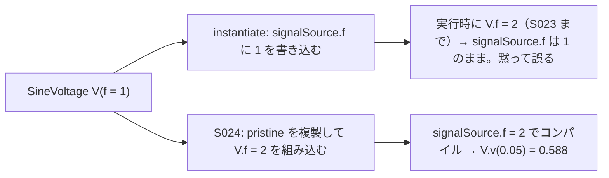

# S024 サイリスタと時間イベントの上書き

| | |
| --- | --- |
| セッション | S024 |
| 日付 | 2026-10-28 |
| ブランチ | `feature/s024-thyristor-param-overrides` |
| Phase | P3 |
| スライド | [slides.html](slides.html) |
| 作業記録 | `log/work/2026-10-28-s024-thyristor-param-overrides.md` |

## 1. 目的

S023 の残しを続ける。esdirk34 の `ThyristorBehaviourTest`（消弧の逆回復で射影が発散）の原因と、`--param` で時間イベントの時刻が変わらない件の手元での直し方。調べると `--param` の件は時間イベントに限らず、同じ名前の修飾で写された値（`SineVoltage` の `f` など）にも上書きが届かず、黙って誤った結果を返していた。これを直した（[ADR-0022](../../adr/0022-structural-parameter-overrides.md)）。原因の記録は [research/msl-sim-failures.md](../../research/msl-sim-failures.md) の「S024 で直したもの」。

調査と実装はユーザーの指示でサブエージェント（Sonnet、effort high）3 本に分けた。`ThyristorBehaviourTest` の計測、`--param` の直し方の見積もり（読むだけ）、決めた直しの実装。

## 2. 決定と理由

| 項目 | 決定 | 理由 |
| --- | --- | --- |
| `--param` の直し方 | 上書きがあれば、ライブラリだけの session（`pristine`）を複製し、利用者のファイルを足して `set_structural_overrides` で組み込んでからコンパイルする | ソースの修飾を書き換えたのと同じ結果になる。DAE の時点で外側と内側の依存は消えているので、「効かない上書き」を見分けて警告する案は名前の形の推測になる。Rumoca の時間イベントの畳み込みを直す patch は、もともと効いていた形しか変えなかった |
| 複製してから組み込む | 既定のコンパイルを済ませた session には足さない | 一度コンパイルした session で `set_structural_overrides` を呼ぶと ED020 で落ちる（上流の候補 17） |
| 上書きの型 | 既定の DAE の変数の型から `Real`・`Int`・`Bool` を選ぶ | `Real` を Integer のパラメータに渡すと型の誤りで落ちる |
| 実行時の上書き | そのまま渡す | 名前の誤りや構造パラメータの拒否（GM-E10006）と `SimRun.parameters` をそのまま使える。変えられる名前の範囲は前と同じ |
| 組み込みの失敗 | その診断をコンパイルの失敗として返す。黙って既定に戻さない | 戻すと前と同じく黙って誤る |
| `ThyristorBehaviourTest` | 直さない。上流の候補 19・20 | 原因は host が試しの点の射影の失敗を復帰不能として記憶すること（候補 13 と同じ機構）。再開の刻みを 0.9 倍にすると通るが崖のすぐ下の調整で、通しても Hermite の補間が硬い変数で外れて管に収まらない見込み |

## 3. 図



## 4. 再現手順

```bash
cd .git-worktree/s024-thyristor-param-overrides
target/release/globe simulate -L data/msl SineF.mo -m SineF --solver bdf --interval 0.05 --param V.f=2   # V.v(0.05)
target/release/globe simulate -L src/Modelica -m GlobeModeValidation.Simulation.InlinedParameters \
  --solver bdf --param src.startTime=0.5                                                                # src.y(1) = 0.5
target/release/globe simulate -L data/msl -m Modelica.Electrical.Analog.Examples.CauerLowPassSC \
  --solver bdf --param V.startTime=0.5 --stop-time 0.7
cargo test -p globe-mode-exec --release --test simulate structural_overrides
mise run msl:compare && mise run wasm:node && mise run wasm:compare && mise run check
```

`SineF.mo` は `SineVoltage V(V = 1, f = 1)`・`Resistor R(R = 1)`・`Ground G` を繋いだモデル（[research](../../research/msl-sim-failures.md) の「S024 で直したもの」）。

検証の結果（WSL x86_64、2026-10-28）:

- `SineF` に `--param V.f=2`: V.v(0.05) = 0.309 → **0.5878**（sin(2π·2·0.05)）。上書きなしと `--param R.R=2` は前と同じ。
- `CauerLowPassSC` に `--param V.startTime=0.5`: V.v は前は全区間 0、直した後は t = 0.5 から 1。
- `InlinedParameters`: `src.startTime=0.5` で src.y(1) = 0.5（前は 0）、Integer の `n=3` で z = 3。`Parameters` の構造パラメータ・`Evaluate`・`final`・定数は前と同じく GM-E10006。
- wasm（Node の `simulate.mjs`）: `InlinedParameters` に `--param src.startTime=0.5` で src.y(1) = 0.5（上書きなしは 0）。
- 費用（`CauerLowPassSC`）: 複製と文書の追加 0.4 s・コンパイル約 2 s、最大 RSS 1.58 → 約 2.0 GB。上書きの無い実行は変わらない。
- `ThyristorBehaviourTest`（計測だけ）: 再開の刻み 4.05e-6 で落ち、0.9 倍（3.6e-6）で通る。
- `msl:compare`: 20 本中 20 本が一致（両方とも成功 17 本）。
- `wasm:node`・`wasm:compare`: `wasm:node` は通った。`wasm:compare` は 153 件中 150 件が一致・既知の差 3・一致しない 0（`InlinedParameters` を足して 9 件増えた）。
- `mise run check`: 492 本通過・0 失敗・10 ignore、fmt・clippy・deny OK（47 分）。

## 5. 次回

- 上流への報告の候補 17〜20（ユーザーが出す）。
- 配列の要素のパラメータ（`a[1]`）の上書きは型の表に無く、実行時の上書きだけになる（確かめていない）。
- 上書きの組み込みは 3 GB の WSL では swap に入る（最大 RSS 約 2 GB）。wasm での費用は測っていない。
- [roadmap](../../roadmap.md) の候補 1（止まった例題の残り）・3（ブラウザ）・ADR-0021 の費用の前後比較。
