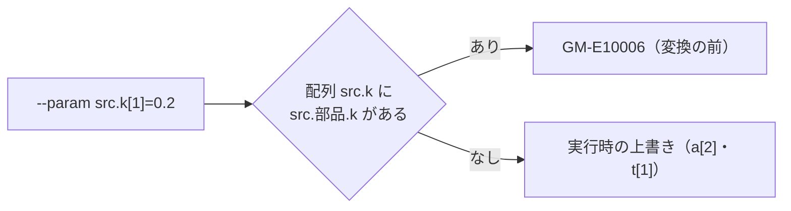

# S025 配列パラメータの上書き

| | |
| --- | --- |
| セッション | S025 |
| 日付 | 2026-10-28 |
| ブランチ | `feature/s025-array-param-overrides` |
| Phase | P3 |
| スライド | [slides.html](slides.html) |
| 作業記録 | `log/work/2026-10-28-s025-array-param-overrides.md` |

## 1. 目的

S024（[ADR-0022](../../adr/0022-structural-parameter-overrides.md)）で `--param` を、上書きを組み込んでコンパイルし直す道にした。構造的な上書きの型の表は変数の名前で引くので、配列の要素（`a[2]`）は載らず、実行時の上書きだけになる。これが正しいかを確かめる（S024 の積み残し）。P3 の「パラメータを変えた再実行」（[features.md](../../features.md)）の抜けを埋める作業。

## 2. 決定と理由

| 項目 | 決定 | 理由 |
| --- | --- | --- |
| 直接使う配列の要素、時間イベントの配列の要素 | 変えない | 実行時の上書きがスカラ名で一致し、正しく届く |
| 配列全体（`a`） | 構造的な上書きに渡さず、`GM-E10006` | 渡すと Rumoca が束縛をスカラのリテラルで置き換えて ED020（「未対応」と見えていた） |
| 同じ名前の修飾で内側へ写された配列の要素（`src.k[1]`） | 変換の前に `GM-E10006` | Rumoca の構造的な上書きはスカラだけで直せず、実行時の上書きは内側に届かず黙って誤る |
| 見分け方 | 名前の形（`src.k` に対し `src.<部品>.k`） | 届いたかを DAE から調べる安い方法が無い。違う名前の修飾は見逃す |

## 3. 図



## 4. 再現手順

```bash
cargo build -p globe-mode-cli
target/debug/globe simulate -L src/Modelica/GlobeModeValidation \
  -m GlobeModeValidation.Simulation.ArrayParameters --param 'a[2]=5'      # y_a が 2 → 5
target/debug/globe simulate -L src/Modelica/GlobeModeValidation \
  -m GlobeModeValidation.Simulation.ArrayParameters --param 'src.k[1]=0.2' # GM-E10006
cargo test -p globe-mode-exec --test simulate array_parameter
```

検証の結果（数字）:

- `mise run check`: 493 本通過・失敗 0・無視 10
- `msl:compare`: 20 本中 20 本が一致
- `wasm:compare`: 162 件中 159 件が一致（既知の差 3、不一致 0）
- `check_docs.py`: 文書 141 件 / 相対リンク 878 件 / 切れ 0 件

## 5. 次回

- 違う名前の修飾（`final kk = k`）は見逃す。Rumoca が配列の構造的な上書きを持ったら断りを外す。上流の候補 21（[msl-sim-failures.md](../../research/msl-sim-failures.md)）
- wasm では確かめていない（同じ関数を通るが、実行は `wasm:compare` の既存の例題だけ）
