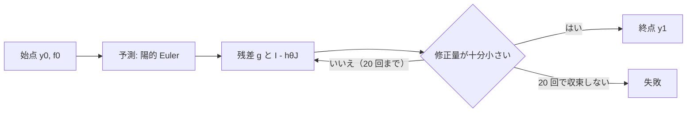

# S026 固定刻みの陰的ソルバ

| | |
| --- | --- |
| セッション | S026 |
| 日付 | 2026-10-28 |
| ブランチ | `feature/s026-implicit-fixed-step` |
| Phase | P3 |
| スライド | [slides.html](slides.html) |
| 作業記録 | `log/work/2026-10-28-s026-implicit-fixed-step.md` |

## 1. 目的

ロードマップの候補 6（残りの計画のソルバ）のうち、登録表にあるが未実装（`GM-E10005`）だった固定刻みの陰的ソルバ `impeuler`（陰的 Euler 法）と `trapezoid`（台形公式）を使えるようにする。P3 の「複数ソルバ」（[features.md](../../features.md)）の続き。

## 2. 決定と理由

| 項目 | 決定 | 理由 |
| --- | --- | --- |
| 道 | 既存の固定刻みのプラグイン（`plugins/fixed.rs`）に θ 法の 1 歩を足す | 格子・イベント・試しの点の拒否・Hermite の補間をそのまま使える。diffsol の SDIRK は刻みの調整が前提で、固定刻みにする道を確かめていない |
| 式 | `y₁ = y₀ + h((1-θ) f₀ + θ f(t₁, y₁))`。θ = 1 が `impeuler`、θ = ½ が `trapezoid` | 2 つを 1 つの道具（`ThetaStepper`、`globe-mode-sim::integrators`）で書ける |
| Newton 法 | ヤコビ行列は部品の方向微分を単位ベクトルごとに呼んで密に作り、部分ピボットの LU で解く。上限 20 回、修正量 ≤ 1e-12·(1+\|y\|) | 依存を足さない。固定刻みは許容誤差を使わないので判定は定数 |
| 解けないとき | 失敗にする（黙って進まない） | 特異な行列、非有限の値、収束しないときは `AdvanceExhausted` |
| 刻み | `--step`、既定は出力の間隔 | 陽的な固定刻み（`euler` など）と同じ |

## 3. 図



## 4. 再現手順

```bash
cargo build -p globe-mode-cli
target/debug/globe simulate -L src/Modelica/GlobeModeValidation \
  -m GlobeModeValidation.Simulation.Decay --solver trapezoid --step 0.05
cargo test -p globe-mode-sim integrators
cargo test -p globe-mode-exec --test integrators
```

`Decay`（x' = -x）の x(1) の誤差:

| ソルバ | h = 0.1 | h = 0.05 | 次数（実測） |
| --- | --- | --- | --- |
| `impeuler` | 1.77e-2 | 9.01e-3 | 0.97 |
| `trapezoid` | 3.07e-4 | 7.67e-5 | 2.00 |

硬い減衰（k = 1000、h = 0.1、hλ = -100）では、どちらも理論の増幅率（1/101、-49/51）と 1e-13 以内で一致し、陽的 Euler は発散する。

検証の結果（数字）:

- `mise run check`: 498 本通過・失敗 0・無視 10
- `wasm:compare`: 198 件中 195 件が一致（既知の差 3、不一致 0）
- `check_docs.py`: 文書 144 件 / 相対リンク 884 件 / 切れ 0 件

## 5. 次回

- ヤコビ行列を密に毎回作るので、状態が数百の系では遅い（コードに `shortcut:` を書いた）。疎の形（`state_jacobian_columns`）と LU の使い回しにするのは、必要になってから。
- MSL の例題では回していない（`msl:sim` は既定の `auto` だけを回す）。
- 残りの計画のソルバ（`radau5`・`esdirk23` など）。
