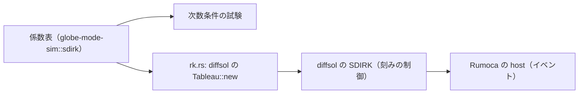

# S027 自前の係数表の SDIRK

| | |
| --- | --- |
| セッション | S027 |
| 日付 | 2026-10-29 |
| ブランチ | `feature/s027-sdirk-tableaus` |
| Phase | P3 |
| スライド | [slides.html](slides.html) |
| 作業記録 | `log/work/2026-10-29-s027-sdirk-tableaus.md` |

## 1. 目的

ロードマップの候補 6（残りの計画のソルバ）の続き。登録表で未実装（`GM-E10005`）だった刻みを調整する SDIRK の 3 つ、`esdirk23`・`esdirk45`・`sdirk34hw` を使えるようにする。diffsol 0.13.2 の `Tableau::new` が公開なので、`esdirk34`・`trbdf2` と同じ道（`plugins/rk.rs`）に自前の係数表を差す。

## 2. 決定と理由

| 項目 | 決定 | 理由 |
| --- | --- | --- |
| 道 | 係数表を `globe-mode-sim::sdirk` に置き、`rk.rs` で diffsol の `Tableau` にして SDIRK に渡す | 刻みの制御・イベント・ヤコビ行列は既存の道を使い回せる |
| `esdirk23` | Jørgensen ら（arXiv:1803.01613、§3.2）の ESDIRK23 | 出典が確かめられる。係数と誤差の見積もりは diffsol の `tr_bdf2` と同じで、刻みの終点の値は `trbdf2` と 12 桁以上一致する（新しい方法ではなく、名前の受け口） |
| `esdirk45` | Kennedy–Carpenter（2019）の ESDIRK5(4)7L[2]SA2。値は OrdinaryDiffEq.jl の `ESDIRK547L2SA2Tableau`（MIT）から写した | NASA/TM-2016-219173 の表 25 は c₆ = 26/25 > 1 の別の版で、段の時刻が刻みの外に出る |
| `esdirk45` の `c₄` | 49/353 にした（写し元は 49/453） | `a` の行の和がちょうど 49/353。写し元の誤記と判断した |
| `sdirk34hw` | Hairer–Wanner II の SDIRK4（γ = 1/4、5 段）。補間の係数も渡す | diffsol の既定の Hermite 補間は左の傾きを段 0 から取り、ESDIRK でしか正しくない（BouncingBall の h(2) が 0.157、正しくは 0.2607） |
| 係数の誤記を防ぐ | 根つき木で 6 次までの次数条件を数値で確かめる単体の試験 | 約 60 個の分数を写したので、1 つの誤記でも次数が落ちて試験が落ちる |

係数の出典の確認日はすべて 2026-10-29。arXiv:1803.01613 は <https://arxiv.org/abs/1803.01613>、OrdinaryDiffEq.jl は <https://github.com/SciML/OrdinaryDiffEq.jl>（`sdirk_tableaus.jl`、master）。Kennedy–Carpenter の論文と Hairer–Wanner の本の表そのものは見ていない【未確認】。

## 3. 図



## 4. 再現手順

```bash
target/debug/globe simulate -L src/Modelica/GlobeModeValidation \
  -m GlobeModeValidation.Simulation.Oscillator --solver esdirk45
cargo test -p globe-mode-sim sdirk
cargo test -p globe-mode-exec --test integrators
```

| ソルバ | `Decay` x(1) の誤差 | `Oscillator` x(1) の誤差 | `BouncingBall` h(2) |
| --- | --- | --- | --- |
| `esdirk23` | 3.2e-7 | 2.0e-6 | 0.26074173 |
| `esdirk45` | 1.1e-10 | 1.4e-9 | 0.26074173 |
| `sdirk34hw` | 4.9e-8 | 4.3e-10 | 0.26074173 |

検証の結果（数字）:

- `mise run check`: 506 本通過・失敗 0・無視 10
- `wasm:compare`: 252 件中 246 件が一致（既知の差 6、不一致 0。新しい 3 つの BouncingBall を既存の SDIRK と同じ既知の差に足した）
- `check_docs.py`: 文書 147 件 / 相対リンク 890 件 / 切れ 0 件

## 5. 次回

- `esdirk45` の刻みの間の値は 3 次の Hermite 補間（終点は 5 次）。
- MSL の例題では回していない（`msl:sim` は既定の `auto` だけ）。
- 残りの計画のソルバ（`radau5`・`dopri853`・`ida`・`cvode` など）。
