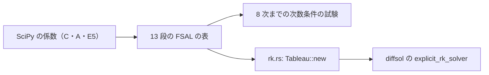

# S028 dopri853

| | |
| --- | --- |
| セッション | S028 |
| 日付 | 2026-10-29 |
| ブランチ | `feature/s028-dopri853` |
| Phase | P3 |
| スライド | [slides.html](slides.html) |
| 作業記録 | `log/work/2026-10-29-s028-dopri853.md` |

## 1. 目的

ロードマップの候補 6（残りの計画のソルバ）の続き。登録表で未実装（`GM-E10005`）だった陽的な高次の `dopri853`（Dormand–Prince 8 次）を使えるようにする。S027 と同じく、diffsol 0.13.2 の陽的 RK（`explicit_rk_solver`）に自前の係数表を差す。

## 2. 決定と理由

| 項目 | 決定 | 理由 |
| --- | --- | --- |
| 係数 | SciPy の `scipy/integrate/_ivp/dop853_coefficients.py`（BSD-3）の `C`・`A`・`E5` を、スクリプトで Rust の値に写した | 出典があり、手で打ち直さない。Hairer の `dop853.f` そのものは見ていない【未確認】 |
| 13 段 | Hairer の 13 段目（c = 1、行 = b、b₁₃ = 0）を足して FSAL にした | diffsol の陽的 RK は最後の行が b、c の最後が 1 であることを求める（`check_explicit_rk`）。次の刻みの最初の段に使い回すので、1 刻みの評価は 12 回のまま |
| 誤差の見積もり | 5 次の埋め込み（`E5`）だけを使う | diffsol は誤差の重みを 1 本しか持てない。Hairer の 5 次と 3 次の組み合わせとは刻みの制御が違い、`dop853.f` と同じ結果にはならない |
| 刻みの間の値 | diffsol の 3 次の Hermite 補間 | Hairer の 7 次の補間は追加の段が 3 つ要り、diffsol の `beta` では書けない。両端の傾き（段 0 と FSAL の段）は正しい |
| 写し間違いの守り | S027 の根つき木の検査を 8 次まで（木の数 1・1・2・4・9・20・48・115）に広げた | b はちょうど 8 次（9 次で落ちる）、埋め込みはちょうど 5 次。係数を 1 つ変えると試験が落ちることも確かめた |

出典の確認日は 2026-10-29。<https://github.com/scipy/scipy/blob/main/scipy/integrate/_ivp/dop853_coefficients.py>

## 3. 図



## 4. 再現手順

```bash
target/debug/globe simulate -L src/Modelica/GlobeModeValidation \
  -m GlobeModeValidation.Simulation.Oscillator --solver dopri853
cargo test -p globe-mode-sim sdirk
cargo test -p globe-mode-exec --test integrators
```

同じ許容誤差（1e-8）での誤差:

| 場合 | `tsit45` | `dopri853` |
| --- | --- | --- |
| `Decay` x(1) | 7.3e-10 | 1.5e-12 |
| `Oscillator` x(1) | 3.5e-10 | 6.8e-12 |
| `BouncingBall` h(2) | 0.2607417283271 | 0.2607417283270 |

検証の結果（数字）:

- `mise run check`: 509 本通過・失敗 0・無視 10
- `wasm:compare`: 270 件中 263 件が一致（既知の差 7、不一致 0）。`BouncingBall/dopri853` はイベントの近くで wasm とネイティブのイベントの行の数が分かれて間の行がずれるもので、軌道は 1e-14 程度で一致する。既存の既知の差と同じ仕組みなので足した
- `check_docs.py`: 文書 150 件 / 相対リンク 896 件 / 切れ 0 件

## 5. 次回

- 刻みは 5 次の見積もりで決まるので、`tsit45` に近い刻みで、許容誤差よりかなり精確になる。
- MSL の例題では回していない（`msl:sim` は既定の `auto` だけ）。
- 残りの計画のソルバ（`radau5`・`ida`・`cvode`・`cerk*`・`qss`）。
