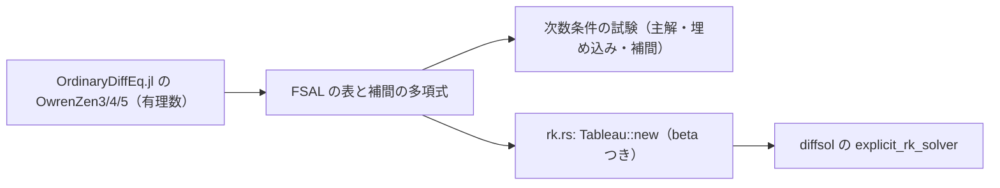

# S029 cerk23・cerk34・cerk45

| | |
| --- | --- |
| セッション | S029 |
| 日付 | 2026-10-29 |
| ブランチ | `feature/s029-cerk` |
| Phase | P3 |
| スライド | [slides.html](slides.html) |
| 作業記録 | `log/work/2026-10-29-s029-cerk.md` |

## 1. 目的

ロードマップの候補 6（残りの計画のソルバ）の続き。登録表で後回し（`GM-E10005`）だった連続の陽的 RK `cerk23`・`cerk34`・`cerk45` を使えるようにする。S028 の `dopri853` と同じく、diffsol 0.13.2 の陽的 RK（`explicit_rk_solver`）に自前の係数表を差す。連続の RK の要である刻みの間の補間の多項式は、diffsol の `beta` に渡す。

## 2. 決定と理由

| 項目 | 決定 | 理由 |
| --- | --- | --- |
| 方法 | Owren–Zennaro（1992）の 3(2)・4(3)・5(4) を `cerk23`・`cerk34`・`cerk45` に当てる | 連続の陽的 RK の代表で、3 つとも FSAL（diffsol の陽的 RK が求める形）。補間が主解と同じ次数 |
| 係数 | OrdinaryDiffEq.jl（MIT）の `OwrenZen3/4/5` の有理数の版を、スクリプトで Rust に起こした | 出典があり、手で打ち直さない。論文本体は見ていない【未確認】。OpenModelica の係数は使わない |
| 補間 | 多項式の係数を `beta[段][θ¹..θᵖ]` で渡す（S027 の `sdirk34hw` と同じ並び） | 3 次の Hermite 補間ではなく、刻みの間も 3・4・5 次になる |
| diffsol の `order` | 埋め込みの次数（2・3・4） | diffsol は低い方の次数で刻みを決める（組み込みの `tsit45` は 4、`tr_bdf2` は 2） |
| 写し間違いの守り | 根つき木の次数条件を、主解・埋め込み・補間（θ のべきごと）で確かめる | 主解はちょうど 3・4・5 次、埋め込みはちょうど 2・3・4 次、補間は θ = 1 で b に一致 |

出典の確認日は 2026-10-29。<https://github.com/SciML/OrdinaryDiffEq.jl/blob/45ff46afe9919acf32e9af8058705073e0995503/lib/OrdinaryDiffEqLowOrderRK/src/low_order_rk_tableaus.jl>

## 3. 図



## 4. 再現手順

```bash
target/debug/globe simulate -L src/Modelica/GlobeModeValidation \
  -m GlobeModeValidation.Simulation.Oscillator --solver cerk45
cargo test -p globe-mode-sim sdirk
cargo test -p globe-mode-exec --test integrators
```

同じ許容誤差（1e-8）での x(1) の誤差:

| 場合 | `tsit45` | `cerk23` | `cerk34` | `cerk45` |
| --- | --- | --- | --- | --- |
| `Decay` | 7.3e-10 | 1.8e-9 | 9.1e-10 | 8.1e-10 |
| `Oscillator` | 3.6e-10 | 2.4e-9 | 3.7e-9 | 9.8e-10 |

`Decay` の全出力行（刻みの間の補間の点を含む）の最大誤差は `cerk23` 1.8e-9・`cerk34` 9.2e-10・`cerk45` 8.4e-10。`BouncingBall` は 3 つとも跳ねる回数が `bdf` と同じで、h(2) は `bdf` と 3.8e-8 の差。

検証の結果（数字）:

- `mise run check`: 513 本通過・失敗 0・無視 10
- `wasm:compare`: 324 件中 311 件が一致（既知の差 13、不一致 0）。新しい 6 件（`BouncingBall`・`DiodeSwitching` の `cerk*`）は既知の差に足した（`BouncingBall` はイベントの行のずれ、`DiodeSwitching` は硬い問題で陽的 RK が安定の限界の刻みを刻み、丸めの違いで最初の出力行から刻みの列が分かれる。相対の差は最大 8.9e-6、絶対では許容誤差 1e-6 の内側）
- `check_docs.py`: 文書 153 件 / 相対リンク 903 件 / 切れ 0 件

## 5. 次回

- 補間を Hermite にした場合と比べて精度がどれだけ上がるかは測っていない。
- MSL の例題では回していない（`msl:sim` は既定の `auto` だけ）。
- 残りの計画のソルバ（`radau5`・`ida`・`cvode`・`qss`）。
