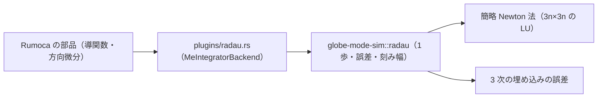

# S030 radau5

| | |
| --- | --- |
| セッション | S030 |
| 日付 | 2026-10-29 |
| ブランチ | `feature/s030-radau5` |
| Phase | P3 |
| スライド | [slides.html](slides.html) |
| 作業記録 | `log/work/2026-10-29-s030-radau5.md` |

## 1. 目的

ロードマップの候補 6（残りの計画のソルバ）の続き。登録表で未実装（`GM-E10005`）だった `radau5` を、自前の Radau IIA（3 段、5 次、刻み幅は自動）として使えるようにする。設計は [architecture.md](../../architecture.md) のソルバの表と S030 の注。

## 2. 決定と理由

| 項目 | 決定 | 理由 |
| --- | --- | --- |
| 何を足すか | `radau5`（残りの `ida`・`cvode`・`qss` より先） | 依存を足さずに書ける。SUNDIALS は C のビルドと依存が要り、`qss` は積分の形が違う |
| 係数 | `c = ((4−√6)/10, (4+√6)/10, 1)` と配置法の閉じた式。B(5)・C(3)・D(1) を試験で確かめる | 写さずに出せる。`radau5.f` も OpenModelica も読んでいない |
| 段の方程式 | 簡略 Newton 法。ヤコビ行列は歩の始めに方向微分から密に作り、3n×3n を 1 回 LU 分解 | 最短で正しい。Hairer の複素変換は `shortcut:` で後回し |
| 誤差の見積もり | 3 次の埋め込みとの差に `(I − hγ₀J)⁻¹` を掛ける。係数 `dd` は自分で導いた | 硬い成分で見積もりが膨らまない。y' = t^m（m ≤ 2）で 0 になる試験と、h⁴ で減る試験で確かめる |
| 補間 | 3 次の Hermite（`plugins/fixed.rs` と同じ） | 配置多項式の補間は後回し |

## 3. 図



## 4. 再現手順

```bash
target/debug/globe simulate -L src/Modelica/GlobeModeValidation \
  -m GlobeModeValidation.Simulation.DiodeSwitching --solver radau5
cargo test -p globe-mode-sim radau
cargo test -p globe-mode-exec --test integrators
```

同じ許容誤差（1e-8）での誤差:

| 場合 | `tsit45` | `esdirk45` | `radau5` |
| --- | --- | --- | --- |
| `Decay` x(1) | 7.3e-10 | 1.1e-10 | 6.8e-12 |
| `Oscillator` x(1) | 3.6e-10 | 1.4e-9 | 1.2e-11 |

- 次数: 固定刻み 8・16・32 歩の y' = −y³ で大域誤差 1.76e-8・5.77e-10・1.83e-11（次数 4.93・4.98）。誤差の見積もりは h⁴ で減る（3.88）。
- 硬い問題 y' = −1000(y − cos t)（rtol 1e-6）: 受理 52 歩・棄却 11 回・f 430 回、誤差 4.1e-10。
- `DiodeSwitching`（Tolerance 1e-6、debug ビルド）: `bdf` との差は v で最大 9.6e-7、i は一致。時間は `radau5` 0.77 s、`bdf` 1.85 s、`tsit45` 105 s。
- `BouncingBall`: 跳ねる回数が `bdf` と同じ。

検証の結果（数字）:

- `mise run check`: 522 本通過・失敗 0・無視 10
- `wasm:compare`: 342 件中 329 件が一致（既知の差 13、不一致 0）。`radau5` の 18 件はすべて一致（`DiodeSwitching` も相対の差 4.4e-16）

## 5. 次回

- 状態の数が多いと遅い（3n×3n の密な LU を歩ごとに作り、ヤコビ行列を歩をまたいで使い回さない）。MSL の例題で使うなら Hairer の複素変換と使い回しを入れる。
- 最初の歩と棄却の直後の誤差の見積もりの直し（`f(y₀ + err)`）を省いたので、硬い問題で刻みを余計に縮めることがある。
- MSL の例題では回していない（`msl:sim` は既定の `auto` だけ）。
- 残りの計画のソルバ（`ida`・`cvode`・`qss`）。
