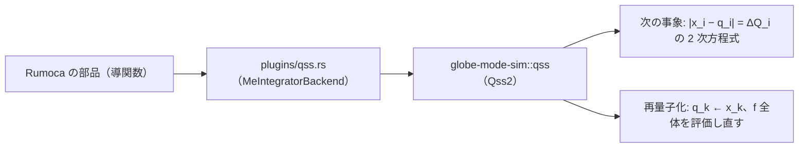

# S031 qss

| | |
| --- | --- |
| セッション | S031 |
| 日付 | 2026-10-30 |
| ブランチ | `feature/s031-qss` |
| Phase | P3 |
| スライド | [slides.html](slides.html) |
| 作業記録 | `log/work/2026-10-30-s031-qss.md` |

## 1. 目的

ロードマップの候補 6（残りの計画のソルバ）の続き。登録表で未実装（`GM-E10005`）だった `qss` を、自前の量子化状態法 QSS2 として使えるようにする。設計は [architecture.md](../../architecture.md) のソルバの表と S031 の注。

## 2. 決定と理由

| 項目 | 決定 | 理由 |
| --- | --- | --- |
| 何を足すか | `qss`（残りの `ida`・`cvode` より先） | 依存を足さずに書ける。SUNDIALS は C のビルドと依存が要る |
| 方法 | QSS2（状態の軌道は 2 次、量子化した状態は 1 次の多項式） | QSS1 は事象の数が量子の逆数で増え、許容誤差 1e-8 では多すぎる |
| 量子 | `ΔQ_i = max(atol_i, rtol·|x_i|)`（再量子化の時点の値） | 他の適応ソルバと同じ許容誤差の読み方 |
| 2 次の項 | `q` の軌道に沿った `f` の前進差分（事象 1 回で `f` 2 回） | 方向微分を使わずに済む。差分の誤差は量子に比べて小さい |
| 状態の更新 | 事象のたびに `f` 全体を呼び、全状態の多項式を作り直す | 依存の構造（どの `f_j` がどの `q_i` を読むか）を持たない。`shortcut:` で後回し |
| 実行系との境 | 1 回の `advance` が 1 つの事象。刻みの間は多項式そのもの | 補間の誤差が無い。イベント・リセットの後は量子化し直す |
| 硬い系 | LIQSS は入れず、歩の数の上限も持たない。壁時計の上限（`GM-E11005`）で止まる | 最小で、黙って止まらない |

出典は E. Kofman, S. Junco, "Quantized-state systems: a DEVS approach for continuous system simulation"（Trans. SCS 18(3), 2001）と F. Cellier, E. Kofman『Continuous System Simulation』（Springer, 2006）の手法の説明【本文は未確認】。qss-solver・PowerDEVS・OpenModelica のコードは読んでいない。

## 3. 図



## 4. 再現手順

```bash
target/debug/globe simulate -L src/Modelica/GlobeModeValidation \
  -m GlobeModeValidation.Simulation.BouncingBall --solver qss
cargo test -p globe-mode-sim qss -- --nocapture
cargo test -p globe-mode-exec --test integrators
```

x(1) の誤差（debug、`--interval 0.5`）:

| 場合 | 許容誤差 | `tsit45` | `qss` |
| --- | --- | --- | --- |
| `Decay` | 1e-6 | 9.6e-8 | 2.1e-7 |
| `Decay` | 1e-8 | 7.3e-10 | 2.1e-9 |
| `HarmonicOscillator` | 1e-6 | 1.9e-7 | 7.1e-7 |
| `HarmonicOscillator` | 1e-8 | 3.6e-10 | 7.0e-9 |

- 量子との関係: 振動子（T = 3、許容誤差 1e-5・1e-7・1e-9）で誤差 1.28e-5・1.28e-7・1.28e-9、事象 1030・10318・103209。誤差は `ΔQ^1.00`、事象は `ΔQ^−0.50`。
- `x' = a + b t` の軌道は相対 1e-13 で再現する（2 次の項が前進差分なので丸めの水準ではない）。
- `DiodeSwitching`（Tolerance 1e-6、debug）: 成功、47.96 s（`bdf` 1.81 s、`radau5` 0.77 s、`tsit45` 105 s）。`bdf` との差は v で最大 5.8e-7、i・k は 1085 行すべて一致。
- `BouncingBall`: 成功、0.41 s。跳ねる回数は 3 で `bdf` と同じ。h の差は最大 7.6e-8。
- 硬い Van der Pol（μ = 1000、[0, 3000]、`--timeout 20`）: `GM-E11005`（時間切れ）で止まる。`radau5` は 0.1 s。

検証の結果（数字）は作業記録に書く。

## 5. 次回

- 状態の数が多いと遅い（事象のたびに `f` 全体）。使うならヤコビ行列の疎パターンから依存を取り、依存する状態だけ更新する。
- 硬い系は LIQSS が要る。
- 前進差分の δ が時間の目盛りを知らない（固有の時間が 1e-6 s より短い系で大きすぎる）。
- MSL の例題では回していない（`msl:sim` は既定の `auto` だけ）。
- 残りの計画のソルバ（`ida`・`cvode`。SUNDIALS）。
