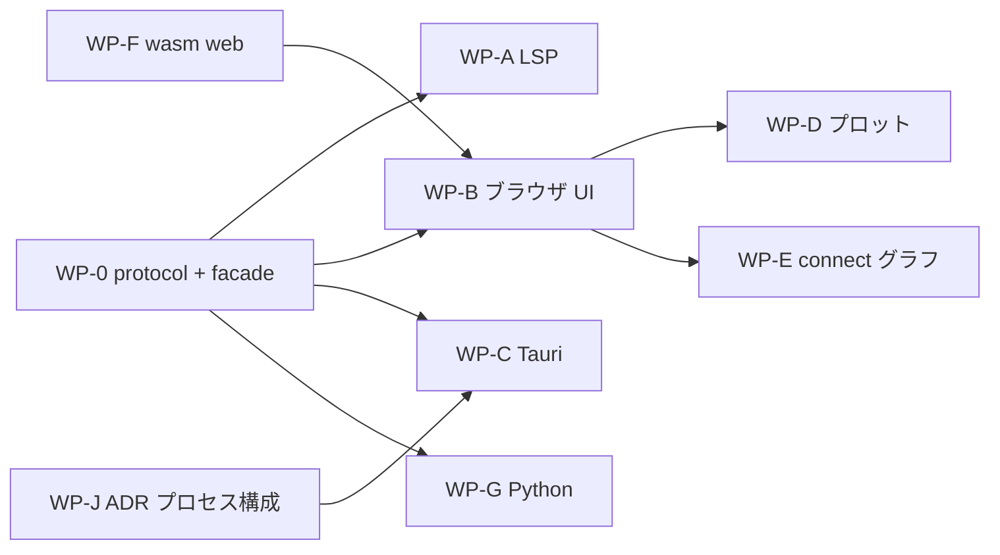

# S033 リリースの見積もりと並行作業プラン

| | |
| --- | --- |
| セッション | S033 |
| 日付 | 2026-10-30 |
| ブランチ | `feature/s033-parallel-plan` |
| Phase | 計画（P3 と P4 の間） |
| スライド | [slides.html](slides.html) |
| 作業記録 | `log/work/2026-10-30-s033-parallel-plan.md` |

## 1. 目的

S032 までを俯瞰し、設計への助言、リリースまでの見積もり、他のエージェントに渡せる並行作業の指示書を書く。成果物は [doc/plan/2026-10-30-release-estimate-and-parallel-plan.md](../../plan/2026-10-30-release-estimate-and-parallel-plan.md)。合わせて、Codex を監査役にしたレビュー履歴の置き場 [log/review/](../../../log/review/README.md) を作る。コードは変えない。

## 2. 決定と理由

| 項目 | 決定 | 理由 |
| --- | --- | --- |
| 見積もりの根拠 | `log/local/raw/*.jsonl.gz` の `usage` を合計した実測（主セッション 10 本） | 推測ではなく、同じ作業者・同じ運用の実績から出せる。サブエージェント分は含まないので上側に 1.5 倍 |
| 係数 | roadmap の目安 × 2 | P2 は 4 → 7 回、P3 は 5 → 10 回かかった |
| 金額 | 書かない | 単価を文書に写すと古くなる。公式の料金表を参照 |
| 次の 1 回 | `globe-mode-protocol` と facade `globe-mode` | すべてのクライアントがここに依存する。並行化の分岐点 |
| ソルバ | 足すのを止める。`ida` は P8 | S026〜S032 は P8 の前倒しで、リリースを近づけない |
| UI の順序 | ブラウザ版 → Tauri | WSL の RAM 3 GB で Tauri と Android は回らない（[ADR-0019](../../adr/0019-rpi-aarch64-environment.md)） |
| レビュー履歴 | `log/review/` に 1 レビュー 1 枚。指摘は原文、採否は実装側 | 「何が起きたか」（セッション記録）と「何を決めたか」（作業記録）に「何を指摘され、どう扱ったか」を足す。差分は書かない |
| 無料プロバイダ | 機械的に検証できる作業だけ。worktree を分けて push させない | 誤りが黙って混ざる作業は検証に本体と同じ費用がかかる。学習利用の規約は【未確認】 |
| 判断特化モデル | 採否の判定だけ。一致率を記録してから広げる | 生成に使うと検証の費用が増える。ユーザーが挙げた「Jev」は提供元を【未確認】 |

ユーザーと決めたこと: Codex を監査役にする、無料プロバイダと判断特化モデルを計画に残す、このセッションのサブエージェントは Opus / medium（使わなかった）。

## 3. 図



WP-H（上流報告と CI の sundials）と WP-I（v0.1 の配布）は独立。

## 4. 再現手順

```bash
# 実測の費用（main の log/local/raw/ で）
for f in log/local/raw/*.jsonl.gz; do gunzip -c "$f" | python3 -I -c '
import sys,json
o=c=r=n=0
for l in sys.stdin:
    try: u=(json.loads(l).get("message") or {}).get("usage")
    except Exception: continue
    if u: n+=1; o+=u.get("output_tokens",0); c+=u.get("cache_creation_input_tokens",0); r+=u.get("cache_read_input_tokens",0)
print(n,o,c,r)'; done
python3 -I .claude/skills/session-docs/check_docs.py
```

検証の結果（数字）:

- 生ログ 10 本: ターン 5,427、出力 7.06 M、キャッシュ書き込み 18.8 M、キャッシュ読み出し 1.38 G。
- `check_docs.py`: デッキ 39 件 OK、相対リンク切れ 0 件。
- 作業パッケージ 11（WP-0〜WP-J）。

## 5. 次回

- WP-0 を 1 人で終え、その後 WP-A / WP-B / WP-F / WP-G / WP-H / WP-I を同時に走らせる。
- 最初の WP から Codex のレビューを `log/review/` に残す。
- 無料プロバイダは WP-H の issue の下書きで試し、確認の時間が本体を上回らないかを測る。
