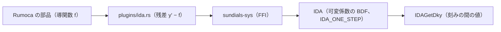

# S034 ida

| | |
| --- | --- |
| セッション | S034 |
| 日付 | 2026-10-30 |
| ブランチ | `feature/s034-ida` |
| Phase | P3 |
| スライド | [slides.html](slides.html) |
| 作業記録 | `log/work/2026-10-30-s034-ida.md` |

## 1. 目的

ロードマップの候補 6（残りの計画のソルバ）の最後。登録表で未実装（`GM-E10005`）だった `ida` を、S032 の `cvode` と同じ feature `sundials` で SUNDIALS の IDA を呼んで使えるようにする。設計は [architecture.md](../../architecture.md) のソルバの表と S034 の注、ライセンスは [licenses.md](../../licenses.md) の SUNDIALS の行。

## 2. 決定と理由

| 項目 | 決定 | 理由 |
| --- | --- | --- |
| feature | 新しく立てず `sundials` に入れる。sundials-sys の feature に `ida` を足す | 依存は S032 と同じ crate。既定・wasm・CI のビルドは変わらない |
| 問題の渡し方 | 残差 F(t, y, y') = y' − f(t, y)。全成分が微分変数 | ホストの `MeIntegratorBackend` は ODE の導関数しか渡さない |
| 初期の傾き | `IDACalcIC` を呼ばず、y'0 = f(t0, y0) を導関数 1 回で求める。始め直すたびも同じ | ODE なら無矛盾な y'0 はこれで決まる |
| 実行系との境 | 1 回の `advance` が `IDASolve` の 1 歩（`IDA_ONE_STEP`）。上限は `IDASetStopTime`、刻みの間は `IDAGetDky` | `cvode` と同じ |
| 線形ソルバ | 密な行列、差分商のヤコビ行列。根探索なし | `cvode` と同じ。`shortcut:` で後回し |
| コード | `plugins/ida.rs` は `cvode.rs` を写した作り（共通化しない） | 抽象の層を足すより小さい。unsafe はこの 2 ファイルだけ |

## 3. 図



## 4. 再現手順

```bash
cargo build -p globe-mode-cli --features sundials   # cmake・C コンパイラ・libclang が要る
target/debug/globe simulate -L src/Modelica/GlobeModeValidation \
  -m GlobeModeValidation.Simulation.DiodeSwitching --solver ida
cargo test -p globe-mode-exec --features sundials
```

t = 1 の誤差（debug、`--interval 0.5`。`HarmonicOscillator` は x と v の誤差の大きい方。S032 の表も同じ基準だった）:

| 場合 | 許容誤差 | `bdf` | `cvode` | `ida` |
| --- | --- | --- | --- | --- |
| `Decay` | 1e-6 | 2.9e-7 | 2.1e-6 | 1.5e-9 |
| `Decay` | 1e-8 | 2.7e-8 | 5.2e-8 | 1.0e-8 |
| `HarmonicOscillator` | 1e-6 | 1.1e-5 | 5.3e-6 | 1.3e-5 |
| `HarmonicOscillator` | 1e-8 | 1.4e-7 | 8.9e-8 | 1.1e-7 |

- `DiodeSwitching`（Tolerance 1e-6、debug）: 0.48 s（`cvode` 0.43 s、`bdf` 1.77 s）。`bdf` との差は v で最大 5.8e-7、i・k は一致。
- `BouncingBall`: 跳ねる回数は 3 で `bdf` と同じ。終点の h の差は 7.6e-8。
- feature を立てないビルドの `--solver ida` は従来どおり `GM-E10005`。

検証の結果（数字）は作業記録に書く。

## 5. 次回

- 候補 6 はこれで終わり。既定のビルドでは `cvode`・`ida` が未実装のまま（feature を立てないため）。
- CI は feature つきのビルドを回していない（S032 と同じ）。
- IDA の本領（代数変数を残した陰的な DAE）は、ホストが残差を渡せるようになるまで使えない。
