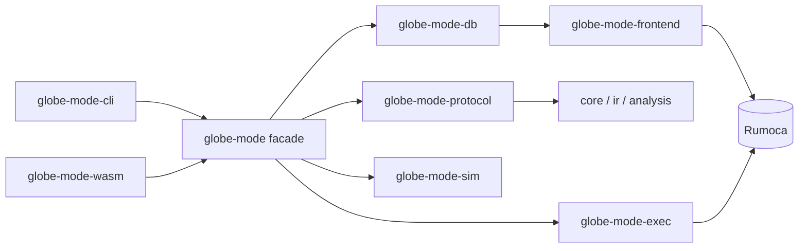

# S035 protocol と facade

| | |
| --- | --- |
| セッション | S035 |
| 日付 | 2026-10-30 |
| ブランチ | `feature/s035-protocol-facade` |
| Phase | P4 の準備（[計画書](../../plan/2026-10-30-release-estimate-and-parallel-plan.md)の WP-0） |
| スライド | [slides.html](slides.html) |
| 作業記録 | `log/work/2026-10-30-s035-protocol-facade.md` |

## 1. 目的

S033 の計画書で「次の 1 回は `globe-mode-protocol` と facade `globe-mode` に使う」と決めた WP-0 を実施する。UI・LSP・Python・wasm がこの 2 つだけに依存できるようにし、WP-A 以降を同時に始められる分岐点を作る。新しい計算は入れない。

## 2. 決定と理由

| 項目 | 決定 | 理由 |
| --- | --- | --- |
| protocol の型 | 今の `globe check --json`・`globe simulate --list-parameters --json`・wasm の `Request` / `Response` の形をそのまま struct にする（フィールドの順も同じ） | 後方互換。serde_json は `preserve_order` が有効（indexmap）なので、struct の順がそのまま JSON の順になる |
| 応答の型は Serialize だけ | `Diagnostic` と各段の報告に Deserialize が無い | core・analysis を触らない（WP-0 の「触らない」）。読み戻しが要るときに足す |
| facade の `simulate_with(request, now)` | 検査 → コンパイル → 実行の流れを 1 本にし、時計を引数で受ける | S034 まで CLI と wasm が同じ流れを別々に持っていた。wasm32 では std の時計が無いので JS の `performance.now()` を外から渡す |
| `Simulated { response, run, compiled }` | JSON にする部分と、Rust からだけ使う結果を分ける | CLI は MAT を書くのに時系列とコンパイル済みのモデルが要る。JSON に時系列を全部入れると wasm の応答が大きくなる |
| CLI の文字の表示は `ws.db().check_model()` のまま | 文字の表示は DAE の未知数の一覧や初期化系の構造まで読む | protocol の型に入れると JSON が太る。`--json` だけを protocol の型にすれば、外から見える形は守れる |
| facade が db・exec・sim を再公開する | `globe_mode::{db, exec, sim}` | CLI が `FullReport`・`write_csv`・`write_mat4` を使う。CLI の直接の依存を facade + core + ir に減らすため |
| 断る文言 | `--force で強行できる` → `force で強行できる` | facade は CLI のフラグ名を知らない。wasm は元から `force`。JSON で唯一の変化 |
| JSON Schema は持ち越し | xtask のコマンドを作らない | schemars は core・ir・analysis の約 50 の型に derive が要る。WP-B が TypeScript の型を要るときに決める |
| snapshot 試験 | `globe-mode-cli/tests/snapshots/` に 4 つ（check 2、simulate を断った JSON、パラメータの一覧） | 時計の値を含む出力は snapshot にしない。`UPDATE_SNAPSHOTS=1` で書き直す |

## 3. 図



facade の公開 API: `Workspace { new, with_libraries, with_library_sources, set_file, remove_file, load_dir, files, outline, check, deps, flat, graph, compile, tunable_parameters, simulate, simulate_with, db }`、`solvers()`、`now_ms()`。

## 4. 再現手順

```bash
mise run check                                  # fmt / clippy / test / deny
cargo test -p globe-mode-cli --test json_snapshots
mise run wasm:node                              # release の wasm を Node で
python3 -I .github/scripts/test_ci_plan.py      # CI の判定（新しい crate を含む）
```

変更前の JSON との突き合わせは、変更前のバイナリで `globe check --json` などを 19 通り保存し、変更後と `diff -r` した（時計の値と断る文言の 1 語だけが違う）。

検証の結果（数字）は作業記録に書く。

## 5. 次回

- WP-A（LSP）・WP-B（ブラウザ UI）・WP-F（wasm の web target）・WP-G（Python）を同時に始められる。どれも facade と protocol だけに依存する。
- JSON Schema（schemars）は WP-B が TypeScript の型を要るときに。
- 最初の Codex のレビューを `log/review/` に残す。
