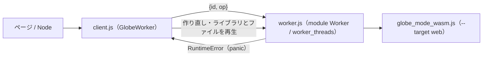

# S036 wasm-web-worker

| | |
| --- | --- |
| セッション | S036 |
| 日付 | 2026-10-30 |
| ブランチ | `feature/s036-wasm-web-worker` |
| Phase | P3 |
| スライド | [slides.html](slides.html) |
| 作業記録 | `log/work/2026-10-30-s036-wasm-web-worker.md` |

## 1. 目的

ロードマップの候補 3（ブラウザ。P6 の前提）と、並行作業プランの WP-F（[plan](../../plan/2026-10-30-release-estimate-and-parallel-plan.md)）。S012 から Node でだけ回していた `globe-mode-wasm` を、`wasm-bindgen --target web` の糊と Web Worker で回し、panic の後に使える状態へ戻す道を作る。wasm の道は [ADR-0014](../../adr/0014-session-route-wasm.md)。

## 2. 決定と理由

| 項目 | 決定 | 理由 |
| --- | --- | --- |
| 糊 | `wasm:build` で同じ .wasm から `--target nodejs` と `--target web` の両方を作る（`target/wasm-pkg/web`） | Rust のビルドは 1 回のまま |
| Worker | `web/worker.js` 1 本を、ブラウザの module Worker と Node の `worker_threads` で共用する | CI（`wasm-node`）は Node だけで Worker の道を試せる |
| 呼び出し | `web/client.js` の `GlobeWorker`。`{id, op}` を送り、呼び出しは直列にする | 作り直しの再生の間に次の呼び出しが割り込まない |
| panic | wasm32 は panic=abort なので、`WebAssembly.RuntimeError` の後はインスタンスを捨てる。Worker を作り直し、記憶したライブラリとファイルを再生する | 同じインスタンスで初期化し直す方法は無い |
| Rust | `lib.rs` を変えない | WP-0（S035）が型を差し替えるのでぶつけない |
| 範囲外 | MSL の線形メモリを減らす分割読み込み | db に query を足す大きさなので次に回す |

## 3. 図



## 4. 再現手順

```bash
mise run wasm:web     # wasm:build → Node の worker_threads → Playwright の Chromium
```

- Node: `GlobeModeValidation.Simulation.Decay`（bdf）で x(1) の誤差 2.7e-8。わざと panic させると呼び出しが panic の文言で reject され、`restarts` が 1 になり、もう一度回すと同じ値。
- Chromium: `page.route` で手元のファイルを配る（HTTP サーバを立てない）。結果は Node と同じ。
- 初回は `uv run playwright install chromium` が要る。

検証の結果（数字）は作業記録に書く。

## 5. 次回

- MSL を読んだ後の線形メモリ（S012 で 262 MiB）を、パッケージ単位の分割読み込みで減らす。
- 作り直しはライブラリ全体の読み直しを含む（MSL で約 13 s）。
- ブラウザ UI の骨格（WP-B）は、この `GlobeWorker` を Backend の実装に使える。
