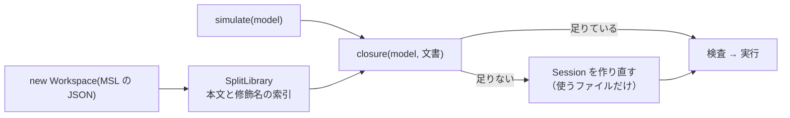

# S037 msl-split-load

| | |
| --- | --- |
| セッション | S037 |
| 日付 | 2026-10-31 |
| ブランチ | `feature/s037-msl-split-load` |
| Phase | P3 |
| スライド | [slides.html](slides.html) |
| 作業記録 | `log/work/2026-10-30-s037-msl-split-load.md` |

## 1. 目的

ロードマップの候補 3（ブラウザ。P6 の前提）の残り。wasm で MSL を in-memory のライブラリとして読むと、線形メモリが 262 MiB（`ChuaCircuit` の後 513 MiB）になる（S012）。これをパッケージ単位の分割読み込みで減らす。あわせて、手元（RAM 3 GB）では重い `msl:funnel` と `msl:sim` を GitHub Actions のランナーで回す道を作る。正典は [roadmap](../../roadmap.md) の S037 の節、wasm の道は [ADR-0014](../../adr/0014-session-route-wasm.md)。

## 2. 決定と理由

| 項目 | 決定 | 理由 |
| --- | --- | --- |
| 何を読むか | モデルと作業中の文書から、名前の連なり（絶対・字句的なスコープ・`import` の別名とワイルドカード）をたどったファイルの閉包と、外側のパッケージの `package.mo` | MSL 2556 ファイルのうち ChuaCircuit は 292 で足りる |
| たどり方 | 字句の走査だけ（`split_library.rs`）。ファイルは `within` と先頭のクラスの修飾名で引く | 構文木を作るとメモリを減らす意味が薄れる。広めに拾うのはよいが、狭いと名前解決が落ちる |
| 足し方 | 足りないときは Session を作り直し、記録してある文書を足し直す。読んだものは外さない | Rumoca の in-memory の組は差し替えで渡すため |
| 既定 | wasm の JS の `new Workspace(json, name)` だけを分割にする。`eager = true` で全部を読む道を残す | ネイティブの CLI と `msl:funnel` の判定を変えない |
| 制約 | 1 ファイルに 1 つのトップレベルのクラスを仮定する（`shortcut:` のコメント） | Modelica の構造化ディレクトリの規約。外れるライブラリは `eager` で読む |
| msl:sim | `.github/workflows/msl-sim.yml`（`workflow_dispatch` だけ）。報告と JSON は artifact `msl-sim`、前回の JSON は actions/cache から戻す | push の CI に入れるには重い。報告のコミットは手元で artifact を取ってから |

## 3. 図



## 4. 再現手順

```bash
mise run wasm:node        # MSL の段で読み込み後と各モデルの後のメモリを出す
cargo test -p globe-mode-frontend --test split -- --ignored   # msl-compare.txt の 20 本で全部を読んだときと一致
gh workflow run msl-sim.yml                                   # GitHub Actions で msl:funnel と msl:sim
gh run download <run-id> -n msl-sim                           # 報告と JSON を取る
```

結果（`mise run wasm:node`）:

| 時点 | S012（全部） | S037（分割） |
| --- | ---: | ---: |
| 読み込み後 | 262 MiB | 62 MiB |
| `ChuaCircuit` の後 | 513 MiB | 113 MiB |
| `Rotational.Examples.First` の後 | — | 113 MiB |

`ChuaCircuit` の C1.v(T) は -0.9928894683235796。

## 5. 次回

- ブラウザ UI の骨格（[計画書](../../plan/2026-10-30-release-estimate-and-parallel-plan.md)の WP-B）に `GlobeWorker` と分割読み込みを使う。
- 分割読み込みで MSL の 566 本の検査が全部を読んだときと一致するかを確かめる（今は 20 本）。
- `msl-sim.yml` の artifact から `doc/msl-sim.md` を更新する。
