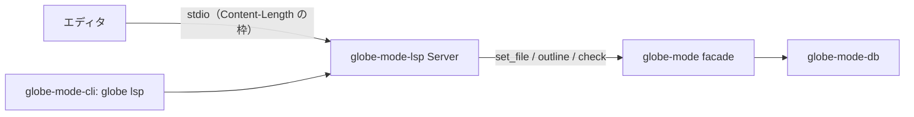

# S038 LSP サーバ

| | |
| --- | --- |
| セッション | S038 |
| 日付 | 2026-10-30 |
| ブランチ | `feature/s038-lsp` |
| Phase | P4（[計画書](../../plan/2026-10-30-release-estimate-and-parallel-plan.md)の WP-A） |
| スライド | [slides.html](slides.html) |
| 作業記録 | `log/work/2026-10-30-s038-lsp.md` |

## 1. 目的

計画書の WP-A。stdio の LSP サーバ `globe lsp` を作る。機能は診断（検査 S0〜S10 の結果）・documentSymbol（アウトライン）・hover（クラスの種類）の 3 つだけで、補完と定義へ移動は入れない。S035 の facade `globe-mode` だけを呼び、新しい計算は入れない。

実装は計画書の推奨（モデル B）どおり Sonnet（effort high）のサブエージェント 1 人に渡し、Fable がコードを読んで検査と文書を行った。

## 2. 決定と理由

| 項目 | 決定 | 理由 |
| --- | --- | --- |
| 依存 | `lsp-types` 0.97 の型だけ。JSON-RPC の枠（`Content-Length`）とディスパッチは自前 | [architecture §2.2](../../architecture.md) の方針（tower-lsp は足さない）。1 本のスレッドで順に処理すれば足りる。推移的依存は fluent-uri と serde_repr の 2 つ（[licenses.md](../../licenses.md)） |
| 同期 | Full（`textDocumentSync: 1`）。最後の `contentChanges` を本文全体とする | 差分の適用を書かない。salsa の防火壁（ADR-0005）で位置だけの変更は下流が再計算されない |
| 検査する対象 | 開いたファイルの最上位の `model` / `block` / `class` を 1 つずつ `Workspace::check` | package・record・connector・function を検査すると誤った診断が出る。パッケージの中のモデルは検査しない（`shortcut:` の注記） |
| 診断の絞り込み | `file` が None か、このファイル（`normalize_path` の鍵）と等しいものだけ。同じ診断は 1 つにまとめる | ライブラリ側の診断を開いたファイルに出さない |
| 位置の換算 | `line_col` を使わず、0 始まりの行と UTF-16 の列を直接数える | core の `line_col` は 1 始まりで列が文字数。LSP の既定は UTF-16。日本語と絵文字の単体試験あり |
| hover の内容 | `**model Foo**` と `extends` の行だけ（Markdown） | アウトラインにクラスの説明文字列が無い。要るときに ir に足す |
| `exit` | `shutdown` の有無にかかわらず終了コード 0 | 仕様では shutdown 無しの exit は 1。手を抜いた |
| ライブラリ | `--library DIR`（`-L`）。読めなければ stderr に出して終了コード 2 | `check` と同じ |

## 3. 図



流れ: `didOpen` / `didChange` → `set_file` → アウトライン（S0 の誤りならそのまま診断）→ 最上位の各モデルを `check` → `publishDiagnostics`。`documentSymbol` と `hover` はアウトラインだけを見る。

## 4. 再現手順

```bash
mise run check                                   # fmt / clippy / test / deny
cargo test -p globe-mode-lsp                     # 単体 6 本
cargo test -p globe-mode-cli --test lsp          # globe lsp を子プロセスで叩く
python3 -I .github/scripts/test_ci_plan.py       # CI の判定（lsp を含む）
```

手で試すなら `cargo run -p globe-mode-cli -- lsp --library src/Modelica` に、`Content-Length:` の枠で `initialize` → `textDocument/didOpen` を送る。VS Code などのエディタでの動作は確かめていない。

検証の結果（数字）は作業記録に書く。

## 5. 次回

- WP-B（ブラウザ UI の骨格）で、この LSP を Web Worker の transport でも回すかを決める（architecture の行では stdio / Tauri のチャネル / Web Worker）。
- パッケージの中のモデルの検査（再帰）、hover の説明文字列、`shutdown` 無しの `exit` の終了コード 1。
- エディタ（VS Code）の拡張は P4 の UI と合わせて。
