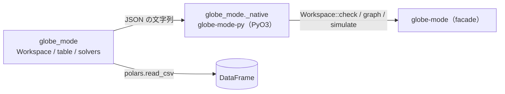

# S039 Python の wheel

| | |
| --- | --- |
| セッション | S039 |
| 日付 | 2026-10-31 |
| ブランチ | `feature/s039-python-wheel` |
| Phase | P7（言語 API の Python。[計画書](../../plan/2026-10-30-release-estimate-and-parallel-plan.md)の WP-G） |
| スライド | [slides.html](slides.html) |
| 作業記録 | `log/work/2026-10-31-s039-python-wheel.md` |

## 1. 目的

計画書の WP-G。新しい crate `globe-mode-py`（PyO3、abi3-py312）を maturin で既存の Python パッケージ `src/Python/mod/globe_mode` に入れ、参照シナリオ（open → check → graph → simulate → 結果を表で読む）を `uv run pytest` で通す。facade `globe-mode` だけを呼び、新しい計算は入れない。

実装は計画書の推奨（モデル B）どおり Sonnet（effort high）のサブエージェント 1 人に渡し、Fable がコードを読んで検査と文書を行った。同じ時間に S040（ADR-0023）を Fable が書いた。

## 2. 決定と理由

| 項目 | 決定 | 理由 |
| --- | --- | --- |
| 型の受け渡し | Rust の `_native` は JSON の文字列を返し、`globe_mode/__init__.py` の `Workspace` が `json.loads` で `dict` にする | wasm（[ADR-0014](../../adr/0014-session-route-wasm.md)）と同じ形。pythonize を足さず、Rust の型を 1 つずつ Python の型に写さない |
| 結果の表 | `table(res)` が `SimulateResponse.csv` を `polars.read_csv` で読む。実行できなかったら `ValueError` | polars は既に依存にある。numpy は足さない（計画書の「numpy で」は polars に読み替えた） |
| 例外 | ライブラリが読めない・`load_dir` の失敗は `RuntimeError`、settings の JSON の誤りと索引に無いモデルは `ValueError`。モデルの誤りは例外にせず `ok` と `diagnostics` で返す | CLI・wasm と同じ振り分け |
| ビルド | `pyproject.toml` の build-backend を uv_build から maturin に。`[tool.maturin]` で `python-source = src/Python/mod`、`module-name = globe_mode._native`、`features = ["pyo3/abi3-py312"]` | `uv sync` が wheel を作る。maturin は隔離環境で取るので mise には入れない。`uv.lock` を更新した |
| CI | `python` のジョブに rust と rust-cache を足し、`uv run pytest -q` を回す。`ci_plan.py` は `globe-mode-py` が影響を受けたときも `python` を真にし、`src/Modelica/*` の変更でも `globe-mode-py` を検査する | wheel が Rust をビルドし、試験が `src/Modelica` を読むため。`test_ci_plan.py` は 22 本 |
| スレッド | `#[pyclass(unsendable)]` | salsa のデータベースは Sync でない。作ったスレッドからだけ使う |
| 依存 | pyo3 0.30.1（pyo3-ffi・pyo3-macros・pyo3-macros-backend・pyo3-build-config）。Python 側は maturin（ビルド時だけ）と pytest 9（開発） | すべて MIT OR Apache-2.0 か MIT（[licenses.md](../../licenses.md)） |

## 3. 図



## 4. 再現手順

```bash
uv sync                     # maturin が globe-mode-py を release でビルドして globe_mode/_native*.so に置く
uv run pytest -q            # 2 passed
uv run globe-mode           # GlobeMode: ソルバ 26 種。…
uv build --wheel            # dist/globe_mode-0.1.0-cp312-abi3-linux_x86_64.whl（17.3 MB、.so は 54 MB）
mise run check              # fmt / clippy / test / deny / uv sync --locked
python3 .github/scripts/test_ci_plan.py   # 22 OK
```

参照シナリオ（`src/Python/tests/test_api.py`）: `load_dir(src/Modelica)` → `check("GlobeModeValidation.Simulation.Decay")` は `passed` → `graph("GlobeModeValidation.Connect.RealCircuit")` に node と edge → `simulate` は `ok` で、`table(res)` の `x` の最後が e⁻¹ と相対 1e-4 で一致。

## 5. 次回

- `graph` はライブラリ（`libraries=`）として読んだモデルを索引から引けない（facade の `graph` が作業中のファイルだけを見る）。試験は `load_dir` で回している。facade 側でライブラリのモデルも引けるようにするかを決める。
- 結果の Arrow での受け渡し（CSV を介さない）。`export_fmu`（P5 の後）。
- Windows・macOS・aarch64 の wheel と、CI での配布（WP-I）。marimo の anywidget（P6）。
