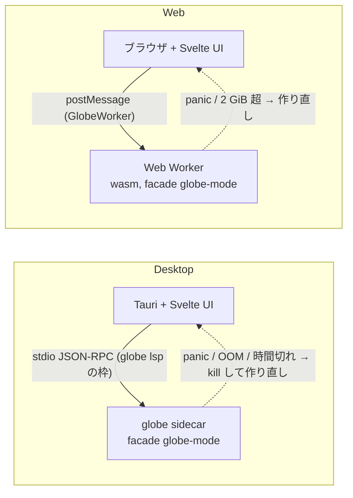

# S040 Desktop と Web のプロセス構成（ADR-0023）

| | |
| --- | --- |
| セッション | S040 |
| 日付 | 2026-10-31 |
| ブランチ | `feature/s040-adr-process-layout` |
| Phase | P4（[計画書](../../plan/2026-10-30-release-estimate-and-parallel-plan.md)の WP-J） |
| スライド | [slides.html](slides.html) |
| 作業記録 | `log/work/2026-10-31-s040-adr-process-layout.md` |

## 1. 目的

計画書の WP-J。Tauri のシェル（WP-C）を作る前に、検査（S0〜S10）と実行を UI のプロセスから分けるか、分けるなら sidecar（`globe` の CLI）か専用のワーカーかを決め、wasm 側の線形メモリの目標と上限も決める。結果は [ADR-0023](../../adr/0023-desktop-and-web-process-layout.md)。コードは変えない。

## 2. 決定と理由

| 項目 | 決定 | 理由 |
| --- | --- | --- |
| (a) 分ける | UI のプロセスでは計算しない。計算は 1 つのワーカーに送り、1 度に 1 要求。落ちたら作り直してライブラリと開いているファイルを再生する | 検査は 1 モデルでも GiB の単位で、終わらない計算は同じプロセスでは止められない（[ADR-0017](../../adr/0017-lowering-limit-and-hard-timeout-retry.md)・[ADR-0018](../../adr/0018-no-preflight-limit.md)）。作り直しの手順は S036 の `GlobeWorker` にある |
| (b) Desktop | `globe` の CLI を Tauri の sidecar にし、S038 の `globe lsp` の stdio の枠に独自の要求（`globe/check` など）を足す。Tauri の Rust 側は facade をリンクしない | コアの実体が配布物に 1 つ。外から kill できる。WP-I（リリース）のバイナリがそのまま sidecar になる。専用のワーカー crate は枠が 1 つ増えるだけ |
| (c) Web | S036 の Web Worker のまま。線形メモリは目標「MSL を読んだ後 128 MiB、1 モデルの検査と実行の後 1 GiB」、上限「2 GiB を超えたら作り直し」 | ADR を書いた時点は 262 MiB / 513〜634 MiB（[ADR-0014](../../adr/0014-session-route-wasm.md)）。同じ日の S037（別のセッション）の分割読み込みで 62 MiB / 113 MiB になり、目標の内側に入った。上限は実測の根拠が無く【未確認】で、P6 で測る |
| ワーカーの数 | 1 つ。並列に検査したいときは待たせる | RSS の上限が人の環境の RAM で決まる（[ADR-0019](../../adr/0019-rpi-aarch64-environment.md)） |
| `Checker` の内側の上限 | 入れない | 外から kill して作り直す方が小さく、効く範囲が広い（[roadmap](../../roadmap.md) の持ち越し 9 を閉じる） |

採らなかった案（プロセス内・スレッドと `catch_unwind`・専用のワーカー crate・複数ワーカー・Desktop でも wasm）と理由は ADR の (d) にある。

## 3. 図



## 4. 再現手順

測定は x86_64 の WSL2（RAM 3 GB + swap 16 GB）、release ビルド、MSL 4.1.0 は `data/msl/`（`cargo xtask fetch-msl`）。

```bash
cargo build --release -p globe-mode-cli
MSL=data/msl   # Modelica・ModelicaServices・Complex をまとめて読む（サブフォルダだけでは ModelicaServices が解決できない）
# 1. ChuaCircuit の検査の最大 RSS と壁時計
/usr/bin/time -v target/release/globe check --library "$MSL" --model Modelica.Electrical.Analog.Examples.ChuaCircuit
# 2. globe lsp の起動（initialize の応答まで）。ライブラリなしと MSL あり
python3 - <<'EOF'
import json, subprocess, sys, time
def start(args):
    t = time.perf_counter()
    p = subprocess.Popen(["target/release/globe", "lsp", *args], stdin=subprocess.PIPE, stdout=subprocess.PIPE)
    body = json.dumps({"jsonrpc": "2.0", "id": 1, "method": "initialize", "params": {"capabilities": {}}}).encode()
    p.stdin.write(b"Content-Length: %d\r\n\r\n%s" % (len(body), body)); p.stdin.flush()
    while True:
        line = p.stdout.readline()
        if line.startswith(b"Content-Length:"):
            n = int(line.split(b":")[1]); p.stdout.readline(); p.stdout.read(n); break
    print(args, f"{time.perf_counter() - t:.3f} s"); p.kill()
start([]); start(["--library", "data/msl"])
EOF
# 3. globe --help
/usr/bin/time -f "%e s" target/release/globe --help > /dev/null
```

| 項目 | 値 |
| --- | --- |
| ChuaCircuit の検査の最大 RSS | 1.48 GiB |
| 同じ検査の壁時計 | 5.2〜6.6 s |
| `globe lsp` の起動（ライブラリなし） | 3 ms |
| `globe lsp --library <MSL>` の起動 | 2.3〜2.8 s |
| `globe --help` | 10 ms 未満 |

文書の検査: `python3 -I .claude/skills/session-docs/check_docs.py` と `uv run python .claude/skills/session-docs/render_slides.py doc/sessions/S040-adr-process-layout/slides.html`。

## 5. 次回

- WP-C（Tauri のシェル）: sidecar の起動・再起動・予算での kill と、`globe lsp` への独自の要求の名前と形（`globe/check`・`globe/simulate`・`globe/graph`。中身は `globe-mode-protocol` の JSON）。
- Android で Tauri の sidecar が使えるか【未確認】（P6）。
- 線形メモリの上限 2 GiB の実測（P6）。目標 128 MiB は S037 の分割読み込みで。
