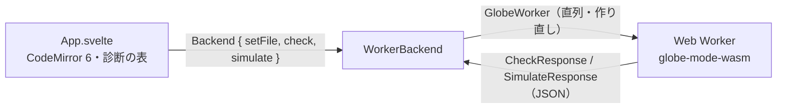

# S041 ブラウザ UI の骨格

| | |
| --- | --- |
| セッション | S041 |
| 日付 | 2026-10-31 |
| ブランチ | `feature/s041-browser-ui` |
| Phase | P4（[計画書](../../plan/2026-10-30-release-estimate-and-parallel-plan.md)の WP-B） |
| スライド | [slides.html](slides.html) |
| 作業記録 | `log/work/2026-10-31-s041-browser-ui.md` |

## 1. 目的

計画書の WP-B。`src/Svelte` に Svelte 5 + TypeScript の最小の UI を作る。`Backend` インターフェース、S036 の `GlobeWorker` を包む `WorkerBackend`（wasm を Web Worker で）、CodeMirror 6 のエディタ、検査パネル（診断の一覧）。Tauri・プロット・グラフ・実行の UI は入れない。CSP `connect-src 'self'` のまま動く（[ADR-0023](../../adr/0023-desktop-and-web-process-layout.md): UI のプロセスでは計算しない）。

実装は計画書の推奨（モデル B）どおり Sonnet（effort high）のサブエージェント 1 人に渡し、Fable がコードを読んで検査と文書を行った。

## 2. 決定と理由

| 項目 | 決定 | 理由 |
| --- | --- | --- |
| wasm の `check` | `globe-mode-wasm` の `Workspace::check(model)`（facade の `CheckResponse` の JSON）を足し、`worker.js` と `client.js` にも `check` を足した | 検査パネルは実行せずに診断が要る。wasm には `simulate` しか無かった。WP-B の所有の例外として Fable が許した |
| 型 | `src/lib/protocol.ts` に protocol の構造体から手で書く（UI が使う項目だけ） | JSON Schema はまだ無い（WP-0 の持ち越し）。schemars を足すかは次に決める |
| エディタ | CodeMirror 6（state・view・commands・language）。Modelica の文法は入れない | 最小。LSP の接続は次 |
| 診断の並び | 段 S0〜S10、同じ段では error > warning > info。行を押すとエディタの範囲へ（`range` は UTF-8 のバイトなので UTF-16 に換算） | 計画書のとおり |
| 試験 | Python の Playwright 1 本（`src/Svelte/tests/test_ui.py`）。`dist/` を localhost で配り、Decay で error 0 行、Bad で error あり、押すと選択が動く。console の error は失敗 | Playwright は既に開発依存。npm の試験の枠を足さない |
| 起動で落ちた worker | `GlobeWorker` は `init` が終わる前に落ちた worker を作り直さず、以後の呼び出しを reject する（Fable が直した） | `worker.js` が読めないと無限に作り直し、8 秒に 914 回の GET を出していた。Node の試験に 1 件足した |
| npm のライセンス | 57 パッケージ: MIT 49 / Apache-2.0 4 / MPL-2.0 2 / ISC 1 / BSD-3-Clause 1。MPL-2.0 は Vite 8 が引く lightningcss（ビルド時だけ）で、cbindgen と同じくツールとして許可 | 配布物に入る prod の 12 個は全部 MIT（[licenses.md](../../licenses.md)） |
| ツール | `mise.toml` に node 24.22.0・pnpm 12.14.0、タスク `ui:build`・`ui:check`。TypeScript は 6（svelte-check 4.7 が 7 を受けない） | [ADR-0003](../../adr/0003-toolchain.md) |
| CI | ジョブ `ui`（wasm:build → svelte-check → vite build → Playwright → `pnpm licenses` の禁止の確認）。`ci_plan.py` の `ui` は `src/Svelte/*` の変更か wasm の束ねが影響を受けたとき | ADR-0006 の差分の検査に合わせる |

## 3. 図



## 4. 再現手順

```bash
export CARGO_TARGET_DIR=$PWD/target   # worktree なら main の target
mise run wasm:build                   # release の wasm と --target web の糊
mise run ui:check                     # pnpm install → svelte-check → vite build → Playwright（Decay / Bad）
cd src/Svelte && pnpm dev             # 手で見る（先に wasm:build）
pnpm licenses list                    # 57 パッケージ、GPL・NC は 0
node src/Rust/mod/globe-mode-wasm/web/worker-node.mjs   # Node の Worker。panic で作り直し 1 回、起動で落ちたら 0 回
```

| 項目 | 値 |
| --- | --- |
| svelte-check | 誤り 0・警告 0（151 ファイル） |
| `vite build` | JS 323.6 kB（gzip 107.5 kB）、CSS 0.6 kB。wasm は 14,608,826 バイト |
| Playwright | Decay: 診断 1 行（GM-I10001、info）、error 0 行。Bad: GM-E5002 が 1 行。押すと `Bad` が選択 |
| `mise run check` | 543 本通過・0 失敗・10 ignore。clippy 0 件。deny ok |
| `test_ci_plan.py` | 23 本 OK |

ヘッドレス Chromium は、この WSL の環境では**新しいブラウザの最初のページ**で frame が出ず、`screenshot` と素の `click` が「stable」待ちで詰まることがある（素の HTML でも起き、2 つ目のコンテキストでは 0.06 s で通った）。試験は `click(force=True)` と `expect(...).to_be_enabled` で回している。

## 5. 次回

- WP-D（プロット）・WP-E（connect グラフ）・実行の UI。`simulate` はインターフェースだけ。
- WP-C（Tauri）: `TauriBackend` が sidecar の `globe` に同じ `Backend` で話す（[ADR-0023](../../adr/0023-desktop-and-web-process-layout.md)）。
- protocol の JSON Schema と TypeScript の型の生成。CodeMirror と `globe lsp` の接続（`@codemirror/lsp-client`）。
