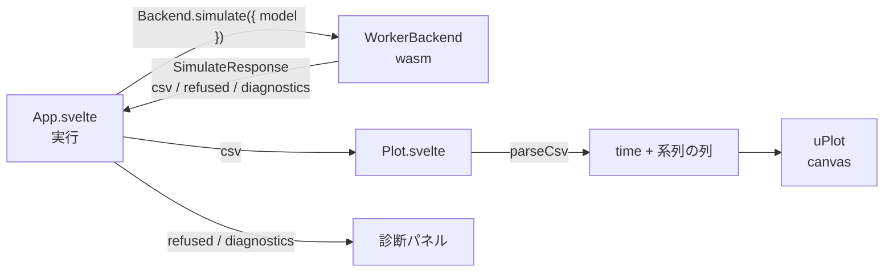

# S042 プロットと実行の UI

| | |
| --- | --- |
| セッション | S042 |
| 日付 | 2026-10-31 |
| ブランチ | `feature/s042-plot` |
| Phase | P4（[計画書](../../plan/2026-10-30-release-estimate-and-parallel-plan.md)の WP-D） |
| スライド | [slides.html](slides.html) |
| 作業記録 | `log/work/2026-10-31-s042-plot.md` |

## 1. 目的

S041 のブラウザ UI に「実行」ボタンとプロットを足す。`Backend.simulate` を呼び、結果の CSV を列に分けて uPlot で時系列に描き、信号をチェックボックスで選べるようにする。2 軸・凝った凡例・MAT v4 の読み込みは入れない（最小の形）。Rust には触らない。実装は Sonnet のサブエージェント 1 人。

## 2. 決定と理由

| 項目 | 決定 | 理由 |
| --- | --- | --- |
| プロットの部品 | uPlot 1.6.32（MIT、依存なし） | 軽く、時系列を数十万点まで描ける。`pnpm licenses list` で GPL・LGPL・AGPL・NC が 0（[licenses.md](../../licenses.md)） |
| CSV の解析 | UI 側の `src/lib/plot/csv.ts`。`write_csv` の形（見出しは引用符つき、値は数か NaN / Inf）だけ読み、有限でない値は `null` にして線を切る | wasm に列ごとの API を足すと Rust と protocol に触る。今回は足さない |
| 信号の選択 | チェックボックス（既定は最初の 3 本）が uPlot の `setSeries(i, { show })` を呼ぶ。ズームは uPlot の既定 | 最小。凡例の独自 UI は入れない |
| 診断 | `simulate` の `refused` は赤字（`role="alert"`）、`diagnostics` は既存の診断パネル | S041 の部品を使い回す |
| 10 万点の試験 | 本番に試験用の入口を足さず、`experiment(StopTime = 1000, Interval = 0.01)` を書いた 4 状態のモデルを実際に実行して 100,001 点を得る | 実際の経路（wasm → CSV → 解析 → 描画）を測れる |
| `check` と `simulate` | `run()` で共通化（`setFile` → 本体 → busy） | 同じ前処理と後処理が二重になるため |

## 3. 図



## 4. 再現手順

```bash
export CARGO_TARGET_DIR=$PWD/target   # worktree なら main の target（wasm はビルド済みを使う）
cd src/Svelte
pnpm install --frozen-lockfile
pnpm check                            # svelte-check
pnpm build                            # public/wasm へ糊をコピーして vite build
cd ../..
uv run python src/Svelte/tests/test_ui.py   # Playwright。Decay の実行、信号の選択、10 万点の描画時間、Bad
pnpm --dir src/Svelte licenses list   # 58 パッケージ、GPL・NC は 0
```

検証の結果（数字）:

| 項目 | 値 |
| --- | --- |
| svelte-check | 誤り 0・警告 0（154 ファイル） |
| `vite build` | JS 377.4 kB（gzip 130.8 kB。S041 は 323.6 kB）、CSS 2.4 kB |
| Playwright（Decay の実行） | 501 点、信号 1 本、canvas あり。選択を外すと系列が 1 本減る。console の error 0 |
| 10 万点の描画（100,001 点 × 4 列、3 系列を表示） | CSV の解析 約 318 ms を含めて最初の描画まで 376〜407 ms（3 回）。目安 33 ms（30 fps）に届かない |
| npm | 58 パッケージ（MIT 50 / Apache-2.0 4 / MPL-2.0 2 / ISC 1 / BSD-3-Clause 1） |

描画時間は WSL2 の headless Chromium（GPU 無し）の値で、ズーム中のフレームの時間ではない。解析（約 318 ms）が大半を占め、uPlot の構築と最初の描画は約 60〜90 ms。

## 5. 次回

- 10 万点の 30 fps: CSV の解析を 1 回の走査で `Float64Array` に入れる、wasm が列ごとに返す API（Rust と protocol に触る）、間引き。GPU のある実機でフレームを測る。
- 2 軸、凡例の凝った UI、MAT v4 の読み込み、ChuaCircuit のスクリーンショット試験。
- WP-E（connect グラフ）、WP-C（Tauri の `TauriBackend`）。
