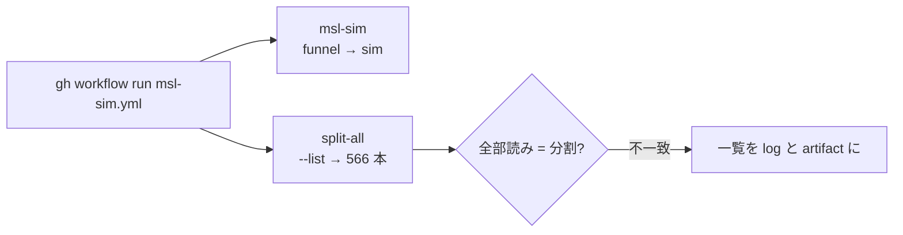

# S043 split-all-msl

| | |
| --- | --- |
| セッション | S043 |
| 日付 | 2026-10-31 |
| ブランチ | `feature/s043-split-all-msl` |
| Phase | P3 |
| スライド | [slides.html](slides.html) |
| 作業記録 | `log/work/2026-10-31-s043-split-all-msl.md` |

## 1. 目的

S037 で wasm のライブラリ読み込みを分割読み込みにした（[roadmap](../../roadmap.md) の S037 の節）。使うファイルの閉包が狭すぎると Rumoca の名前解決が落ち、ブラウザでだけ検査が失敗する。S037 で全部読みと一致を確かめたのは `msl-compare.txt` の 20 本だけなので、MSL の全例題 566 本で確かめる道を作る。手元の機械は RAM 3 GB なので、GitHub Actions の手動のワークフロー `msl-sim.yml` に載せる。

## 2. 決定と理由

| 項目 | 決定 | 理由 |
| --- | --- | --- |
| 対象 | `tests/split.rs` の ignored 試験で、`GM_SPLIT_MODELS=<ファイル>` で一覧を差し替える（無ければ 20 本） | 既存の試験を広げるだけで済む |
| 一覧の作り方 | `cargo xtask msl-funnel --list`（索引だけ。検査はしない） | funnel の JSON を待たずに作れる。566 本は Rumoca の基準値と同じ数 |
| 失敗の出し方 | 最初の不一致で止めず、全部回してから不一致の一覧（全部読みと分割の診断の要約）を出す | 1 回の実行で直すべきものが全部わかる |
| panic | `catch_unwind` で拾い、結果の 1 つとして比べる | 1 本の panic で全体が止まらない |
| 検査器 | `GM_SPLIT_FRESH=1` でモデルごとに分割読み込みの検査器を作り直す | 読んだファイルは外さないので、先のモデルが読んだファイルが後のモデルの閉包の足りなさを隠す。ブラウザで最初に開くモデルと同じ条件にする |
| ジョブ | `msl-sim.yml` にジョブ `split-all` を足し、`msl-sim` と並行に回す（`needs` なし） | msl-sim は数時間かかる。split-all が落ちても msl-sim は止まらない |

## 3. 図



## 4. 再現手順

```bash
cargo xtask msl-funnel --list > models.txt
GM_SPLIT_MODELS=$PWD/models.txt GM_SPLIT_FRESH=1 \
  cargo test --release -p globe-mode-frontend --test split -- --ignored --nocapture
gh workflow run msl-sim.yml          # ジョブ split-all の artifact は split-all
```

手元の確認（release）: 4 本の一覧で全部一致、存在しないモデルを混ぜた 3 本で両方 `GM-E1001` の一致、`GM_SPLIT_FRESH=1` の 4 本で一致（19.5 s）。566 本は手元では回していない。

## 5. 次回

- `split-all` の結果に不一致があれば、`split_library.rs` の閉包を直す。
- `msl-sim` の artifact から `doc/msl-sim.md` と `doc/msl-funnel.md` を更新する。
