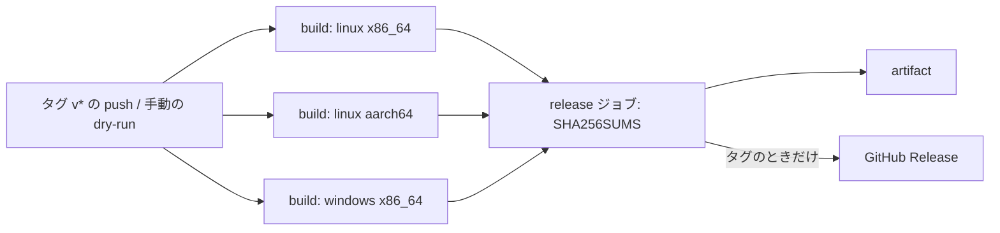

# S044 v0.1 のリリース工程

| | |
| --- | --- |
| セッション | S044 |
| 日付 | 2026-10-31 |
| ブランチ | `feature/s044-release` |
| Phase | P8（リリース。[計画書](../../plan/2026-10-30-release-estimate-and-parallel-plan.md)の WP-I） |
| スライド | [slides.html](slides.html) |
| 作業記録 | `log/work/2026-10-31-s044-release.md` |

## 1. 目的

`globe` の CLI（`globe-mode-cli`）を、linux x86_64・linux aarch64・windows x86_64 のバイナリとして配る道を作る。範囲は計画書の WP-I の最小: `.github/workflows/release.yml`、`CHANGELOG.md`、Cargo の metadata、README の Install。version（0.0.1）と `publish = false`（Rumoca の git 依存のため。[ADR-0002](../../adr/0002-rumoca-adapter.md)）は変えない。

## 2. 決定と理由

| 項目 | 決定 | 理由 |
| --- | --- | --- |
| 道具 | 素の GitHub Actions の matrix。cargo-dist は足さない | ターゲットは 3 つ、バイナリは 1 つで matrix で足りる。cargo-dist を足すと依存と設定（`dist-workspace.toml`）が増え、`/add-dependency` の手順も要る |
| aarch64 | `ubuntu-24.04-arm` でネイティブにビルド | リポジトリは public なので無料。クロスコンパイルの linker と、Rumoca 側の依存への影響を避けられる。S017 で aarch64 の Linux でビルドできることは確認済み |
| Windows | rustup を直接使う | ci.yml の `rust-windows` と同じ。mise の shim 経由の cargo が失敗した（[ADR-0003](../../adr/0003-toolchain.md)） |
| Linux の rust | `jdx/mise-action`（`install_args: rust`） | ci.yml と同じ。版は `mise.lock` |
| 構成 | `--features sundials` は付けない | cmake と C コンパイラが要る。CI・wasm と同じ既定の構成。README に `cvode`・`ida` は入らないと書いた |
| 成果物 | `globe-<version>-<target>.tar.gz`（Windows は `.zip`）に `globe[.exe]`・`LICENSE-MIT`・`LICENSE-APACHE`・`README.md` | 計画書の WP-I |
| SHA256SUMS | `release` ジョブが全成果物から 1 つ作る | 配布物の照合用。タグでなくても artifact に残る |
| Release | タグ `v*` の push のときだけ `softprops/action-gh-release@v2`。`contents: write` は `release` ジョブだけ。ハイフンを含むタグは prerelease | 権限を最小にする。dry-run では Release を作らない |
| dry-run | `workflow_dispatch`。version は `Cargo.toml` の値に `-dryrun` を付ける | タグ無しで 3 つの成果物を確かめるため |
| concurrency | `release-${{ github.ref }}`、キャンセルしない | ci.yml（`ci-…`）と別。配布の途中で止めない |
| metadata | `[workspace.package]` に description・readme・keywords・categories・homepage。CLI の `Cargo.toml` が継承 | 他の crate は自前の description を持つ。crates.io に出せるようになってから揃える |

## 3. 図



## 4. 再現手順

```bash
cargo fmt --all --check
cargo deny check
python3 -I .github/scripts/test_ci_plan.py
python3 -I .github/scripts/ci_plan.py --base main --head HEAD   # .github/ の変更で full になる
gh workflow run release.yml                                      # dry-run。artifact に 3 つの成果物と SHA256SUMS
git tag v0.1.0-rc1 && git push origin v0.1.0-rc1                # rc の Release（prerelease）
```

検証の結果（数字）は作業記録に書いた。ビルド自体は手元（RAM 3 GB）では回さず、CI の dry-run で確かめる。

## 5. 次回

- タグ `v0.1.0-rc1` の dry-run で成果物が 3 つ出ることを確かめる（WP-I の完了条件）。
- 配布物にサードパーティのライセンス表（cargo-about。[doc/licenses.md](../../licenses.md)）を入れるか決める。
- deb・msi と署名は Tauri（WP-C）と一緒に。
